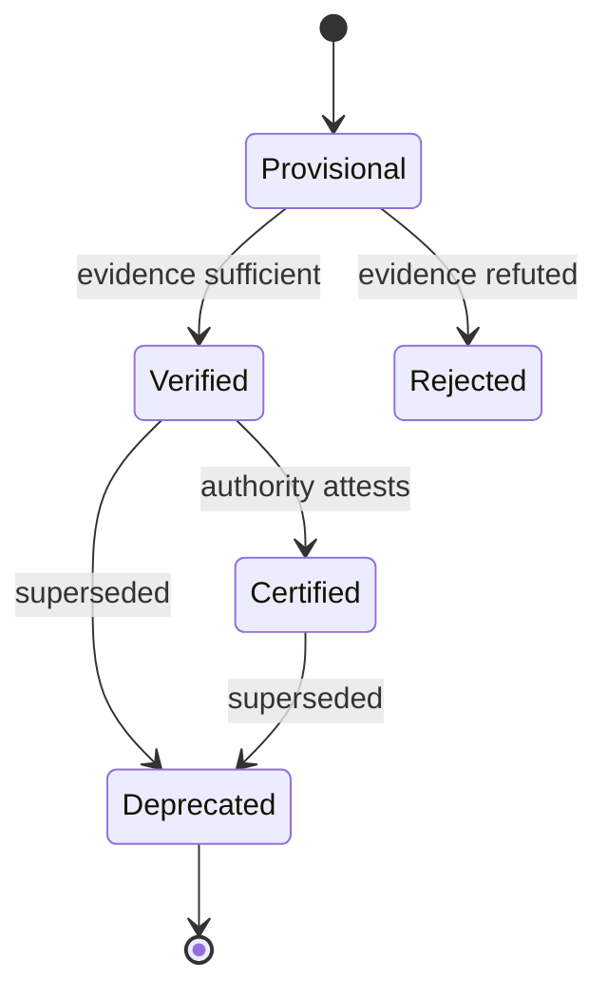
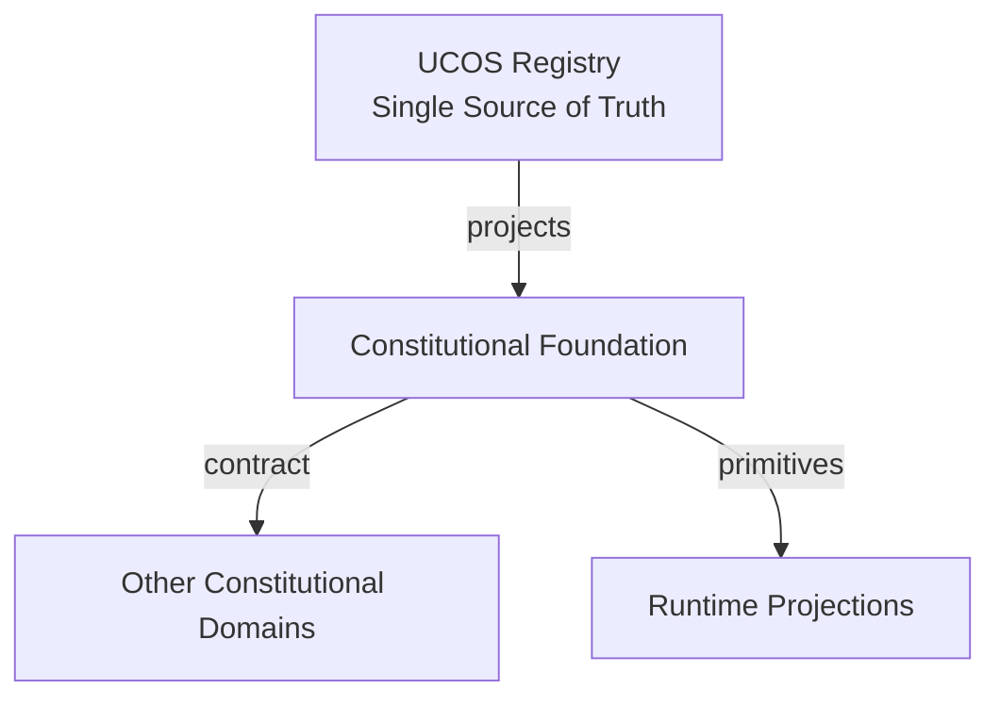
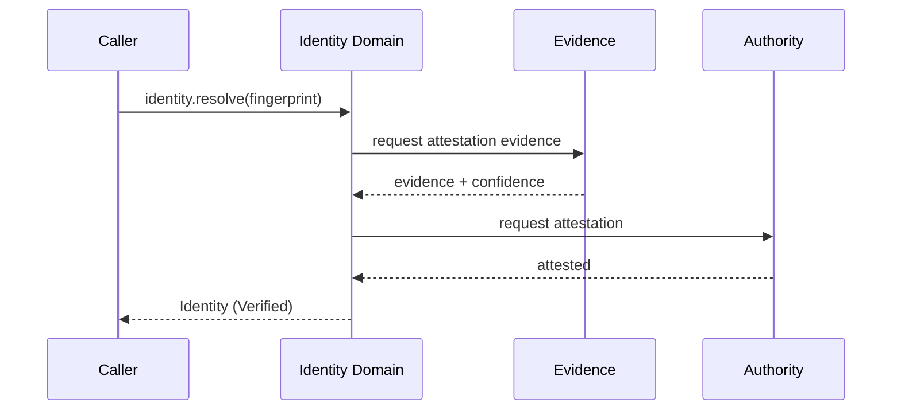
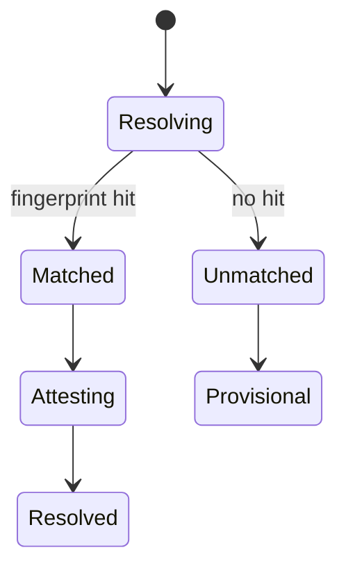
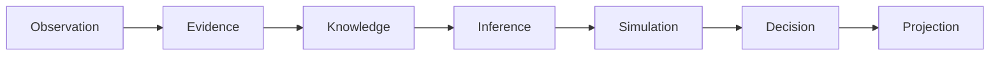
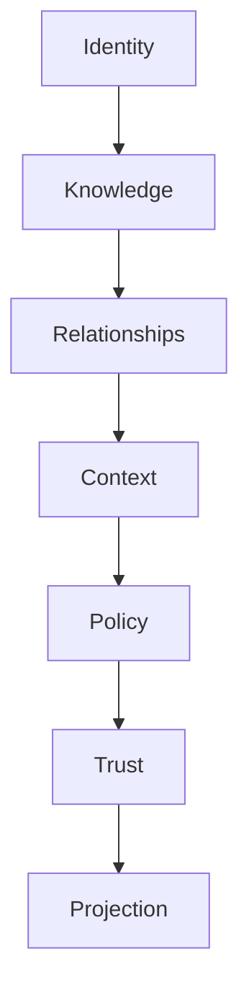

# UCOS-CON-000001
# Constitutional Foundation

**Version:** Ω∞.1  |  **Status:** Constitutional Artifact  |  **Authority:** UCOS Ω∞ Constitutional Authority
**Category:** Constitutions  |  **Source of Truth:** `_registry/` (projected, never hand-authored)

> Constitutional notice: this document is a **projection**. Its truth lives in the registry. Editing this document directly violates Law 002 (Knowledge Once).

---

## 1. Executive Summary

**UCOS-CON-000001 — Constitutional Foundation**

This artifact is a constitutionally governed, implementation-ready specification projected from the _UCOS Registry_ single source of truth.
It conforms to the _Immutable Primitive Registry_ (27 frozen primitives) and the _Canonical Terminology Registry_ (31 governed terms).
It contains no hardcoded business, industry, currency, country, or commerce concepts. All such concepts are runtime projections.

---

## 2. Constitutional Purpose

To define the binding contract for **Constitutional Foundation** such that:
- every concept it names has exactly one owner,
- every capability it exposes has exactly one boundary,
- every boundary is expressed as an explicit contract,
- every contract is enforceable by the Governance Constitution.

---

## 3. Scope

In scope: the primitives, contracts, schemas, events, and policies owned by **Constitutional Foundation**.
In scope: the projection rules by which this domain exposes its truth to other domains.
In scope: the verification obligations this domain must satisfy before activation.

---

## 4. Out of Scope

Out of scope: any concept owned by another constitutional domain.
Out of scope: business, industry, commerce, country, currency, or language content (all projected).
Out of scope: mutation of another domain’s internal state.

---

## 5. Definitions

All terms in this artifact are used in their canonical sense as defined in the Canonical Terminology Registry.
Where a term appears, its `termId` is normative and its `prohibitedMeanings` are void.

---

## 6. Canonical Terminology

| Term | Canonical Definition | Owner | Prohibited Meanings |
|---|---|---|---|
| Existence | Anything that may exist. | Universal Existence Kernel | business meaning, commercial meaning, operational meaning |
| Entity | Technical representation of an Existence Object. | Identity Domain | existence itself |
| Knowledge | Interpreted information with evidence and meaning. | Knowledge Domain | data, information, evidence |
| Data | Raw observations. | Observation Domain | knowledge, meaning |
| Information | Organized data. | Observation Domain | knowledge |
| Evidence | Proof supporting an assertion. | Evidence Domain | knowledge, trust |
| Trust | Computed confidence in an assertion, derived from evidence. | Trust Domain | evidence, faith |
| Meaning | Semantic interpretation; higher-level understanding. | Semantic Domain | classification, taxonomy, ontology |
| Ontology | What exists. | Semantic Domain | taxonomy, classification |
| Taxonomy | How things are classified. | Semantic Domain | ontology, meaning |
| Classification | Assignment into taxonomy. | Semantic Domain | meaning |
| Relationship | Connection between objects. | Relationship Domain | causality |

---

## 7. Ownership Boundaries

Ownership is recorded in the _Domain Ownership Registry_.

---

## 8. Domain Responsibilities

See the Domain Ownership Registry for the authoritative responsibility list.

---

## 9. Domain Non-Responsibilities

See the Domain Ownership Registry.

---

## 10. Concepts

Identity is the constitutionally verifiable handle for any existence. It is namespace-partitioned, versioned, and lineage-carrying. External schemes (GTIN, EAN, UPC, ISBN, ISSN, IMEI, VIN, CUSIP, ISIN, HSN, SAC) and future schemes are represented WITHOUT schema change, as registry-driven fingerprints.

---

## 11. Ontology

Identity ⊂ Existence. Identity has exactly one Namespace. Identity ≥ 1 Fingerprint. Identity has 0..n Aliases. Identity has 1 Lineage chain. Identity is referenced by every other primitive as its anchor.

---

## 12. Taxonomy

By namespace: Platform / Tenant / External / Future. By strength: Provisional / Verified / Certified. By scope: Universal / Scoped / Ephemeral.

---

## 13. Registries

This domain is registry-driven. Its registries are entries in the Universal Registry System:

```yaml
RegistryEntry:
  registryId: UCOS-REG-DOMAIN
  owner: Constitutional Authority
  law: Knowledge Once — each concept defined exactly once
```

---

## 14. Data Model

```yaml
Identity:
  identityId: <uuid v7, sort-friendly>
  namespace: <registry-driven, never hardcoded>
  version: <monotonic integer>
  lineage:
    parentId: <Identity|null>
    forkOf: <Identity|null>
  aliases: [<Alias>]
  fingerprints:
    - scheme: <registry scheme id>   # GTIN|EAN|VIN|...|future
      value: <normalized string>
      checksum: <registry-validated>
  signatures: [<Signature>]
  temporal: {validFrom, validTo, observedAt}
  metadata: {provenance, trustRef}
```

---

## 15. Graph Model

(:Identity)-[:LINEAGE_OF]->(:Identity); (:Identity)-[:ALIAS_OF]->(:Identity); (:Identity)-[:FINGERPRINT_IN]->(:Registry); (:Identity)<-[:ANCHORS]-(:Knowledge|:Relationship|:Policy)

---

## 16. Schemas

```yaml
# Canonical projection schema for UCOS-CON-000001
ucos_con_000001:
  identity:      <Identity primitive>
  intent:        <Intent primitive>
  meaning:       <Meaning primitive>
  knowledge:     <Knowledge primitive>
  registry:      <Registry primitive>
  relationship:  <Relationship primitive>
  context:       <Context primitive>
  policy:        <Policy primitive>
  authority:     <Authority primitive>
  evidence:      <Evidence primitive>
  trust:         <Trust primitive>
  temporal:      <Time primitive>
  metadata:      <Metadata primitive>
```

---

## 17. Contracts

```yaml
DomainContract:
  domain: Constitutional Foundation
  commands:   []   # registry-driven
  queries:    []   # registry-driven
  events:     []   # registry-driven
  policies:   []   # registry-driven
  permissions: []  # registry-driven
```

Contract law: domains never directly access another domain’s internal structures.

---

## 18. APIs

POST /identity.v1.create,POST /identity.v1.resolve,GET  /identity.v1/{id},GET  /identity.v1/{id}/lineage,POST /identity.v1/{id}/alias,POST /identity.v1/{id}/verify

---

## 19. Events

IdentityCreated,IdentityResolved,IdentityVerified,IdentityAliased,IdentityDeprecated,IdentityMerged,IdentityConflictDetected

---

## 20. Commands

identity.create,identity.resolve,identity.alias.add,identity.verify,identity.deprecate,identity.fork,identity.merge

---

## 21. Queries

identity.byId,identity.byFingerprint,identity.byAlias,identity.lineage,identity.resolveBatch,identity.conflicts

---

## 22. State Machines



---

## 23. Workflows

resolve external scheme → registry lookup → fingerprint match → evidence capture → authority attestation → publish IdentityVerified

---

## 24. Policies

```yaml
Policy:
  identity: <Identity>
  conditions: []   # registry-driven
  actions:    []   # registry-driven
  priorities: []   # registry-driven
  exceptions: []   # registry-driven
```

All behavior derives from policy. Policy ≠ Rule: policy is behavioral governance; the rule is its executable projection.

---

## 25. Rules

```yaml
Rule:
  ruleId: <Identity>
  derivedFrom: <Policy identity>
  executable: true
  constraint: <registry expression>
```

---

## 26. Authorities

Platform Authority (namespace creation),Tenant Authority (scoped identity),External Authority (attestation of external schemes)

---

## 27. Permissions

identity.create (tenant admin),identity.verify (trusted attestor),identity.merge (platform authority),identity.read (any authenticated)

---

## 28. Security Model

Zero Trust applies: no implicit trust between domains, services, agents, or tenants.
Every call is authenticated, authorized against Policy, and evidenced.
Cryptographic identity is issued by the Identity Domain; keys by the Key Management Architecture.

---

## 29. Privacy Model

Aliases and fingerprints are pseudonymous. Direct identifiers require consent scope `identity:read`. Resolution logs are minimized and retention-governed by the Consent Architecture.

---

## 30. Trust Model

Trust is computed, never assumed. Inputs: evidence, authority, consistency, provenance, confidence.
```yaml
Trust:
  evidenceScore: <0..1>
  authorityScore: <0..1>
  consistencyScore: <0..1>
  provenanceScore: <0..1>
  confidenceScore: <0..1>
```

---

## 31. Audit Model

Every resolution records: who resolved, which fingerprint matched, under which authority, with what evidence, at what confidence. Immutable, append-only, cryptographically chained.

---

## 32. Observability Model

Every action emits: What happened? Why? Who authorized it? Which policy allowed it? What evidence supports it? What confidence exists? What alternatives were evaluated?
These are the seven Explainability questions and are mandatory event fields.

---

## 33. Digital Twin Model

Identity Twin mirrors the real-world identifier state across registries (e.g., a GS1 GTIN changing ownership), continuously synchronized via the Twin Federation.

---

## 34. Agent Model

Identity Agent monitors fingerprint collisions, lineage forks, and stale aliases, raising IdentityConflictDetected under governance.

---

## 35. Runtime Model

Stateless resolution service with a versioned cache keyed by (namespace, normalized fingerprint). Cache invalidation on IdentityDeprecated/IdentityMerged events.

---

## 36. Scaling Model

Read-heavy (>99%). Partition by namespace; replicate globally; resolve via content-addressable fingerprint index. Write path is authority-sharded.

---

## 37. Multi-Tenant Model

Namespace isolation is mandatory: a tenant can never read another tenant's scoped identities unless an explicit cross-tenant Relationship + Policy permits it.

---

## 38. Geo-Distribution Model

Resolution is locally served per region with fingerprint-index replicas; authoritative write quorum remains in the tenant's home jurisdiction per Data Sovereignty.

---

## 39. Failure Model

Fingerprint collision, alias loop, lineage cycle, authority unavailability, checksum drift on external scheme change.

---

## 40. Recovery Model

Lineage is an immutable append-only log; recovery = replay. Deleted aliases are reconstructable from the chain. IdentityMerged is reversible via compensating event.

---

## 41. Verification Model

Before activation, Constitutional Foundation must pass identity, knowledge, relationship, context, policy, authority, trust, and reality integrity checks.
Verification is performed by the Formal Verification Architecture (UCOS-FML-000001).

---

## 42. Certification Model

Identity must pass checksum validity, lineage acyclicity, namespace ownership, and fingerprint uniqueness before it may anchor any Knowledge or Relationship.

---

## 43. Migration Model

External scheme migration (e.g., UPC→GTIN-13) is a registry-driven re-fingerprint, never a schema migration. Old fingerprints remain valid aliases.

---

## 44. Evolution Model

Evolution is governed and history-preserving. Primitives are frozen; extension occurs through registries, policies, capabilities, contexts, relationships, knowledge, agents, and projections — never through primitive expansion.

---

## 45. Implementation Blueprint

Build order for IDN: (1) define registry entries — this domain owns by namespace: platform / tenant / external / future as registry truth, not code; (2) implement the contract surface first (identity.create, identity.resolve, identity.alias.add) and validate against IDN boundaries; (3) event-source all state so history is reconstructable; (4) wire the enforcement points — authority check, policy guard, evidence binding, trace — in-line, with no bypass path; (5) add tests per the Testing Architecture, citing evidence per gate; (6) obtain Verification and Certification before activation. Acceptance: the Zero Partial and Law 001 audits pass, every action answers the seven explainability questions, and this domain mutates no other domain internals.

---

## 46. Reference Architecture Diagram



---

## 47. Sequence Diagrams



---

## 48. State Diagrams



---

## 49. Data Flow Diagrams



---

## 50. Dependency Maps



Forbidden: circular dependencies, mutual ownership, cross-domain state mutation.

---

## ∞

Constitutionally governed. Implementation ready. Universally extensible.