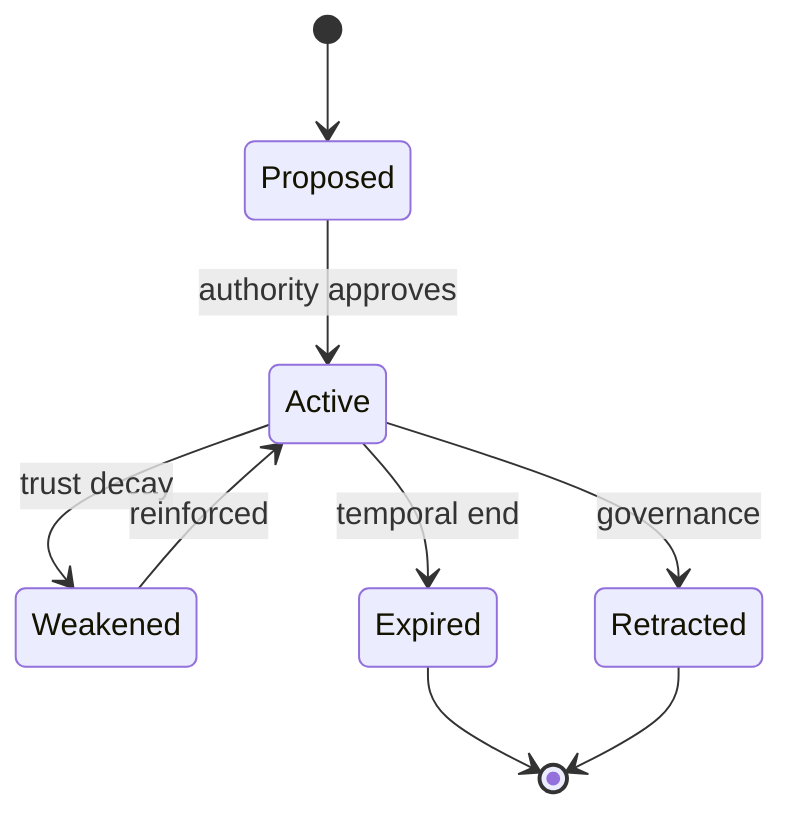
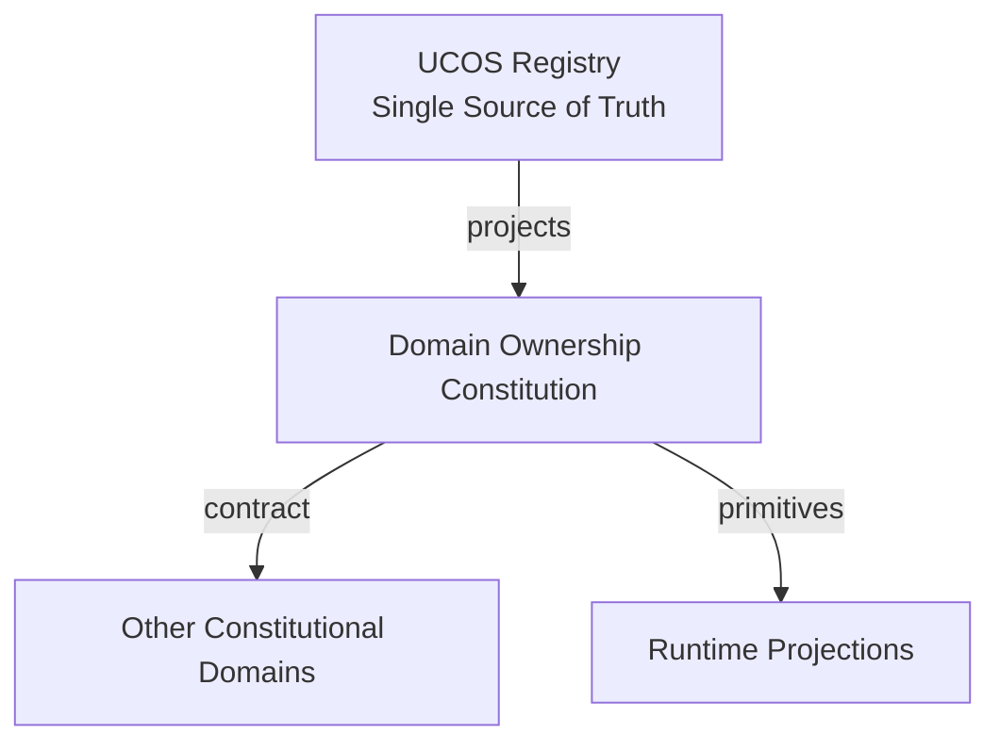
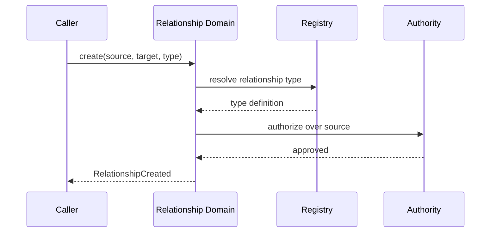
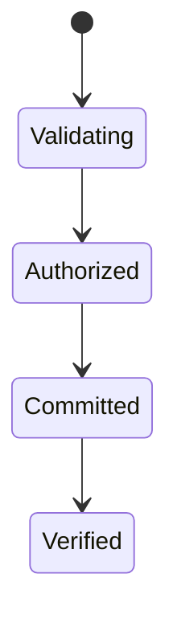
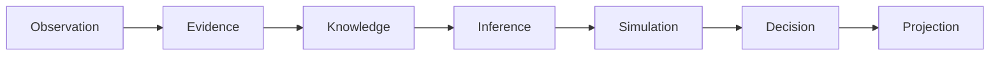
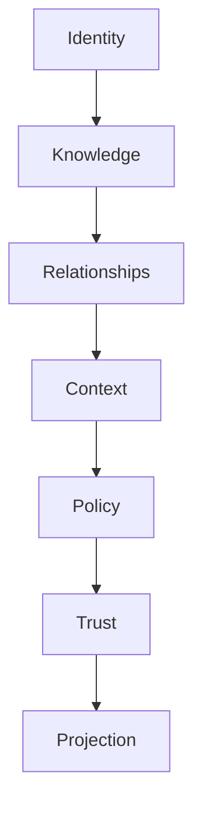

# UCOS-CON-000003
# Domain Ownership Constitution

**Version:** Ω∞.1  |  **Status:** Constitutional Artifact  |  **Authority:** UCOS Ω∞ Constitutional Authority
**Category:** Constitutions  |  **Source of Truth:** `_registry/` (projected, never hand-authored)

> Constitutional notice: this document is a **projection**. Its truth lives in the registry. Editing this document directly violates Law 002 (Knowledge Once).

---

## 1. Executive Summary

**UCOS-CON-000003 — Domain Ownership Constitution**

This artifact is a constitutionally governed, implementation-ready specification projected from the _UCOS Registry_ single source of truth.
It conforms to the _Immutable Primitive Registry_ (27 frozen primitives) and the _Canonical Terminology Registry_ (31 governed terms).
It contains no hardcoded business, industry, currency, country, or commerce concepts. All such concepts are runtime projections.

---

## 2. Constitutional Purpose

To define the binding contract for **Domain Ownership Constitution** such that:
- every concept it names has exactly one owner,
- every capability it exposes has exactly one boundary,
- every boundary is expressed as an explicit contract,
- every contract is enforceable by the Governance Constitution.

---

## 3. Scope

In scope: the primitives, contracts, schemas, events, and policies owned by **Domain Ownership Constitution**.
In scope: the projection rules by which this domain exposes its truth to other domains.
In scope: the verification obligations this domain must satisfy before activation.

---

## 4. Out of Scope

Out of scope: any concept owned by another constitutional domain.
Out of scope: business, industry, commerce, country, currency, or language content (all projected).
Out of scope: mutation of another domain’s internal state.

---

## 5. Definitions

All terms in this artifact are used in their canonical sense as defined in the Canonical Terminology Registry.
Where a term appears, its `termId` is normative and its `prohibitedMeanings` are void.

---

## 6. Canonical Terminology

| Term | Canonical Definition | Owner | Prohibited Meanings |
|---|---|---|---|
| Existence | Anything that may exist. | Universal Existence Kernel | business meaning, commercial meaning, operational meaning |
| Entity | Technical representation of an Existence Object. | Identity Domain | existence itself |
| Knowledge | Interpreted information with evidence and meaning. | Knowledge Domain | data, information, evidence |
| Data | Raw observations. | Observation Domain | knowledge, meaning |
| Information | Organized data. | Observation Domain | knowledge |
| Evidence | Proof supporting an assertion. | Evidence Domain | knowledge, trust |
| Trust | Computed confidence in an assertion, derived from evidence. | Trust Domain | evidence, faith |
| Meaning | Semantic interpretation; higher-level understanding. | Semantic Domain | classification, taxonomy, ontology |
| Ontology | What exists. | Semantic Domain | taxonomy, classification |
| Taxonomy | How things are classified. | Semantic Domain | ontology, meaning |
| Classification | Assignment into taxonomy. | Semantic Domain | meaning |
| Relationship | Connection between objects. | Relationship Domain | causality |

---

## 7. Ownership Boundaries

Ownership is recorded in the _Domain Ownership Registry_.

---

## 8. Domain Responsibilities

See the Domain Ownership Registry for the authoritative responsibility list.

---

## 9. Domain Non-Responsibilities

See the Domain Ownership Registry.

---

## 10. Concepts

Relationship is a typed, contextualized, time-bounded connection between existences. Reality emerges through relationships, not through objects. Relationship ≠ Causality: a link is not a reason.

---

## 11. Ontology

Relationship has 1 source Identity, 1 target Identity, 1 RelationshipType (registry-driven), 0..n Context, temporal validity, and an Authority. Relationship types are open: Owns, Consumes, Produces, Requires, Provides, Contains, DependsOn, CompatibleWith, Replaces, Supersedes, Associates, Influences, Causes — plus unlimited future types from the registry.

---

## 12. Taxonomy

By direction: Directed / Undirected / Bidirectional. By strength: Structural / Behavioral / Ephemeral. By derivation: Declared / Inferred / Simulated.

---

## 13. Registries

This domain is registry-driven. Its registries are entries in the Universal Registry System:

```yaml
RegistryEntry:
  registryId: UCOS-REG-DOMAIN
  owner: Constitutional Authority
  law: Knowledge Once — each concept defined exactly once
```

---

## 14. Data Model

```yaml
Relationship:
  relationshipId: <Identity>
  relationshipType: <registry id>
  source: <Identity>
  target: <Identity>
  context: [<Context>]
  authority: <Authority>
  temporal: {validFrom, validTo}
  provenance: {declaredBy | inferredBy}
  trust: <Trust>
  metadata: <Metadata>
```

---

## 15. Graph Model

This IS the graph. (:Identity)-[:RELATIONSHIP_TYPE {context, temporal, trust}]->(:Identity). Traversal is context-filtered at query time.

---

## 16. Schemas

```yaml
# Canonical projection schema for UCOS-CON-000003
ucos_con_000003:
  identity:      <Identity primitive>
  intent:        <Intent primitive>
  meaning:       <Meaning primitive>
  knowledge:     <Knowledge primitive>
  registry:      <Registry primitive>
  relationship:  <Relationship primitive>
  context:       <Context primitive>
  policy:        <Policy primitive>
  authority:     <Authority primitive>
  evidence:      <Evidence primitive>
  trust:         <Trust primitive>
  temporal:      <Time primitive>
  metadata:      <Metadata primitive>
```

---

## 17. Contracts

```yaml
DomainContract:
  domain: Domain Ownership Constitution
  commands:   []   # registry-driven
  queries:    []   # registry-driven
  events:     []   # registry-driven
  policies:   []   # registry-driven
  permissions: []  # registry-driven
```

Contract law: domains never directly access another domain’s internal structures.

---

## 18. APIs

POST /relationship.v1.create,POST /relationship.v1.query,GET  /relationship.v1/{id},POST /relationship.v1/{id}/temporal,GET  /relationship.v1.path

---

## 19. Events

RelationshipCreated,RelationshipRetracted,RelationshipExpired,RelationshipReinforced,RelationshipInferred,RelationshipIntegrityViolation

---

## 20. Commands

relationship.create,relationship.retype,relationship.expire,relationship.reinforce,relationship.retract

---

## 21. Queries

relationship.neighbors,relationship.path,relationship.byType,relationship.byContext,relationship.temporalAt,relationship.density

---

## 22. State Machines



---

## 23. Workflows

validate endpoints exist → resolve type from registry → check authority → enforce context policy → commit → publish → integrity verify

---

## 24. Policies

```yaml
Policy:
  identity: <Identity>
  conditions: []   # registry-driven
  actions:    []   # registry-driven
  priorities: []   # registry-driven
  exceptions: []   # registry-driven
```

All behavior derives from policy. Policy ≠ Rule: policy is behavioral governance; the rule is its executable projection.

---

## 25. Rules

```yaml
Rule:
  ruleId: <Identity>
  derivedFrom: <Policy identity>
  executable: true
  constraint: <registry expression>
```

---

## 26. Authorities

Source-side Authority (declares),Platform Authority (retracts),Inference Authority (infers, lower trust by default)

---

## 27. Permissions

relationship.create (endpoint owner or delegated),relationship.retract (platform authority),relationship.read (context-scoped)

---

## 28. Security Model

Zero Trust applies: no implicit trust between domains, services, agents, or tenants.
Every call is authenticated, authorized against Policy, and evidenced.
Cryptographic identity is issued by the Identity Domain; keys by the Key Management Architecture.

---

## 29. Privacy Model

Relationships between persons are sensitive by default; traversal requires `relationship:read` scope plus a Context policy. Hidden-edge protection enforced.

---

## 30. Trust Model

Trust is computed, never assumed. Inputs: evidence, authority, consistency, provenance, confidence.
```yaml
Trust:
  evidenceScore: <0..1>
  authorityScore: <0..1>
  consistencyScore: <0..1>
  provenanceScore: <0..1>
  confidenceScore: <0..1>
```

---

## 31. Audit Model

Every traversal of a sensitive edge is logged with the seven explainability fields. Inferred relationships are always marked as such, never presented as declared.

---

## 32. Observability Model

Every action emits: What happened? Why? Who authorized it? Which policy allowed it? What evidence supports it? What confidence exists? What alternatives were evaluated?
These are the seven Explainability questions and are mandatory event fields.

---

## 33. Digital Twin Model

Relationship Twin mirrors real-world connections (e.g., supplier links) and flags when observed reality diverges from declared relationships.

---

## 34. Agent Model

Relationship Agent discovers latent edges via the Inference Domain and proposes them with reduced trust pending corroboration.

---

## 35. Runtime Model

Graph-native store. Context filtering at traversal time — no pre-materialized per-context graphs, which would duplicate truth.

---

## 36. Scaling Model

Shard by source Identity hash. Multi-hop traversal is bounded by policy hop-limit. Hot vertices are cached as projections, never as truth.

---

## 37. Multi-Tenant Model

Cross-tenant edges require an explicit published RelationshipType + Policy. Default deny.

---

## 38. Geo-Distribution Model

Edge locality follows Data Sovereignty: a vertex's authoritative edges live in its jurisdiction; replicas are read-only.

---

## 39. Failure Model

Dangling endpoint, type registry drift, temporal inversion (validFrom > validTo), orphaned inferred edges after retraction.

---

## 40. Recovery Model

Edges are immutable + temporal; recovery is replay. Retraction is a tombstone, not a delete. Integrity job rebuilds dangling detection.

---

## 41. Verification Model

Before activation, Domain Ownership Constitution must pass identity, knowledge, relationship, context, policy, authority, trust, and reality integrity checks.
Verification is performed by the Formal Verification Architecture (UCOS-FML-000001).

---

## 42. Certification Model

Relationship must pass endpoint existence, type registry validity, authority jurisdiction, and temporal sanity.

---

## 43. Migration Model

New relationship types are registry additions — zero schema migration. Retired types become non-creatable but remain queryable historically.

---

## 44. Evolution Model

Evolution is governed and history-preserving. Primitives are frozen; extension occurs through registries, policies, capabilities, contexts, relationships, knowledge, agents, and projections — never through primitive expansion.

---

## 45. Implementation Blueprint

Build order for REL: (1) define registry entries — this domain owns by direction: directed / undirected / bidirectional as registry truth, not code; (2) implement the contract surface first (relationship.create, relationship.retype, relationship.expire) and validate against REL boundaries; (3) event-source all state so history is reconstructable; (4) wire the enforcement points — authority check, policy guard, evidence binding, trace — in-line, with no bypass path; (5) add tests per the Testing Architecture, citing evidence per gate; (6) obtain Verification and Certification before activation. Acceptance: the Zero Partial and Law 001 audits pass, every action answers the seven explainability questions, and this domain mutates no other domain internals.

---

## 46. Reference Architecture Diagram



---

## 47. Sequence Diagrams



---

## 48. State Diagrams



---

## 49. Data Flow Diagrams



---

## 50. Dependency Maps



Forbidden: circular dependencies, mutual ownership, cross-domain state mutation.

---

## ∞

Constitutionally governed. Implementation ready. Universally extensible.