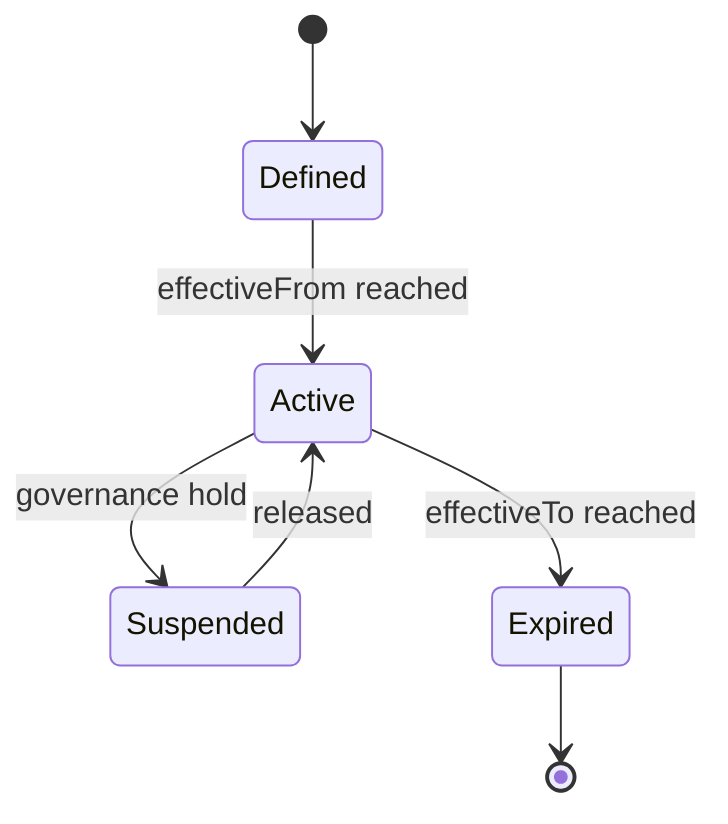
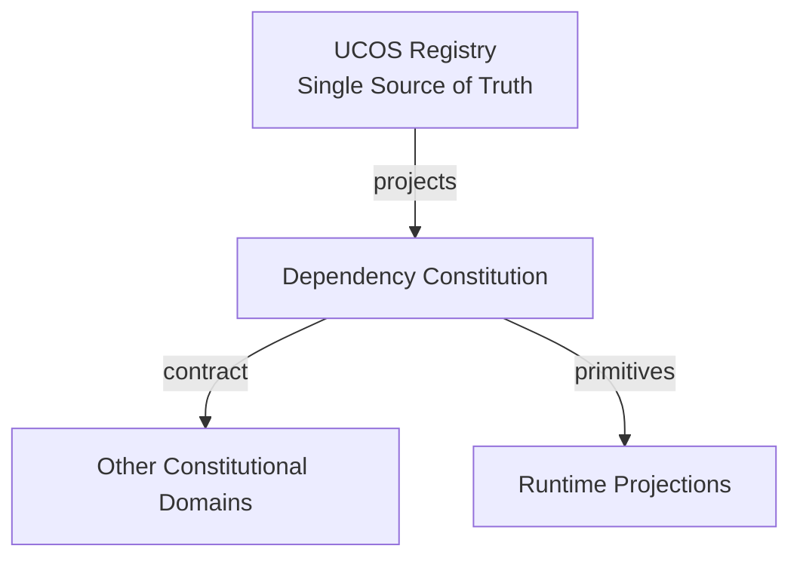
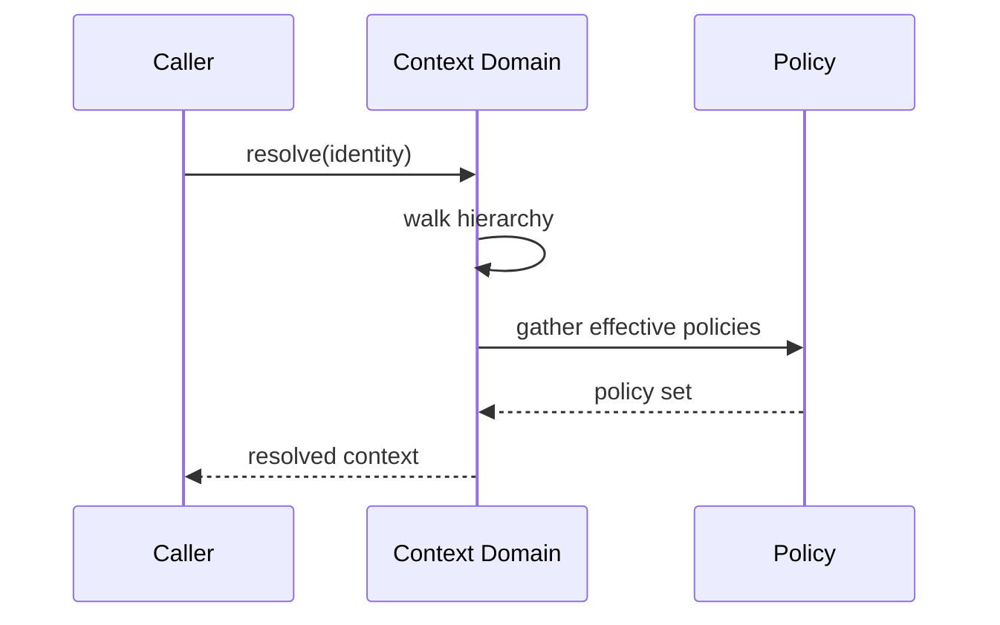
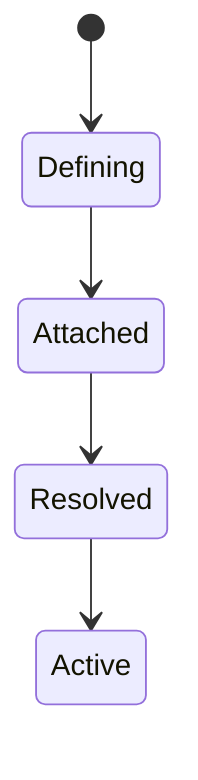
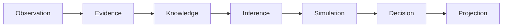
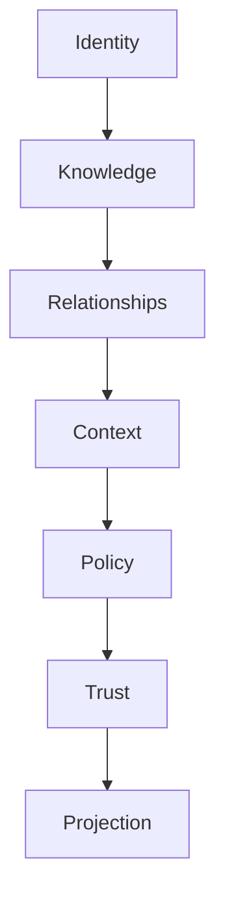

# UCOS-CON-000004
# Dependency Constitution

**Version:** Ω∞.1  |  **Status:** Constitutional Artifact  |  **Authority:** UCOS Ω∞ Constitutional Authority
**Category:** Constitutions  |  **Source of Truth:** `_registry/` (projected, never hand-authored)

> Constitutional notice: this document is a **projection**. Its truth lives in the registry. Editing this document directly violates Law 002 (Knowledge Once).

---

## 1. Executive Summary

**UCOS-CON-000004 — Dependency Constitution**

This artifact is a constitutionally governed, implementation-ready specification projected from the _UCOS Registry_ single source of truth.
It conforms to the _Immutable Primitive Registry_ (27 frozen primitives) and the _Canonical Terminology Registry_ (31 governed terms).
It contains no hardcoded business, industry, currency, country, or commerce concepts. All such concepts are runtime projections.

---

## 2. Constitutional Purpose

To define the binding contract for **Dependency Constitution** such that:
- every concept it names has exactly one owner,
- every capability it exposes has exactly one boundary,
- every boundary is expressed as an explicit contract,
- every contract is enforceable by the Governance Constitution.

---

## 3. Scope

In scope: the primitives, contracts, schemas, events, and policies owned by **Dependency Constitution**.
In scope: the projection rules by which this domain exposes its truth to other domains.
In scope: the verification obligations this domain must satisfy before activation.

---

## 4. Out of Scope

Out of scope: any concept owned by another constitutional domain.
Out of scope: business, industry, commerce, country, currency, or language content (all projected).
Out of scope: mutation of another domain’s internal state.

---

## 5. Definitions

All terms in this artifact are used in their canonical sense as defined in the Canonical Terminology Registry.
Where a term appears, its `termId` is normative and its `prohibitedMeanings` are void.

---

## 6. Canonical Terminology

| Term | Canonical Definition | Owner | Prohibited Meanings |
|---|---|---|---|
| Existence | Anything that may exist. | Universal Existence Kernel | business meaning, commercial meaning, operational meaning |
| Entity | Technical representation of an Existence Object. | Identity Domain | existence itself |
| Knowledge | Interpreted information with evidence and meaning. | Knowledge Domain | data, information, evidence |
| Data | Raw observations. | Observation Domain | knowledge, meaning |
| Information | Organized data. | Observation Domain | knowledge |
| Evidence | Proof supporting an assertion. | Evidence Domain | knowledge, trust |
| Trust | Computed confidence in an assertion, derived from evidence. | Trust Domain | evidence, faith |
| Meaning | Semantic interpretation; higher-level understanding. | Semantic Domain | classification, taxonomy, ontology |
| Ontology | What exists. | Semantic Domain | taxonomy, classification |
| Taxonomy | How things are classified. | Semantic Domain | ontology, meaning |
| Classification | Assignment into taxonomy. | Semantic Domain | meaning |
| Relationship | Connection between objects. | Relationship Domain | causality |

---

## 7. Ownership Boundaries

Ownership is recorded in the _Domain Ownership Registry_.

---

## 8. Domain Responsibilities

See the Domain Ownership Registry for the authoritative responsibility list.

---

## 9. Domain Non-Responsibilities

See the Domain Ownership Registry.

---

## 10. Concepts

Context is the applicability boundary that changes how reality is projected. Context ≠ Perspective: a context is a scope; a perspective is an observer's interpretation. The same primitives project differently per context.

---

## 11. Ontology

Context is hierarchical and compositional. Context types are registry-driven: Geographical, Organizational, Commercial, Customer, Contractual, Marketplace, Legal, Regulatory, Operational, Behavioral, Temporal, Digital, Physical, Future. A context constrains which Policies and Authorities are in force.

---

## 12. Taxonomy

By breadth: Universal / Regional / Local / Instance. By nature: Structural (geo, org) / Temporal (time window) / Situational (session, intent).

---

## 13. Registries

This domain is registry-driven. Its registries are entries in the Universal Registry System:

```yaml
RegistryEntry:
  registryId: UCOS-REG-DOMAIN
  owner: Constitutional Authority
  law: Knowledge Once — each concept defined exactly once
```

---

## 14. Data Model

```yaml
Context:
  contextId: <Identity>
  contextType: <registry id>
  hierarchy:
    parentId: <Context|null>
  constraints: [<constraint expressions>]
  policies: [<Policy>]
  authorities: [<Authority>]
  temporal: {effectiveFrom, effectiveTo}
  metadata: <Metadata>
```

---

## 15. Graph Model

(:Context)-[:CHILD_OF*]->(:Context); (:Context)-[:IN_FORCE]->(:Policy); (:Context)-[:JURISDICTION]->(:Authority); (:Identity)-[:PROJECTED_IN]->(:Context)

---

## 16. Schemas

```yaml
# Canonical projection schema for UCOS-CON-000004
ucos_con_000004:
  identity:      <Identity primitive>
  intent:        <Intent primitive>
  meaning:       <Meaning primitive>
  knowledge:     <Knowledge primitive>
  registry:      <Registry primitive>
  relationship:  <Relationship primitive>
  context:       <Context primitive>
  policy:        <Policy primitive>
  authority:     <Authority primitive>
  evidence:      <Evidence primitive>
  trust:         <Trust primitive>
  temporal:      <Time primitive>
  metadata:      <Metadata primitive>
```

---

## 17. Contracts

```yaml
DomainContract:
  domain: Dependency Constitution
  commands:   []   # registry-driven
  queries:    []   # registry-driven
  events:     []   # registry-driven
  policies:   []   # registry-driven
  permissions: []  # registry-driven
```

Contract law: domains never directly access another domain’s internal structures.

---

## 18. APIs

POST /context.v1.create,GET  /context.v1/{id},POST /context.v1.resolve,GET  /context.v1/{id}/policies,GET  /context.v1/{id}/ancestors

---

## 19. Events

ContextCreated,ContextPolicyAttached,ContextMerged,ContextExpired,ContextConflictDetected

---

## 20. Commands

context.create,context.attachPolicy,context.delegate,context.merge,context.expire

---

## 21. Queries

context.resolve,context.effectivePolicies,context.lineage,context.overlaps,context.byType

---

## 22. State Machines



---

## 23. Workflows

define → attach policies → resolve hierarchy → detect overlap conflicts → activate → publish effective policy set

---

## 24. Policies

```yaml
Policy:
  identity: <Identity>
  conditions: []   # registry-driven
  actions:    []   # registry-driven
  priorities: []   # registry-driven
  exceptions: []   # registry-driven
```

All behavior derives from policy. Policy ≠ Rule: policy is behavioral governance; the rule is its executable projection.

---

## 25. Rules

```yaml
Rule:
  ruleId: <Identity>
  derivedFrom: <Policy identity>
  executable: true
  constraint: <registry expression>
```

---

## 26. Authorities

Jurisdiction Authority (creates contexts in its scope),Platform Authority (universal context)

---

## 27. Permissions

context.create (jurisdiction authority),context.attachPolicy (context owner),context.resolve (any authenticated)

---

## 28. Security Model

Zero Trust applies: no implicit trust between domains, services, agents, or tenants.
Every call is authenticated, authorized against Policy, and evidenced.
Cryptographic identity is issued by the Identity Domain; keys by the Key Management Architecture.

---

## 29. Privacy Model

Context may implicitly narrow data access; privacy impact is asserted on creation and re-audited on policy attachment.

---

## 30. Trust Model

Trust is computed, never assumed. Inputs: evidence, authority, consistency, provenance, confidence.
```yaml
Trust:
  evidenceScore: <0..1>
  authorityScore: <0..1>
  consistencyScore: <0..1>
  provenanceScore: <0..1>
  confidenceScore: <0..1>
```

---

## 31. Audit Model

Context resolution is logged: which contexts applied, in what precedence, and which policy won on conflict. Precedence is deterministic, never incidental.

---

## 32. Observability Model

Every action emits: What happened? Why? Who authorized it? Which policy allowed it? What evidence supports it? What confidence exists? What alternatives were evaluated?
These are the seven Explainability questions and are mandatory event fields.

---

## 33. Digital Twin Model

Context Twin mirrors real-world scope changes (e.g., a new regulatory regime activating) and projects the change through affected artifacts.

---

## 34. Agent Model

Context Agent detects overlapping contexts with contradictory policies and escalates per the Contradiction Architecture.

---

## 35. Runtime Model

Resolution is a memoized hierarchy walk. Effective policy set = union of ancestor policies with deterministic conflict precedence (child > parent; specific > general).

---

## 36. Scaling Model

Hierarchy is shallow and cache-friendly; resolution results cached per (Identity, Context) with invalidation on ContextPolicyAttached.

---

## 37. Multi-Tenant Model

A tenant's contexts are isolated. Cross-context projection requires explicit delegation.

---

## 38. Geo-Distribution Model

Geographical contexts are the primary sovereignty mechanism — data residency policy attaches here, not in application code.

---

## 39. Failure Model

Cycle in hierarchy, contradictory policies at same precedence, orphaned policy attachment, temporal overlap ambiguity.

---

## 40. Recovery Model

Contexts are immutable versions; recovery = repoint to prior version. Policy attachments are event-sourced and reversible.

---

## 41. Verification Model

Before activation, Dependency Constitution must pass identity, knowledge, relationship, context, policy, authority, trust, and reality integrity checks.
Verification is performed by the Formal Verification Architecture (UCOS-FML-000001).

---

## 42. Certification Model

Context must pass acyclicity, jurisdiction ownership, policy compatibility, and deterministic precedence before activation.

---

## 43. Migration Model

New context types are registry additions. Existing contexts re-project on type definition change.

---

## 44. Evolution Model

Evolution is governed and history-preserving. Primitives are frozen; extension occurs through registries, policies, capabilities, contexts, relationships, knowledge, agents, and projections — never through primitive expansion.

---

## 45. Implementation Blueprint

Build order for CTX: (1) define registry entries — this domain owns by breadth: universal / regional / local / instance as registry truth, not code; (2) implement the contract surface first (context.create, context.attachPolicy, context.delegate) and validate against CTX boundaries; (3) event-source all state so history is reconstructable; (4) wire the enforcement points — authority check, policy guard, evidence binding, trace — in-line, with no bypass path; (5) add tests per the Testing Architecture, citing evidence per gate; (6) obtain Verification and Certification before activation. Acceptance: the Zero Partial and Law 001 audits pass, every action answers the seven explainability questions, and this domain mutates no other domain internals.

---

## 46. Reference Architecture Diagram



---

## 47. Sequence Diagrams



---

## 48. State Diagrams



---

## 49. Data Flow Diagrams



---

## 50. Dependency Maps



Forbidden: circular dependencies, mutual ownership, cross-domain state mutation.

---

## ∞

Constitutionally governed. Implementation ready. Universally extensible.