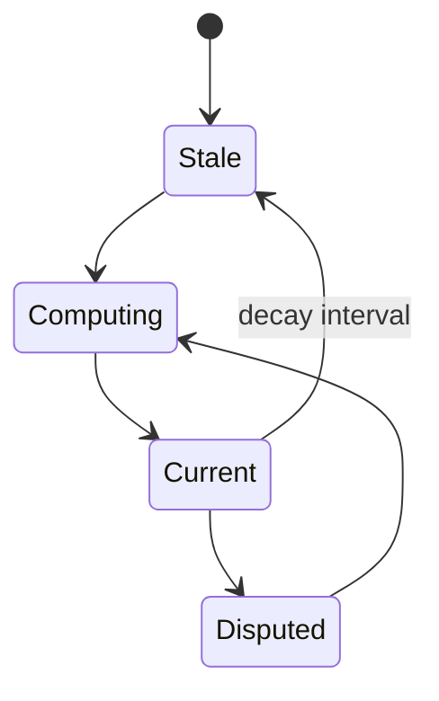
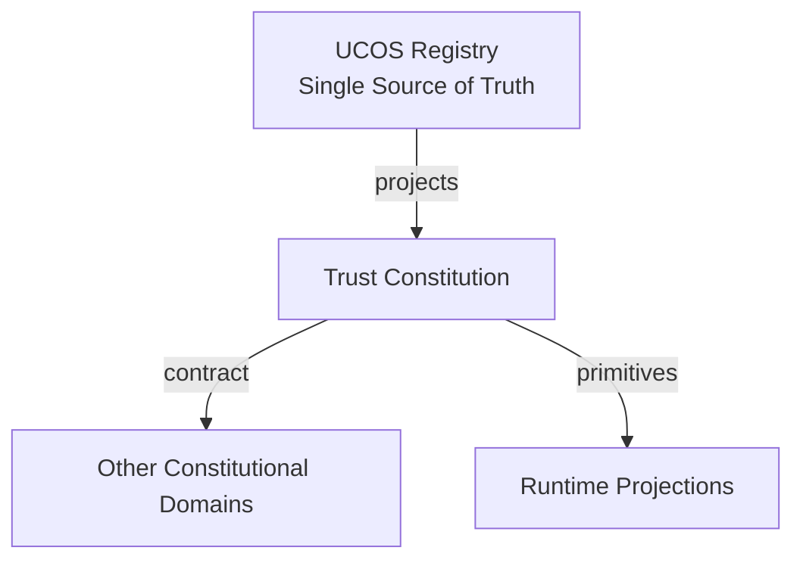
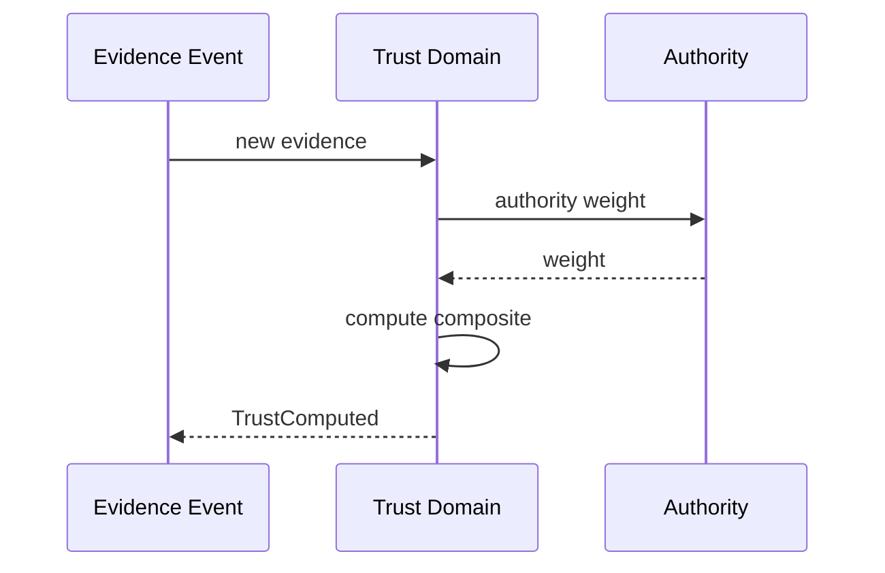
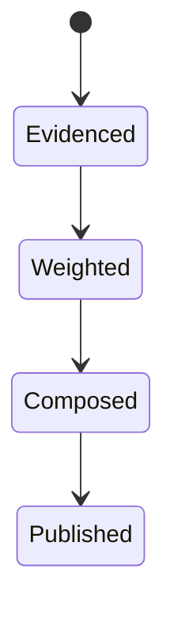
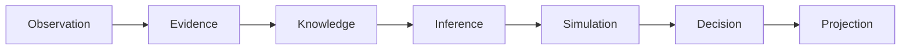
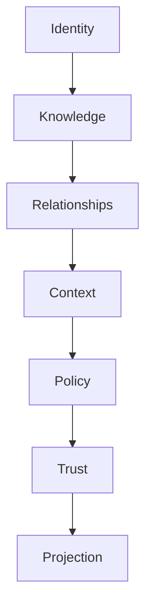

# UCOS-CON-000008
# Trust Constitution

**Version:** Ω∞.1  |  **Status:** Constitutional Artifact  |  **Authority:** UCOS Ω∞ Constitutional Authority
**Category:** Constitutions  |  **Source of Truth:** `_registry/` (projected, never hand-authored)

> Constitutional notice: this document is a **projection**. Its truth lives in the registry. Editing this document directly violates Law 002 (Knowledge Once).

---

## 1. Executive Summary

**UCOS-CON-000008 — Trust Constitution**

This artifact is a constitutionally governed, implementation-ready specification projected from the _UCOS Registry_ single source of truth.
It conforms to the _Immutable Primitive Registry_ (27 frozen primitives) and the _Canonical Terminology Registry_ (31 governed terms).
It contains no hardcoded business, industry, currency, country, or commerce concepts. All such concepts are runtime projections.

---

## 2. Constitutional Purpose

To define the binding contract for **Trust Constitution** such that:
- every concept it names has exactly one owner,
- every capability it exposes has exactly one boundary,
- every boundary is expressed as an explicit contract,
- every contract is enforceable by the Governance Constitution.

---

## 3. Scope

In scope: the primitives, contracts, schemas, events, and policies owned by **Trust Constitution**.
In scope: the projection rules by which this domain exposes its truth to other domains.
In scope: the verification obligations this domain must satisfy before activation.

---

## 4. Out of Scope

Out of scope: any concept owned by another constitutional domain.
Out of scope: business, industry, commerce, country, currency, or language content (all projected).
Out of scope: mutation of another domain’s internal state.

---

## 5. Definitions

All terms in this artifact are used in their canonical sense as defined in the Canonical Terminology Registry.
Where a term appears, its `termId` is normative and its `prohibitedMeanings` are void.

---

## 6. Canonical Terminology

| Term | Canonical Definition | Owner | Prohibited Meanings |
|---|---|---|---|
| Existence | Anything that may exist. | Universal Existence Kernel | business meaning, commercial meaning, operational meaning |
| Entity | Technical representation of an Existence Object. | Identity Domain | existence itself |
| Knowledge | Interpreted information with evidence and meaning. | Knowledge Domain | data, information, evidence |
| Data | Raw observations. | Observation Domain | knowledge, meaning |
| Information | Organized data. | Observation Domain | knowledge |
| Evidence | Proof supporting an assertion. | Evidence Domain | knowledge, trust |
| Trust | Computed confidence in an assertion, derived from evidence. | Trust Domain | evidence, faith |
| Meaning | Semantic interpretation; higher-level understanding. | Semantic Domain | classification, taxonomy, ontology |
| Ontology | What exists. | Semantic Domain | taxonomy, classification |
| Taxonomy | How things are classified. | Semantic Domain | ontology, meaning |
| Classification | Assignment into taxonomy. | Semantic Domain | meaning |
| Relationship | Connection between objects. | Relationship Domain | causality |

---

## 7. Ownership Boundaries

**Owner:** Trust Domain
**Owns:** Trust
**Boundary law:** no domain may modify, bypass, or reinterpret another domain’s internals. All interaction is via contract.

---

## 8. Domain Responsibilities

- Trust Computation
- Trust Scores
- Trust Verification

---

## 9. Domain Non-Responsibilities

- Evidence Generation
- Policy
- Identity

---

## 10. Concepts

Trust is computed confidence in an assertion, derived from evidence. Trust ≠ Evidence and Trust ≠ Faith: it is a score, recomputable, always current, never asserted. Trust degrades without corroboration.

---

## 11. Ontology

Trust is a function over (Evidence, Authority, Consistency, Provenance, Confidence). Trust has a timestamp — stale trust decays. Trust is per-Context.

---

## 12. Taxonomy

By subject: Identity / Knowledge / Relationship / Authority / Agent. By method: Evidence-weighted / Authority-weighted / Consistency-weighted / Consensus / Decay-based.

---

## 13. Registries

This domain is registry-driven. Its registries are entries in the Universal Registry System:

```yaml
RegistryEntry:
  registryId: UCOS-REG-TRUST
  owner: Trust Domain
  law: Knowledge Once — each concept defined exactly once
```

---

## 14. Data Model

```yaml
Trust:
  trustId: <Identity>
  subject: <Identity>
  evidenceScore: <0..1>
  authorityScore: <0..1>
  consistencyScore: <0..1>
  provenanceScore: <0..1>
  confidenceScore: <0..1>
  composite: <0..1, registry formula>
  computedAt: <Time>
  context: <Context>
  decayPolicy: <Policy>
```

---

## 15. Graph Model

(:Trust)-[:SCORES]->(:Identity|:Knowledge|:Relationship|:Authority); (:Trust)-[:DERIVED_FROM]->(:Evidence); (:Trust)-[:DECAYS_PER]->(:Policy)

---

## 16. Schemas

```yaml
# Canonical projection schema for UCOS-CON-000008
ucos_con_000008:
  identity:      <Identity primitive>
  intent:        <Intent primitive>
  meaning:       <Meaning primitive>
  knowledge:     <Knowledge primitive>
  registry:      <Registry primitive>
  relationship:  <Relationship primitive>
  context:       <Context primitive>
  policy:        <Policy primitive>
  authority:     <Authority primitive>
  evidence:      <Evidence primitive>
  trust:         <Trust primitive>
  temporal:      <Time primitive>
  metadata:      <Metadata primitive>
```

---

## 17. Contracts

```yaml
DomainContract:
  domain: Trust
  commands:   []   # registry-driven
  queries:    []   # registry-driven
  events:     []   # registry-driven
  policies:   []   # registry-driven
  permissions: []  # registry-driven
```

Contract law: domains never directly access another domain’s internal structures.

---

## 18. APIs

GET  /trust.v1/{subjectId},POST /trust.v1/recompute,GET  /trust.v1.history/{subjectId},GET  /trust.v1.compare

---

## 19. Events

TrustComputed,TrustDecayed,TrustDisputed,TrustThresholdCrossed,TrustRecomputed

---

## 20. Commands

trust.recompute,trust.decay,trust.cite,trust.dispute

---

## 21. Queries

trust.bySubject,trust.history,trust.distribution,trust.belowThreshold,trust.byContext

---

## 22. State Machines



---

## 23. Workflows

gather evidence → weight by authority → measure consistency → score provenance → apply confidence → composite → publish → schedule decay

---

## 24. Policies

```yaml
Policy:
  identity: <Identity>
  conditions: []   # registry-driven
  actions:    []   # registry-driven
  priorities: []   # registry-driven
  exceptions: []   # registry-driven
```

All behavior derives from policy. Policy ≠ Rule: policy is behavioral governance; the rule is its executable projection.

---

## 25. Rules

```yaml
Rule:
  ruleId: <Identity>
  derivedFrom: <Policy identity>
  executable: true
  constraint: <registry expression>
```

---

## 26. Authorities

Trust Domain computes; it does not assert. Authority Domain supplies the authority weight; Trust never overrides it.

---

## 27. Permissions

trust.read (subject owner or scoped),trust.recompute (system),trust.dispute (peer authority)

---

## 28. Security Model

Zero Trust applies: no implicit trust between domains, services, agents, or tenants.
Every call is authenticated, authorized against Policy, and evidenced.
Cryptographic identity is issued by the Identity Domain; keys by the Key Management Architecture.

---

## 29. Privacy Model

Trust over personal subjects is derived from minimized evidence; raw evidence is not exposed, only the score and its factor breakdown.

---

## 30. Trust Model

Trust is computed, never assumed. Inputs: evidence, authority, consistency, provenance, confidence.
```yaml
Trust:
  evidenceScore: <0..1>
  authorityScore: <0..1>
  consistencyScore: <0..1>
  provenanceScore: <0..1>
  confidenceScore: <0..1>
```

---

## 31. Audit Model

Every score is reproducible: inputs, weights, formula version, and timestamp are recorded. A score that cannot be reproduced is void.

---

## 32. Observability Model

Every action emits: What happened? Why? Who authorized it? Which policy allowed it? What evidence supports it? What confidence exists? What alternatives were evaluated?
These are the seven Explainability questions and are mandatory event fields.

---

## 33. Digital Twin Model

Trust Twin tracks real-world reputation drift and flags divergence between computed trust and observed outcomes.

---

## 34. Agent Model

Trust Agent continuously recomputes decaying scores and raises TrustThresholdCrossed for governance attention.

---

## 35. Runtime Model

Scores are read-optimized projections recomputed on evidence change or decay tick; never stored as primary truth.

---

## 36. Scaling Model

Recomputation is a stream job over evidence events; composite scores cached per (subject, context) with decay-aware TTL.

---

## 37. Multi-Tenant Model

Trust is tenant-scoped; a subject's trust in one tenant says nothing about another unless a shared Context exists.

---

## 38. Geo-Distribution Model

Trust factors are jurisdiction-weighted: an authority's weight is Context-dependent, so the same evidence yields different scores per jurisdiction — by design.

---

## 39. Failure Model

Evidence starvation, formula drift across versions, authority score corruption, decay cascade.

---

## 40. Recovery Model

Scores are recomputable from evidence history; a corrupted score is regenerated, never restored from backup.

---

## 41. Verification Model

Before activation, Trust Constitution must pass identity, knowledge, relationship, context, policy, authority, trust, and reality integrity checks.
Verification is performed by the Formal Verification Architecture (UCOS-FML-000001).

---

## 42. Certification Model

Trust score must be reproducible, timestamped, formula-versioned, and within threshold for its subject's certifications.

---

## 43. Migration Model

Formula evolves by registry version; recomputation triggers on version change with full history replay.

---

## 44. Evolution Model

Evolution is governed and history-preserving. Primitives are frozen; extension occurs through registries, policies, capabilities, contexts, relationships, knowledge, agents, and projections — never through primitive expansion.

---

## 45. Implementation Blueprint

Build order for TRS: (1) define registry entries — this domain owns by subject: identity / knowledge / relationship / authority / agent as registry truth, not code; (2) implement the contract surface first (trust.recompute, trust.decay, trust.cite) and validate against TRS boundaries; (3) event-source all state so history is reconstructable; (4) wire the enforcement points — authority check, policy guard, evidence binding, trace — in-line, with no bypass path; (5) add tests per the Testing Architecture, citing evidence per gate; (6) obtain Verification and Certification before activation. Acceptance: the Zero Partial and Law 001 audits pass, every action answers the seven explainability questions, and this domain mutates no other domain internals.

---

## 46. Reference Architecture Diagram



---

## 47. Sequence Diagrams



---

## 48. State Diagrams



---

## 49. Data Flow Diagrams



---

## 50. Dependency Maps



Forbidden: circular dependencies, mutual ownership, cross-domain state mutation.

---

## ∞

Constitutionally governed. Implementation ready. Universally extensible.