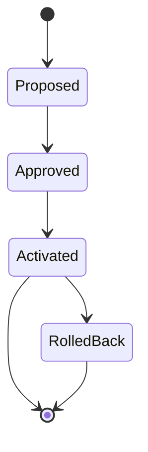
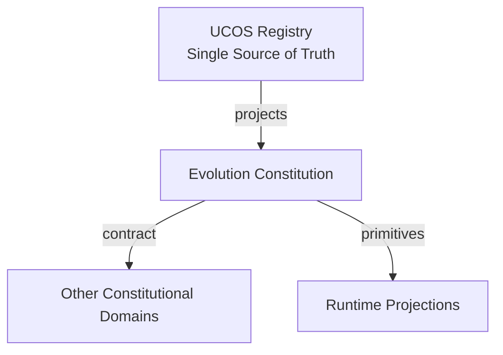
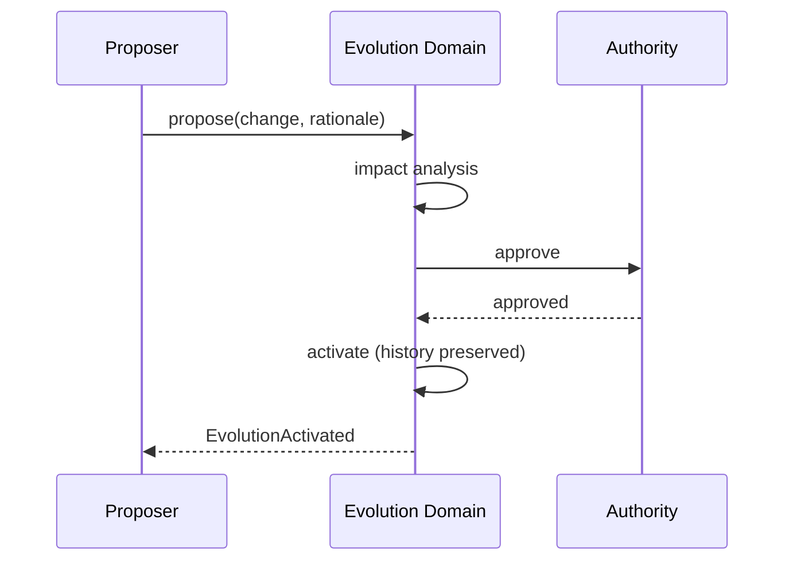
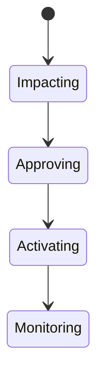
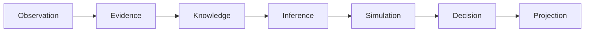
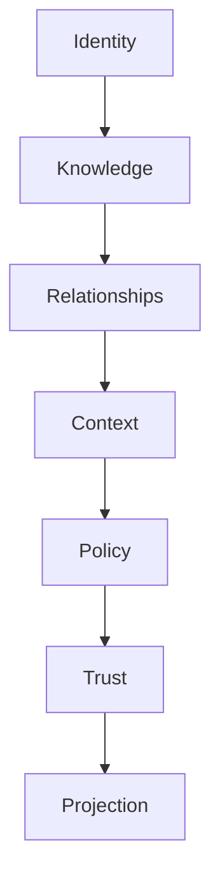

# UCOS-CON-000009
# Evolution Constitution

**Version:** Ω∞.1  |  **Status:** Constitutional Artifact  |  **Authority:** UCOS Ω∞ Constitutional Authority
**Category:** Constitutions  |  **Source of Truth:** `_registry/` (projected, never hand-authored)

> Constitutional notice: this document is a **projection**. Its truth lives in the registry. Editing this document directly violates Law 002 (Knowledge Once).

---

## 1. Executive Summary

**UCOS-CON-000009 — Evolution Constitution**

This artifact is a constitutionally governed, implementation-ready specification projected from the _UCOS Registry_ single source of truth.
It conforms to the _Immutable Primitive Registry_ (27 frozen primitives) and the _Canonical Terminology Registry_ (31 governed terms).
It contains no hardcoded business, industry, currency, country, or commerce concepts. All such concepts are runtime projections.

---

## 2. Constitutional Purpose

To define the binding contract for **Evolution Constitution** such that:
- every concept it names has exactly one owner,
- every capability it exposes has exactly one boundary,
- every boundary is expressed as an explicit contract,
- every contract is enforceable by the Governance Constitution.

---

## 3. Scope

In scope: the primitives, contracts, schemas, events, and policies owned by **Evolution Constitution**.
In scope: the projection rules by which this domain exposes its truth to other domains.
In scope: the verification obligations this domain must satisfy before activation.

---

## 4. Out of Scope

Out of scope: any concept owned by another constitutional domain.
Out of scope: business, industry, commerce, country, currency, or language content (all projected).
Out of scope: mutation of another domain’s internal state.

---

## 5. Definitions

All terms in this artifact are used in their canonical sense as defined in the Canonical Terminology Registry.
Where a term appears, its `termId` is normative and its `prohibitedMeanings` are void.

---

## 6. Canonical Terminology

| Term | Canonical Definition | Owner | Prohibited Meanings |
|---|---|---|---|
| Existence | Anything that may exist. | Universal Existence Kernel | business meaning, commercial meaning, operational meaning |
| Entity | Technical representation of an Existence Object. | Identity Domain | existence itself |
| Knowledge | Interpreted information with evidence and meaning. | Knowledge Domain | data, information, evidence |
| Data | Raw observations. | Observation Domain | knowledge, meaning |
| Information | Organized data. | Observation Domain | knowledge |
| Evidence | Proof supporting an assertion. | Evidence Domain | knowledge, trust |
| Trust | Computed confidence in an assertion, derived from evidence. | Trust Domain | evidence, faith |
| Meaning | Semantic interpretation; higher-level understanding. | Semantic Domain | classification, taxonomy, ontology |
| Ontology | What exists. | Semantic Domain | taxonomy, classification |
| Taxonomy | How things are classified. | Semantic Domain | ontology, meaning |
| Classification | Assignment into taxonomy. | Semantic Domain | meaning |
| Relationship | Connection between objects. | Relationship Domain | causality |

---

## 7. Ownership Boundaries

**Owner:** Evolution Domain
**Owns:** Evolution, Emergence
**Boundary law:** no domain may modify, bypass, or reinterpret another domain’s internals. All interaction is via contract.

---

## 8. Domain Responsibilities

- Governed Change
- History Preservation
- Emergence Detection

---

## 9. Domain Non-Responsibilities

- Runtime Execution

---

## 10. Concepts

Evolution is governed change over time that preserves history. Nothing evolves without governance; nothing that evolved is forgotten. Evolution covers Ontology, Schema, Policy, Capability, Workflow, API, Agent, and Knowledge evolution.

---

## 11. Ontology

Evolution has a Subject, a Change, a Rationale, an Authority, and a preserved History. Emergence is evolution's un-planned cousin: properties arising from interaction that were not present in the parts.

---

## 12. Taxonomy

By intent: Planned / Emergent. By impact: Additive / Breaking / Deprecated-path. By scope: Primitive-level (constitution only) / Registry-level / Projection-level.

---

## 13. Registries

This domain is registry-driven. Its registries are entries in the Universal Registry System:

```yaml
RegistryEntry:
  registryId: UCOS-REG-EVOLUTION
  owner: Evolution Domain
  law: Knowledge Once — each concept defined exactly once
```

---

## 14. Data Model

```yaml
Evolution:
  evolutionId: <Identity>
  subject: <Identity>
  changeType: <registry id>
  from: <prior version ref>
  to: <new version ref>
  rationale: <Knowledge>
  authority: <Authority>
  temporal: {effectiveAt}
  supersession: {priorVersions: [...], historyPreserved: true}
```

---

## 15. Graph Model

(:Evolution)-[:EVOLVES]->(:Identity); (:Evolution)-[:SUPERSEDES_VERSION]->(:Evolution); (:Evolution)-[:DRIVES]->(:Emergence); (:Evolution)-[:APPROVED_BY]->(:Authority)

---

## 16. Schemas

```yaml
# Canonical projection schema for UCOS-CON-000009
ucos_con_000009:
  identity:      <Identity primitive>
  intent:        <Intent primitive>
  meaning:       <Meaning primitive>
  knowledge:     <Knowledge primitive>
  registry:      <Registry primitive>
  relationship:  <Relationship primitive>
  context:       <Context primitive>
  policy:        <Policy primitive>
  authority:     <Authority primitive>
  evidence:      <Evidence primitive>
  trust:         <Trust primitive>
  temporal:      <Time primitive>
  metadata:      <Metadata primitive>
```

---

## 17. Contracts

```yaml
DomainContract:
  domain: Evolution
  commands:   []   # registry-driven
  queries:    []   # registry-driven
  events:     []   # registry-driven
  policies:   []   # registry-driven
  permissions: []  # registry-driven
```

Contract law: domains never directly access another domain’s internal structures.

---

## 18. APIs

POST /evolution.v1.propose,POST /evolution.v1.approve,GET  /evolution.v1/{id},GET  /evolution.v1.history/{subjectId}

---

## 19. Events

EvolutionProposed,EvolutionApproved,EvolutionActivated,EvolutionRolledBack,EmergenceDetected,EmergenceRecorded

---

## 20. Commands

evolution.propose,evolution.approve,evolution.activate,evolution.rollback,emergence.record

---

## 21. Queries

evolution.history,evolution.pending,evolution.bySubject,emergence.detected,evolution.impact

---

## 22. State Machines



---

## 23. Workflows

propose with rationale → impact analysis → approve by authority → activate with prior version preserved → publish → monitor emergence

---

## 24. Policies

```yaml
Policy:
  identity: <Identity>
  conditions: []   # registry-driven
  actions:    []   # registry-driven
  priorities: []   # registry-driven
  exceptions: []   # registry-driven
```

All behavior derives from policy. Policy ≠ Rule: policy is behavioral governance; the rule is its executable projection.

---

## 25. Rules

```yaml
Rule:
  ruleId: <Identity>
  derivedFrom: <Policy identity>
  executable: true
  constraint: <registry expression>
```

---

## 26. Authorities

Evolution Authority (registry-level); Constitutional Assembly (primitive-level only)

---

## 27. Permissions

evolution.propose (any authority),evolution.approve (subject's owning authority),evolution.rollback (approving authority)

---

## 28. Security Model

Zero Trust applies: no implicit trust between domains, services, agents, or tenants.
Every call is authenticated, authorized against Policy, and evidenced.
Cryptographic identity is issued by the Identity Domain; keys by the Key Management Architecture.

---

## 29. Privacy Model

Evolution of privacy-relevant subjects triggers consent re-evaluation; changes cannot silently widen data use.

---

## 30. Trust Model

Trust is computed, never assumed. Inputs: evidence, authority, consistency, provenance, confidence.
```yaml
Trust:
  evidenceScore: <0..1>
  authorityScore: <0..1>
  consistencyScore: <0..1>
  provenanceScore: <0..1>
  confidenceScore: <0..1>
```

---

## 31. Audit Model

Every change records rationale, authority, impact, and prior state. History is never rewritten — only superseded.

---

## 32. Observability Model

Every action emits: What happened? Why? Who authorized it? Which policy allowed it? What evidence supports it? What confidence exists? What alternatives were evaluated?
These are the seven Explainability questions and are mandatory event fields.

---

## 33. Digital Twin Model

Evolution drives twin model versioning; a twin's history is as valuable as its current state.

---

## 34. Agent Model

Evolution Agent proposes changes from observed drift; Emergence Agent detects system-level properties for governance review.

---

## 35. Runtime Model

Version resolution prefers latest activated; historical queries time-travel via the version chain.

---

## 36. Scaling Model

Version chains are append-only and shard by subject; time-travel queries are bounded by retention policy.

---

## 37. Multi-Tenant Model

Tenant-level evolution cannot alter shared ontology; shared changes go through the Evolution Authority.

---

## 38. Geo-Distribution Model

Evolution activation is jurisdiction-aware; a change legal in one region rolls out per regional policy.

---

## 39. Failure Model

Breaking change without deprecation, orphaned version chain, emergence runaway, rollback failure.

---

## 40. Recovery Model

Rollback is a first-class command that activates the prior version — never a data restore. History remains intact either way.

---

## 41. Verification Model

Before activation, Evolution Constitution must pass identity, knowledge, relationship, context, policy, authority, trust, and reality integrity checks.
Verification is performed by the Formal Verification Architecture (UCOS-FML-000001).

---

## 42. Certification Model

Evolution must pass impact analysis, deprecation path (for breaking changes), authority jurisdiction, and history preservation.

---

## 43. Migration Model

Migration IS evolution — there is no separate migration path. All changes flow through this domain.

---

## 44. Evolution Model

Evolution is governed and history-preserving. Primitives are frozen; extension occurs through registries, policies, capabilities, contexts, relationships, knowledge, agents, and projections — never through primitive expansion.

---

## 45. Implementation Blueprint

Build order for EVO: (1) define registry entries — this domain owns by intent: planned / emergent as registry truth, not code; (2) implement the contract surface first (evolution.propose, evolution.approve, evolution.activate) and validate against EVO boundaries; (3) event-source all state so history is reconstructable; (4) wire the enforcement points — authority check, policy guard, evidence binding, trace — in-line, with no bypass path; (5) add tests per the Testing Architecture, citing evidence per gate; (6) obtain Verification and Certification before activation. Acceptance: the Zero Partial and Law 001 audits pass, every action answers the seven explainability questions, and this domain mutates no other domain internals.

---

## 46. Reference Architecture Diagram



---

## 47. Sequence Diagrams



---

## 48. State Diagrams



---

## 49. Data Flow Diagrams



---

## 50. Dependency Maps



Forbidden: circular dependencies, mutual ownership, cross-domain state mutation.

---

## ∞

Constitutionally governed. Implementation ready. Universally extensible.