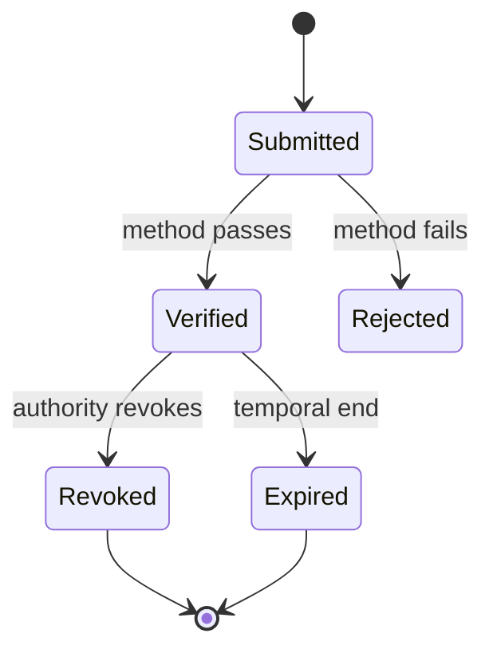
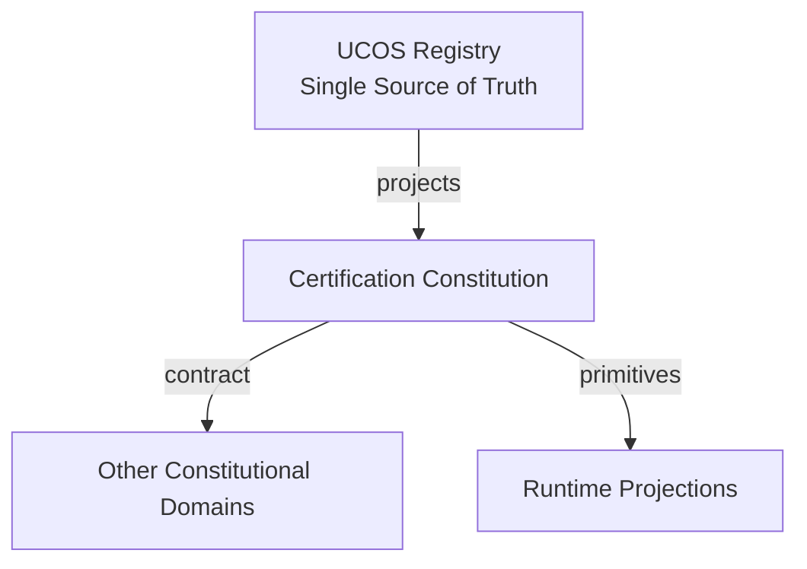
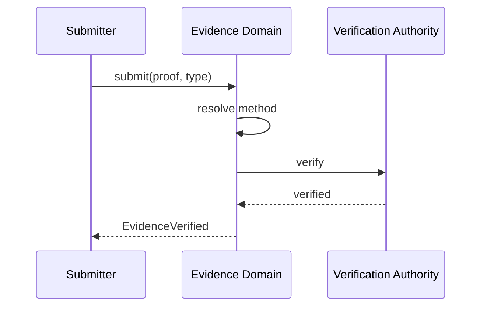
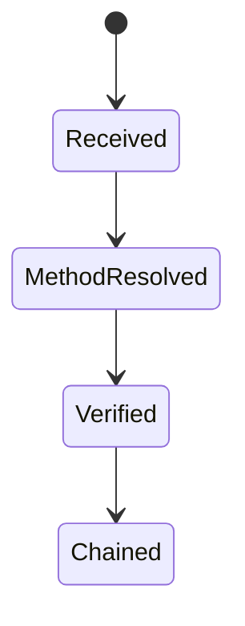
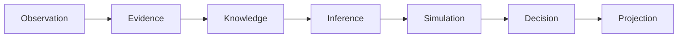
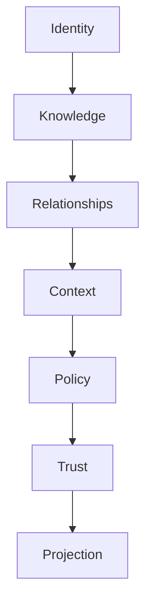

# UCOS-CON-000010
# Certification Constitution

**Version:** Ω∞.1  |  **Status:** Constitutional Artifact  |  **Authority:** UCOS Ω∞ Constitutional Authority
**Category:** Constitutions  |  **Source of Truth:** `_registry/` (projected, never hand-authored)

> Constitutional notice: this document is a **projection**. Its truth lives in the registry. Editing this document directly violates Law 002 (Knowledge Once).

---

## 1. Executive Summary

**UCOS-CON-000010 — Certification Constitution**

This artifact is a constitutionally governed, implementation-ready specification projected from the _UCOS Registry_ single source of truth.
It conforms to the _Immutable Primitive Registry_ (27 frozen primitives) and the _Canonical Terminology Registry_ (31 governed terms).
It contains no hardcoded business, industry, currency, country, or commerce concepts. All such concepts are runtime projections.

---

## 2. Constitutional Purpose

To define the binding contract for **Certification Constitution** such that:
- every concept it names has exactly one owner,
- every capability it exposes has exactly one boundary,
- every boundary is expressed as an explicit contract,
- every contract is enforceable by the Governance Constitution.

---

## 3. Scope

In scope: the primitives, contracts, schemas, events, and policies owned by **Certification Constitution**.
In scope: the projection rules by which this domain exposes its truth to other domains.
In scope: the verification obligations this domain must satisfy before activation.

---

## 4. Out of Scope

Out of scope: any concept owned by another constitutional domain.
Out of scope: business, industry, commerce, country, currency, or language content (all projected).
Out of scope: mutation of another domain’s internal state.

---

## 5. Definitions

All terms in this artifact are used in their canonical sense as defined in the Canonical Terminology Registry.
Where a term appears, its `termId` is normative and its `prohibitedMeanings` are void.

---

## 6. Canonical Terminology

| Term | Canonical Definition | Owner | Prohibited Meanings |
|---|---|---|---|
| Existence | Anything that may exist. | Universal Existence Kernel | business meaning, commercial meaning, operational meaning |
| Entity | Technical representation of an Existence Object. | Identity Domain | existence itself |
| Knowledge | Interpreted information with evidence and meaning. | Knowledge Domain | data, information, evidence |
| Data | Raw observations. | Observation Domain | knowledge, meaning |
| Information | Organized data. | Observation Domain | knowledge |
| Evidence | Proof supporting an assertion. | Evidence Domain | knowledge, trust |
| Trust | Computed confidence in an assertion, derived from evidence. | Trust Domain | evidence, faith |
| Meaning | Semantic interpretation; higher-level understanding. | Semantic Domain | classification, taxonomy, ontology |
| Ontology | What exists. | Semantic Domain | taxonomy, classification |
| Taxonomy | How things are classified. | Semantic Domain | ontology, meaning |
| Classification | Assignment into taxonomy. | Semantic Domain | meaning |
| Relationship | Connection between objects. | Relationship Domain | causality |

---

## 7. Ownership Boundaries

Ownership is recorded in the _Domain Ownership Registry_.

---

## 8. Domain Responsibilities

See the Domain Ownership Registry for the authoritative responsibility list.

---

## 9. Domain Non-Responsibilities

See the Domain Ownership Registry.

---

## 10. Concepts

Evidence is proof supporting an assertion. Evidence ≠ Knowledge and Evidence ≠ Trust: it supports knowledge and feeds trust; it is not itself understanding. Nothing exists without evidence.

---

## 11. Ontology

Evidence has a Source, a Proof payload, Validity, and Confidence. Evidence types: Document / Signature / Timestamp / Attestation / Observation / Receipt / Hash-witness / Future type — all registry-driven.

---

## 12. Taxonomy

By strength: Cryptographic / Attested / Observed / Claimed (weakest). By permanence: Immutable / Temporal / Revocable.

---

## 13. Registries

This domain is registry-driven. Its registries are entries in the Universal Registry System:

```yaml
RegistryEntry:
  registryId: UCOS-REG-DOMAIN
  owner: Constitutional Authority
  law: Knowledge Once — each concept defined exactly once
```

---

## 14. Data Model

```yaml
Evidence:
  evidenceId: <Identity>
  type: <registry id>
  source: <Identity|Authority>
  proof: <content-addressed payload reference>
  validity: {verifiedAt, method, expiresAt}
  confidence: <0..1>
  chain: [parent evidence]
  metadata: <Metadata>
```

---

## 15. Graph Model

(:Evidence)-[:SUPPORTS]->(:Knowledge); (:Evidence)-[:SIGNED_BY]->(:Authority); (:Evidence)-[:DERIVED_FROM]->(:Evidence); (:Evidence)-[:REVOKED_BY]->(:Authority)

---

## 16. Schemas

```yaml
# Canonical projection schema for UCOS-CON-000010
ucos_con_000010:
  identity:      <Identity primitive>
  intent:        <Intent primitive>
  meaning:       <Meaning primitive>
  knowledge:     <Knowledge primitive>
  registry:      <Registry primitive>
  relationship:  <Relationship primitive>
  context:       <Context primitive>
  policy:        <Policy primitive>
  authority:     <Authority primitive>
  evidence:      <Evidence primitive>
  trust:         <Trust primitive>
  temporal:      <Time primitive>
  metadata:      <Metadata primitive>
```

---

## 17. Contracts

```yaml
DomainContract:
  domain: Certification Constitution
  commands:   []   # registry-driven
  queries:    []   # registry-driven
  events:     []   # registry-driven
  policies:   []   # registry-driven
  permissions: []  # registry-driven
```

Contract law: domains never directly access another domain’s internal structures.

---

## 18. APIs

POST /evidence.v1.submit,GET  /evidence.v1/{id},POST /evidence.v1.verify,POST /evidence.v1.revoke,GET  /evidence.v1.chain/{id}

---

## 19. Events

EvidenceSubmitted,EvidenceVerified,EvidenceRevoked,EvidenceChained,EvidenceExpired

---

## 20. Commands

evidence.submit,evidence.verify,evidence.revoke,evidence.chain,evidence.archive

---

## 21. Queries

evidence.byId,evidence.supporting,evidence.bySource,evidence.revoked,evidence.chain

---

## 22. State Machines



---

## 23. Workflows

submit → select verification method from registry → verify → chain to parent evidence → publish → schedule expiry

---

## 24. Policies

```yaml
Policy:
  identity: <Identity>
  conditions: []   # registry-driven
  actions:    []   # registry-driven
  priorities: []   # registry-driven
  exceptions: []   # registry-driven
```

All behavior derives from policy. Policy ≠ Rule: policy is behavioral governance; the rule is its executable projection.

---

## 25. Rules

```yaml
Rule:
  ruleId: <Identity>
  derivedFrom: <Policy identity>
  executable: true
  constraint: <registry expression>
```

---

## 26. Authorities

Source Authority (submits),Verification Authority (attests method),Revocation Authority (original signer or higher)

---

## 27. Permissions

evidence.submit (authenticated),evidence.verify (verification authority),evidence.revoke (revocation authority)

---

## 28. Security Model

Zero Trust applies: no implicit trust between domains, services, agents, or tenants.
Every call is authenticated, authorized against Policy, and evidenced.
Cryptographic identity is issued by the Identity Domain; keys by the Key Management Architecture.

---

## 29. Privacy Model

Proof payloads are content-addressed and access-scoped; personal evidence follows the Consent Architecture's retention and erasure policy.

---

## 30. Trust Model

Trust is computed, never assumed. Inputs: evidence, authority, consistency, provenance, confidence.
```yaml
Trust:
  evidenceScore: <0..1>
  authorityScore: <0..1>
  consistencyScore: <0..1>
  provenanceScore: <0..1>
  confidenceScore: <0..1>
```

---

## 31. Audit Model

Every verification records method, verifier, timestamp, and result. Revocation never deletes — it invalidates downstream support and is logged.

---

## 32. Observability Model

Every action emits: What happened? Why? Who authorized it? Which policy allowed it? What evidence supports it? What confidence exists? What alternatives were evaluated?
These are the seven Explainability questions and are mandatory event fields.

---

## 33. Digital Twin Model

Evidence Twin mirrors real-world proof status (e.g., a license expiring) and propagates expiry to dependent Knowledge.

---

## 34. Agent Model

Evidence Agent detects expiring and weak-chain evidence, triggering re-verification before downstream trust degrades.

---

## 35. Runtime Model

Verification is method-dispatched from the registry; hot path caches verification results keyed by content hash.

---

## 36. Scaling Model

Payloads are stored once, content-addressed; verification results are cached and invalidated on EvidenceRevoked.

---

## 37. Multi-Tenant Model

Evidence is tenant-scoped; cross-tenant citation requires explicit published relationship.

---

## 38. Geo-Distribution Model

Proof payloads follow Data Sovereignty residency; verification method availability varies by jurisdiction (e.g., eIDAS vs. eID).

---

## 39. Failure Model

Method unavailability, chain breakage, hash collision (mitigated by algorithm agility), revocation storm.

---

## 40. Recovery Model

Content-addressed storage is self-verifying; recovery re-verifies hashes. Revoked evidence stays invalid — integrity over recoverability.

---

## 41. Verification Model

Before activation, Certification Constitution must pass identity, knowledge, relationship, context, policy, authority, trust, and reality integrity checks.
Verification is performed by the Formal Verification Architecture (UCOS-FML-000001).

---

## 42. Certification Model

Evidence must pass method verification, chain integrity, non-expiration, and source authority validity.

---

## 43. Migration Model

New verification methods are registry additions; existing evidence re-verifies on method activation.

---

## 44. Evolution Model

Evolution is governed and history-preserving. Primitives are frozen; extension occurs through registries, policies, capabilities, contexts, relationships, knowledge, agents, and projections — never through primitive expansion.

---

## 45. Implementation Blueprint

Build order for EVD: (1) define registry entries — this domain owns by strength: cryptographic / attested / observed / claimed (weakest) as registry truth, not code; (2) implement the contract surface first (evidence.submit, evidence.verify, evidence.revoke) and validate against EVD boundaries; (3) event-source all state so history is reconstructable; (4) wire the enforcement points — authority check, policy guard, evidence binding, trace — in-line, with no bypass path; (5) add tests per the Testing Architecture, citing evidence per gate; (6) obtain Verification and Certification before activation. Acceptance: the Zero Partial and Law 001 audits pass, every action answers the seven explainability questions, and this domain mutates no other domain internals.

---

## 46. Reference Architecture Diagram



---

## 47. Sequence Diagrams



---

## 48. State Diagrams



---

## 49. Data Flow Diagrams



---

## 50. Dependency Maps



Forbidden: circular dependencies, mutual ownership, cross-domain state mutation.

---

## ∞

Constitutionally governed. Implementation ready. Universally extensible.