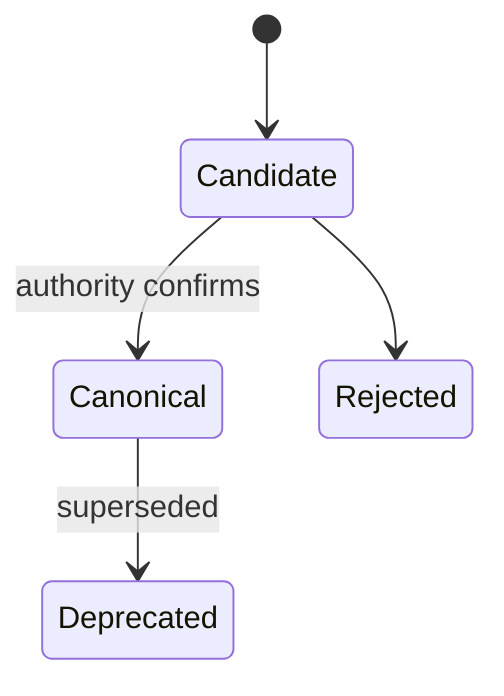
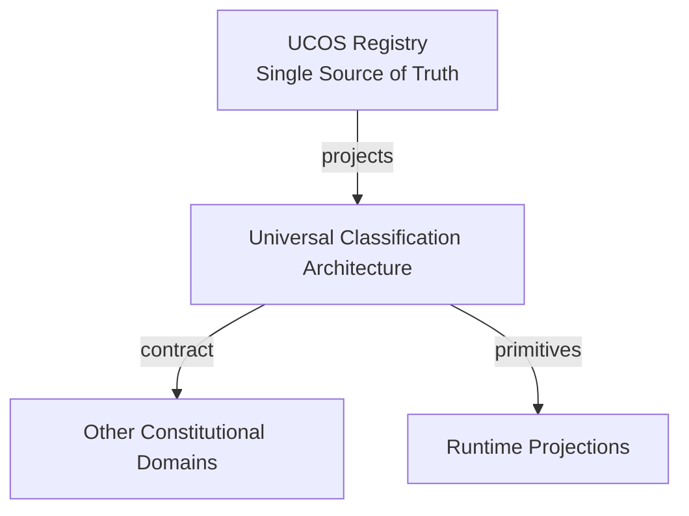
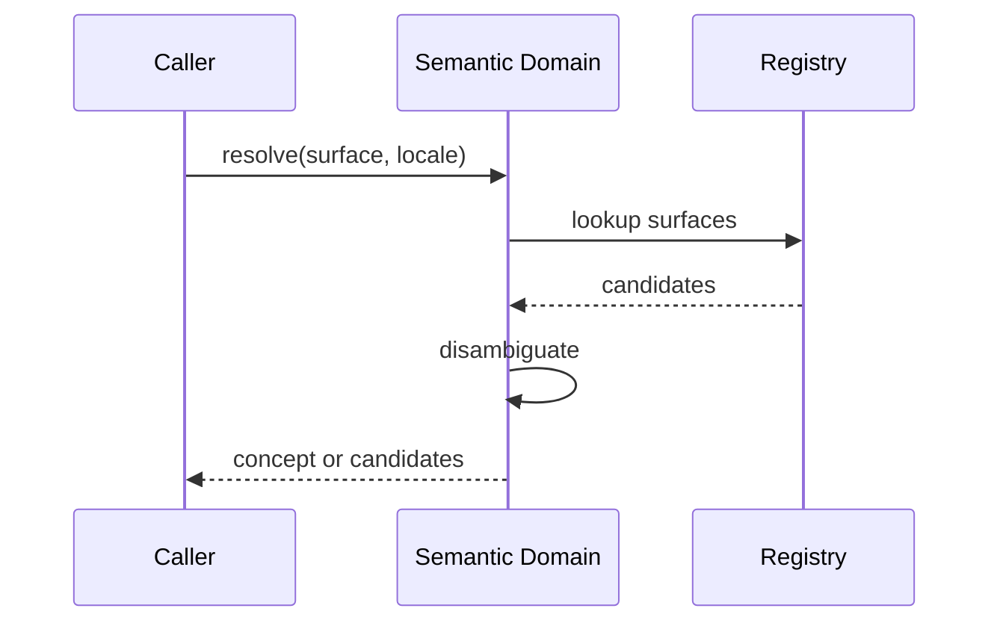
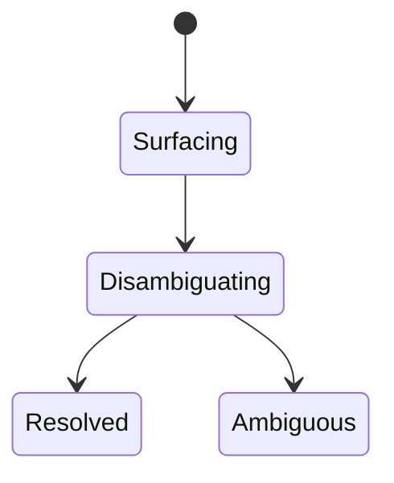
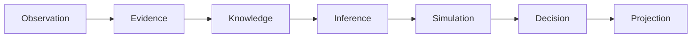
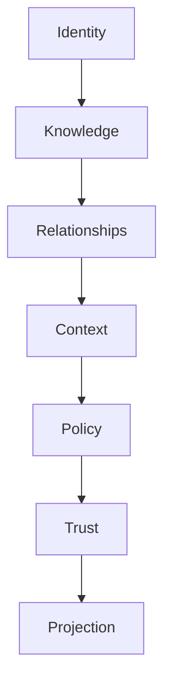

# UCOS-CLS-000001
# Universal Classification Architecture

**Version:** Ω∞.1  |  **Status:** Constitutional Artifact  |  **Authority:** UCOS Ω∞ Constitutional Authority
**Category:** Semantics  |  **Source of Truth:** `_registry/` (projected, never hand-authored)

> Constitutional notice: this document is a **projection**. Its truth lives in the registry. Editing this document directly violates Law 002 (Knowledge Once).

---

## 1. Executive Summary

**UCOS-CLS-000001 — Universal Classification Architecture**

This artifact is a constitutionally governed, implementation-ready specification projected from the _UCOS Registry_ single source of truth.
It conforms to the _Immutable Primitive Registry_ (27 frozen primitives) and the _Canonical Terminology Registry_ (31 governed terms).
It contains no hardcoded business, industry, currency, country, or commerce concepts. All such concepts are runtime projections.

---

## 2. Constitutional Purpose

To define the binding contract for **Universal Classification Architecture** such that:
- every concept it names has exactly one owner,
- every capability it exposes has exactly one boundary,
- every boundary is expressed as an explicit contract,
- every contract is enforceable by the Governance Constitution.

---

## 3. Scope

In scope: the primitives, contracts, schemas, events, and policies owned by **Universal Classification Architecture**.
In scope: the projection rules by which this domain exposes its truth to other domains.
In scope: the verification obligations this domain must satisfy before activation.

---

## 4. Out of Scope

Out of scope: any concept owned by another constitutional domain.
Out of scope: business, industry, commerce, country, currency, or language content (all projected).
Out of scope: mutation of another domain’s internal state.

---

## 5. Definitions

All terms in this artifact are used in their canonical sense as defined in the Canonical Terminology Registry.
Where a term appears, its `termId` is normative and its `prohibitedMeanings` are void.

---

## 6. Canonical Terminology

| Term | Canonical Definition | Owner | Prohibited Meanings |
|---|---|---|---|
| Existence | Anything that may exist. | Universal Existence Kernel | business meaning, commercial meaning, operational meaning |
| Entity | Technical representation of an Existence Object. | Identity Domain | existence itself |
| Knowledge | Interpreted information with evidence and meaning. | Knowledge Domain | data, information, evidence |
| Data | Raw observations. | Observation Domain | knowledge, meaning |
| Information | Organized data. | Observation Domain | knowledge |
| Evidence | Proof supporting an assertion. | Evidence Domain | knowledge, trust |
| Trust | Computed confidence in an assertion, derived from evidence. | Trust Domain | evidence, faith |
| Meaning | Semantic interpretation; higher-level understanding. | Semantic Domain | classification, taxonomy, ontology |
| Ontology | What exists. | Semantic Domain | taxonomy, classification |
| Taxonomy | How things are classified. | Semantic Domain | ontology, meaning |
| Classification | Assignment into taxonomy. | Semantic Domain | meaning |
| Relationship | Connection between objects. | Relationship Domain | causality |

---

## 7. Ownership Boundaries

Ownership is recorded in the _Domain Ownership Registry_.

---

## 8. Domain Responsibilities

See the Domain Ownership Registry for the authoritative responsibility list.

---

## 9. Domain Non-Responsibilities

See the Domain Ownership Registry.

---

## 10. Concepts

The Semantic System understands meaning. Phone, Mobile, Cellphone, Smartphone, and Handset are one semantic concept with many lexical surfaces. Meaning is higher-level understanding — it is not classification, not taxonomy, not ontology.

---

## 11. Ontology

Meaning ⊂ Existence. A Concept has 1 canonical Meaning, 0..n LexicalSurfaces, 0..n Equivalencies, and language-neutral intent. Ontology says what exists; taxonomy says how it is classified; meaning says what it signifies.

---

## 12. Taxonomy

By depth: Concept / Property / Relation. By status: Canonical / Equivalent / Candidate / Deprecated. By language coverage: Universal / Locale-specific.

---

## 13. Registries

This domain is registry-driven. Its registries are entries in the Universal Registry System:

```yaml
RegistryEntry:
  registryId: UCOS-REG-DOMAIN
  owner: Constitutional Authority
  law: Knowledge Once — each concept defined exactly once
```

---

## 14. Data Model

```yaml
SemanticModel:
  conceptId: <Identity>
  canonicalName: <string>
  meaning: <semantic statement>
  lexicalSurfaces: [{locale, surface, register}]
  equivalencies: [<conceptId>]
  synonyms: [<surface>]
  translations: [{locale, equivalent}]
  ontologyRef: <Ontology node>
  status: <Canonical|Equivalent|Candidate|Deprecated>
```

---

## 15. Graph Model

(:Concept)-[:EQUIVALENT_TO]->(:Concept); (:Concept)-[:SURFACE_IN]->(:Language); (:Concept)-[:MEMBER_OF]->(:Ontology); (:Concept)-[:CLASSIFIED_AS]->(:Taxonomy)

---

## 16. Schemas

```yaml
# Canonical projection schema for UCOS-CLS-000001
ucos_cls_000001:
  identity:      <Identity primitive>
  intent:        <Intent primitive>
  meaning:       <Meaning primitive>
  knowledge:     <Knowledge primitive>
  registry:      <Registry primitive>
  relationship:  <Relationship primitive>
  context:       <Context primitive>
  policy:        <Policy primitive>
  authority:     <Authority primitive>
  evidence:      <Evidence primitive>
  trust:         <Trust primitive>
  temporal:      <Time primitive>
  metadata:      <Metadata primitive>
```

---

## 17. Contracts

```yaml
DomainContract:
  domain: Universal Classification Architecture
  commands:   []   # registry-driven
  queries:    []   # registry-driven
  events:     []   # registry-driven
  policies:   []   # registry-driven
  permissions: []  # registry-driven
```

Contract law: domains never directly access another domain’s internal structures.

---

## 18. APIs

POST /semantic.v1.concept.create,POST /semantic.v1.resolve,GET  /semantic.v1/{id},POST /semantic.v1.translate,GET  /semantic.v1.equivalents/{id}

---

## 19. Events

ConceptCreated,ConceptEquivalencyAdded,ConceptDeprecated,MeaningDisambiguated

---

## 20. Commands

semantic.concept.create,semantic.resolve,semantic.equivalency.add,semantic.translate,semantic.deprecate

---

## 21. Queries

semantic.bySurface,semantic.equivalents,semantic.byLocale,semantic.disambiguate

---

## 22. State Machines



---

## 23. Workflows

surface detected → disambiguate against existing concepts → propose or merge → authority confirms → publish canonical

---

## 24. Policies

```yaml
Policy:
  identity: <Identity>
  conditions: []   # registry-driven
  actions:    []   # registry-driven
  priorities: []   # registry-driven
  exceptions: []   # registry-driven
```

All behavior derives from policy. Policy ≠ Rule: policy is behavioral governance; the rule is its executable projection.

---

## 25. Rules

```yaml
Rule:
  ruleId: <Identity>
  derivedFrom: <Policy identity>
  executable: true
  constraint: <registry expression>
```

---

## 26. Authorities

Semantic Authority (canonical confirmation),Locale Authority (translation validity)

---

## 27. Permissions

semantic.concept.create (semantic authority),semantic.resolve (any authenticated),semantic.deprecate (semantic authority)

---

## 28. Security Model

Zero Trust applies: no implicit trust between domains, services, agents, or tenants.
Every call is authenticated, authorized against Policy, and evidenced.
Cryptographic identity is issued by the Identity Domain; keys by the Key Management Architecture.

---

## 29. Privacy Model

Semantic resolution does not retain query content; disambiguation logs store hashes, not surfaces.

---

## 30. Trust Model

Trust is computed, never assumed. Inputs: evidence, authority, consistency, provenance, confidence.
```yaml
Trust:
  evidenceScore: <0..1>
  authorityScore: <0..1>
  consistencyScore: <0..1>
  provenanceScore: <0..1>
  confidenceScore: <0..1>
```

---

## 31. Audit Model

Every equivalency records who asserted it, under which authority, with which evidence. Ambiguity is preserved, never silently resolved.

---

## 32. Observability Model

Every action emits: What happened? Why? Who authorized it? Which policy allowed it? What evidence supports it? What confidence exists? What alternatives were evaluated?
These are the seven Explainability questions and are mandatory event fields.

---

## 33. Digital Twin Model

Semantic Twin tracks real-world language drift — neologisms, shifted meanings — and proposes concept updates.

---

## 34. Agent Model

Semantic Agent discovers new surfaces from observations and proposes equivalencies under governance.

---

## 35. Runtime Model

Resolution is a locale-aware disambiguation lookup; ambiguity returns candidate sets, not guesses.

---

## 36. Scaling Model

Concept index is globally replicated; locale surfaces are partitioned by locale with lazy loading.

---

## 37. Multi-Tenant Model

Tenants may extend semantics but cannot redefine canonical concepts — those are shared truth.

---

## 38. Geo-Distribution Model

Locale resolution is region-served; canonical truth is global.

---

## 39. Failure Model

Ambiguity collapse, equivalency cycle, locale coverage gap, meaning drift undetected.

---

## 40. Recovery Model

Concepts are versioned; deprecation supersedes. Equivalency cycles are detected and rejected at write time.

---

## 41. Verification Model

Before activation, Universal Classification Architecture must pass identity, knowledge, relationship, context, policy, authority, trust, and reality integrity checks.
Verification is performed by the Formal Verification Architecture (UCOS-FML-000001).

---

## 42. Certification Model

Concept must pass uniqueness of canonical name, acyclicity of equivalency, and locale coverage.

---

## 43. Migration Model

New locales and registers are registry additions; no schema change.

---

## 44. Evolution Model

Evolution is governed and history-preserving. Primitives are frozen; extension occurs through registries, policies, capabilities, contexts, relationships, knowledge, agents, and projections — never through primitive expansion.

---

## 45. Implementation Blueprint

Build order for SEM: (1) define registry entries — this domain owns by depth: concept / property / relation as registry truth, not code; (2) implement the contract surface first (semantic.concept.create, semantic.resolve, semantic.equivalency.add) and validate against SEM boundaries; (3) event-source all state so history is reconstructable; (4) wire the enforcement points — authority check, policy guard, evidence binding, trace — in-line, with no bypass path; (5) add tests per the Testing Architecture, citing evidence per gate; (6) obtain Verification and Certification before activation. Acceptance: the Zero Partial and Law 001 audits pass, every action answers the seven explainability questions, and this domain mutates no other domain internals.

---

## 46. Reference Architecture Diagram



---

## 47. Sequence Diagrams



---

## 48. State Diagrams



---

## 49. Data Flow Diagrams



---

## 50. Dependency Maps



Forbidden: circular dependencies, mutual ownership, cross-domain state mutation.

---

## ∞

Constitutionally governed. Implementation ready. Universally extensible.