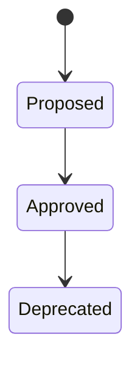
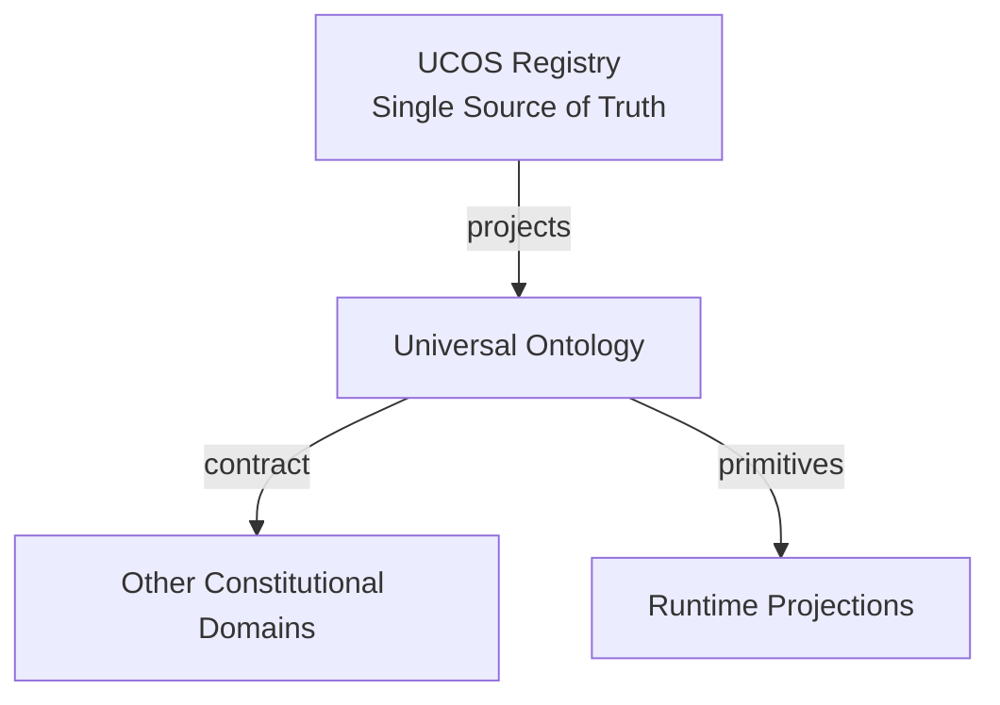
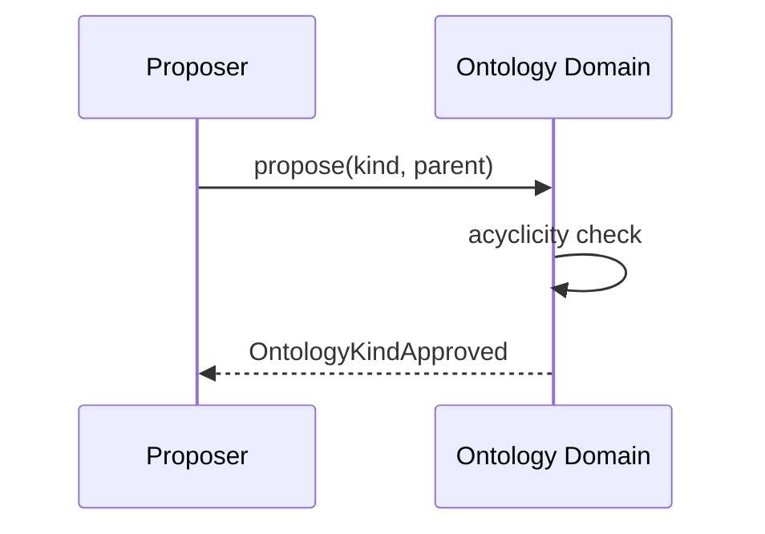
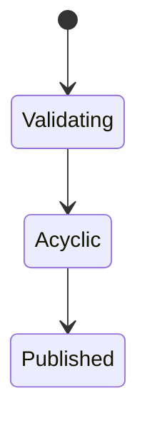
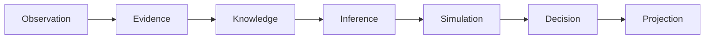
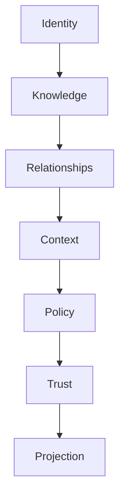

# UCOS-ONT-000001
# Universal Ontology

**Version:** Ω∞.1  |  **Status:** Constitutional Artifact  |  **Authority:** UCOS Ω∞ Constitutional Authority
**Category:** Semantics  |  **Source of Truth:** `_registry/` (projected, never hand-authored)

> Constitutional notice: this document is a **projection**. Its truth lives in the registry. Editing this document directly violates Law 002 (Knowledge Once).

---

## 1. Executive Summary

**UCOS-ONT-000001 — Universal Ontology**

This artifact is a constitutionally governed, implementation-ready specification projected from the _UCOS Registry_ single source of truth.
It conforms to the _Immutable Primitive Registry_ (27 frozen primitives) and the _Canonical Terminology Registry_ (31 governed terms).
It contains no hardcoded business, industry, currency, country, or commerce concepts. All such concepts are runtime projections.

---

## 2. Constitutional Purpose

To define the binding contract for **Universal Ontology** such that:
- every concept it names has exactly one owner,
- every capability it exposes has exactly one boundary,
- every boundary is expressed as an explicit contract,
- every contract is enforceable by the Governance Constitution.

---

## 3. Scope

In scope: the primitives, contracts, schemas, events, and policies owned by **Universal Ontology**.
In scope: the projection rules by which this domain exposes its truth to other domains.
In scope: the verification obligations this domain must satisfy before activation.

---

## 4. Out of Scope

Out of scope: any concept owned by another constitutional domain.
Out of scope: business, industry, commerce, country, currency, or language content (all projected).
Out of scope: mutation of another domain’s internal state.

---

## 5. Definitions

All terms in this artifact are used in their canonical sense as defined in the Canonical Terminology Registry.
Where a term appears, its `termId` is normative and its `prohibitedMeanings` are void.

---

## 6. Canonical Terminology

| Term | Canonical Definition | Owner | Prohibited Meanings |
|---|---|---|---|
| Existence | Anything that may exist. | Universal Existence Kernel | business meaning, commercial meaning, operational meaning |
| Entity | Technical representation of an Existence Object. | Identity Domain | existence itself |
| Knowledge | Interpreted information with evidence and meaning. | Knowledge Domain | data, information, evidence |
| Data | Raw observations. | Observation Domain | knowledge, meaning |
| Information | Organized data. | Observation Domain | knowledge |
| Evidence | Proof supporting an assertion. | Evidence Domain | knowledge, trust |
| Trust | Computed confidence in an assertion, derived from evidence. | Trust Domain | evidence, faith |
| Meaning | Semantic interpretation; higher-level understanding. | Semantic Domain | classification, taxonomy, ontology |
| Ontology | What exists. | Semantic Domain | taxonomy, classification |
| Taxonomy | How things are classified. | Semantic Domain | ontology, meaning |
| Classification | Assignment into taxonomy. | Semantic Domain | meaning |
| Relationship | Connection between objects. | Relationship Domain | causality |

---

## 7. Ownership Boundaries

Ownership is recorded in the _Domain Ownership Registry_.

---

## 8. Domain Responsibilities

See the Domain Ownership Registry for the authoritative responsibility list.

---

## 9. Domain Non-Responsibilities

See the Domain Ownership Registry.

---

## 10. Concepts

Ontology is what exists. It is the constitutional inventory of being — not how things are sorted (taxonomy), not what they mean (meaning). Ontology is the ground floor; everything else stands on it.

---

## 11. Ontology

Ontology is a directed acyclic graph of Existence kinds. Root: Existence. Each kind is a RegistryEntry. Extension is by registry, never by primitive expansion.

---

## 12. Taxonomy

By abstraction: Kind / Subkind / Instance-kind. By stability: Foundational / Core / Domain / Ephemeral.

---

## 13. Registries

This domain is registry-driven. Its registries are entries in the Universal Registry System:

```yaml
RegistryEntry:
  registryId: UCOS-REG-DOMAIN
  owner: Constitutional Authority
  law: Knowledge Once — each concept defined exactly once
```

---

## 14. Data Model

```yaml
Ontology:
  node: <Identity>
  kind: <registry kind id>
  parentKinds: [<Identity>]
  properties: [<registry property>]
  relationships: [<registry relation kind>]
  source: <Primitive|Projection>
```

---

## 15. Graph Model

(:Kind)-[:SUBKIND_OF*]->(:Kind); (:Kind)-[:HAS_PROPERTY]->(:Property); (:Kind)-[:HAS_RELATION]->(:RelationKind); (:Kind)-[:ROOTS_AT]->(:Existence)

---

## 16. Schemas

```yaml
# Canonical projection schema for UCOS-ONT-000001
ucos_ont_000001:
  identity:      <Identity primitive>
  intent:        <Intent primitive>
  meaning:       <Meaning primitive>
  knowledge:     <Knowledge primitive>
  registry:      <Registry primitive>
  relationship:  <Relationship primitive>
  context:       <Context primitive>
  policy:        <Policy primitive>
  authority:     <Authority primitive>
  evidence:      <Evidence primitive>
  trust:         <Trust primitive>
  temporal:      <Time primitive>
  metadata:      <Metadata primitive>
```

---

## 17. Contracts

```yaml
DomainContract:
  domain: Universal Ontology
  commands:   []   # registry-driven
  queries:    []   # registry-driven
  events:     []   # registry-driven
  policies:   []   # registry-driven
  permissions: []  # registry-driven
```

Contract law: domains never directly access another domain’s internal structures.

---

## 18. APIs

GET  /ontology.v1/{node},GET  /ontology.v1.ancestors/{node},GET  /ontology.v1.descendants/{node},POST /ontology.v1.kind.propose

---

## 19. Events

OntologyKindProposed,OntologyKindApproved,OntologyKindDeprecated

---

## 20. Commands

ontology.kind.propose,ontology.kind.approve,ontology.kind.deprecate

---

## 21. Queries

ontology.ancestors,ontology.descendants,ontology.kinds,ontology.paths

---

## 22. State Machines



---

## 23. Workflows

propose kind with parent → acyclicity check → approve → publish → existing instances re-project

---

## 24. Policies

```yaml
Policy:
  identity: <Identity>
  conditions: []   # registry-driven
  actions:    []   # registry-driven
  priorities: []   # registry-driven
  exceptions: []   # registry-driven
```

All behavior derives from policy. Policy ≠ Rule: policy is behavioral governance; the rule is its executable projection.

---

## 25. Rules

```yaml
Rule:
  ruleId: <Identity>
  derivedFrom: <Policy identity>
  executable: true
  constraint: <registry expression>
```

---

## 26. Authorities

Semantic Authority (kind approval); primitive-level changes require Constitutional Assembly.

---

## 27. Permissions

ontology.kind.propose (semantic authority),ontology.kind.approve (semantic authority),ontology.read (any authenticated)

---

## 28. Security Model

Zero Trust applies: no implicit trust between domains, services, agents, or tenants.
Every call is authenticated, authorized against Policy, and evidenced.
Cryptographic identity is issued by the Identity Domain; keys by the Key Management Architecture.

---

## 29. Privacy Model

Ontology carries no personal data by design — it is structure, not content.

---

## 30. Trust Model

Trust is computed, never assumed. Inputs: evidence, authority, consistency, provenance, confidence.
```yaml
Trust:
  evidenceScore: <0..1>
  authorityScore: <0..1>
  consistencyScore: <0..1>
  provenanceScore: <0..1>
  confidenceScore: <0..1>
```

---

## 31. Audit Model

Every kind addition/deprecation is logged with rationale and authority; the full history of 'what existed when' is queryable.

---

## 32. Observability Model

Every action emits: What happened? Why? Who authorized it? Which policy allowed it? What evidence supports it? What confidence exists? What alternatives were evaluated?
These are the seven Explainability questions and are mandatory event fields.

---

## 33. Digital Twin Model

Ontology versions the structure twins are built on; a twin's schema is an ontology projection.

---

## 34. Agent Model

Ontology Agent proposes new kinds from observed patterns and detects orphaned subkinds.

---

## 35. Runtime Model

Traversal is cached per node; invalidation on kind approval/deprecation.

---

## 36. Scaling Model

Small, globally replicated, read-heavy graph. Write path is authority-gated and low-frequency.

---

## 37. Multi-Tenant Model

Ontology is shared constitutional truth; tenants extend via projections, never by mutating the core.

---

## 38. Geo-Distribution Model

Globally consistent; ontology is not jurisdiction-scoped — applications apply jurisdiction via Context.

---

## 39. Failure Model

Cycle introduction, orphaned kind, conflicting parents, primitive-level drift.

---

## 40. Recovery Model

Kinds are versioned; deprecation is reversible while no dependents remain.

---

## 41. Verification Model

Before activation, Universal Ontology must pass identity, knowledge, relationship, context, policy, authority, trust, and reality integrity checks.
Verification is performed by the Formal Verification Architecture (UCOS-FML-000001).

---

## 42. Certification Model

Kind must pass acyclicity, parent existence, property compatibility, and naming uniqueness.

---

## 43. Migration Model

Ontology evolves only through this domain — schema migration and ontology evolution are the same act.

---

## 44. Evolution Model

Evolution is governed and history-preserving. Primitives are frozen; extension occurs through registries, policies, capabilities, contexts, relationships, knowledge, agents, and projections — never through primitive expansion.

---

## 45. Implementation Blueprint

Build order for ONT: (1) define registry entries — this domain owns by abstraction: kind / subkind / instance-kind as registry truth, not code; (2) implement the contract surface first (ontology.kind.propose, ontology.kind.approve, ontology.kind.deprecate) and validate against ONT boundaries; (3) event-source all state so history is reconstructable; (4) wire the enforcement points — authority check, policy guard, evidence binding, trace — in-line, with no bypass path; (5) add tests per the Testing Architecture, citing evidence per gate; (6) obtain Verification and Certification before activation. Acceptance: the Zero Partial and Law 001 audits pass, every action answers the seven explainability questions, and this domain mutates no other domain internals.

---

## 46. Reference Architecture Diagram



---

## 47. Sequence Diagrams



---

## 48. State Diagrams



---

## 49. Data Flow Diagrams



---

## 50. Dependency Maps



Forbidden: circular dependencies, mutual ownership, cross-domain state mutation.

---

## ∞

Constitutionally governed. Implementation ready. Universally extensible.