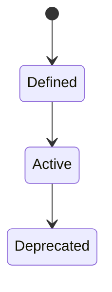
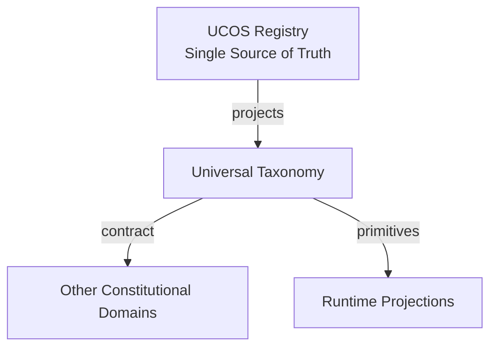
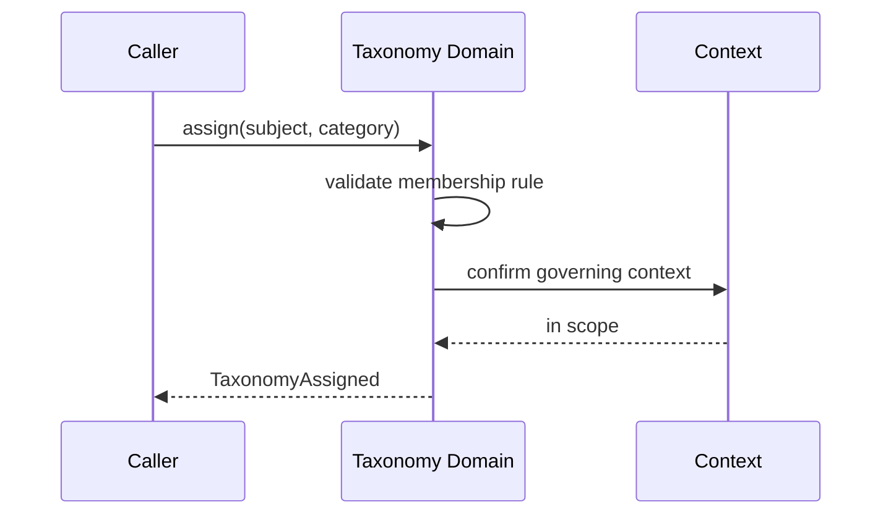
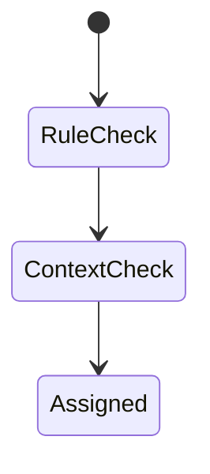
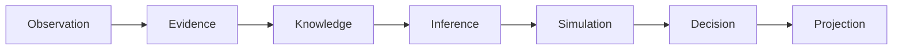
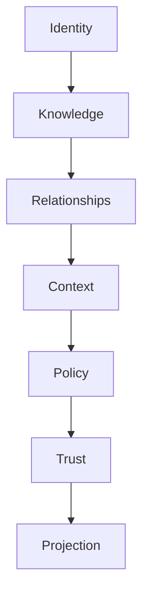

# UCOS-TAX-000001
# Universal Taxonomy

**Version:** Ω∞.1  |  **Status:** Constitutional Artifact  |  **Authority:** UCOS Ω∞ Constitutional Authority
**Category:** Semantics  |  **Source of Truth:** `_registry/` (projected, never hand-authored)

> Constitutional notice: this document is a **projection**. Its truth lives in the registry. Editing this document directly violates Law 002 (Knowledge Once).

---

## 1. Executive Summary

**UCOS-TAX-000001 — Universal Taxonomy**

This artifact is a constitutionally governed, implementation-ready specification projected from the _UCOS Registry_ single source of truth.
It conforms to the _Immutable Primitive Registry_ (27 frozen primitives) and the _Canonical Terminology Registry_ (31 governed terms).
It contains no hardcoded business, industry, currency, country, or commerce concepts. All such concepts are runtime projections.

---

## 2. Constitutional Purpose

To define the binding contract for **Universal Taxonomy** such that:
- every concept it names has exactly one owner,
- every capability it exposes has exactly one boundary,
- every boundary is expressed as an explicit contract,
- every contract is enforceable by the Governance Constitution.

---

## 3. Scope

In scope: the primitives, contracts, schemas, events, and policies owned by **Universal Taxonomy**.
In scope: the projection rules by which this domain exposes its truth to other domains.
In scope: the verification obligations this domain must satisfy before activation.

---

## 4. Out of Scope

Out of scope: any concept owned by another constitutional domain.
Out of scope: business, industry, commerce, country, currency, or language content (all projected).
Out of scope: mutation of another domain’s internal state.

---

## 5. Definitions

All terms in this artifact are used in their canonical sense as defined in the Canonical Terminology Registry.
Where a term appears, its `termId` is normative and its `prohibitedMeanings` are void.

---

## 6. Canonical Terminology

| Term | Canonical Definition | Owner | Prohibited Meanings |
|---|---|---|---|
| Existence | Anything that may exist. | Universal Existence Kernel | business meaning, commercial meaning, operational meaning |
| Entity | Technical representation of an Existence Object. | Identity Domain | existence itself |
| Knowledge | Interpreted information with evidence and meaning. | Knowledge Domain | data, information, evidence |
| Data | Raw observations. | Observation Domain | knowledge, meaning |
| Information | Organized data. | Observation Domain | knowledge |
| Evidence | Proof supporting an assertion. | Evidence Domain | knowledge, trust |
| Trust | Computed confidence in an assertion, derived from evidence. | Trust Domain | evidence, faith |
| Meaning | Semantic interpretation; higher-level understanding. | Semantic Domain | classification, taxonomy, ontology |
| Ontology | What exists. | Semantic Domain | taxonomy, classification |
| Taxonomy | How things are classified. | Semantic Domain | ontology, meaning |
| Classification | Assignment into taxonomy. | Semantic Domain | meaning |
| Relationship | Connection between objects. | Relationship Domain | causality |

---

## 7. Ownership Boundaries

Ownership is recorded in the _Domain Ownership Registry_.

---

## 8. Domain Responsibilities

See the Domain Ownership Registry for the authoritative responsibility list.

---

## 9. Domain Non-Responsibilities

See the Domain Ownership Registry.

---

## 10. Concepts

Taxonomy is how things are classified. Taxonomy ≠ Ontology (what exists) and ≠ Classification (the act of assigning). Taxonomy is the structure of classification.

---

## 11. Ontology

Taxonomy is a tree/DAG of Categories. Each Category has one canonical parent (tree) or defined parents (DAG), membership rules, and a governing Context.

---

## 12. Taxonomy

By structure: Tree / DAG / Facet. By mutability: Frozen / Governed / Open. By scope: Universal / Domain / Tenant.

---

## 13. Registries

This domain is registry-driven. Its registries are entries in the Universal Registry System:

```yaml
RegistryEntry:
  registryId: UCOS-REG-DOMAIN
  owner: Constitutional Authority
  law: Knowledge Once — each concept defined exactly once
```

---

## 14. Data Model

```yaml
Taxonomy:
  categoryRef: <Identity>
  parentCategories: [<Identity>]
  membershipRule: <registry expression>
  governingContext: <Context>
  temporal: {effectiveFrom, effectiveTo}
```

---

## 15. Graph Model

(:Category)-[:SUBCATEGORY_OF*]->(:Category); (:Category)-[:CLASSIFIES]->(:Existence); (:Category)-[:GOVERNED_IN]->(:Context)

---

## 16. Schemas

```yaml
# Canonical projection schema for UCOS-TAX-000001
ucos_tax_000001:
  identity:      <Identity primitive>
  intent:        <Intent primitive>
  meaning:       <Meaning primitive>
  knowledge:     <Knowledge primitive>
  registry:      <Registry primitive>
  relationship:  <Relationship primitive>
  context:       <Context primitive>
  policy:        <Policy primitive>
  authority:     <Authority primitive>
  evidence:      <Evidence primitive>
  trust:         <Trust primitive>
  temporal:      <Time primitive>
  metadata:      <Metadata primitive>
```

---

## 17. Contracts

```yaml
DomainContract:
  domain: Universal Taxonomy
  commands:   []   # registry-driven
  queries:    []   # registry-driven
  events:     []   # registry-driven
  policies:   []   # registry-driven
  permissions: []  # registry-driven
```

Contract law: domains never directly access another domain’s internal structures.

---

## 18. APIs

POST /taxonomy.v1.category.create,GET  /taxonomy.v1/{category},GET  /taxonomy.v1.tree,POST /taxonomy.v1.assign

---

## 19. Events

TaxonomyCategoryCreated,TaxonomyAssigned,TaxonomyReclassified,TaxonomyMerged

---

## 20. Commands

taxonomy.category.create,taxonomy.assign,taxonomy.reclassify,taxonomy.merge

---

## 21. Queries

taxonomy.tree,taxonomy.path,taxonomy.members,taxonomy.byContext

---

## 22. State Machines



---

## 23. Workflows

create category with rule → assign under governance → reclassify on rule change → preserve history

---

## 24. Policies

```yaml
Policy:
  identity: <Identity>
  conditions: []   # registry-driven
  actions:    []   # registry-driven
  priorities: []   # registry-driven
  exceptions: []   # registry-driven
```

All behavior derives from policy. Policy ≠ Rule: policy is behavioral governance; the rule is its executable projection.

---

## 25. Rules

```yaml
Rule:
  ruleId: <Identity>
  derivedFrom: <Policy identity>
  executable: true
  constraint: <registry expression>
```

---

## 26. Authorities

Semantic Authority (structure); Context Authority may add domain categories in scope.

---

## 27. Permissions

taxonomy.category.create (semantic or context authority),taxonomy.assign (context-scoped writer),taxonomy.read (any authenticated)

---

## 28. Security Model

Zero Trust applies: no implicit trust between domains, services, agents, or tenants.
Every call is authenticated, authorized against Policy, and evidenced.
Cryptographic identity is issued by the Identity Domain; keys by the Key Management Architecture.

---

## 29. Privacy Model

Classifications of persons are sensitive; category membership over personal data requires consent scope.

---

## 30. Trust Model

Trust is computed, never assumed. Inputs: evidence, authority, consistency, provenance, confidence.
```yaml
Trust:
  evidenceScore: <0..1>
  authorityScore: <0..1>
  consistencyScore: <0..1>
  provenanceScore: <0..1>
  confidenceScore: <0..1>
```

---

## 31. Audit Model

Every assignment and reclassification records who, under which rule, in which context, and when. Prior classifications remain queryable.

---

## 32. Observability Model

Every action emits: What happened? Why? Who authorized it? Which policy allowed it? What evidence supports it? What confidence exists? What alternatives were evaluated?
These are the seven Explainability questions and are mandatory event fields.

---

## 33. Digital Twin Model

Taxonomy versions structure that classification twins mirror.

---

## 34. Agent Model

Taxonomy Agent proposes new categories from clustering observations and detects stale classifications.

---

## 35. Runtime Model

Tree traversal cached; assignment is validated against membership rule at write time.

---

## 36. Scaling Model

Read-heavy; cache per context. Write path validates full ancestor chain.

---

## 37. Multi-Tenant Model

Universal taxonomy is shared; tenant taxonomies are projections layered on top, never mutations of the core.

---

## 38. Geo-Distribution Model

Category names are locale-resolved via the Semantic Domain; structure is global.

---

## 39. Failure Model

Cycle, orphaned category, ambiguous membership, merge conflict.

---

## 40. Recovery Model

Reclassification is versioned; merges preserve both lineages. No classification is ever lost.

---

## 41. Verification Model

Before activation, Universal Taxonomy must pass identity, knowledge, relationship, context, policy, authority, trust, and reality integrity checks.
Verification is performed by the Formal Verification Architecture (UCOS-FML-000001).

---

## 42. Certification Model

Category must pass acyclicity, rule validity, context jurisdiction, and naming uniqueness.

---

## 43. Migration Model

New categories are registry additions; reclassification is governed, never bulk-rewritten.

---

## 44. Evolution Model

Evolution is governed and history-preserving. Primitives are frozen; extension occurs through registries, policies, capabilities, contexts, relationships, knowledge, agents, and projections — never through primitive expansion.

---

## 45. Implementation Blueprint

Build order for TAX: (1) define registry entries — this domain owns by structure: tree / dag / facet as registry truth, not code; (2) implement the contract surface first (taxonomy.category.create, taxonomy.assign, taxonomy.reclassify) and validate against TAX boundaries; (3) event-source all state so history is reconstructable; (4) wire the enforcement points — authority check, policy guard, evidence binding, trace — in-line, with no bypass path; (5) add tests per the Testing Architecture, citing evidence per gate; (6) obtain Verification and Certification before activation. Acceptance: the Zero Partial and Law 001 audits pass, every action answers the seven explainability questions, and this domain mutates no other domain internals.

---

## 46. Reference Architecture Diagram



---

## 47. Sequence Diagrams



---

## 48. State Diagrams



---

## 49. Data Flow Diagrams



---

## 50. Dependency Maps



Forbidden: circular dependencies, mutual ownership, cross-domain state mutation.

---

## ∞

Constitutionally governed. Implementation ready. Universally extensible.