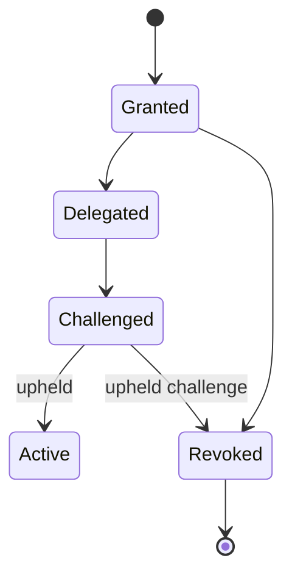
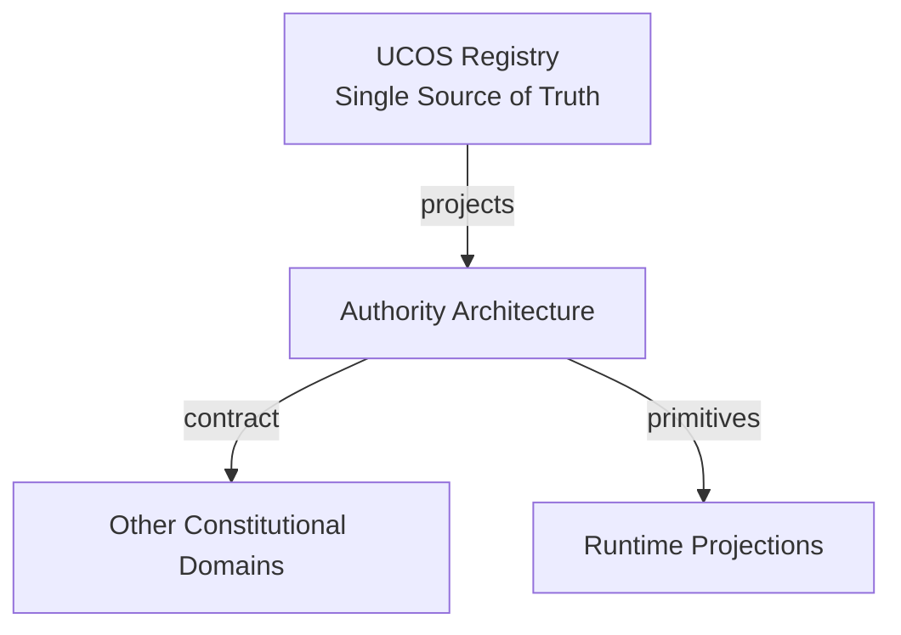
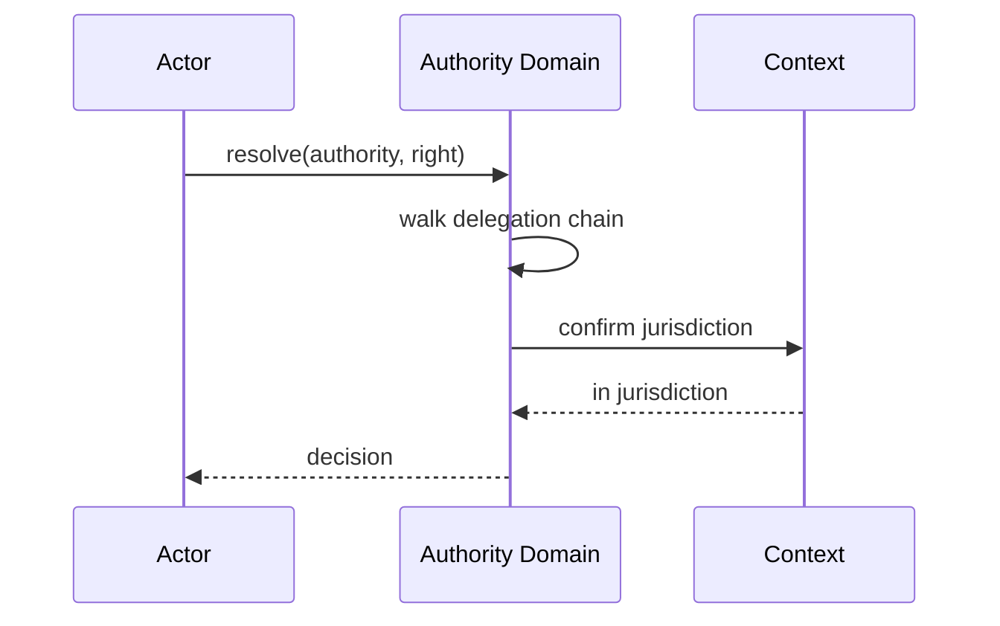
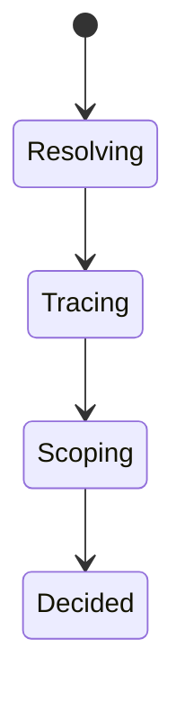
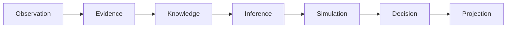
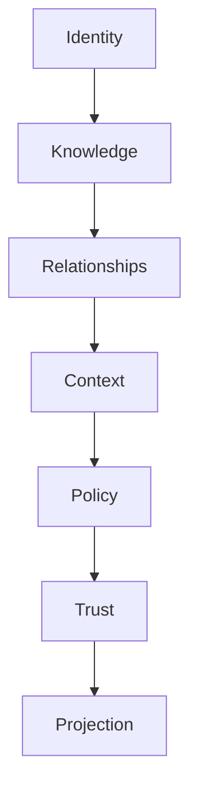

# UCOS-AUT-000001
# Authority Architecture

**Version:** Ω∞.1  |  **Status:** Constitutional Artifact  |  **Authority:** UCOS Ω∞ Constitutional Authority
**Category:** Core Domains  |  **Source of Truth:** `_registry/` (projected, never hand-authored)

> Constitutional notice: this document is a **projection**. Its truth lives in the registry. Editing this document directly violates Law 002 (Knowledge Once).

---

## 1. Executive Summary

**UCOS-AUT-000001 — Authority Architecture**

This artifact is a constitutionally governed, implementation-ready specification projected from the _UCOS Registry_ single source of truth.
It conforms to the _Immutable Primitive Registry_ (27 frozen primitives) and the _Canonical Terminology Registry_ (31 governed terms).
It contains no hardcoded business, industry, currency, country, or commerce concepts. All such concepts are runtime projections.

---

## 2. Constitutional Purpose

To define the binding contract for **Authority Architecture** such that:
- every concept it names has exactly one owner,
- every capability it exposes has exactly one boundary,
- every boundary is expressed as an explicit contract,
- every contract is enforceable by the Governance Constitution.

---

## 3. Scope

In scope: the primitives, contracts, schemas, events, and policies owned by **Authority Architecture**.
In scope: the projection rules by which this domain exposes its truth to other domains.
In scope: the verification obligations this domain must satisfy before activation.

---

## 4. Out of Scope

Out of scope: any concept owned by another constitutional domain.
Out of scope: business, industry, commerce, country, currency, or language content (all projected).
Out of scope: mutation of another domain’s internal state.

---

## 5. Definitions

All terms in this artifact are used in their canonical sense as defined in the Canonical Terminology Registry.
Where a term appears, its `termId` is normative and its `prohibitedMeanings` are void.

---

## 6. Canonical Terminology

| Term | Canonical Definition | Owner | Prohibited Meanings |
|---|---|---|---|
| Existence | Anything that may exist. | Universal Existence Kernel | business meaning, commercial meaning, operational meaning |
| Entity | Technical representation of an Existence Object. | Identity Domain | existence itself |
| Knowledge | Interpreted information with evidence and meaning. | Knowledge Domain | data, information, evidence |
| Data | Raw observations. | Observation Domain | knowledge, meaning |
| Information | Organized data. | Observation Domain | knowledge |
| Evidence | Proof supporting an assertion. | Evidence Domain | knowledge, trust |
| Trust | Computed confidence in an assertion, derived from evidence. | Trust Domain | evidence, faith |
| Meaning | Semantic interpretation; higher-level understanding. | Semantic Domain | classification, taxonomy, ontology |
| Ontology | What exists. | Semantic Domain | taxonomy, classification |
| Taxonomy | How things are classified. | Semantic Domain | ontology, meaning |
| Classification | Assignment into taxonomy. | Semantic Domain | meaning |
| Relationship | Connection between objects. | Relationship Domain | causality |

---

## 7. Ownership Boundaries

**Owner:** Authority Domain
**Owns:** Authority, Ownership
**Boundary law:** no domain may modify, bypass, or reinterpret another domain’s internals. All interaction is via contract.

---

## 8. Domain Responsibilities

- Governance Rights
- Jurisdictions
- Delegations

---

## 9. Domain Non-Responsibilities

- Knowledge
- Meaning
- Relationships

---

## 10. Concepts

Authority is the right to govern within a jurisdiction. Authority ≠ Ownership: authority is the right; ownership is the responsibility. Authority is delegable, revocable, and always bounded.

---

## 11. Ontology

Authority has a Jurisdiction, Rights, Responsibilities, and a delegating parent Authority. Types: Platform / Tenant / Country / Regulatory / Corporate / Future — all registry-driven.

---

## 12. Taxonomy

By scope: Universal / Jurisdictional / Organizational / Contextual. By source: Constitutional / Delegated / Assumed (weakest) / Attested.

---

## 13. Registries

This domain is registry-driven. Its registries are entries in the Universal Registry System:

```yaml
RegistryEntry:
  registryId: UCOS-REG-AUTHORITY
  owner: Authority Domain
  law: Knowledge Once — each concept defined exactly once
```

---

## 14. Data Model

```yaml
Authority:
  authorityId: <Identity>
  type: <registry id>
  jurisdiction: <Context>
  rights: [<registry capability>]
  responsibilities: [<registry obligation>]
  delegatedFrom: <Authority|null>
  temporal: {grantedAt, revokedAt}
  status: <Active|Revoked|Expired>
```

---

## 15. Graph Model

(:Authority)-[:DELEGATED_FROM*]->(:Authority); (:Authority)-[:JURISDICTION]->(:Context); (:Authority)-[:GRANTS]->(:Policy|:Permission); (:Authority)<-[:ASSERTED_BY]-(:Knowledge)

---

## 16. Schemas

```yaml
# Canonical projection schema for UCOS-AUT-000001
ucos_aut_000001:
  identity:      <Identity primitive>
  intent:        <Intent primitive>
  meaning:       <Meaning primitive>
  knowledge:     <Knowledge primitive>
  registry:      <Registry primitive>
  relationship:  <Relationship primitive>
  context:       <Context primitive>
  policy:        <Policy primitive>
  authority:     <Authority primitive>
  evidence:      <Evidence primitive>
  trust:         <Trust primitive>
  temporal:      <Time primitive>
  metadata:      <Metadata primitive>
```

---

## 17. Contracts

```yaml
DomainContract:
  domain: Authority
  commands:   []   # registry-driven
  queries:    []   # registry-driven
  events:     []   # registry-driven
  policies:   []   # registry-driven
  permissions: []  # registry-driven
```

Contract law: domains never directly access another domain’s internal structures.

---

## 18. APIs

POST /authority.v1.grant,POST /authority.v1.delegate,POST /authority.v1.revoke,GET  /authority.v1/{id},GET  /authority.v1.resolve

---

## 19. Events

AuthorityGranted,AuthorityDelegated,AuthorityRevoked,AuthorityChallenged,AuthorityExpired,AuthorityChainViolation

---

## 20. Commands

authority.grant,authority.delegate,authority.revoke,authority.attest,authority.challenge

---

## 21. Queries

authority.byId,authority.resolve,authority.chain,authority.jurisdiction,authority.conflicts

---

## 22. State Machines



---

## 23. Workflows

grant → scope to jurisdiction → delegate with reduced rights → challenge on suspicion → revoke with cascade to derived authorities

---

## 24. Policies

```yaml
Policy:
  identity: <Identity>
  conditions: []   # registry-driven
  actions:    []   # registry-driven
  priorities: []   # registry-driven
  exceptions: []   # registry-driven
```

All behavior derives from policy. Policy ≠ Rule: policy is behavioral governance; the rule is its executable projection.

---

## 25. Rules

```yaml
Rule:
  ruleId: <Identity>
  derivedFrom: <Policy identity>
  executable: true
  constraint: <registry expression>
```

---

## 26. Authorities

Constitutional Authority is self-sovereign; all others derive from it.

---

## 27. Permissions

authority.grant (holder of the right being granted),authority.delegate (holder, with rights subset),authority.revoke (granter or higher)

---

## 28. Security Model

Zero Trust applies: no implicit trust between domains, services, agents, or tenants.
Every call is authenticated, authorized against Policy, and evidenced.
Cryptographic identity is issued by the Identity Domain; keys by the Key Management Architecture.

---

## 29. Privacy Model

Authority chains over personal jurisdictions are auditable but access-restricted; revocation of consent cascades to derived grants.

---

## 30. Trust Model

Trust is computed, never assumed. Inputs: evidence, authority, consistency, provenance, confidence.
```yaml
Trust:
  evidenceScore: <0..1>
  authorityScore: <0..1>
  consistencyScore: <0..1>
  provenanceScore: <0..1>
  confidenceScore: <0..1>
```

---

## 31. Audit Model

Every governed action records its full authority chain back to the Constitutional Authority. Untraceable chains are denied by default.

---

## 32. Observability Model

Every action emits: What happened? Why? Who authorized it? Which policy allowed it? What evidence supports it? What confidence exists? What alternatives were evaluated?
These are the seven Explainability questions and are mandatory event fields.

---

## 33. Digital Twin Model

Authority Twin mirrors real-world governance changes (e.g., regulatory body restructure) and cascades them through delegations.

---

## 34. Agent Model

Authority Agent detects over-broad delegations and authority chain anomalies, challenging them under governance.

---

## 35. Runtime Model

Resolution walks the delegation chain with memoization; revocation invalidates the entire derived subtree.

---

## 36. Scaling Model

Chain depth is bounded by constitution. Resolution cached per (Authority, right); invalidation on AuthorityRevoked.

---

## 37. Multi-Tenant Model

Tenant authority is bounded by constitutional authority — delegation cannot exceed the granter's rights (monotone decreasing).

---

## 38. Geo-Distribution Model

Jurisdictional authority is geo-scoped; cross-jurisdiction action requires authority recognized in both — or is denied.

---

## 39. Failure Model

Delegation cycle, rights inflation (child > parent), orphaned chain after revocation, jurisdiction gap.

---

## 40. Recovery Model

Chains are append-only; revocation is a terminal event. Recovery rebuilds the effective-authority projection from the chain.

---

## 41. Verification Model

Before activation, Authority Architecture must pass identity, knowledge, relationship, context, policy, authority, trust, and reality integrity checks.
Verification is performed by the Formal Verification Architecture (UCOS-FML-000001).

---

## 42. Certification Model

Authority must pass chain traceability, rights monotonicity, jurisdiction validity, and non-expiration.

---

## 43. Migration Model

New authority types are registry additions; existing chains re-resolve on type change.

---

## 44. Evolution Model

Evolution is governed and history-preserving. Primitives are frozen; extension occurs through registries, policies, capabilities, contexts, relationships, knowledge, agents, and projections — never through primitive expansion.

---

## 45. Implementation Blueprint

Build order for AUT: (1) define registry entries — this domain owns by scope: universal / jurisdictional / organizational / contextual as registry truth, not code; (2) implement the contract surface first (authority.grant, authority.delegate, authority.revoke) and validate against AUT boundaries; (3) event-source all state so history is reconstructable; (4) wire the enforcement points — authority check, policy guard, evidence binding, trace — in-line, with no bypass path; (5) add tests per the Testing Architecture, citing evidence per gate; (6) obtain Verification and Certification before activation. Acceptance: the Zero Partial and Law 001 audits pass, every action answers the seven explainability questions, and this domain mutates no other domain internals.

---

## 46. Reference Architecture Diagram



---

## 47. Sequence Diagrams



---

## 48. State Diagrams



---

## 49. Data Flow Diagrams



---

## 50. Dependency Maps



Forbidden: circular dependencies, mutual ownership, cross-domain state mutation.

---

## ∞

Constitutionally governed. Implementation ready. Universally extensible.