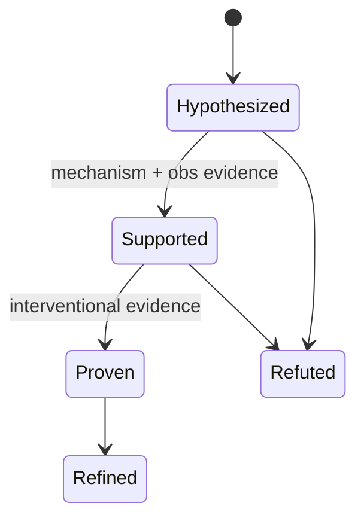
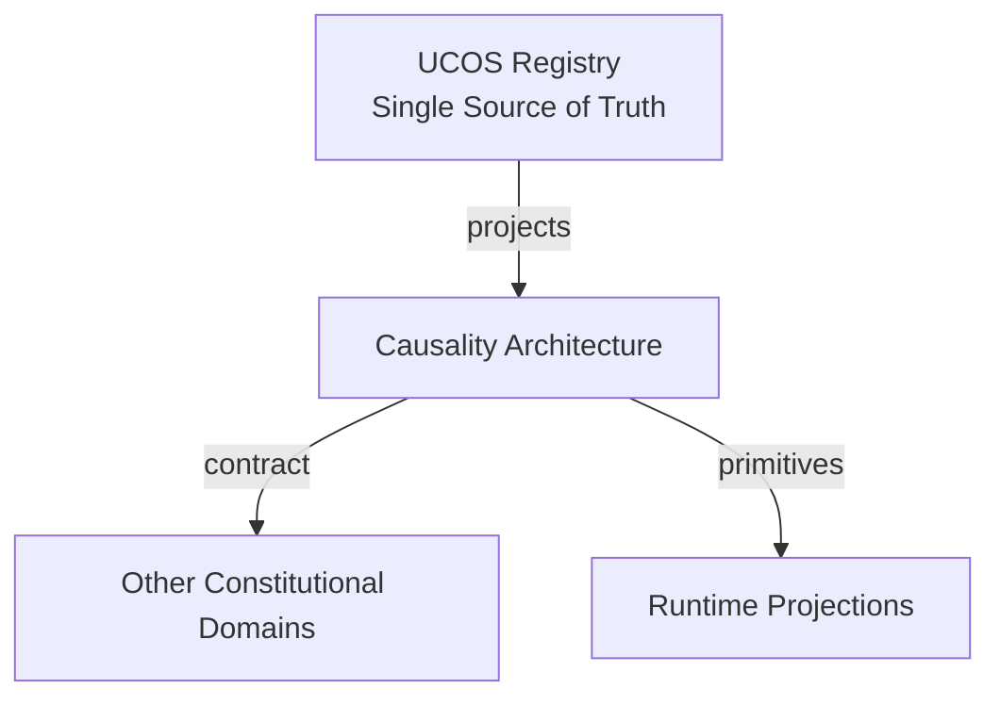
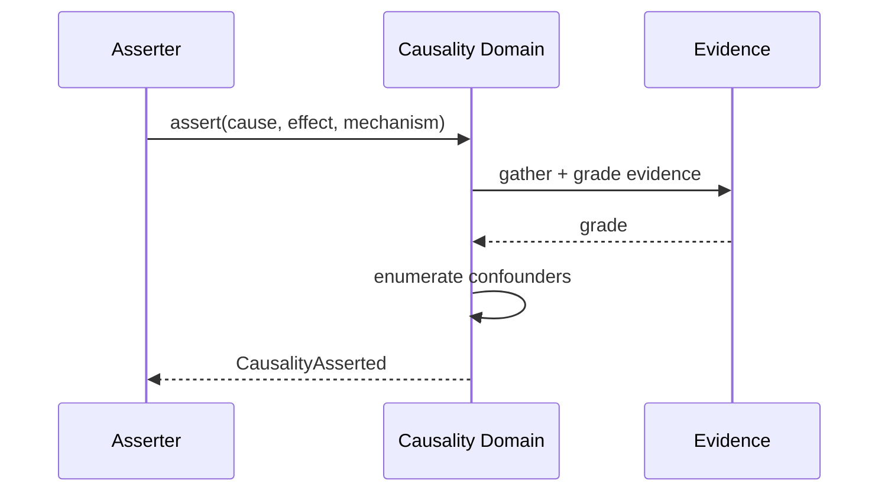
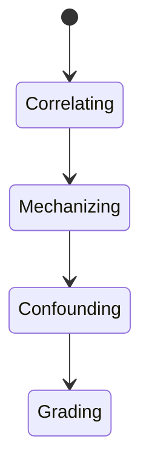
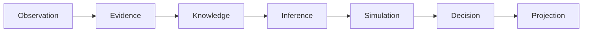
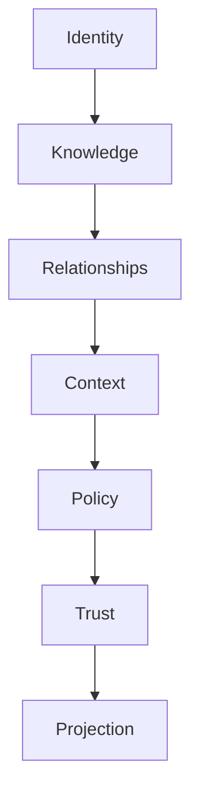

# UCOS-CAU-000001
# Causality Architecture

**Version:** Ω∞.1  |  **Status:** Constitutional Artifact  |  **Authority:** UCOS Ω∞ Constitutional Authority
**Category:** Core Domains  |  **Source of Truth:** `_registry/` (projected, never hand-authored)

> Constitutional notice: this document is a **projection**. Its truth lives in the registry. Editing this document directly violates Law 002 (Knowledge Once).

---

## 1. Executive Summary

**UCOS-CAU-000001 — Causality Architecture**

This artifact is a constitutionally governed, implementation-ready specification projected from the _UCOS Registry_ single source of truth.
It conforms to the _Immutable Primitive Registry_ (27 frozen primitives) and the _Canonical Terminology Registry_ (31 governed terms).
It contains no hardcoded business, industry, currency, country, or commerce concepts. All such concepts are runtime projections.

---

## 2. Constitutional Purpose

To define the binding contract for **Causality Architecture** such that:
- every concept it names has exactly one owner,
- every capability it exposes has exactly one boundary,
- every boundary is expressed as an explicit contract,
- every contract is enforceable by the Governance Constitution.

---

## 3. Scope

In scope: the primitives, contracts, schemas, events, and policies owned by **Causality Architecture**.
In scope: the projection rules by which this domain exposes its truth to other domains.
In scope: the verification obligations this domain must satisfy before activation.

---

## 4. Out of Scope

Out of scope: any concept owned by another constitutional domain.
Out of scope: business, industry, commerce, country, currency, or language content (all projected).
Out of scope: mutation of another domain’s internal state.

---

## 5. Definitions

All terms in this artifact are used in their canonical sense as defined in the Canonical Terminology Registry.
Where a term appears, its `termId` is normative and its `prohibitedMeanings` are void.

---

## 6. Canonical Terminology

| Term | Canonical Definition | Owner | Prohibited Meanings |
|---|---|---|---|
| Existence | Anything that may exist. | Universal Existence Kernel | business meaning, commercial meaning, operational meaning |
| Entity | Technical representation of an Existence Object. | Identity Domain | existence itself |
| Knowledge | Interpreted information with evidence and meaning. | Knowledge Domain | data, information, evidence |
| Data | Raw observations. | Observation Domain | knowledge, meaning |
| Information | Organized data. | Observation Domain | knowledge |
| Evidence | Proof supporting an assertion. | Evidence Domain | knowledge, trust |
| Trust | Computed confidence in an assertion, derived from evidence. | Trust Domain | evidence, faith |
| Meaning | Semantic interpretation; higher-level understanding. | Semantic Domain | classification, taxonomy, ontology |
| Ontology | What exists. | Semantic Domain | taxonomy, classification |
| Taxonomy | How things are classified. | Semantic Domain | ontology, meaning |
| Classification | Assignment into taxonomy. | Semantic Domain | meaning |
| Relationship | Connection between objects. | Relationship Domain | causality |

---

## 7. Ownership Boundaries

**Owner:** Causality Domain
**Owns:** Causality
**Boundary law:** no domain may modify, bypass, or reinterpret another domain’s internals. All interaction is via contract.

---

## 8. Domain Responsibilities

- Cause/Effect Tracking
- Impact Analysis
- Consequence Modeling

---

## 9. Domain Non-Responsibilities

- Relationship Storage
- Decision

---

## 10. Concepts

Causality is the reason one existence influences another. Causality ≠ Relationship: a link says 'connected'; causality says 'because'. Causal claims require intervention-grade evidence, not correlation.

---

## 11. Ontology

Causality has a Cause, an Effect, a Mechanism, and an Evidence grade. Claims are typed: Direct / Mediated / Contributory / Counterfactual.

---

## 12. Taxonomy

By strength: Proven (interventional) / Supported (observational + mechanism) / Hypothesized (correlational) / Refuted.

---

## 13. Registries

This domain is registry-driven. Its registries are entries in the Universal Registry System:

```yaml
RegistryEntry:
  registryId: UCOS-REG-CAUSALITY
  owner: Causality Domain
  law: Knowledge Once — each concept defined exactly once
```

---

## 14. Data Model

```yaml
Causality:
  causalityId: <Identity>
  cause: <Identity|Event>
  effect: <Identity|Event>
  mechanism: <registry id>
  evidenceGrade: <Proven|Supported|Hypothesized|Refuted>
  evidence: [<Evidence>]
  confounders: [<Identity>]
  context: <Context>
  trust: <Trust>
```

---

## 15. Graph Model

(:Cause)-[:CAUSES {mechanism, grade}]->(:Effect); (:Causality)-[:MEDIATED_BY]->(:Identity); (:Causality)-[:CONFOUNDED_BY]->(:Identity)

---

## 16. Schemas

```yaml
# Canonical projection schema for UCOS-CAU-000001
ucos_cau_000001:
  identity:      <Identity primitive>
  intent:        <Intent primitive>
  meaning:       <Meaning primitive>
  knowledge:     <Knowledge primitive>
  registry:      <Registry primitive>
  relationship:  <Relationship primitive>
  context:       <Context primitive>
  policy:        <Policy primitive>
  authority:     <Authority primitive>
  evidence:      <Evidence primitive>
  trust:         <Trust primitive>
  temporal:      <Time primitive>
  metadata:      <Metadata primitive>
```

---

## 17. Contracts

```yaml
DomainContract:
  domain: Causality
  commands:   []   # registry-driven
  queries:    []   # registry-driven
  events:     []   # registry-driven
  policies:   []   # registry-driven
  permissions: []  # registry-driven
```

Contract law: domains never directly access another domain’s internal structures.

---

## 18. APIs

POST /causality.v1.assert,GET  /causality.v1/{id},POST /causality.v1.explain,GET  /causality.v1.impact/{id}

---

## 19. Events

CausalityAsserted,CausalityRefined,CausalityRefuted,ImpactAssessed

---

## 20. Commands

causality.assert,causality.refine,causality.refute,causality.explain

---

## 21. Queries

causality.byId,causality.effectsOf,causality.causesOf,causality.impact,causality.byGrade

---

## 22. State Machines



---

## 23. Workflows

observe correlation → propose mechanism → rule out confounders → upgrade on interventional evidence → publish grade

---

## 24. Policies

```yaml
Policy:
  identity: <Identity>
  conditions: []   # registry-driven
  actions:    []   # registry-driven
  priorities: []   # registry-driven
  exceptions: []   # registry-driven
```

All behavior derives from policy. Policy ≠ Rule: policy is behavioral governance; the rule is its executable projection.

---

## 25. Rules

```yaml
Rule:
  ruleId: <Identity>
  derivedFrom: <Policy identity>
  executable: true
  constraint: <registry expression>
```

---

## 26. Authorities

Causality Authority (asserts under evidence standards); interventional claims require elevated authority.

---

## 27. Permissions

causality.assert (causality authority),causality.refute (peer authority),causality.read (context-scoped)

---

## 28. Security Model

Zero Trust applies: no implicit trust between domains, services, agents, or tenants.
Every call is authenticated, authorized against Policy, and evidenced.
Cryptographic identity is issued by the Identity Domain; keys by the Key Management Architecture.

---

## 29. Privacy Model

Causal claims over persons require aggregated or consented evidence; individual-level causal claims are prohibited without consent.

---

## 30. Trust Model

Trust is computed, never assumed. Inputs: evidence, authority, consistency, provenance, confidence.
```yaml
Trust:
  evidenceScore: <0..1>
  authorityScore: <0..1>
  consistencyScore: <0..1>
  provenanceScore: <0..1>
  confidenceScore: <0..1>
```

---

## 31. Audit Model

Every claim records evidence grade, confounders considered, and method. Correlational claims are never projected as causal.

---

## 32. Observability Model

Every action emits: What happened? Why? Who authorized it? Which policy allowed it? What evidence supports it? What confidence exists? What alternatives were evaluated?
These are the seven Explainability questions and are mandatory event fields.

---

## 33. Digital Twin Model

Causal models explain twin divergence and predict intervention outcomes on twins before reality is touched.

---

## 34. Agent Model

Causality Agent continuously downgrades unsupported claims and flags spurious correlations for review.

---

## 35. Runtime Model

Graph traversal for impact analysis; confounder sets computed at assert time and rechecked on related Knowledge change.

---

## 36. Scaling Model

Causal graphs are partitioned by subject; impact queries are bounded by policy depth.

---

## 37. Multi-Tenant Model

Causal claims never cross tenant boundaries without published relationship.

---

## 38. Geo-Distribution Model

Evidence standards are jurisdiction-aware; a claim Proven under one regime may be Supported elsewhere — both recorded.

---

## 39. Failure Model

Confounder omission, grade inflation, mechanism invalidation, cyclic causal claims.

---

## 40. Recovery Model

Claims are versioned; refutation supersedes rather than deletes, preserving the history of what was believed and why.

---

## 41. Verification Model

Before activation, Causality Architecture must pass identity, knowledge, relationship, context, policy, authority, trust, and reality integrity checks.
Verification is performed by the Formal Verification Architecture (UCOS-FML-000001).

---

## 42. Certification Model

Claim must pass mechanism validity, confounder enumeration, evidence-grade honesty, and acyclicity.

---

## 43. Migration Model

New mechanisms are registry additions; existing claims re-grade on mechanism version change.

---

## 44. Evolution Model

Evolution is governed and history-preserving. Primitives are frozen; extension occurs through registries, policies, capabilities, contexts, relationships, knowledge, agents, and projections — never through primitive expansion.

---

## 45. Implementation Blueprint

Build order for CAU: (1) define registry entries — this domain owns by strength: proven (interventional) / supported (observational + mechanism) / hypothesized (correlational) / refuted as registry truth, not code; (2) implement the contract surface first (causality.assert, causality.refine, causality.refute) and validate against CAU boundaries; (3) event-source all state so history is reconstructable; (4) wire the enforcement points — authority check, policy guard, evidence binding, trace — in-line, with no bypass path; (5) add tests per the Testing Architecture, citing evidence per gate; (6) obtain Verification and Certification before activation. Acceptance: the Zero Partial and Law 001 audits pass, every action answers the seven explainability questions, and this domain mutates no other domain internals.

---

## 46. Reference Architecture Diagram



---

## 47. Sequence Diagrams



---

## 48. State Diagrams



---

## 49. Data Flow Diagrams



---

## 50. Dependency Maps



Forbidden: circular dependencies, mutual ownership, cross-domain state mutation.

---

## ∞

Constitutionally governed. Implementation ready. Universally extensible.