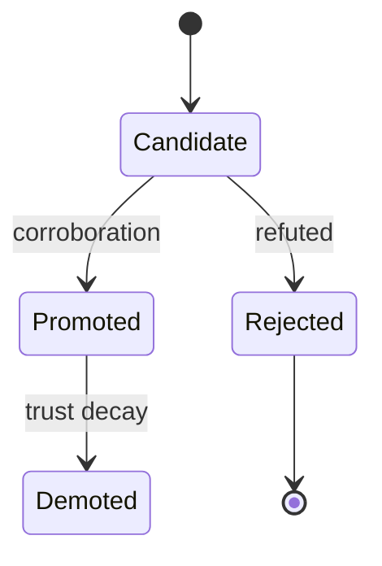
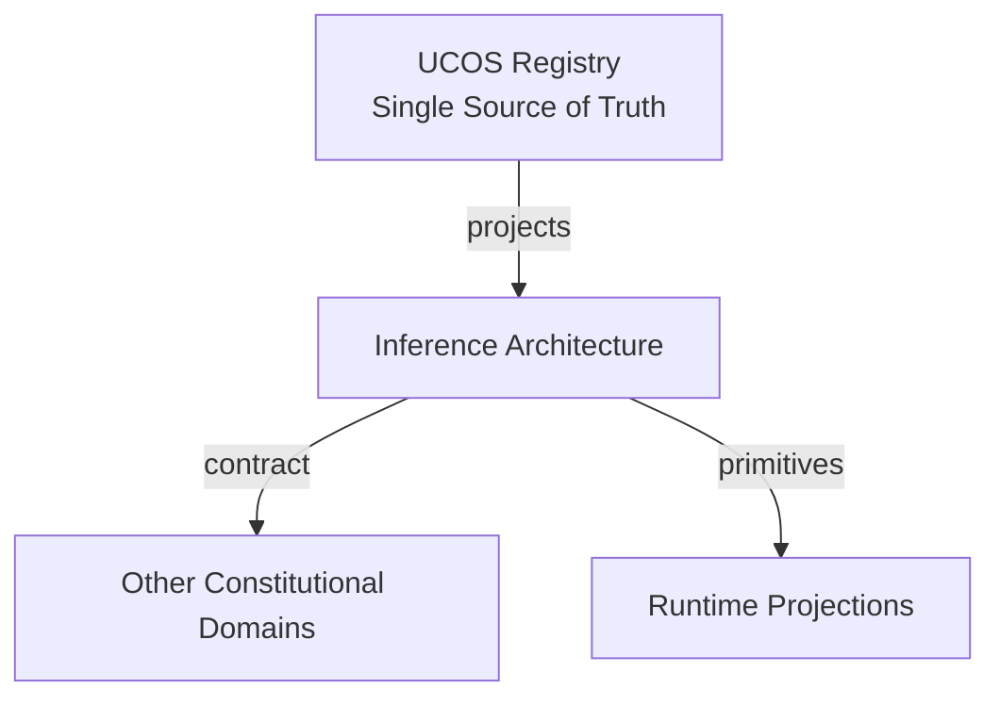
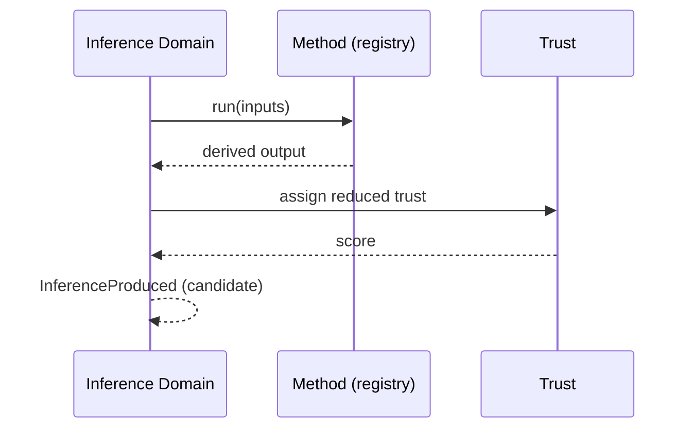
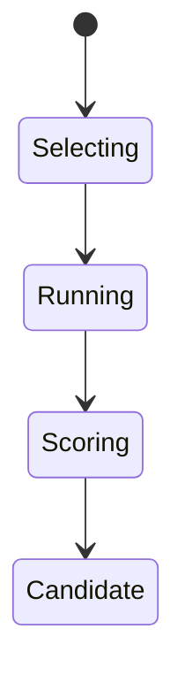
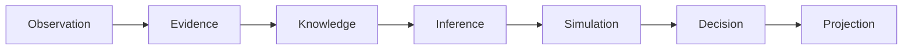
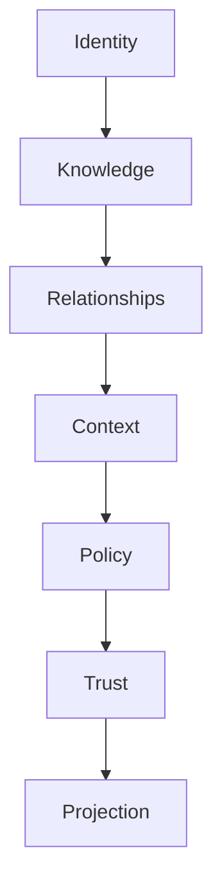

# UCOS-INF-000001
# Inference Architecture

**Version:** Ω∞.1  |  **Status:** Constitutional Artifact  |  **Authority:** UCOS Ω∞ Constitutional Authority
**Category:** Core Domains  |  **Source of Truth:** `_registry/` (projected, never hand-authored)

> Constitutional notice: this document is a **projection**. Its truth lives in the registry. Editing this document directly violates Law 002 (Knowledge Once).

---

## 1. Executive Summary

**UCOS-INF-000001 — Inference Architecture**

This artifact is a constitutionally governed, implementation-ready specification projected from the _UCOS Registry_ single source of truth.
It conforms to the _Immutable Primitive Registry_ (27 frozen primitives) and the _Canonical Terminology Registry_ (31 governed terms).
It contains no hardcoded business, industry, currency, country, or commerce concepts. All such concepts are runtime projections.

---

## 2. Constitutional Purpose

To define the binding contract for **Inference Architecture** such that:
- every concept it names has exactly one owner,
- every capability it exposes has exactly one boundary,
- every boundary is expressed as an explicit contract,
- every contract is enforceable by the Governance Constitution.

---

## 3. Scope

In scope: the primitives, contracts, schemas, events, and policies owned by **Inference Architecture**.
In scope: the projection rules by which this domain exposes its truth to other domains.
In scope: the verification obligations this domain must satisfy before activation.

---

## 4. Out of Scope

Out of scope: any concept owned by another constitutional domain.
Out of scope: business, industry, commerce, country, currency, or language content (all projected).
Out of scope: mutation of another domain’s internal state.

---

## 5. Definitions

All terms in this artifact are used in their canonical sense as defined in the Canonical Terminology Registry.
Where a term appears, its `termId` is normative and its `prohibitedMeanings` are void.

---

## 6. Canonical Terminology

| Term | Canonical Definition | Owner | Prohibited Meanings |
|---|---|---|---|
| Existence | Anything that may exist. | Universal Existence Kernel | business meaning, commercial meaning, operational meaning |
| Entity | Technical representation of an Existence Object. | Identity Domain | existence itself |
| Knowledge | Interpreted information with evidence and meaning. | Knowledge Domain | data, information, evidence |
| Data | Raw observations. | Observation Domain | knowledge, meaning |
| Information | Organized data. | Observation Domain | knowledge |
| Evidence | Proof supporting an assertion. | Evidence Domain | knowledge, trust |
| Trust | Computed confidence in an assertion, derived from evidence. | Trust Domain | evidence, faith |
| Meaning | Semantic interpretation; higher-level understanding. | Semantic Domain | classification, taxonomy, ontology |
| Ontology | What exists. | Semantic Domain | taxonomy, classification |
| Taxonomy | How things are classified. | Semantic Domain | ontology, meaning |
| Classification | Assignment into taxonomy. | Semantic Domain | meaning |
| Relationship | Connection between objects. | Relationship Domain | causality |

---

## 7. Ownership Boundaries

**Owner:** Inference Domain
**Owns:** Inference
**Boundary law:** no domain may modify, bypass, or reinterpret another domain’s internals. All interaction is via contract.

---

## 8. Domain Responsibilities

- Knowledge Discovery
- Relationship Discovery
- Pattern Discovery

---

## 9. Domain Non-Responsibilities

- Policy
- Authority
- Governance

---

## 10. Concepts

Inference is derived reality — discovery without explicit definition. Inference ≠ Observation: it is what was concluded, not what was sensed. Inferences carry lower trust by default and are always labeled as derived.

---

## 11. Ontology

Inference has a Method, input Observations/Knowledge, a derived output, and a Confidence. Methods: Statistical / Graph / Semantic / Causal / Neural / Hybrid — registry-driven.

---

## 12. Taxonomy

By output: New Relationship / New Knowledge / New Risk / New Capability / New Pattern. By method: Deductive-projected / Inductive / Abductive / Analogical.

---

## 13. Registries

This domain is registry-driven. Its registries are entries in the Universal Registry System:

```yaml
RegistryEntry:
  registryId: UCOS-REG-INFERENCE
  owner: Inference Domain
  law: Knowledge Once — each concept defined exactly once
```

---

## 14. Data Model

```yaml
Inference:
  inferenceId: <Identity>
  method: <registry id>
  inputs: [<Observation|Knowledge>]
  output: <Relationship|Knowledge|Risk|Pattern>
  confidence: <0..1>
  trust: <Trust, reduced by default>
  context: <Context>
  reproducible: <bool>
```

---

## 15. Graph Model

(:Inference)-[:DERIVED_FROM]->(:Observation|:Knowledge); (:Inference)-[:PRODUCED]->(:Relationship|:Knowledge); (:Inference)-[:METHOD]->(:RegistryEntry)

---

## 16. Schemas

```yaml
# Canonical projection schema for UCOS-INF-000001
ucos_inf_000001:
  identity:      <Identity primitive>
  intent:        <Intent primitive>
  meaning:       <Meaning primitive>
  knowledge:     <Knowledge primitive>
  registry:      <Registry primitive>
  relationship:  <Relationship primitive>
  context:       <Context primitive>
  policy:        <Policy primitive>
  authority:     <Authority primitive>
  evidence:      <Evidence primitive>
  trust:         <Trust primitive>
  temporal:      <Time primitive>
  metadata:      <Metadata primitive>
```

---

## 17. Contracts

```yaml
DomainContract:
  domain: Inference
  commands:   []   # registry-driven
  queries:    []   # registry-driven
  events:     []   # registry-driven
  policies:   []   # registry-driven
  permissions: []  # registry-driven
```

Contract law: domains never directly access another domain’s internal structures.

---

## 18. APIs

POST /inference.v1.run,GET  /inference.v1/{id},POST /inference.v1.promote,GET  /inference.v1.candidates

---

## 19. Events

InferenceProduced,InferencePromoted,InferenceRejected,InferenceConfidenceLow,InferenceReproduced

---

## 20. Commands

inference.run,inference.promote,inference.reject,inference.explain,inference.rerun

---

## 21. Queries

inference.byId,inference.candidates,inference.byMethod,inference.lowConfidence,inference.explain

---

## 22. State Machines



---

## 23. Workflows

select method → gather inputs within consent scope → run → assign reduced trust → present as candidate → promote on corroboration

---

## 24. Policies

```yaml
Policy:
  identity: <Identity>
  conditions: []   # registry-driven
  actions:    []   # registry-driven
  priorities: []   # registry-driven
  exceptions: []   # registry-driven
```

All behavior derives from policy. Policy ≠ Rule: policy is behavioral governance; the rule is its executable projection.

---

## 25. Rules

```yaml
Rule:
  ruleId: <Identity>
  derivedFrom: <Policy identity>
  executable: true
  constraint: <registry expression>
```

---

## 26. Authorities

Inference Authority (runs methods under governance),Promotion Authority (domain authority in output scope)

---

## 27. Permissions

inference.run (inference authority),inference.promote (domain authority),inference.read (context-scoped)

---

## 28. Security Model

Zero Trust applies: no implicit trust between domains, services, agents, or tenants.
Every call is authenticated, authorized against Policy, and evidenced.
Cryptographic identity is issued by the Identity Domain; keys by the Key Management Architecture.

---

## 29. Privacy Model

Inferences about persons are sensitive; no inference over personal data without consent scope covering the method's purpose.

---

## 30. Trust Model

Trust is computed, never assumed. Inputs: evidence, authority, consistency, provenance, confidence.
```yaml
Trust:
  evidenceScore: <0..1>
  authorityScore: <0..1>
  consistencyScore: <0..1>
  provenanceScore: <0..1>
  confidenceScore: <0..1>
```

---

## 31. Audit Model

Every inference records method, inputs, confidence, and is reproducible or void. Inferences are never presented as observations.

---

## 32. Observability Model

Every action emits: What happened? Why? Who authorized it? Which policy allowed it? What evidence supports it? What confidence exists? What alternatives were evaluated?
These are the seven Explainability questions and are mandatory event fields.

---

## 33. Digital Twin Model

Inference feeds Twins with predicted states, clearly separated from observed twin state.

---

## 34. Agent Model

Inference Agent is the primary autonomous discovery mechanism, governed by Agent Safety and the constitution.

---

## 35. Runtime Model

Methods are registry-dispatched plugins running in a sandbox with resource limits; outputs never mutate reality directly.

---

## 36. Scaling Model

Inference is a batch/stream job; candidates queue for promotion; hot methods are pre-warmed.

---

## 37. Multi-Tenant Model

Inferences never cross tenant boundaries; cross-tenant inference requires published relationship and policy.

---

## 38. Geo-Distribution Model

Inference over regulated data runs in-jurisdiction; method availability respects local regulation.

---

## 39. Failure Model

Method drift, input starvation, unreproducible output, confidence inflation.

---

## 40. Recovery Model

Inferences are re-derivable; promotion is reversible to candidate. Unreproducible inferences are auto-rejected.

---

## 41. Verification Model

Before activation, Inference Architecture must pass identity, knowledge, relationship, context, policy, authority, trust, and reality integrity checks.
Verification is performed by the Formal Verification Architecture (UCOS-FML-000001).

---

## 42. Certification Model

Inference must be reproducible, method-registered, consent-scoped, and below promotion threshold until corroborated.

---

## 43. Migration Model

New methods are registry additions; rerun on method version change.

---

## 44. Evolution Model

Evolution is governed and history-preserving. Primitives are frozen; extension occurs through registries, policies, capabilities, contexts, relationships, knowledge, agents, and projections — never through primitive expansion.

---

## 45. Implementation Blueprint

Build order for INF: (1) define registry entries — this domain owns by output: new relationship / new knowledge / new risk / new capability / new pattern as registry truth, not code; (2) implement the contract surface first (inference.run, inference.promote, inference.reject) and validate against INF boundaries; (3) event-source all state so history is reconstructable; (4) wire the enforcement points — authority check, policy guard, evidence binding, trace — in-line, with no bypass path; (5) add tests per the Testing Architecture, citing evidence per gate; (6) obtain Verification and Certification before activation. Acceptance: the Zero Partial and Law 001 audits pass, every action answers the seven explainability questions, and this domain mutates no other domain internals.

---

## 46. Reference Architecture Diagram



---

## 47. Sequence Diagrams



---

## 48. State Diagrams



---

## 49. Data Flow Diagrams



---

## 50. Dependency Maps



Forbidden: circular dependencies, mutual ownership, cross-domain state mutation.

---

## ∞

Constitutionally governed. Implementation ready. Universally extensible.