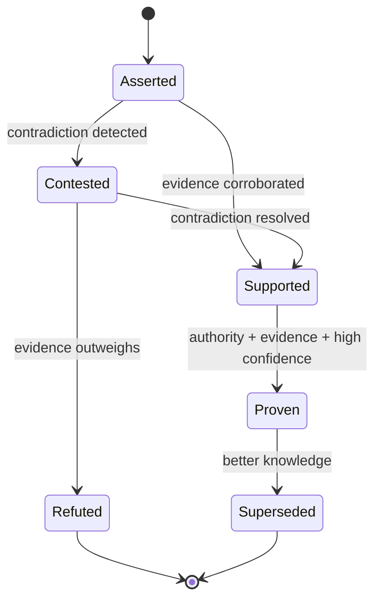
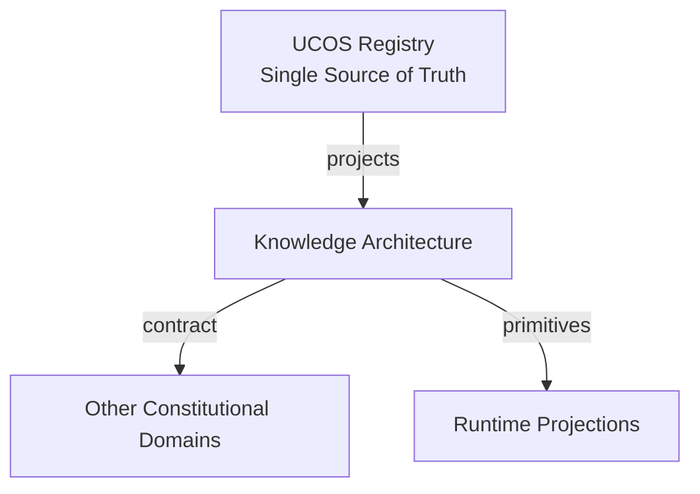
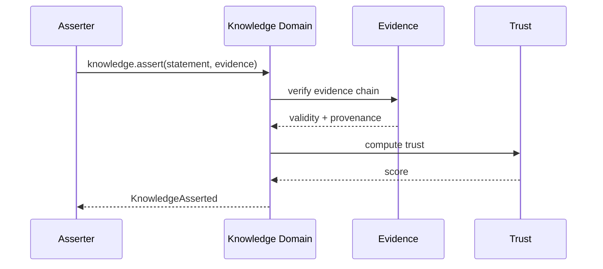
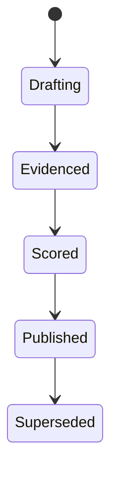
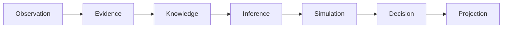
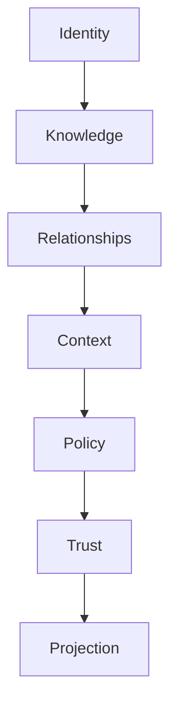

# UCOS-KNW-000001
# Knowledge Architecture

**Version:** Ω∞.1  |  **Status:** Constitutional Artifact  |  **Authority:** UCOS Ω∞ Constitutional Authority
**Category:** Core Domains  |  **Source of Truth:** `_registry/` (projected, never hand-authored)

> Constitutional notice: this document is a **projection**. Its truth lives in the registry. Editing this document directly violates Law 002 (Knowledge Once).

---

## 1. Executive Summary

**UCOS-KNW-000001 — Knowledge Architecture**

This artifact is a constitutionally governed, implementation-ready specification projected from the _UCOS Registry_ single source of truth.
It conforms to the _Immutable Primitive Registry_ (27 frozen primitives) and the _Canonical Terminology Registry_ (31 governed terms).
It contains no hardcoded business, industry, currency, country, or commerce concepts. All such concepts are runtime projections.

---

## 2. Constitutional Purpose

To define the binding contract for **Knowledge Architecture** such that:
- every concept it names has exactly one owner,
- every capability it exposes has exactly one boundary,
- every boundary is expressed as an explicit contract,
- every contract is enforceable by the Governance Constitution.

---

## 3. Scope

In scope: the primitives, contracts, schemas, events, and policies owned by **Knowledge Architecture**.
In scope: the projection rules by which this domain exposes its truth to other domains.
In scope: the verification obligations this domain must satisfy before activation.

---

## 4. Out of Scope

Out of scope: any concept owned by another constitutional domain.
Out of scope: business, industry, commerce, country, currency, or language content (all projected).
Out of scope: mutation of another domain’s internal state.

---

## 5. Definitions

All terms in this artifact are used in their canonical sense as defined in the Canonical Terminology Registry.
Where a term appears, its `termId` is normative and its `prohibitedMeanings` are void.

---

## 6. Canonical Terminology

| Term | Canonical Definition | Owner | Prohibited Meanings |
|---|---|---|---|
| Existence | Anything that may exist. | Universal Existence Kernel | business meaning, commercial meaning, operational meaning |
| Entity | Technical representation of an Existence Object. | Identity Domain | existence itself |
| Knowledge | Interpreted information with evidence and meaning. | Knowledge Domain | data, information, evidence |
| Data | Raw observations. | Observation Domain | knowledge, meaning |
| Information | Organized data. | Observation Domain | knowledge |
| Evidence | Proof supporting an assertion. | Evidence Domain | knowledge, trust |
| Trust | Computed confidence in an assertion, derived from evidence. | Trust Domain | evidence, faith |
| Meaning | Semantic interpretation; higher-level understanding. | Semantic Domain | classification, taxonomy, ontology |
| Ontology | What exists. | Semantic Domain | taxonomy, classification |
| Taxonomy | How things are classified. | Semantic Domain | ontology, meaning |
| Classification | Assignment into taxonomy. | Semantic Domain | meaning |
| Relationship | Connection between objects. | Relationship Domain | causality |

---

## 7. Ownership Boundaries

**Owner:** Knowledge Domain
**Owns:** Knowledge
**Boundary law:** no domain may modify, bypass, or reinterpret another domain’s internals. All interaction is via contract.

---

## 8. Domain Responsibilities

- Knowledge Creation
- Knowledge Validation
- Knowledge Provenance
- Knowledge Evolution

---

## 9. Domain Non-Responsibilities

- Identity
- Policy
- Authority

---

## 10. Concepts

Knowledge is validated understanding of reality — interpreted information with evidence and meaning. It is NOT data, NOT information, NOT evidence. It is derived from them. Every Knowledge element answers who asserted it, when, why, under which authority, based on what evidence, with what confidence.

---

## 11. Ontology

Knowledge ⊂ Existence. Knowledge requires ≥1 Evidence. Knowledge has 1 Authority. Knowledge has Confidence ∈ [0,1]. Knowledge Types: Fact / Assertion / Hypothesis / Model / Belief / PolicyAsKnowledge / Regulation / Learned / Derived / Future.

---

## 12. Taxonomy

By epistemic status: Proven / Supported / Contested / Refuted / Hypothetical. By source: Observed / Inferred / Asserted / Simulated. By volatility: Stable / Drifting / Volatile.

---

## 13. Registries

This domain is registry-driven. Its registries are entries in the Universal Registry System:

```yaml
RegistryEntry:
  registryId: UCOS-REG-KNOWLEDGE
  owner: Knowledge Domain
  law: Knowledge Once — each concept defined exactly once
```

---

## 14. Data Model

```yaml
Knowledge:
  knowledgeId: <Identity>
  type: <registry-driven type>
  assertion: <semantic statement>
  evidence: [<Evidence>]
  confidence: <0..1>
  provenance:
    assertedBy: <Authority>
    assertedAt: <Time>
    intent: <Intent>
  trust: <Trust>
  status: <Proven|Supported|Contested|Refuted|Hypothetical>
  supersededBy: <Knowledge|null>
```

---

## 15. Graph Model

(:Knowledge)-[:SUPPORTED_BY]->(:Evidence); (:Knowledge)-[:ASSERTED_BY]->(:Authority); (:Knowledge)-[:SUPERSEDES]->(:Knowledge); (:Knowledge)-[:ABOUT]->(:Identity); (:Knowledge)-[:DERIVED_FROM]->(:Observation)

---

## 16. Schemas

```yaml
# Canonical projection schema for UCOS-KNW-000001
ucos_knw_000001:
  identity:      <Identity primitive>
  intent:        <Intent primitive>
  meaning:       <Meaning primitive>
  knowledge:     <Knowledge primitive>
  registry:      <Registry primitive>
  relationship:  <Relationship primitive>
  context:       <Context primitive>
  policy:        <Policy primitive>
  authority:     <Authority primitive>
  evidence:      <Evidence primitive>
  trust:         <Trust primitive>
  temporal:      <Time primitive>
  metadata:      <Metadata primitive>
```

---

## 17. Contracts

```yaml
DomainContract:
  domain: Knowledge
  commands:   []   # registry-driven
  queries:    []   # registry-driven
  events:     []   # registry-driven
  policies:   []   # registry-driven
  permissions: []  # registry-driven
```

Contract law: domains never directly access another domain’s internal structures.

---

## 18. APIs

POST /knowledge.v1.assert,GET  /knowledge.v1/{id},POST /knowledge.v1/{id}/contest,GET  /knowledge.v1.query,POST /knowledge.v1/{id}/supersede

---

## 19. Events

KnowledgeAsserted,KnowledgeContested,KnowledgeSuperseded,KnowledgeRefuted,KnowledgeConfidenceDrifted,KnowledgeRevalidated

---

## 20. Commands

knowledge.assert,knowledge.contest,knowledge.supersede,knowledge.refute,knowledge.revalidate,knowledge.purge

---

## 21. Queries

knowledge.byId,knowledge.about,knowledge.byEvidence,knowledge.contested,knowledge.lineage,knowledge.confidenceHistogram

---

## 22. State Machines



---

## 23. Workflows

assert → evidence binding → trust computation → contradiction check → (contest | promote) → publish event

---

## 24. Policies

```yaml
Policy:
  identity: <Identity>
  conditions: []   # registry-driven
  actions:    []   # registry-driven
  priorities: []   # registry-driven
  exceptions: []   # registry-driven
```

All behavior derives from policy. Policy ≠ Rule: policy is behavioral governance; the rule is its executable projection.

---

## 25. Rules

```yaml
Rule:
  ruleId: <Identity>
  derivedFrom: <Policy identity>
  executable: true
  constraint: <registry expression>
```

---

## 26. Authorities

Domain Authority (asserts within jurisdiction),Peer Authority (contests),Platform Authority (purge)

---

## 27. Permissions

knowledge.assert (authenticated + scoped),knowledge.contest (peer authority),knowledge.purge (platform authority only)

---

## 28. Security Model

Zero Trust applies: no implicit trust between domains, services, agents, or tenants.
Every call is authenticated, authorized against Policy, and evidenced.
Cryptographic identity is issued by the Identity Domain; keys by the Key Management Architecture.

---

## 29. Privacy Model

Assertions about persons require consent scope `knowledge:assert:pii`. Evidence retention follows the Consent Architecture; purge is a first-class command, not an afterthought.

---

## 30. Trust Model

Trust is computed, never assumed. Inputs: evidence, authority, consistency, provenance, confidence.
```yaml
Trust:
  evidenceScore: <0..1>
  authorityScore: <0..1>
  consistencyScore: <0..1>
  provenanceScore: <0..1>
  confidenceScore: <0..1>
```

---

## 31. Audit Model

The seven explainability questions are mandatory fields. Knowledge chain is append-only; refutation never deletes — it supersedes, preserving history.

---

## 32. Observability Model

Every action emits: What happened? Why? Who authorized it? Which policy allowed it? What evidence supports it? What confidence exists? What alternatives were evaluated?
These are the seven Explainability questions and are mandatory event fields.

---

## 33. Digital Twin Model

Knowledge Twin tracks the real-world truth state of the subject (e.g., a regulation's enactment status) and flags drift between asserted and observed reality.

---

## 34. Agent Model

Knowledge Agent continuously revalidates drifting knowledge, detects contradictions, and proposes supersessions under governance.

---

## 35. Runtime Model

Write path is evidence-verified before commit; read path serves the current non-superseded head per query context.

---

## 36. Scaling Model

Partition by subject Identity. Confidence computation is a read-side projection cached per (Knowledge, Context). Contradiction detection is a stream job.

---

## 37. Multi-Tenant Model

Knowledge is tenant-scoped unless explicitly published to a shared ontology. Cross-tenant assertion requires a Relationship + Policy.

---

## 38. Geo-Distribution Model

Regulatory knowledge is jurisdiction-scoped; the same assertion may be Proven in one jurisdiction and Contested in another — both remain valid within Context.

---

## 39. Failure Model

Evidence detachment, confidence drift beyond threshold, authority revocation mid-attestation, contradiction avalanche.

---

## 40. Recovery Model

Never delete: supersede. Recovery = rebuild current-head projection from the append-only chain. Purge is governance-gated and leaves a tombstone.

---

## 41. Verification Model

Before activation, Knowledge Architecture must pass identity, knowledge, relationship, context, policy, authority, trust, and reality integrity checks.
Verification is performed by the Formal Verification Architecture (UCOS-FML-000001).

---

## 42. Certification Model

Knowledge must carry ≥1 evidence, an active authority, and a computed trust score above domain threshold to be read as Proven.

---

## 43. Migration Model

Knowledge schema evolves by adding types to the registry; existing assertions are re-projected, never rewritten.

---

## 44. Evolution Model

Evolution is governed and history-preserving. Primitives are frozen; extension occurs through registries, policies, capabilities, contexts, relationships, knowledge, agents, and projections — never through primitive expansion.

---

## 45. Implementation Blueprint

Build order for KNW: (1) define registry entries — this domain owns by epistemic status: proven / supported / contested / refuted / hypothetical as registry truth, not code; (2) implement the contract surface first (knowledge.assert, knowledge.contest, knowledge.supersede) and validate against KNW boundaries; (3) event-source all state so history is reconstructable; (4) wire the enforcement points — authority check, policy guard, evidence binding, trace — in-line, with no bypass path; (5) add tests per the Testing Architecture, citing evidence per gate; (6) obtain Verification and Certification before activation. Acceptance: the Zero Partial and Law 001 audits pass, every action answers the seven explainability questions, and this domain mutates no other domain internals.

---

## 46. Reference Architecture Diagram



---

## 47. Sequence Diagrams



---

## 48. State Diagrams



---

## 49. Data Flow Diagrams



---

## 50. Dependency Maps



Forbidden: circular dependencies, mutual ownership, cross-domain state mutation.

---

## ∞

Constitutionally governed. Implementation ready. Universally extensible.