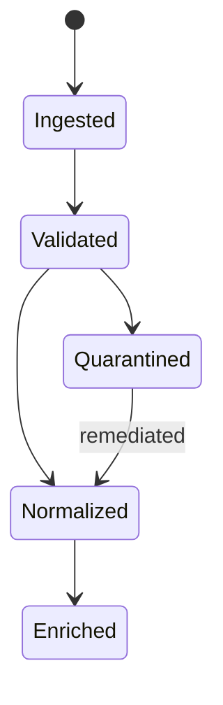
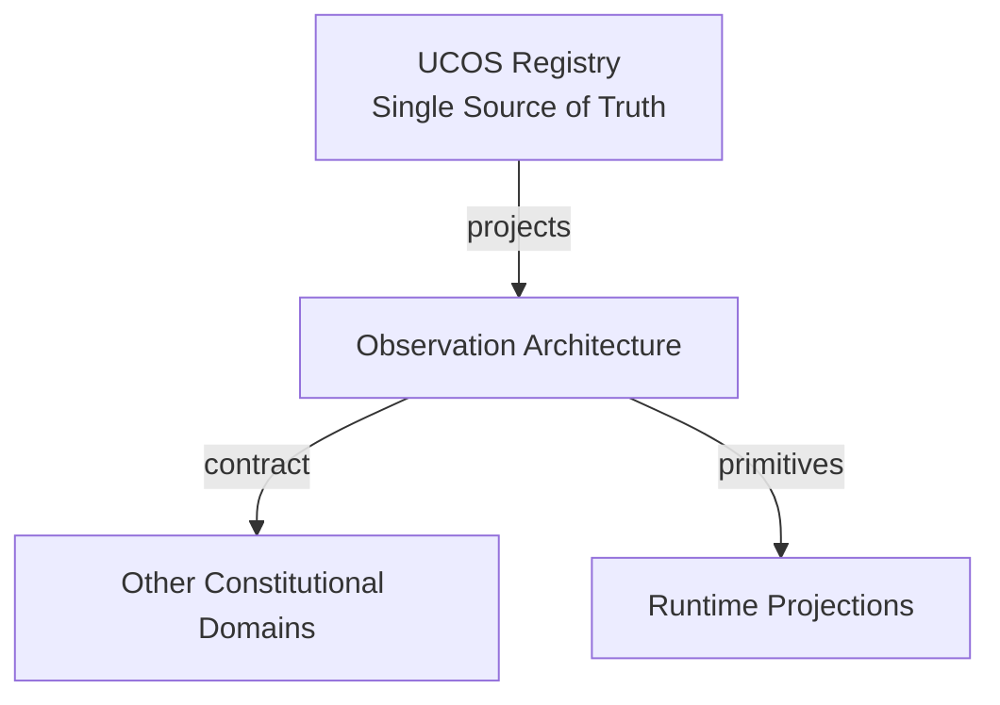
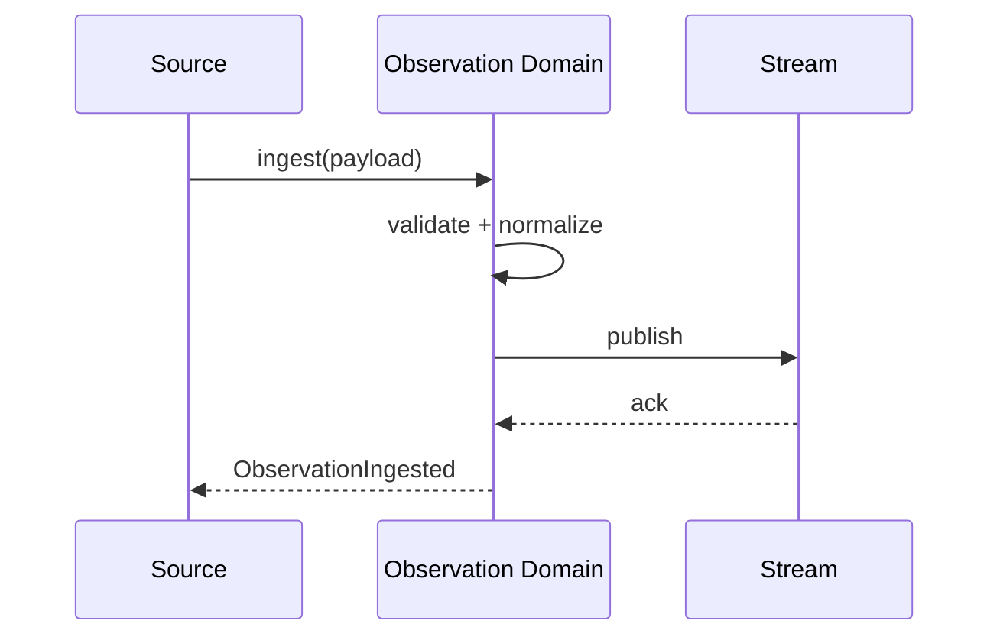
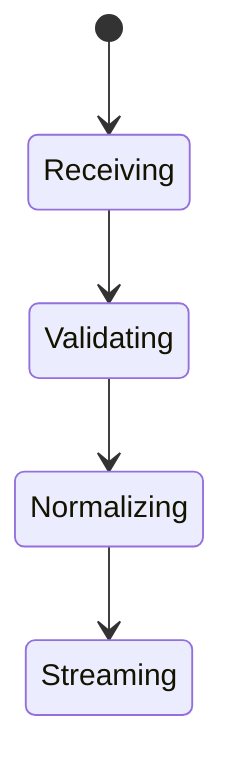
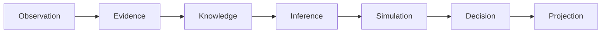
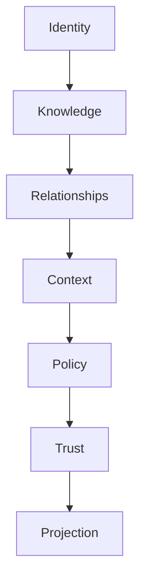

# UCOS-OBS-000001
# Observation Architecture

**Version:** Ω∞.1  |  **Status:** Constitutional Artifact  |  **Authority:** UCOS Ω∞ Constitutional Authority
**Category:** Core Domains  |  **Source of Truth:** `_registry/` (projected, never hand-authored)

> Constitutional notice: this document is a **projection**. Its truth lives in the registry. Editing this document directly violates Law 002 (Knowledge Once).

---

## 1. Executive Summary

**UCOS-OBS-000001 — Observation Architecture**

This artifact is a constitutionally governed, implementation-ready specification projected from the _UCOS Registry_ single source of truth.
It conforms to the _Immutable Primitive Registry_ (27 frozen primitives) and the _Canonical Terminology Registry_ (31 governed terms).
It contains no hardcoded business, industry, currency, country, or commerce concepts. All such concepts are runtime projections.

---

## 2. Constitutional Purpose

To define the binding contract for **Observation Architecture** such that:
- every concept it names has exactly one owner,
- every capability it exposes has exactly one boundary,
- every boundary is expressed as an explicit contract,
- every contract is enforceable by the Governance Constitution.

---

## 3. Scope

In scope: the primitives, contracts, schemas, events, and policies owned by **Observation Architecture**.
In scope: the projection rules by which this domain exposes its truth to other domains.
In scope: the verification obligations this domain must satisfy before activation.

---

## 4. Out of Scope

Out of scope: any concept owned by another constitutional domain.
Out of scope: business, industry, commerce, country, currency, or language content (all projected).
Out of scope: mutation of another domain’s internal state.

---

## 5. Definitions

All terms in this artifact are used in their canonical sense as defined in the Canonical Terminology Registry.
Where a term appears, its `termId` is normative and its `prohibitedMeanings` are void.

---

## 6. Canonical Terminology

| Term | Canonical Definition | Owner | Prohibited Meanings |
|---|---|---|---|
| Existence | Anything that may exist. | Universal Existence Kernel | business meaning, commercial meaning, operational meaning |
| Entity | Technical representation of an Existence Object. | Identity Domain | existence itself |
| Knowledge | Interpreted information with evidence and meaning. | Knowledge Domain | data, information, evidence |
| Data | Raw observations. | Observation Domain | knowledge, meaning |
| Information | Organized data. | Observation Domain | knowledge |
| Evidence | Proof supporting an assertion. | Evidence Domain | knowledge, trust |
| Trust | Computed confidence in an assertion, derived from evidence. | Trust Domain | evidence, faith |
| Meaning | Semantic interpretation; higher-level understanding. | Semantic Domain | classification, taxonomy, ontology |
| Ontology | What exists. | Semantic Domain | taxonomy, classification |
| Taxonomy | How things are classified. | Semantic Domain | ontology, meaning |
| Classification | Assignment into taxonomy. | Semantic Domain | meaning |
| Relationship | Connection between objects. | Relationship Domain | causality |

---

## 7. Ownership Boundaries

**Owner:** Observation Domain
**Owns:** Observation
**Boundary law:** no domain may modify, bypass, or reinterpret another domain’s internals. All interaction is via contract.

---

## 8. Domain Responsibilities

- Capture
- Collection
- Measurement

---

## 9. Domain Non-Responsibilities

- Inference
- Reasoning
- Decision Making

---

## 10. Concepts

Observation is captured reality at a point in time. Observation ≠ Inference: it is what was sensed, never what was derived. Observations are the raw feed from which Knowledge, Trust, and Twins derive.

---

## 11. Ontology

Observation has a Source, a captured Payload, a Timestamp, and a Context. Sources: Transactions, Logs, Events, Documents, Images, Video, Voice, IoT, External APIs, Human Inputs, Agent Inputs — all registry-driven and extensible.

---

## 12. Taxonomy

By source: Machine / Human / Agent / External. By nature: Discrete / Continuous / Composite. By fidelity: Raw / Normalized / Enriched.

---

## 13. Registries

This domain is registry-driven. Its registries are entries in the Universal Registry System:

```yaml
RegistryEntry:
  registryId: UCOS-REG-OBSERVATION
  owner: Observation Domain
  law: Knowledge Once — each concept defined exactly once
```

---

## 14. Data Model

```yaml
Observation:
  observationId: <Identity>
  source: <Identity>
  sourceType: <registry id>
  capturedAt: <Time>
  context: <Context>
  payload: <content-addressed>
  fidelity: <Raw|Normalized|Enriched>
  metadata: <Metadata>
```

---

## 15. Graph Model

(:Observation)-[:CAPTURED_BY]->(:Identity); (:Observation)-[:OBSERVED_IN]->(:Context); (:Observation)-[:FEEDS]->(:Evidence|:Knowledge|:Twin)

---

## 16. Schemas

```yaml
# Canonical projection schema for UCOS-OBS-000001
ucos_obs_000001:
  identity:      <Identity primitive>
  intent:        <Intent primitive>
  meaning:       <Meaning primitive>
  knowledge:     <Knowledge primitive>
  registry:      <Registry primitive>
  relationship:  <Relationship primitive>
  context:       <Context primitive>
  policy:        <Policy primitive>
  authority:     <Authority primitive>
  evidence:      <Evidence primitive>
  trust:         <Trust primitive>
  temporal:      <Time primitive>
  metadata:      <Metadata primitive>
```

---

## 17. Contracts

```yaml
DomainContract:
  domain: Observation
  commands:   []   # registry-driven
  queries:    []   # registry-driven
  events:     []   # registry-driven
  policies:   []   # registry-driven
  permissions: []  # registry-driven
```

Contract law: domains never directly access another domain’s internal structures.

---

## 18. APIs

POST /observation.v1.ingest,GET  /observation.v1/{id},POST /observation.v1.query,GET  /observation.v1.stream

---

## 19. Events

ObservationIngested,ObservationNormalized,ObservationEnriched,ObservationQuarantined,ObservationReplayed

---

## 20. Commands

observation.ingest,observation.normalize,observation.enrich,observation.replay,observation.quarantine

---

## 21. Queries

observation.byId,observation.bySource,observation.byTimeWindow,observation.byContext,observation.stream

---

## 22. State Machines



---

## 23. Workflows

ingest → schema-validate against source type → normalize → enrich with context → publish to stream → persist content-addressed

---

## 24. Policies

```yaml
Policy:
  identity: <Identity>
  conditions: []   # registry-driven
  actions:    []   # registry-driven
  priorities: []   # registry-driven
  exceptions: []   # registry-driven
```

All behavior derives from policy. Policy ≠ Rule: policy is behavioral governance; the rule is its executable projection.

---

## 25. Rules

```yaml
Rule:
  ruleId: <Identity>
  derivedFrom: <Policy identity>
  executable: true
  constraint: <registry expression>
```

---

## 26. Authorities

Source Authority (authorized ingest endpoint),Platform Authority (quarantine release)

---

## 27. Permissions

observation.ingest (authorized source),observation.read (context-scoped),observation.quarantine (platform authority)

---

## 28. Security Model

Zero Trust applies: no implicit trust between domains, services, agents, or tenants.
Every call is authenticated, authorized against Policy, and evidenced.
Cryptographic identity is issued by the Identity Domain; keys by the Key Management Architecture.

---

## 29. Privacy Model

Observations of persons are privacy-sensitive by default; enrichment of personal data requires consent scope and purpose limitation.

---

## 30. Trust Model

Trust is computed, never assumed. Inputs: evidence, authority, consistency, provenance, confidence.
```yaml
Trust:
  evidenceScore: <0..1>
  authorityScore: <0..1>
  consistencyScore: <0..1>
  provenanceScore: <0..1>
  confidenceScore: <0..1>
```

---

## 31. Audit Model

Every ingest records source, timestamp, context, and validation outcome. Quarantine reasons are mandatory and reviewable.

---

## 32. Observability Model

Every action emits: What happened? Why? Who authorized it? Which policy allowed it? What evidence supports it? What confidence exists? What alternatives were evaluated?
These are the seven Explainability questions and are mandatory event fields.

---

## 33. Digital Twin Model

Observation is the primary synchronization feed into Digital Twins — the 'reality' side of the twin loop.

---

## 34. Agent Model

Observation Agent detects anomalies, drift, and source degradation, quarantining suspicious feeds under governance.

---

## 35. Runtime Model

Ingest is a high-throughput append-only stream; enrichment is a pipeline stage; replay is first-class for recovery.

---

## 36. Scaling Model

Partition by source and time bucket; retention is policy-driven per source type; cold storage is registry-configured.

---

## 37. Multi-Tenant Model

Observations are tenant-scoped at ingest; a source cannot write into another tenant's stream.

---

## 38. Geo-Distribution Model

Ingest endpoints are region-local for latency; residency follows the source's Context, enforced at write time.

---

## 39. Failure Model

Schema violation, source spoofing, backpressure overload, clock skew, duplicate ingest.

---

## 40. Recovery Model

Idempotent ingest via source-assigned sequence numbers; replay rebuilds downstream projections exactly.

---

## 41. Verification Model

Before activation, Observation Architecture must pass identity, knowledge, relationship, context, policy, authority, trust, and reality integrity checks.
Verification is performed by the Formal Verification Architecture (UCOS-FML-000001).

---

## 42. Certification Model

Observation must pass source authorization, schema validity, timestamp sanity, and context binding.

---

## 43. Migration Model

New source types are registry additions; the ingest pipeline dispatches by type without code change.

---

## 44. Evolution Model

Evolution is governed and history-preserving. Primitives are frozen; extension occurs through registries, policies, capabilities, contexts, relationships, knowledge, agents, and projections — never through primitive expansion.

---

## 45. Implementation Blueprint

Build order for OBS: (1) define registry entries — this domain owns by source: machine / human / agent / external as registry truth, not code; (2) implement the contract surface first (observation.ingest, observation.normalize, observation.enrich) and validate against OBS boundaries; (3) event-source all state so history is reconstructable; (4) wire the enforcement points — authority check, policy guard, evidence binding, trace — in-line, with no bypass path; (5) add tests per the Testing Architecture, citing evidence per gate; (6) obtain Verification and Certification before activation. Acceptance: the Zero Partial and Law 001 audits pass, every action answers the seven explainability questions, and this domain mutates no other domain internals.

---

## 46. Reference Architecture Diagram



---

## 47. Sequence Diagrams



---

## 48. State Diagrams



---

## 49. Data Flow Diagrams



---

## 50. Dependency Maps



Forbidden: circular dependencies, mutual ownership, cross-domain state mutation.

---

## ∞

Constitutionally governed. Implementation ready. Universally extensible.