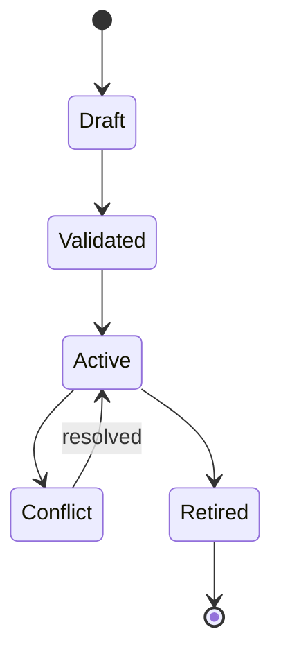
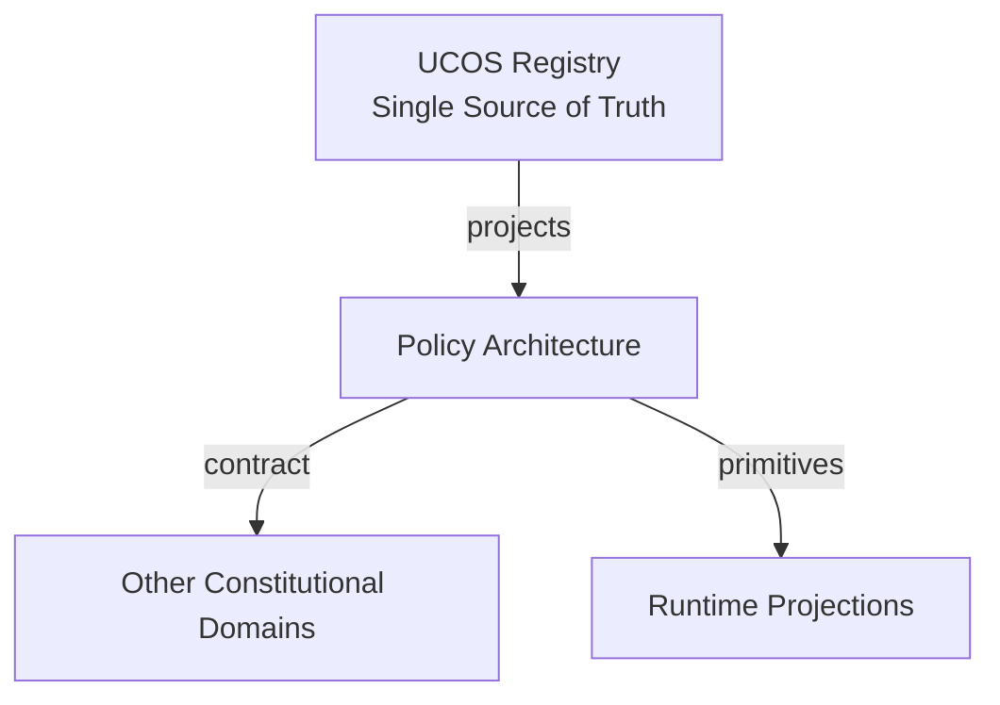
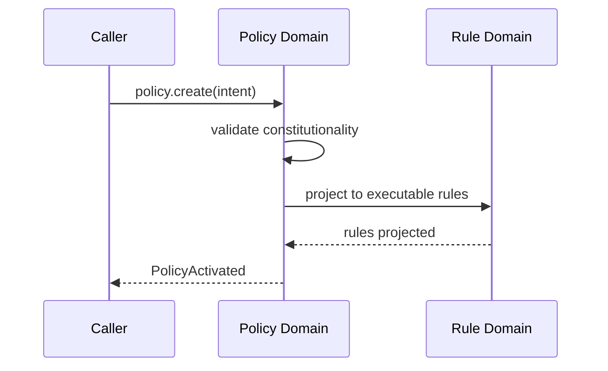
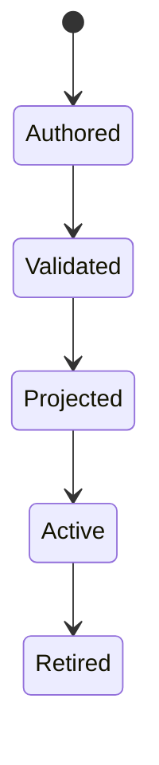
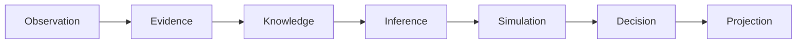
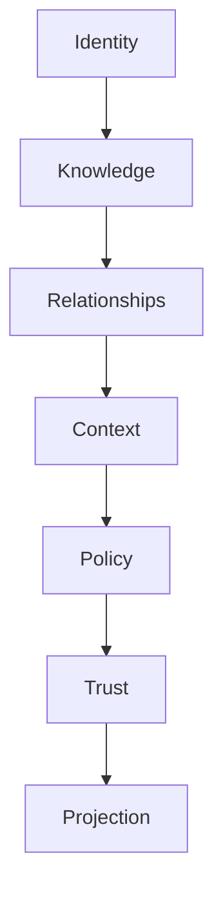

# UCOS-POL-000001
# Policy Architecture

**Version:** Ω∞.1  |  **Status:** Constitutional Artifact  |  **Authority:** UCOS Ω∞ Constitutional Authority
**Category:** Core Domains  |  **Source of Truth:** `_registry/` (projected, never hand-authored)

> Constitutional notice: this document is a **projection**. Its truth lives in the registry. Editing this document directly violates Law 002 (Knowledge Once).

---

## 1. Executive Summary

**UCOS-POL-000001 — Policy Architecture**

This artifact is a constitutionally governed, implementation-ready specification projected from the _UCOS Registry_ single source of truth.
It conforms to the _Immutable Primitive Registry_ (27 frozen primitives) and the _Canonical Terminology Registry_ (31 governed terms).
It contains no hardcoded business, industry, currency, country, or commerce concepts. All such concepts are runtime projections.

---

## 2. Constitutional Purpose

To define the binding contract for **Policy Architecture** such that:
- every concept it names has exactly one owner,
- every capability it exposes has exactly one boundary,
- every boundary is expressed as an explicit contract,
- every contract is enforceable by the Governance Constitution.

---

## 3. Scope

In scope: the primitives, contracts, schemas, events, and policies owned by **Policy Architecture**.
In scope: the projection rules by which this domain exposes its truth to other domains.
In scope: the verification obligations this domain must satisfy before activation.

---

## 4. Out of Scope

Out of scope: any concept owned by another constitutional domain.
Out of scope: business, industry, commerce, country, currency, or language content (all projected).
Out of scope: mutation of another domain’s internal state.

---

## 5. Definitions

All terms in this artifact are used in their canonical sense as defined in the Canonical Terminology Registry.
Where a term appears, its `termId` is normative and its `prohibitedMeanings` are void.

---

## 6. Canonical Terminology

| Term | Canonical Definition | Owner | Prohibited Meanings |
|---|---|---|---|
| Existence | Anything that may exist. | Universal Existence Kernel | business meaning, commercial meaning, operational meaning |
| Entity | Technical representation of an Existence Object. | Identity Domain | existence itself |
| Knowledge | Interpreted information with evidence and meaning. | Knowledge Domain | data, information, evidence |
| Data | Raw observations. | Observation Domain | knowledge, meaning |
| Information | Organized data. | Observation Domain | knowledge |
| Evidence | Proof supporting an assertion. | Evidence Domain | knowledge, trust |
| Trust | Computed confidence in an assertion, derived from evidence. | Trust Domain | evidence, faith |
| Meaning | Semantic interpretation; higher-level understanding. | Semantic Domain | classification, taxonomy, ontology |
| Ontology | What exists. | Semantic Domain | taxonomy, classification |
| Taxonomy | How things are classified. | Semantic Domain | ontology, meaning |
| Classification | Assignment into taxonomy. | Semantic Domain | meaning |
| Relationship | Connection between objects. | Relationship Domain | causality |

---

## 7. Ownership Boundaries

**Owner:** Policy Domain
**Owns:** Policy
**Boundary law:** no domain may modify, bypass, or reinterpret another domain’s internals. All interaction is via contract.

---

## 8. Domain Responsibilities

- Behavior
- Governance
- Enforcement

---

## 9. Domain Non-Responsibilities

- Knowledge
- Meaning
- Identity

---

## 10. Concepts

Policy is behavioral governance — the statement of what must, may, or must not happen. Policy ≠ Rule: policy is intent; the rule is its executable projection. All behavior derives from policy. Nothing executes that policy does not permit.

---

## 11. Ontology

Policy has Conditions, Actions, Priorities, Exceptions, and an Authority. Policy is resolved within a Context. Policy projects into Rules. Policy never executes directly — that is the Rule Domain's role.

---

## 12. Taxonomy

By force: Mandatory / Permissive / Prohibitive. By scope: Universal / Jurisdictional / Contextual / Instance. By origin: Constitutional / Regulatory / Organizational / Learned.

---

## 13. Registries

This domain is registry-driven. Its registries are entries in the Universal Registry System:

```yaml
RegistryEntry:
  registryId: UCOS-REG-POLICY
  owner: Policy Domain
  law: Knowledge Once — each concept defined exactly once
```

---

## 14. Data Model

```yaml
Policy:
  policyId: <Identity>
  intent: <Intent>
  conditions: [<registry expression>]
  actions: [<registry action>]
  priorities: [<int>]
  exceptions: [<Policy exception>]
  authority: <Authority>
  context: [<Context>]
  temporal: {effectiveFrom, effectiveTo}
  status: <Draft|Active|Retired>
```

---

## 15. Graph Model

(:Policy)-[:PROJECTS_TO]->(:Rule); (:Policy)-[:ENFORCED_IN]->(:Context); (:Policy)-[:GRANTED_BY]->(:Authority); (:Policy)-[:EXCEPTIONS]->(:Policy)

---

## 16. Schemas

```yaml
# Canonical projection schema for UCOS-POL-000001
ucos_pol_000001:
  identity:      <Identity primitive>
  intent:        <Intent primitive>
  meaning:       <Meaning primitive>
  knowledge:     <Knowledge primitive>
  registry:      <Registry primitive>
  relationship:  <Relationship primitive>
  context:       <Context primitive>
  policy:        <Policy primitive>
  authority:     <Authority primitive>
  evidence:      <Evidence primitive>
  trust:         <Trust primitive>
  temporal:      <Time primitive>
  metadata:      <Metadata primitive>
```

---

## 17. Contracts

```yaml
DomainContract:
  domain: Policy
  commands:   []   # registry-driven
  queries:    []   # registry-driven
  events:     []   # registry-driven
  policies:   []   # registry-driven
  permissions: []  # registry-driven
```

Contract law: domains never directly access another domain’s internal structures.

---

## 18. APIs

POST /policy.v1.create,POST /policy.v1.activate,POST /policy.v1.evaluate,GET  /policy.v1/{id},POST /policy.v1/{id}/retire

---

## 19. Events

PolicyCreated,PolicyActivated,PolicyRetired,PolicyEvaluated,PolicyConflictDetected,PolicyProjectionUpdated

---

## 20. Commands

policy.create,policy.activate,policy.retire,policy.evaluate,policy.exception.add,policy.conflict.resolve

---

## 21. Queries

policy.byId,policy.effectiveIn,policy.applicableTo,policy.conflicts,policy.projectionStatus

---

## 22. State Machines



---

## 23. Workflows

author intent → validate against constitution → detect conflicts → project to Rules → activate → publish → re-project on change

---

## 24. Policies

```yaml
Policy:
  identity: <Identity>
  conditions: []   # registry-driven
  actions:    []   # registry-driven
  priorities: []   # registry-driven
  exceptions: []   # registry-driven
```

All behavior derives from policy. Policy ≠ Rule: policy is behavioral governance; the rule is its executable projection.

---

## 25. Rules

```yaml
Rule:
  ruleId: <Identity>
  derivedFrom: <Policy identity>
  executable: true
  constraint: <registry expression>
```

---

## 26. Authorities

Constitutional Authority (supreme),Jurisdiction Authority (regional),Context Authority (scoped)

---

## 27. Permissions

policy.create (authority in scope),policy.activate (same or higher authority),policy.evaluate (any authenticated, result scoped)

---

## 28. Security Model

Zero Trust applies: no implicit trust between domains, services, agents, or tenants.
Every call is authenticated, authorized against Policy, and evidenced.
Cryptographic identity is issued by the Identity Domain; keys by the Key Management Architecture.

---

## 29. Privacy Model

Policies governing personal data must reference a lawful basis via the Consent Architecture; purpose limitation is a first-class condition.

---

## 30. Trust Model

Trust is computed, never assumed. Inputs: evidence, authority, consistency, provenance, confidence.
```yaml
Trust:
  evidenceScore: <0..1>
  authorityScore: <0..1>
  consistencyScore: <0..1>
  provenanceScore: <0..1>
  confidenceScore: <0..1>
```

---

## 31. Audit Model

Every PolicyEvaluated records the input facts, matched conditions, chosen action, and precedence rationale. Denials carry appeal references.

---

## 32. Observability Model

Every action emits: What happened? Why? Who authorized it? Which policy allowed it? What evidence supports it? What confidence exists? What alternatives were evaluated?
These are the seven Explainability questions and are mandatory event fields.

---

## 33. Digital Twin Model

Policy Twin mirrors real-world regulatory text and flags when observed regulation drifts from enacted policy.

---

## 34. Agent Model

Policy Agent detects conflicts between overlapping policies and proposes precedence resolutions under governance.

---

## 35. Runtime Model

Evaluation is a forward-chaining pass over the effective policy set for a Context; result is cached per (subject, context, fact-hash).

---

## 36. Scaling Model

Policy resolution is read-heavy and cacheable; invalidation is event-driven on PolicyActivated/PolicyRetired in the affected Context.

---

## 37. Multi-Tenant Model

Tenant policies cannot override constitutional policy; precedence is Constitutional > Jurisdictional > Tenant > Contextual.

---

## 38. Geo-Distribution Model

Jurisdictional policy is geo-scoped; where two jurisdictions conflict, Data Sovereignty policy decides the applicable set — both are recorded, neither is silently dropped.

---

## 39. Failure Model

Conflict at equal precedence, unsatisfiable condition set, projection failure to Rules, policy storm (mass activation).

---

## 40. Recovery Model

Policies are versioned and event-sourced; retirement is reversible. Projection failures roll back to the last validated projection.

---

## 41. Verification Model

Before activation, Policy Architecture must pass identity, knowledge, relationship, context, policy, authority, trust, and reality integrity checks.
Verification is performed by the Formal Verification Architecture (UCOS-FML-000001).

---

## 42. Certification Model

Policy must pass constitutional conformance, conflict precedence determinism, and successful rule projection before activation.

---

## 43. Migration Model

Policy language evolves by registry expression extension — never by changing the policy schema.

---

## 44. Evolution Model

Evolution is governed and history-preserving. Primitives are frozen; extension occurs through registries, policies, capabilities, contexts, relationships, knowledge, agents, and projections — never through primitive expansion.

---

## 45. Implementation Blueprint

Build order for POL: (1) define registry entries — this domain owns by force: mandatory / permissive / prohibitive as registry truth, not code; (2) implement the contract surface first (policy.create, policy.activate, policy.retire) and validate against POL boundaries; (3) event-source all state so history is reconstructable; (4) wire the enforcement points — authority check, policy guard, evidence binding, trace — in-line, with no bypass path; (5) add tests per the Testing Architecture, citing evidence per gate; (6) obtain Verification and Certification before activation. Acceptance: the Zero Partial and Law 001 audits pass, every action answers the seven explainability questions, and this domain mutates no other domain internals.

---

## 46. Reference Architecture Diagram



---

## 47. Sequence Diagrams



---

## 48. State Diagrams



---

## 49. Data Flow Diagrams



---

## 50. Dependency Maps



Forbidden: circular dependencies, mutual ownership, cross-domain state mutation.

---

## ∞

Constitutionally governed. Implementation ready. Universally extensible.