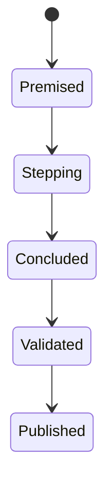
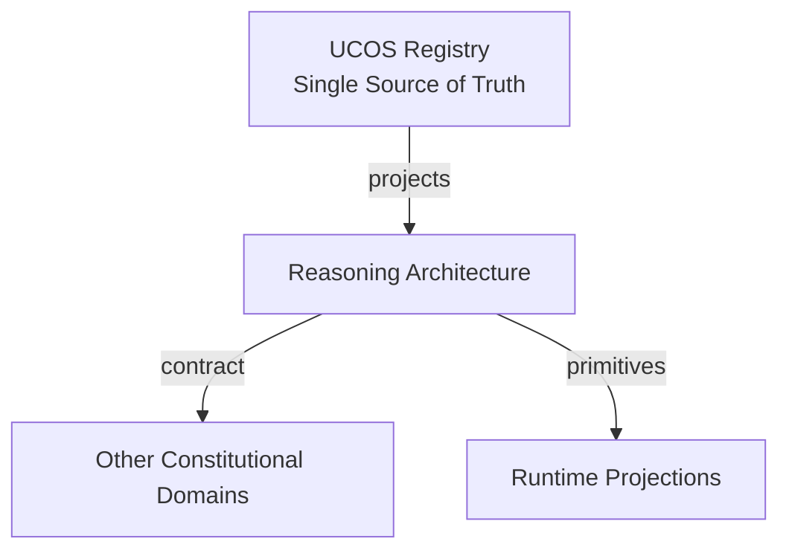
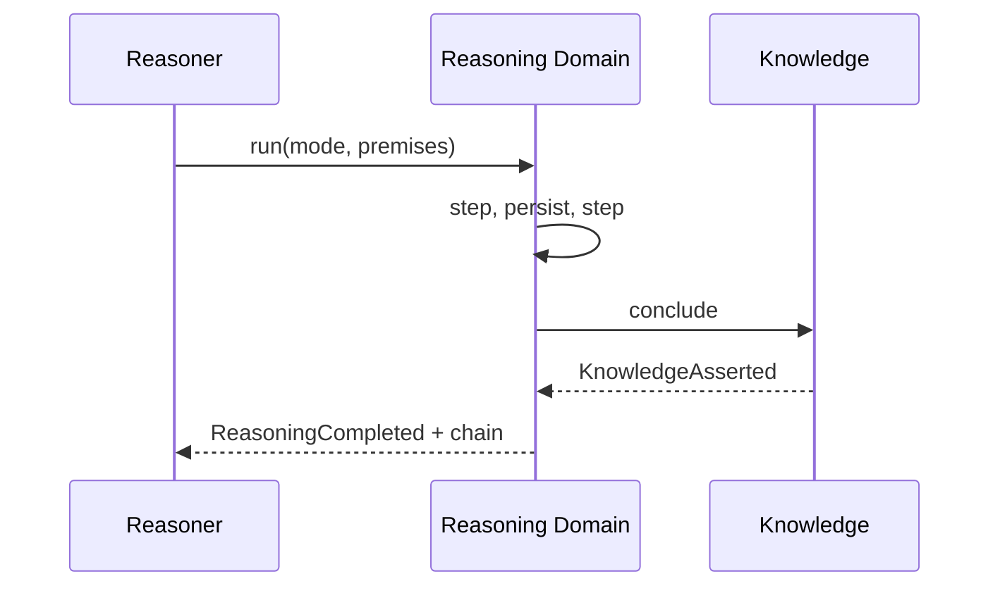
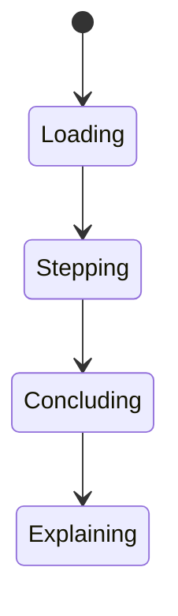
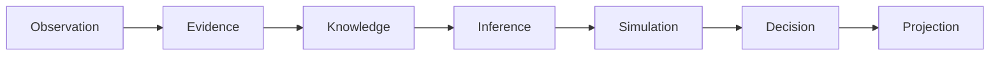
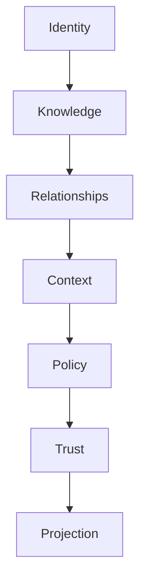

# UCOS-RSN-000001
# Reasoning Architecture

**Version:** Ω∞.1  |  **Status:** Constitutional Artifact  |  **Authority:** UCOS Ω∞ Constitutional Authority
**Category:** Core Domains  |  **Source of Truth:** `_registry/` (projected, never hand-authored)

> Constitutional notice: this document is a **projection**. Its truth lives in the registry. Editing this document directly violates Law 002 (Knowledge Once).

---

## 1. Executive Summary

**UCOS-RSN-000001 — Reasoning Architecture**

This artifact is a constitutionally governed, implementation-ready specification projected from the _UCOS Registry_ single source of truth.
It conforms to the _Immutable Primitive Registry_ (27 frozen primitives) and the _Canonical Terminology Registry_ (31 governed terms).
It contains no hardcoded business, industry, currency, country, or commerce concepts. All such concepts are runtime projections.

---

## 2. Constitutional Purpose

To define the binding contract for **Reasoning Architecture** such that:
- every concept it names has exactly one owner,
- every capability it exposes has exactly one boundary,
- every boundary is expressed as an explicit contract,
- every contract is enforceable by the Governance Constitution.

---

## 3. Scope

In scope: the primitives, contracts, schemas, events, and policies owned by **Reasoning Architecture**.
In scope: the projection rules by which this domain exposes its truth to other domains.
In scope: the verification obligations this domain must satisfy before activation.

---

## 4. Out of Scope

Out of scope: any concept owned by another constitutional domain.
Out of scope: business, industry, commerce, country, currency, or language content (all projected).
Out of scope: mutation of another domain’s internal state.

---

## 5. Definitions

All terms in this artifact are used in their canonical sense as defined in the Canonical Terminology Registry.
Where a term appears, its `termId` is normative and its `prohibitedMeanings` are void.

---

## 6. Canonical Terminology

| Term | Canonical Definition | Owner | Prohibited Meanings |
|---|---|---|---|
| Existence | Anything that may exist. | Universal Existence Kernel | business meaning, commercial meaning, operational meaning |
| Entity | Technical representation of an Existence Object. | Identity Domain | existence itself |
| Knowledge | Interpreted information with evidence and meaning. | Knowledge Domain | data, information, evidence |
| Data | Raw observations. | Observation Domain | knowledge, meaning |
| Information | Organized data. | Observation Domain | knowledge |
| Evidence | Proof supporting an assertion. | Evidence Domain | knowledge, trust |
| Trust | Computed confidence in an assertion, derived from evidence. | Trust Domain | evidence, faith |
| Meaning | Semantic interpretation; higher-level understanding. | Semantic Domain | classification, taxonomy, ontology |
| Ontology | What exists. | Semantic Domain | taxonomy, classification |
| Taxonomy | How things are classified. | Semantic Domain | ontology, meaning |
| Classification | Assignment into taxonomy. | Semantic Domain | meaning |
| Relationship | Connection between objects. | Relationship Domain | causality |

---

## 7. Ownership Boundaries

**Owner:** Reasoning Domain
**Owns:** Reasoning
**Boundary law:** no domain may modify, bypass, or reinterpret another domain’s internals. All interaction is via contract.

---

## 8. Domain Responsibilities

- Deductive/Inductive/Abductive/Constraint/Policy/Semantic/Causal Reasoning

---

## 9. Domain Non-Responsibilities

- Observation Capture
- Policy Approval

---

## 10. Concepts

Reasoning is the deliberate derivation of conclusions under governance. Reasoning ≠ Inference: reasoning is explainable, step-wise, and auditable; inference may be statistical and opaque. Every reasoning chain is reconstructable.

---

## 11. Ontology

Reasoning has a Mode (Deductive / Inductive / Abductive / Constraint / Policy / Semantic / Causal), a chain of steps, premises, and a conclusion. Each step is itself recorded.

---

## 12. Taxonomy

By mode: Deductive / Inductive / Abductive / Constraint-satisfaction / Policy-based / Semantic / Causal. By purpose: Explanation / Prediction / Diagnosis / Planning / Justification.

---

## 13. Registries

This domain is registry-driven. Its registries are entries in the Universal Registry System:

```yaml
RegistryEntry:
  registryId: UCOS-REG-REASONING
  owner: Reasoning Domain
  law: Knowledge Once — each concept defined exactly once
```

---

## 14. Data Model

```yaml
Reasoning:
  reasoningId: <Identity>
  mode: <registry id>
  premises: [<Knowledge|Observation>]
  steps:
    - stepNo: <int>
      rule: <Rule|registry inference rule>
      input: <facts>
      output: <fact>
  conclusion: <Knowledge|Decision>
  explainable: true   # mandatory
  context: <Context>
```

---

## 15. Graph Model

(:Reasoning)-[:FROM_PREMISE]->(:Knowledge); (:Reasoning)-[:STEP*]->(:ReasoningStep); (:Reasoning)-[:CONCLUDED]->(:Knowledge|:Decision); (:Reasoning)-[:MODE]->(:RegistryEntry)

---

## 16. Schemas

```yaml
# Canonical projection schema for UCOS-RSN-000001
ucos_rsn_000001:
  identity:      <Identity primitive>
  intent:        <Intent primitive>
  meaning:       <Meaning primitive>
  knowledge:     <Knowledge primitive>
  registry:      <Registry primitive>
  relationship:  <Relationship primitive>
  context:       <Context primitive>
  policy:        <Policy primitive>
  authority:     <Authority primitive>
  evidence:      <Evidence primitive>
  trust:         <Trust primitive>
  temporal:      <Time primitive>
  metadata:      <Metadata primitive>
```

---

## 17. Contracts

```yaml
DomainContract:
  domain: Reasoning
  commands:   []   # registry-driven
  queries:    []   # registry-driven
  events:     []   # registry-driven
  policies:   []   # registry-driven
  permissions: []  # registry-driven
```

Contract law: domains never directly access another domain’s internal structures.

---

## 18. APIs

POST /reasoning.v1.run,GET  /reasoning.v1/{id},GET  /reasoning.v1/{id}/chain,POST /reasoning.v1.explain

---

## 19. Events

ReasoningCompleted,ReasoningValidated,ReasoningInvalid,ReasoningExplained

---

## 20. Commands

reasoning.run,reasoning.explain,reasoning.validate,reasoning.replay

---

## 21. Queries

reasoning.byId,reasoning.chain,reasoning.byMode,reasoning.conclusions

---

## 22. State Machines



---

## 23. Workflows

load premises within scope → apply mode → record each step → conclude → validate chain → publish with explanation

---

## 24. Policies

```yaml
Policy:
  identity: <Identity>
  conditions: []   # registry-driven
  actions:    []   # registry-driven
  priorities: []   # registry-driven
  exceptions: []   # registry-driven
```

All behavior derives from policy. Policy ≠ Rule: policy is behavioral governance; the rule is its executable projection.

---

## 25. Rules

```yaml
Rule:
  ruleId: <Identity>
  derivedFrom: <Policy identity>
  executable: true
  constraint: <registry expression>
```

---

## 26. Authorities

Reasoning Authority (runs modes); conclusion authority follows the Knowledge/Decision domain rules.

---

## 27. Permissions

reasoning.run (reasoning authority),reasoning.read (context-scoped),reasoning.explain (any stakeholder)

---

## 28. Security Model

Zero Trust applies: no implicit trust between domains, services, agents, or tenants.
Every call is authenticated, authorized against Policy, and evidenced.
Cryptographic identity is issued by the Identity Domain; keys by the Key Management Architecture.

---

## 29. Privacy Model

Premises containing personal data require consent scope; explanations minimize exposed facts while remaining reconstructable.

---

## 30. Trust Model

Trust is computed, never assumed. Inputs: evidence, authority, consistency, provenance, confidence.
```yaml
Trust:
  evidenceScore: <0..1>
  authorityScore: <0..1>
  consistencyScore: <0..1>
  provenanceScore: <0..1>
  confidenceScore: <0..1>
```

---

## 31. Audit Model

The chain is the audit. A conclusion without a reconstructable chain is constitutionally void.

---

## 32. Observability Model

Every action emits: What happened? Why? Who authorized it? Which policy allowed it? What evidence supports it? What confidence exists? What alternatives were evaluated?
These are the seven Explainability questions and are mandatory event fields.

---

## 33. Digital Twin Model

Reasoning produces explanations for twin state divergence — why the twin differs from observed reality.

---

## 34. Agent Model

Reasoning Agent is the explainable counterpart to the Inference Agent, justifying autonomous conclusions.

---

## 35. Runtime Model

Step-wise execution with checkpointing; long chains are resumable. Every step is persisted before the next runs.

---

## 36. Scaling Model

Chains are partitioned by conclusion subject; step storage is append-only and deduplicated by hash.

---

## 37. Multi-Tenant Model

Reasoning never mixes premises across tenants.

---

## 38. Geo-Distribution Model

Reasoning over jurisdiction-scoped knowledge stays in jurisdiction.

---

## 39. Failure Model

Step invalidation, premise revocation mid-chain, mode unavailability, unbounded chain length.

---

## 40. Recovery Model

Chains are replayable; a revoked premise invalidates downstream steps deterministically and re-triggers reasoning.

---

## 41. Verification Model

Before activation, Reasoning Architecture must pass identity, knowledge, relationship, context, policy, authority, trust, and reality integrity checks.
Verification is performed by the Formal Verification Architecture (UCOS-FML-000001).

---

## 42. Certification Model

Reasoning must be fully reconstructable, mode-registered, scope-valid, and step-auditable.

---

## 43. Migration Model

New modes are registry additions; existing chains preserve their mode version.

---

## 44. Evolution Model

Evolution is governed and history-preserving. Primitives are frozen; extension occurs through registries, policies, capabilities, contexts, relationships, knowledge, agents, and projections — never through primitive expansion.

---

## 45. Implementation Blueprint

Build order for RSN: (1) define registry entries — this domain owns by mode: deductive / inductive / abductive / constraint-satisfaction / policy-based / semantic / causal as registry truth, not code; (2) implement the contract surface first (reasoning.run, reasoning.explain, reasoning.validate) and validate against RSN boundaries; (3) event-source all state so history is reconstructable; (4) wire the enforcement points — authority check, policy guard, evidence binding, trace — in-line, with no bypass path; (5) add tests per the Testing Architecture, citing evidence per gate; (6) obtain Verification and Certification before activation. Acceptance: the Zero Partial and Law 001 audits pass, every action answers the seven explainability questions, and this domain mutates no other domain internals.

---

## 46. Reference Architecture Diagram



---

## 47. Sequence Diagrams



---

## 48. State Diagrams



---

## 49. Data Flow Diagrams



---

## 50. Dependency Maps



Forbidden: circular dependencies, mutual ownership, cross-domain state mutation.

---

## ∞

Constitutionally governed. Implementation ready. Universally extensible.