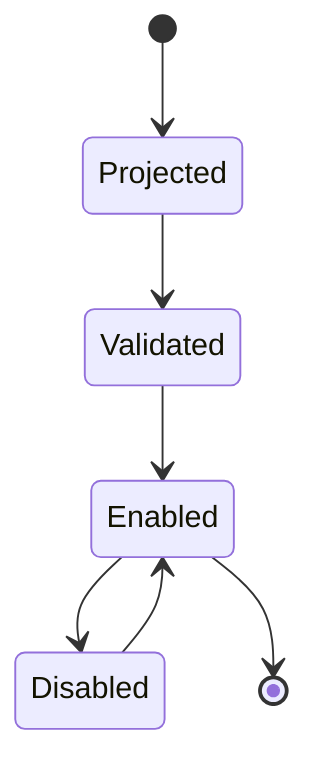
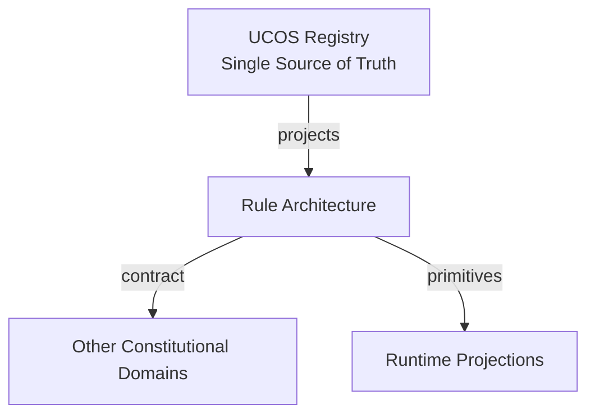
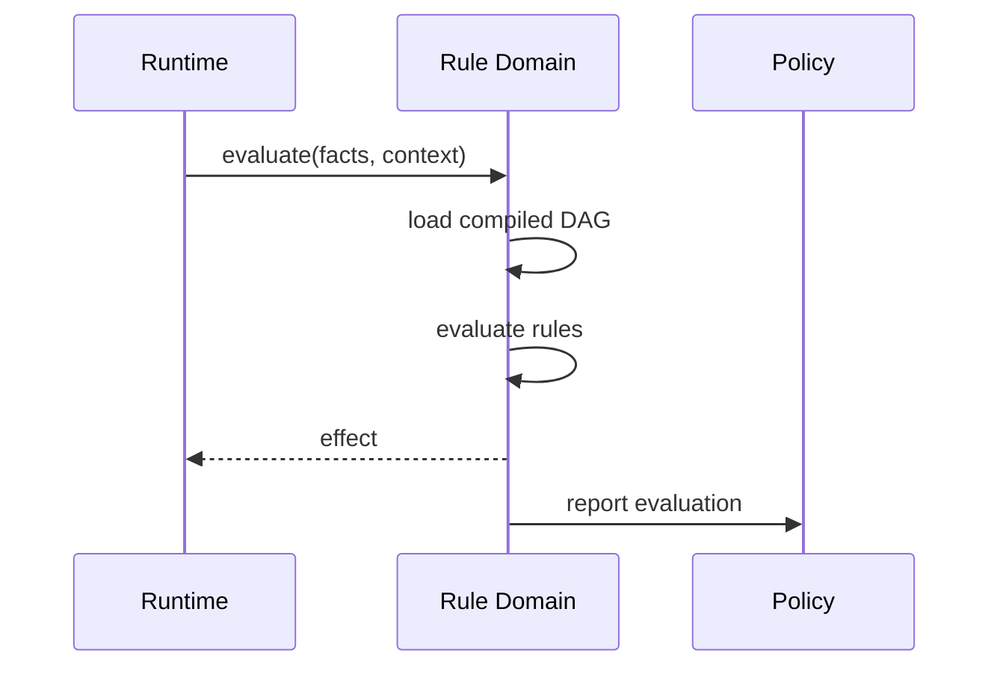
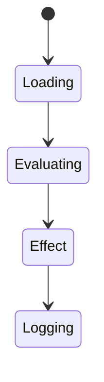
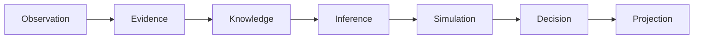
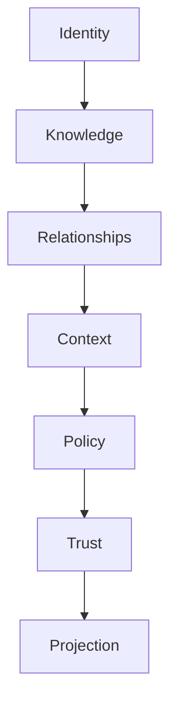

# UCOS-RUL-000001
# Rule Architecture

**Version:** Ω∞.1  |  **Status:** Constitutional Artifact  |  **Authority:** UCOS Ω∞ Constitutional Authority
**Category:** Core Domains  |  **Source of Truth:** `_registry/` (projected, never hand-authored)

> Constitutional notice: this document is a **projection**. Its truth lives in the registry. Editing this document directly violates Law 002 (Knowledge Once).

---

## 1. Executive Summary

**UCOS-RUL-000001 — Rule Architecture**

This artifact is a constitutionally governed, implementation-ready specification projected from the _UCOS Registry_ single source of truth.
It conforms to the _Immutable Primitive Registry_ (27 frozen primitives) and the _Canonical Terminology Registry_ (31 governed terms).
It contains no hardcoded business, industry, currency, country, or commerce concepts. All such concepts are runtime projections.

---

## 2. Constitutional Purpose

To define the binding contract for **Rule Architecture** such that:
- every concept it names has exactly one owner,
- every capability it exposes has exactly one boundary,
- every boundary is expressed as an explicit contract,
- every contract is enforceable by the Governance Constitution.

---

## 3. Scope

In scope: the primitives, contracts, schemas, events, and policies owned by **Rule Architecture**.
In scope: the projection rules by which this domain exposes its truth to other domains.
In scope: the verification obligations this domain must satisfy before activation.

---

## 4. Out of Scope

Out of scope: any concept owned by another constitutional domain.
Out of scope: business, industry, commerce, country, currency, or language content (all projected).
Out of scope: mutation of another domain’s internal state.

---

## 5. Definitions

All terms in this artifact are used in their canonical sense as defined in the Canonical Terminology Registry.
Where a term appears, its `termId` is normative and its `prohibitedMeanings` are void.

---

## 6. Canonical Terminology

| Term | Canonical Definition | Owner | Prohibited Meanings |
|---|---|---|---|
| Existence | Anything that may exist. | Universal Existence Kernel | business meaning, commercial meaning, operational meaning |
| Entity | Technical representation of an Existence Object. | Identity Domain | existence itself |
| Knowledge | Interpreted information with evidence and meaning. | Knowledge Domain | data, information, evidence |
| Data | Raw observations. | Observation Domain | knowledge, meaning |
| Information | Organized data. | Observation Domain | knowledge |
| Evidence | Proof supporting an assertion. | Evidence Domain | knowledge, trust |
| Trust | Computed confidence in an assertion, derived from evidence. | Trust Domain | evidence, faith |
| Meaning | Semantic interpretation; higher-level understanding. | Semantic Domain | classification, taxonomy, ontology |
| Ontology | What exists. | Semantic Domain | taxonomy, classification |
| Taxonomy | How things are classified. | Semantic Domain | ontology, meaning |
| Classification | Assignment into taxonomy. | Semantic Domain | meaning |
| Relationship | Connection between objects. | Relationship Domain | causality |

---

## 7. Ownership Boundaries

**Owner:** Rule Domain
**Owns:** Rule
**Boundary law:** no domain may modify, bypass, or reinterpret another domain’s internals. All interaction is via contract.

---

## 8. Domain Responsibilities

- Executable Constraint Definition
- Rule Evaluation Readiness

---

## 9. Domain Non-Responsibilities

- Policy Intent
- Decision

---

## 10. Concepts

Rule is the executable constraint derived from Policy. Rule ≠ Policy and Rule ≠ Decision. Rules are the machine-runnable projection of governance intent. A rule never contradicts its parent policy.

---

## 11. Ontology

Rule has exactly 1 parent Policy, an executable expression, an evaluation order, and an effect. Rules are composable but never self-referential.

---

## 12. Taxonomy

By effect: Permit / Deny / Require / Transform / Notify / Defer. By evaluation: Boolean / Threshold / Set-membership / Registry-lookup / Composite.

---

## 13. Registries

This domain is registry-driven. Its registries are entries in the Universal Registry System:

```yaml
RegistryEntry:
  registryId: UCOS-REG-RULE
  owner: Rule Domain
  law: Knowledge Once — each concept defined exactly once
```

---

## 14. Data Model

```yaml
Rule:
  ruleId: <Identity>
  derivedFrom: <Policy>
  expression: <registry expression id>
  effect: <Permit|Deny|Require|Transform|Notify|Defer>
  priority: <int>
  evalOrder: <int>
  onConflict: <registry strategy>
  temporal: {effectiveFrom, effectiveTo}
```

---

## 15. Graph Model

(:Rule)-[:DERIVED_FROM]->(:Policy); (:Rule)-[:EVALUATED_IN]->(:Evaluation); (:Rule)-[:CONFLICTS_WITH]->(:Rule)

---

## 16. Schemas

```yaml
# Canonical projection schema for UCOS-RUL-000001
ucos_rul_000001:
  identity:      <Identity primitive>
  intent:        <Intent primitive>
  meaning:       <Meaning primitive>
  knowledge:     <Knowledge primitive>
  registry:      <Registry primitive>
  relationship:  <Relationship primitive>
  context:       <Context primitive>
  policy:        <Policy primitive>
  authority:     <Authority primitive>
  evidence:      <Evidence primitive>
  trust:         <Trust primitive>
  temporal:      <Time primitive>
  metadata:      <Metadata primitive>
```

---

## 17. Contracts

```yaml
DomainContract:
  domain: Rule
  commands:   []   # registry-driven
  queries:    []   # registry-driven
  events:     []   # registry-driven
  policies:   []   # registry-driven
  permissions: []  # registry-driven
```

Contract law: domains never directly access another domain’s internal structures.

---

## 18. APIs

POST /rule.v1.evaluate,GET  /rule.v1/{id},GET  /rule.v1/byPolicy/{policyId},POST /rule.v1.validate

---

## 19. Events

RuleEvaluated,RuleProjectionUpdated,RuleConflictDetected,RuleDisabled,RuleReconciled

---

## 20. Commands

rule.evaluate,rule.validate,rule.reorder,rule.disable,rule.reconcile

---

## 21. Queries

rule.byId,rule.byPolicy,rule.applicable,rule.conflicts,rule.coverage

---

## 22. State Machines



---

## 23. Workflows

policy projects rule → static validation → conflict reconciliation → enable → evaluate at runtime

---

## 24. Policies

```yaml
Policy:
  identity: <Identity>
  conditions: []   # registry-driven
  actions:    []   # registry-driven
  priorities: []   # registry-driven
  exceptions: []   # registry-driven
```

All behavior derives from policy. Policy ≠ Rule: policy is behavioral governance; the rule is its executable projection.

---

## 25. Rules

```yaml
Rule:
  ruleId: <Identity>
  derivedFrom: <Policy identity>
  executable: true
  constraint: <registry expression>
```

---

## 26. Authorities

Inherits parent policy's authority; no independent authority.

---

## 27. Permissions

rule.evaluate (runtime, scoped),rule.disable (parent policy authority),rule.reorder (parent policy authority)

---

## 28. Security Model

Zero Trust applies: no implicit trust between domains, services, agents, or tenants.
Every call is authenticated, authorized against Policy, and evidenced.
Cryptographic identity is issued by the Identity Domain; keys by the Key Management Architecture.

---

## 29. Privacy Model

Rule expressions over personal data must carry the consent scope of their parent policy; evaluation logs minimize captured facts.

---

## 30. Trust Model

Trust is computed, never assumed. Inputs: evidence, authority, consistency, provenance, confidence.
```yaml
Trust:
  evidenceScore: <0..1>
  authorityScore: <0..1>
  consistencyScore: <0..1>
  provenanceScore: <0..1>
  confidenceScore: <0..1>
```

---

## 31. Audit Model

Every RuleEvaluated records input facts, matched rule, effect, and evaluation time. Deterministic replay must reproduce identical outcomes.

---

## 32. Observability Model

Every action emits: What happened? Why? Who authorized it? Which policy allowed it? What evidence supports it? What confidence exists? What alternatives were evaluated?
These are the seven Explainability questions and are mandatory event fields.

---

## 33. Digital Twin Model

Rule Twin tracks real-world enforcement outcomes and flags divergence between rule effect and observed behavior.

---

## 34. Agent Model

Rule Agent detects unreachable or redundant rules and proposes pruning under governance.

---

## 35. Runtime Model

Rules compile to a decision DAG per Context; evaluation is fact-driven with short-circuit on Deny for mandatory policies.

---

## 36. Scaling Model

DAG compilation cached per policy version; runtime evaluation is sub-millisecond. Hot paths are precompiled.

---

## 37. Multi-Tenant Model

Rules are tenant-scoped through their parent policy; cross-tenant evaluation is constitutionally forbidden.

---

## 38. Geo-Distribution Model

Rule evaluation is local per region; the compiled DAG is replicated, authoritative projection stays in jurisdiction.

---

## 39. Failure Model

Non-deterministic expression, projection drift from policy, evaluation timeout, conflicting effects at equal priority.

---

## 40. Recovery Model

Rules are derived, so recovery is re-projection from the parent policy. No rule is ever hand-restored.

---

## 41. Verification Model

Before activation, Rule Architecture must pass identity, knowledge, relationship, context, policy, authority, trust, and reality integrity checks.
Verification is performed by the Formal Verification Architecture (UCOS-FML-000001).

---

## 42. Certification Model

Rule must pass determinism (same facts → same effect), policy conformance, and termination guarantees.

---

## 43. Migration Model

Expression language evolves by registry; existing rules re-project on language version change.

---

## 44. Evolution Model

Evolution is governed and history-preserving. Primitives are frozen; extension occurs through registries, policies, capabilities, contexts, relationships, knowledge, agents, and projections — never through primitive expansion.

---

## 45. Implementation Blueprint

Build order for RUL: (1) define registry entries — this domain owns by effect: permit / deny / require / transform / notify / defer as registry truth, not code; (2) implement the contract surface first (rule.evaluate, rule.validate, rule.reorder) and validate against RUL boundaries; (3) event-source all state so history is reconstructable; (4) wire the enforcement points — authority check, policy guard, evidence binding, trace — in-line, with no bypass path; (5) add tests per the Testing Architecture, citing evidence per gate; (6) obtain Verification and Certification before activation. Acceptance: the Zero Partial and Law 001 audits pass, every action answers the seven explainability questions, and this domain mutates no other domain internals.

---

## 46. Reference Architecture Diagram



---

## 47. Sequence Diagrams



---

## 48. State Diagrams



---

## 49. Data Flow Diagrams



---

## 50. Dependency Maps



Forbidden: circular dependencies, mutual ownership, cross-domain state mutation.

---

## ∞

Constitutionally governed. Implementation ready. Universally extensible.