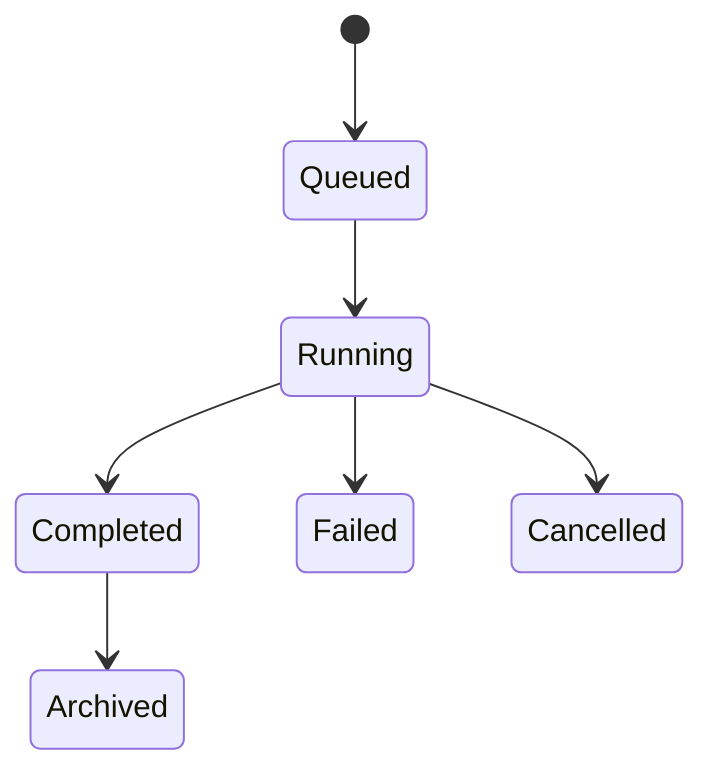
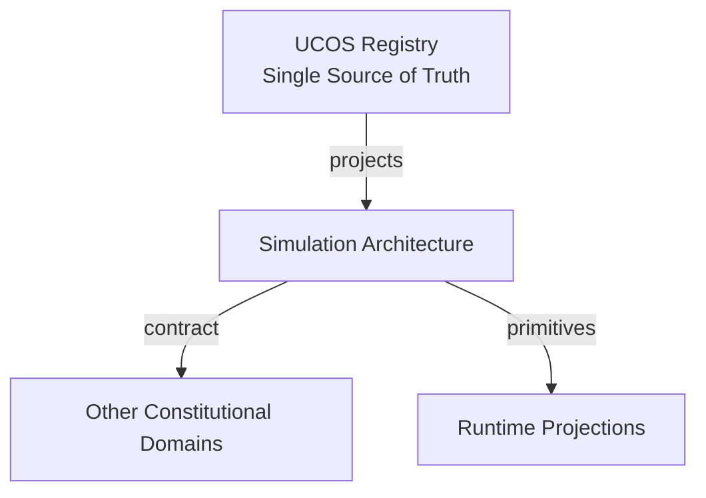
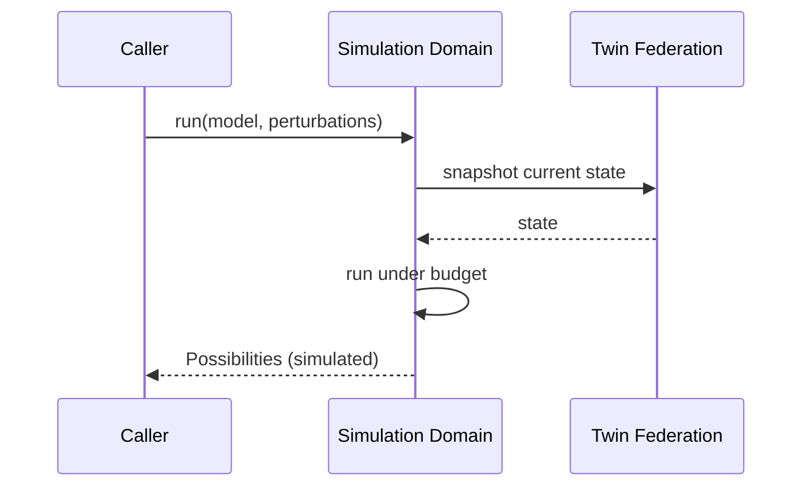
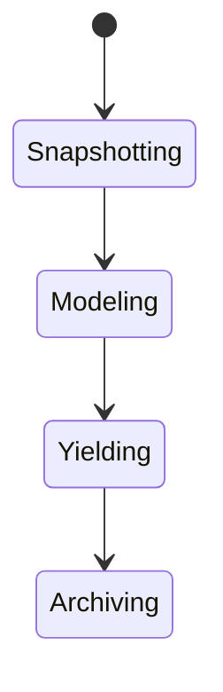
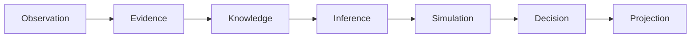
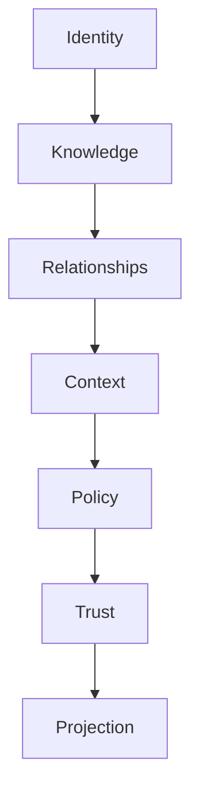

# UCOS-SIM-000001
# Simulation Architecture

**Version:** Ω∞.1  |  **Status:** Constitutional Artifact  |  **Authority:** UCOS Ω∞ Constitutional Authority
**Category:** Core Domains  |  **Source of Truth:** `_registry/` (projected, never hand-authored)

> Constitutional notice: this document is a **projection**. Its truth lives in the registry. Editing this document directly violates Law 002 (Knowledge Once).

---

## 1. Executive Summary

**UCOS-SIM-000001 — Simulation Architecture**

This artifact is a constitutionally governed, implementation-ready specification projected from the _UCOS Registry_ single source of truth.
It conforms to the _Immutable Primitive Registry_ (27 frozen primitives) and the _Canonical Terminology Registry_ (31 governed terms).
It contains no hardcoded business, industry, currency, country, or commerce concepts. All such concepts are runtime projections.

---

## 2. Constitutional Purpose

To define the binding contract for **Simulation Architecture** such that:
- every concept it names has exactly one owner,
- every capability it exposes has exactly one boundary,
- every boundary is expressed as an explicit contract,
- every contract is enforceable by the Governance Constitution.

---

## 3. Scope

In scope: the primitives, contracts, schemas, events, and policies owned by **Simulation Architecture**.
In scope: the projection rules by which this domain exposes its truth to other domains.
In scope: the verification obligations this domain must satisfy before activation.

---

## 4. Out of Scope

Out of scope: any concept owned by another constitutional domain.
Out of scope: business, industry, commerce, country, currency, or language content (all projected).
Out of scope: mutation of another domain’s internal state.

---

## 5. Definitions

All terms in this artifact are used in their canonical sense as defined in the Canonical Terminology Registry.
Where a term appears, its `termId` is normative and its `prohibitedMeanings` are void.

---

## 6. Canonical Terminology

| Term | Canonical Definition | Owner | Prohibited Meanings |
|---|---|---|---|
| Existence | Anything that may exist. | Universal Existence Kernel | business meaning, commercial meaning, operational meaning |
| Entity | Technical representation of an Existence Object. | Identity Domain | existence itself |
| Knowledge | Interpreted information with evidence and meaning. | Knowledge Domain | data, information, evidence |
| Data | Raw observations. | Observation Domain | knowledge, meaning |
| Information | Organized data. | Observation Domain | knowledge |
| Evidence | Proof supporting an assertion. | Evidence Domain | knowledge, trust |
| Trust | Computed confidence in an assertion, derived from evidence. | Trust Domain | evidence, faith |
| Meaning | Semantic interpretation; higher-level understanding. | Semantic Domain | classification, taxonomy, ontology |
| Ontology | What exists. | Semantic Domain | taxonomy, classification |
| Taxonomy | How things are classified. | Semantic Domain | ontology, meaning |
| Classification | Assignment into taxonomy. | Semantic Domain | meaning |
| Relationship | Connection between objects. | Relationship Domain | causality |

---

## 7. Ownership Boundaries

**Owner:** Simulation Domain
**Owns:** Simulation
**Boundary law:** no domain may modify, bypass, or reinterpret another domain’s internals. All interaction is via contract.

---

## 8. Domain Responsibilities

- Future Modeling
- Scenario Analysis
- Prediction

---

## 9. Domain Non-Responsibilities

- Reality Mutation
- Policy Approval

---

## 10. Concepts

Simulation is possible reality. Simulation ≠ Reality: it never mutates actual reality, never approves policy, and never spends money. Simulations are throwaway, reproducible, and clearly labeled.

---

## 11. Ontology

Simulation has a Model, input State, perturbations, and output Possibilities. Types: Pricing / Risk / Compliance / Expansion / Operational / Future Scenario / Economic — registry-driven.

---

## 12. Taxonomy

By horizon: Now / Near / Far. By fidelity: Order-of-magnitude / Approximate / High-fidelity. By purpose: Decision-support / Stress-test / Exploration.

---

## 13. Registries

This domain is registry-driven. Its registries are entries in the Universal Registry System:

```yaml
RegistryEntry:
  registryId: UCOS-REG-SIMULATION
  owner: Simulation Domain
  law: Knowledge Once — each concept defined exactly once
```

---

## 14. Data Model

```yaml
Simulation:
  simulationId: <Identity>
  modelType: <registry id>
  inputState: <snapshot reference>
  perturbations: [<registry perturbation>]
  outputs: [Possibility]
  runs: <int>
  reproducible: <bool>
  temporal: {simulatedFrom, simulatedTo}
```

---

## 15. Graph Model

(:Simulation)-[:MODELED_BY]->(:RegistryEntry); (:Simulation)-[:PERTURBS]->(:Context|:Policy); (:Simulation)-[:YIELDS]->(:Possibility); (:Simulation)-[:BASED_ON]->(:Knowledge|:Twin)

---

## 16. Schemas

```yaml
# Canonical projection schema for UCOS-SIM-000001
ucos_sim_000001:
  identity:      <Identity primitive>
  intent:        <Intent primitive>
  meaning:       <Meaning primitive>
  knowledge:     <Knowledge primitive>
  registry:      <Registry primitive>
  relationship:  <Relationship primitive>
  context:       <Context primitive>
  policy:        <Policy primitive>
  authority:     <Authority primitive>
  evidence:      <Evidence primitive>
  trust:         <Trust primitive>
  temporal:      <Time primitive>
  metadata:      <Metadata primitive>
```

---

## 17. Contracts

```yaml
DomainContract:
  domain: Simulation
  commands:   []   # registry-driven
  queries:    []   # registry-driven
  events:     []   # registry-driven
  policies:   []   # registry-driven
  permissions: []  # registry-driven
```

Contract law: domains never directly access another domain’s internal structures.

---

## 18. APIs

POST /simulation.v1.run,GET  /simulation.v1/{id},POST /simulation.v1.compare,GET  /simulation.v1/{id}/possibilities

---

## 19. Events

SimulationStarted,SimulationProgressed,SimulationCompleted,SimulationFailed,PossibilityYielded

---

## 20. Commands

simulation.run,simulation.cancel,simulation.compare,simulation.archive

---

## 21. Queries

simulation.byId,simulation.possibilities,simulation.byModel,simulation.compare

---

## 22. State Machines



---

## 23. Workflows

snapshot input state → select model → apply perturbations under budget → yield possibilities → label as simulated → archive

---

## 24. Policies

```yaml
Policy:
  identity: <Identity>
  conditions: []   # registry-driven
  actions:    []   # registry-driven
  priorities: []   # registry-driven
  exceptions: []   # registry-driven
```

All behavior derives from policy. Policy ≠ Rule: policy is behavioral governance; the rule is its executable projection.

---

## 25. Rules

```yaml
Rule:
  ruleId: <Identity>
  derivedFrom: <Policy identity>
  executable: true
  constraint: <registry expression>
```

---

## 26. Authorities

Simulation Authority (runs models); no authority to mutate reality — separation is constitutional.

---

## 27. Permissions

simulation.run (simulation authority),simulation.read (context-scoped)

---

## 28. Security Model

Zero Trust applies: no implicit trust between domains, services, agents, or tenants.
Every call is authenticated, authorized against Policy, and evidenced.
Cryptographic identity is issued by the Identity Domain; keys by the Key Management Architecture.

---

## 29. Privacy Model

Simulations over personal populations use synthetic or aggregated inputs; no individual-level personal simulation without consent.

---

## 30. Trust Model

Trust is computed, never assumed. Inputs: evidence, authority, consistency, provenance, confidence.
```yaml
Trust:
  evidenceScore: <0..1>
  authorityScore: <0..1>
  consistencyScore: <0..1>
  provenanceScore: <0..1>
  confidenceScore: <0..1>
```

---

## 31. Audit Model

Every run records model version, inputs, perturbations, and resource cost. Outputs are watermarked as simulated in every projection.

---

## 32. Observability Model

Every action emits: What happened? Why? Who authorized it? Which policy allowed it? What evidence supports it? What confidence exists? What alternatives were evaluated?
These are the seven Explainability questions and are mandatory event fields.

---

## 33. Digital Twin Model

Twins provide the initial state for simulations; simulations never write back to twins — one-directional by law.

---

## 34. Agent Model

Simulation Agent pre-runs scenarios for autonomous planning, governed by Agent Safety budgets.

---

## 35. Runtime Model

Runs in an isolated sandbox with compute/time budget enforcement; outputs are content-addressed and immutable.

---

## 36. Scaling Model

Embarrassingly parallel across perturbation grids; results cache by (model, input-hash, perturbation-hash).

---

## 37. Multi-Tenant Model

Simulations never mix tenant states; cross-tenant scenarios require published relationship.

---

## 38. Geo-Distribution Model

Heavy compute runs in the tenant's authorized regions; regulated data never leaves jurisdiction for simulation.

---

## 39. Failure Model

Model divergence, budget exhaustion, non-convergence, input state staleness.

---

## 40. Recovery Model

Simulations are disposable; recovery is re-run. Archived results are content-addressed and self-verifying.

---

## 41. Verification Model

Before activation, Simulation Architecture must pass identity, knowledge, relationship, context, policy, authority, trust, and reality integrity checks.
Verification is performed by the Formal Verification Architecture (UCOS-FML-000001).

---

## 42. Certification Model

Simulation must be reproducible, budget-bounded, reality-isolated, and clearly labeled in all outputs.

---

## 43. Migration Model

New model types are registry additions; archived runs preserve their model version.

---

## 44. Evolution Model

Evolution is governed and history-preserving. Primitives are frozen; extension occurs through registries, policies, capabilities, contexts, relationships, knowledge, agents, and projections — never through primitive expansion.

---

## 45. Implementation Blueprint

Build order for SIM: (1) define registry entries — this domain owns by horizon: now / near / far as registry truth, not code; (2) implement the contract surface first (simulation.run, simulation.cancel, simulation.compare) and validate against SIM boundaries; (3) event-source all state so history is reconstructable; (4) wire the enforcement points — authority check, policy guard, evidence binding, trace — in-line, with no bypass path; (5) add tests per the Testing Architecture, citing evidence per gate; (6) obtain Verification and Certification before activation. Acceptance: the Zero Partial and Law 001 audits pass, every action answers the seven explainability questions, and this domain mutates no other domain internals.

---

## 46. Reference Architecture Diagram



---

## 47. Sequence Diagrams



---

## 48. State Diagrams



---

## 49. Data Flow Diagrams



---

## 50. Dependency Maps



Forbidden: circular dependencies, mutual ownership, cross-domain state mutation.

---

## ∞

Constitutionally governed. Implementation ready. Universally extensible.