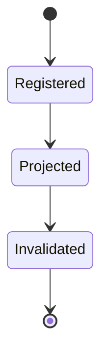
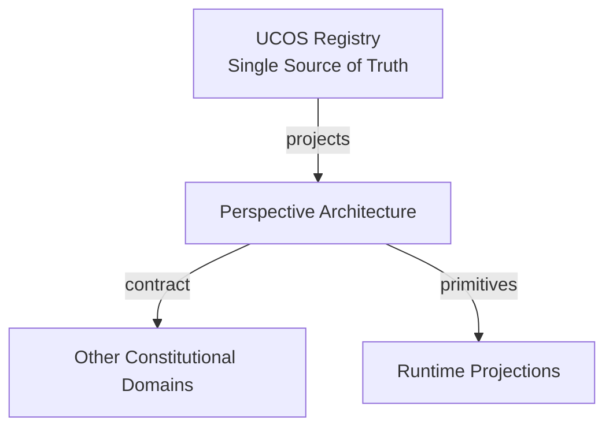
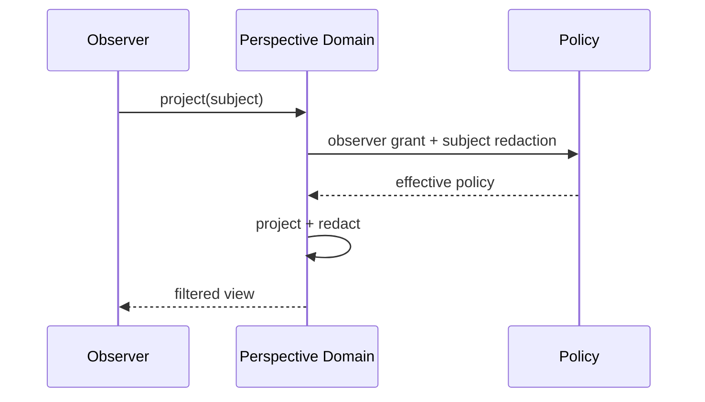
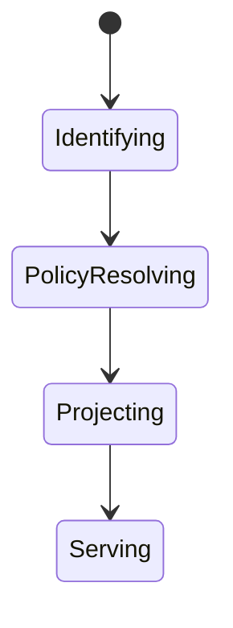
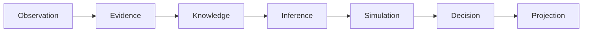
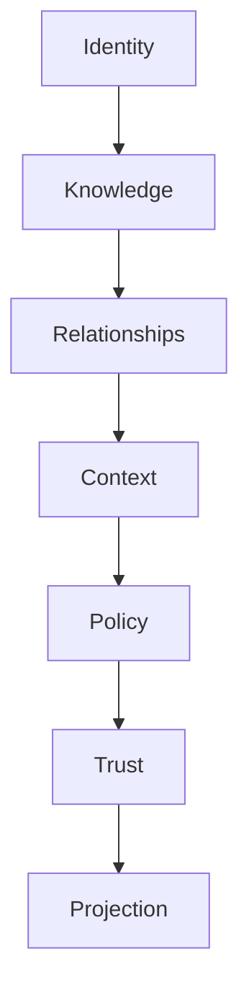

# UCOS-PER-000001
# Perspective Architecture

**Version:** Ω∞.1  |  **Status:** Constitutional Artifact  |  **Authority:** UCOS Ω∞ Constitutional Authority
**Category:** Reality Systems  |  **Source of Truth:** `_registry/` (projected, never hand-authored)

> Constitutional notice: this document is a **projection**. Its truth lives in the registry. Editing this document directly violates Law 002 (Knowledge Once).

---

## 1. Executive Summary

**UCOS-PER-000001 — Perspective Architecture**

This artifact is a constitutionally governed, implementation-ready specification projected from the _UCOS Registry_ single source of truth.
It conforms to the _Immutable Primitive Registry_ (27 frozen primitives) and the _Canonical Terminology Registry_ (31 governed terms).
It contains no hardcoded business, industry, currency, country, or commerce concepts. All such concepts are runtime projections.

---

## 2. Constitutional Purpose

To define the binding contract for **Perspective Architecture** such that:
- every concept it names has exactly one owner,
- every capability it exposes has exactly one boundary,
- every boundary is expressed as an explicit contract,
- every contract is enforceable by the Governance Constitution.

---

## 3. Scope

In scope: the primitives, contracts, schemas, events, and policies owned by **Perspective Architecture**.
In scope: the projection rules by which this domain exposes its truth to other domains.
In scope: the verification obligations this domain must satisfy before activation.

---

## 4. Out of Scope

Out of scope: any concept owned by another constitutional domain.
Out of scope: business, industry, commerce, country, currency, or language content (all projected).
Out of scope: mutation of another domain’s internal state.

---

## 5. Definitions

All terms in this artifact are used in their canonical sense as defined in the Canonical Terminology Registry.
Where a term appears, its `termId` is normative and its `prohibitedMeanings` are void.

---

## 6. Canonical Terminology

| Term | Canonical Definition | Owner | Prohibited Meanings |
|---|---|---|---|
| Existence | Anything that may exist. | Universal Existence Kernel | business meaning, commercial meaning, operational meaning |
| Entity | Technical representation of an Existence Object. | Identity Domain | existence itself |
| Knowledge | Interpreted information with evidence and meaning. | Knowledge Domain | data, information, evidence |
| Data | Raw observations. | Observation Domain | knowledge, meaning |
| Information | Organized data. | Observation Domain | knowledge |
| Evidence | Proof supporting an assertion. | Evidence Domain | knowledge, trust |
| Trust | Computed confidence in an assertion, derived from evidence. | Trust Domain | evidence, faith |
| Meaning | Semantic interpretation; higher-level understanding. | Semantic Domain | classification, taxonomy, ontology |
| Ontology | What exists. | Semantic Domain | taxonomy, classification |
| Taxonomy | How things are classified. | Semantic Domain | ontology, meaning |
| Classification | Assignment into taxonomy. | Semantic Domain | meaning |
| Relationship | Connection between objects. | Relationship Domain | causality |

---

## 7. Ownership Boundaries

Ownership is recorded in the _Domain Ownership Registry_.

---

## 8. Domain Responsibilities

See the Domain Ownership Registry for the authoritative responsibility list.

---

## 9. Domain Non-Responsibilities

See the Domain Ownership Registry.

---

## 10. Concepts

Perspective is observer-specific interpretation. Perspective ≠ Context: context is the applicability boundary; perspective is who is looking. The same object projects differently to customer, merchant, partner, supplier, regulator, auditor, agent, and AI.

---

## 11. Ontology

Perspective has an Observer (Identity or Authority), a subject, and a projection policy. Perspectives never change the subject's truth — only its presentation.

---

## 12. Taxonomy

By observer class: Human-role / Organizational / Regulatory / Automated-agent / AI. By fidelity: Full / Filtered / Redacted.

---

## 13. Registries

This domain is registry-driven. Its registries are entries in the Universal Registry System:

```yaml
RegistryEntry:
  registryId: UCOS-REG-DOMAIN
  owner: Constitutional Authority
  law: Knowledge Once — each concept defined exactly once
```

---

## 14. Data Model

```yaml
Perspective:
  perspectiveId: <Identity>
  observer: <Identity|Authority>
  subject: <Identity>
  projectionPolicy: <Policy>
  redactionPolicy: <Policy>
  context: <Context>
  asOf: <Time>
```

---

## 15. Graph Model

(:Perspective)-[:OBSERVED_BY]->(:Identity); (:Perspective)-[:PROJECTS]->(:Identity); (:Perspective)-[:FILTERED_BY]->(:Policy); (:Perspective)-[:SCOPED_IN]->(:Context)

---

## 16. Schemas

```yaml
# Canonical projection schema for UCOS-PER-000001
ucos_per_000001:
  identity:      <Identity primitive>
  intent:        <Intent primitive>
  meaning:       <Meaning primitive>
  knowledge:     <Knowledge primitive>
  registry:      <Registry primitive>
  relationship:  <Relationship primitive>
  context:       <Context primitive>
  policy:        <Policy primitive>
  authority:     <Authority primitive>
  evidence:      <Evidence primitive>
  trust:         <Trust primitive>
  temporal:      <Time primitive>
  metadata:      <Metadata primitive>
```

---

## 17. Contracts

```yaml
DomainContract:
  domain: Perspective Architecture
  commands:   []   # registry-driven
  queries:    []   # registry-driven
  events:     []   # registry-driven
  policies:   []   # registry-driven
  permissions: []  # registry-driven
```

Contract law: domains never directly access another domain’s internal structures.

---

## 18. APIs

POST /perspective.v1.project,GET  /perspective.v1/{id},GET  /perspective.v1.byObserver/{observerId}

---

## 19. Events

PerspectiveProjected,PerspectiveRedacted,PerspectiveInvalidated

---

## 20. Commands

perspective.project,perspective.redact,perspective.register,perspective.invalidate

---

## 21. Queries

perspective.byObserver,perspective.bySubject,perspective.diff

---

## 22. State Machines



---

## 23. Workflows

identify observer → resolve policy set → project subject → apply redaction → serve

---

## 24. Policies

```yaml
Policy:
  identity: <Identity>
  conditions: []   # registry-driven
  actions:    []   # registry-driven
  priorities: []   # registry-driven
  exceptions: []   # registry-driven
```

All behavior derives from policy. Policy ≠ Rule: policy is behavioral governance; the rule is its executable projection.

---

## 25. Rules

```yaml
Rule:
  ruleId: <Identity>
  derivedFrom: <Policy identity>
  executable: true
  constraint: <registry expression>
```

---

## 26. Authorities

Observer's Authority governs what it may see; the subject's Authority governs what may be shown.

---

## 27. Permissions

perspective.project (observer with read grant),perspective.redact (subject authority)

---

## 28. Security Model

Zero Trust applies: no implicit trust between domains, services, agents, or tenants.
Every call is authenticated, authorized against Policy, and evidenced.
Cryptographic identity is issued by the Identity Domain; keys by the Key Management Architecture.

---

## 29. Privacy Model

Perspective is the primary privacy control surface: data minimization and redaction are projection-time, not afterthoughts.

---

## 30. Trust Model

Trust is computed, never assumed. Inputs: evidence, authority, consistency, provenance, confidence.
```yaml
Trust:
  evidenceScore: <0..1>
  authorityScore: <0..1>
  consistencyScore: <0..1>
  provenanceScore: <0..1>
  confidenceScore: <0..1>
```

---

## 31. Audit Model

Every projection records observer, subject, policies applied, and fields redacted — the basis of disclosure audit.

---

## 32. Observability Model

Every action emits: What happened? Why? Who authorized it? Which policy allowed it? What evidence supports it? What confidence exists? What alternatives were evaluated?
These are the seven Explainability questions and are mandatory event fields.

---

## 33. Digital Twin Model

Perspective drives per-observer twin views — one underlying twin, many safe projections.

---

## 34. Agent Model

Perspective Agent verifies that no projection leaks beyond its policy — an ongoing compliance check.

---

## 35. Runtime Model

Projection is computed per request from policy; results are short-TTL cached keyed by (observer, subject, policy-version).

---

## 36. Scaling Model

Read-heavy; policy evaluation is the hot path and is compiled per policy version.

---

## 37. Multi-Tenant Model

Cross-tenant perspective is denied absent explicit published relationship and policy.

---

## 38. Geo-Distribution Model

Observer jurisdiction policy applies at projection time — a regulator's perspective in one region is not valid in another.

---

## 39. Failure Model

Policy conflict between observer grant and subject redaction, stale policy version, projection timeout.

---

## 40. Recovery Model

Projections are recomputable; policy versioning guarantees deterministic re-projection.

---

## 41. Verification Model

Before activation, Perspective Architecture must pass identity, knowledge, relationship, context, policy, authority, trust, and reality integrity checks.
Verification is performed by the Formal Verification Architecture (UCOS-FML-000001).

---

## 42. Certification Model

Perspective must pass both observer-grant and subject-redaction policy with no unresolved conflict.

---

## 43. Migration Model

New observer classes are registry additions; projections re-derive on policy change.

---

## 44. Evolution Model

Evolution is governed and history-preserving. Primitives are frozen; extension occurs through registries, policies, capabilities, contexts, relationships, knowledge, agents, and projections — never through primitive expansion.

---

## 45. Implementation Blueprint

Build order for PER: (1) define registry entries — this domain owns by observer class: human-role / organizational / regulatory / automated-agent / ai as registry truth, not code; (2) implement the contract surface first (perspective.project, perspective.redact, perspective.register) and validate against PER boundaries; (3) event-source all state so history is reconstructable; (4) wire the enforcement points — authority check, policy guard, evidence binding, trace — in-line, with no bypass path; (5) add tests per the Testing Architecture, citing evidence per gate; (6) obtain Verification and Certification before activation. Acceptance: the Zero Partial and Law 001 audits pass, every action answers the seven explainability questions, and this domain mutates no other domain internals.

---

## 46. Reference Architecture Diagram



---

## 47. Sequence Diagrams



---

## 48. State Diagrams



---

## 49. Data Flow Diagrams



---

## 50. Dependency Maps



Forbidden: circular dependencies, mutual ownership, cross-domain state mutation.

---

## ∞

Constitutionally governed. Implementation ready. Universally extensible.