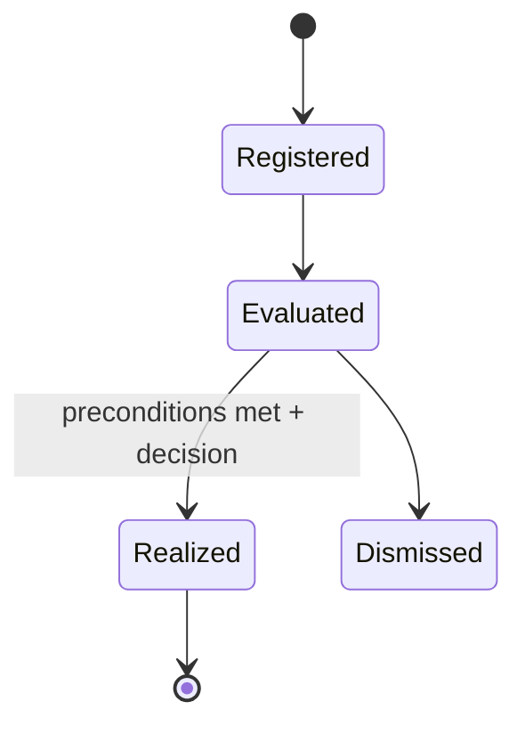
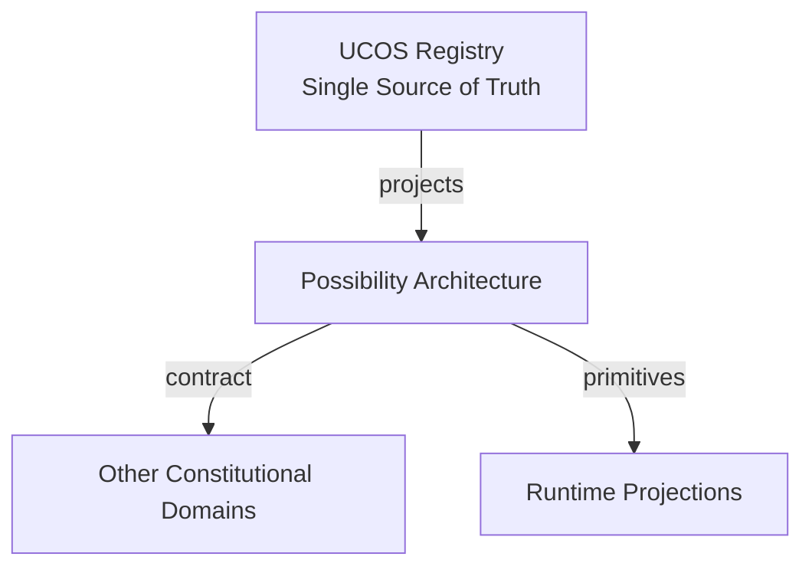
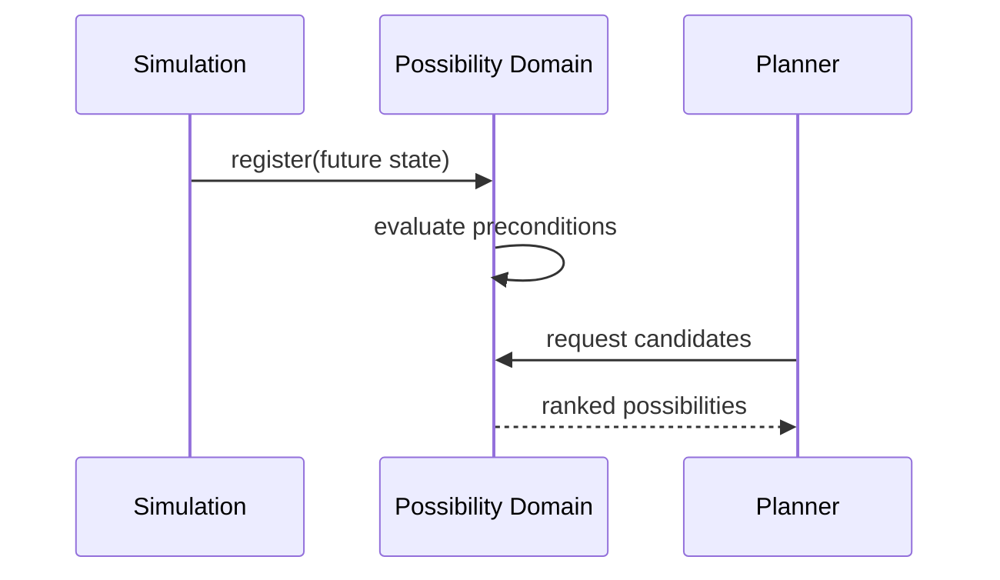
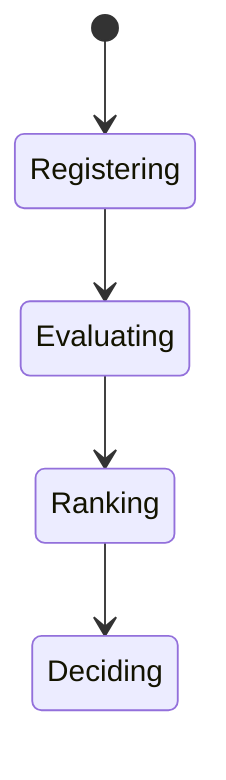
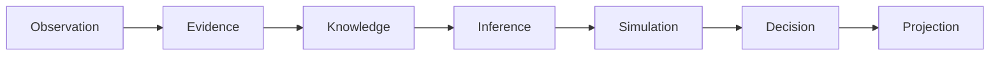
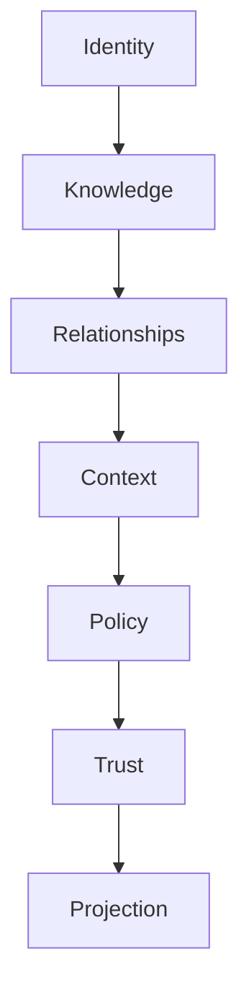

# UCOS-POSS-000001
# Possibility Architecture

**Version:** Ω∞.1  |  **Status:** Constitutional Artifact  |  **Authority:** UCOS Ω∞ Constitutional Authority
**Category:** Reality Systems  |  **Source of Truth:** `_registry/` (projected, never hand-authored)

> Constitutional notice: this document is a **projection**. Its truth lives in the registry. Editing this document directly violates Law 002 (Knowledge Once).

---

## 1. Executive Summary

**UCOS-POSS-000001 — Possibility Architecture**

This artifact is a constitutionally governed, implementation-ready specification projected from the _UCOS Registry_ single source of truth.
It conforms to the _Immutable Primitive Registry_ (27 frozen primitives) and the _Canonical Terminology Registry_ (31 governed terms).
It contains no hardcoded business, industry, currency, country, or commerce concepts. All such concepts are runtime projections.

---

## 2. Constitutional Purpose

To define the binding contract for **Possibility Architecture** such that:
- every concept it names has exactly one owner,
- every capability it exposes has exactly one boundary,
- every boundary is expressed as an explicit contract,
- every contract is enforceable by the Governance Constitution.

---

## 3. Scope

In scope: the primitives, contracts, schemas, events, and policies owned by **Possibility Architecture**.
In scope: the projection rules by which this domain exposes its truth to other domains.
In scope: the verification obligations this domain must satisfy before activation.

---

## 4. Out of Scope

Out of scope: any concept owned by another constitutional domain.
Out of scope: business, industry, commerce, country, currency, or language content (all projected).
Out of scope: mutation of another domain’s internal state.

---

## 5. Definitions

All terms in this artifact are used in their canonical sense as defined in the Canonical Terminology Registry.
Where a term appears, its `termId` is normative and its `prohibitedMeanings` are void.

---

## 6. Canonical Terminology

| Term | Canonical Definition | Owner | Prohibited Meanings |
|---|---|---|---|
| Existence | Anything that may exist. | Universal Existence Kernel | business meaning, commercial meaning, operational meaning |
| Entity | Technical representation of an Existence Object. | Identity Domain | existence itself |
| Knowledge | Interpreted information with evidence and meaning. | Knowledge Domain | data, information, evidence |
| Data | Raw observations. | Observation Domain | knowledge, meaning |
| Information | Organized data. | Observation Domain | knowledge |
| Evidence | Proof supporting an assertion. | Evidence Domain | knowledge, trust |
| Trust | Computed confidence in an assertion, derived from evidence. | Trust Domain | evidence, faith |
| Meaning | Semantic interpretation; higher-level understanding. | Semantic Domain | classification, taxonomy, ontology |
| Ontology | What exists. | Semantic Domain | taxonomy, classification |
| Taxonomy | How things are classified. | Semantic Domain | ontology, meaning |
| Classification | Assignment into taxonomy. | Semantic Domain | meaning |
| Relationship | Connection between objects. | Relationship Domain | causality |

---

## 7. Ownership Boundaries

Ownership is recorded in the _Domain Ownership Registry_.

---

## 8. Domain Responsibilities

See the Domain Ownership Registry for the authoritative responsibility list.

---

## 9. Domain Non-Responsibilities

See the Domain Ownership Registry.

---

## 10. Concepts

Possibility is a realizable future state. Possibility ≠ Simulation (the method) and ≠ Reality (the present). Possibilities are the outputs of simulations and the inputs to planning.

---

## 11. Ontology

Possibility has an origin (Simulation or Reasoning), a subject, a plausibility, and preconditions. Possibilities never claim truth — they claim realizability under conditions.

---

## 12. Taxonomy

By horizon: Immediate / Near / Far. By plausibility: Likely / Possible / Unlikely / Speculative. By desirability: Desired / Neutral / Adverse.

---

## 13. Registries

This domain is registry-driven. Its registries are entries in the Universal Registry System:

```yaml
RegistryEntry:
  registryId: UCOS-REG-DOMAIN
  owner: Constitutional Authority
  law: Knowledge Once — each concept defined exactly once
```

---

## 14. Data Model

```yaml
Possibility:
  possibilityId: <Identity>
  subject: <Identity>
  origin: <Simulation|Reasoning>
  preconditions: [<registry expression>]
  plausibility: <0..1>
  desirability: <Desired|Neutral|Adverse>
  temporal: {earliestRealization}
  context: <Context>
```

---

## 15. Graph Model

(:Possibility)-[:YIELDED_BY]->(:Simulation); (:Possibility)-[:PRECONDITION]->(:Knowledge|:State); (:Possibility)-[:CONCERNS]->(:Identity); (:Possibility)-[:PLANNED_IN]->(:Context)

---

## 16. Schemas

```yaml
# Canonical projection schema for UCOS-POSS-000001
ucos_poss_000001:
  identity:      <Identity primitive>
  intent:        <Intent primitive>
  meaning:       <Meaning primitive>
  knowledge:     <Knowledge primitive>
  registry:      <Registry primitive>
  relationship:  <Relationship primitive>
  context:       <Context primitive>
  policy:        <Policy primitive>
  authority:     <Authority primitive>
  evidence:      <Evidence primitive>
  trust:         <Trust primitive>
  temporal:      <Time primitive>
  metadata:      <Metadata primitive>
```

---

## 17. Contracts

```yaml
DomainContract:
  domain: Possibility Architecture
  commands:   []   # registry-driven
  queries:    []   # registry-driven
  events:     []   # registry-driven
  policies:   []   # registry-driven
  permissions: []  # registry-driven
```

Contract law: domains never directly access another domain’s internal structures.

---

## 18. APIs

POST /possibility.v1.register,GET  /possibility.v1/{id},GET  /possibility.v1.bySubject/{subjectId},POST /possibility.v1.evaluate

---

## 19. Events

PossibilityRegistered,PossibilityEvaluated,PossibilityRealized,PossibilityDismissed

---

## 20. Commands

possibility.register,possibility.evaluate,possibility.realize,possibility.dismiss

---

## 21. Queries

possibility.bySubject,possibility.plausible,possibility.adverse,possibility.byHorizon

---

## 22. State Machines



---

## 23. Workflows

register from simulation → evaluate plausibility against current state → decide → realize or dismiss with rationale

---

## 24. Policies

```yaml
Policy:
  identity: <Identity>
  conditions: []   # registry-driven
  actions:    []   # registry-driven
  priorities: []   # registry-driven
  exceptions: []   # registry-driven
```

All behavior derives from policy. Policy ≠ Rule: policy is behavioral governance; the rule is its executable projection.

---

## 25. Rules

```yaml
Rule:
  ruleId: <Identity>
  derivedFrom: <Policy identity>
  executable: true
  constraint: <registry expression>
```

---

## 26. Authorities

Planning Authority (evaluation); realization requires the acting domain's authority.

---

## 27. Permissions

possibility.register (simulation/reasoning authority),possibility.evaluate (planning authority),possibility.read (context-scoped)

---

## 28. Security Model

Zero Trust applies: no implicit trust between domains, services, agents, or tenants.
Every call is authenticated, authorized against Policy, and evidenced.
Cryptographic identity is issued by the Identity Domain; keys by the Key Management Architecture.

---

## 29. Privacy Model

Possibilities about individuals require aggregated or consented inputs; speculative personal futures are prohibited.

---

## 30. Trust Model

Trust is computed, never assumed. Inputs: evidence, authority, consistency, provenance, confidence.
```yaml
Trust:
  evidenceScore: <0..1>
  authorityScore: <0..1>
  consistencyScore: <0..1>
  provenanceScore: <0..1>
  confidenceScore: <0..1>
```

---

## 31. Audit Model

Every possibility records origin, preconditions, and evaluation rationale. Realization links to the Decision that authorized it.

---

## 32. Observability Model

Every action emits: What happened? Why? Who authorized it? Which policy allowed it? What evidence supports it? What confidence exists? What alternatives were evaluated?
These are the seven Explainability questions and are mandatory event fields.

---

## 33. Digital Twin Model

Possibilities are the forward-looking twin state — what the twin could become, kept strictly separate from what it is.

---

## 34. Agent Model

Possibility Agent ranks possibilities for planning agents and flags adverse ones for risk review.

---

## 35. Runtime Model

Evaluation is a precondition check against current state; registered lazily, cached by origin hash.

---

## 36. Scaling Model

Possibilities are numerous and low-cost; storage is time-bucketed with policy-driven pruning.

---

## 37. Multi-Tenant Model

Possibilities never cross tenants; shared possibilities require published relationship.

---

## 38. Geo-Distribution Model

Evaluation is jurisdiction-scoped — a possibility legal in one region may be adverse in another.

---

## 39. Failure Model

Precondition staleness, plausibility inflation, unbounded possibility accumulation.

---

## 40. Recovery Model

Possibilities are disposable; dismissal is reversible while preconditions still hold.

---

## 41. Verification Model

Before activation, Possibility Architecture must pass identity, knowledge, relationship, context, policy, authority, trust, and reality integrity checks.
Verification is performed by the Formal Verification Architecture (UCOS-FML-000001).

---

## 42. Certification Model

Possibility must declare origin, preconditions, and plausibility to inform any plan.

---

## 43. Migration Model

New horizons and desirability classes are registry additions.

---

## 44. Evolution Model

Evolution is governed and history-preserving. Primitives are frozen; extension occurs through registries, policies, capabilities, contexts, relationships, knowledge, agents, and projections — never through primitive expansion.

---

## 45. Implementation Blueprint

Build order for POSS: (1) define registry entries — this domain owns by horizon: immediate / near / far as registry truth, not code; (2) implement the contract surface first (possibility.register, possibility.evaluate, possibility.realize) and validate against POSS boundaries; (3) event-source all state so history is reconstructable; (4) wire the enforcement points — authority check, policy guard, evidence binding, trace — in-line, with no bypass path; (5) add tests per the Testing Architecture, citing evidence per gate; (6) obtain Verification and Certification before activation. Acceptance: the Zero Partial and Law 001 audits pass, every action answers the seven explainability questions, and this domain mutates no other domain internals.

---

## 46. Reference Architecture Diagram



---

## 47. Sequence Diagrams



---

## 48. State Diagrams



---

## 49. Data Flow Diagrams



---

## 50. Dependency Maps



Forbidden: circular dependencies, mutual ownership, cross-domain state mutation.

---

## ∞

Constitutionally governed. Implementation ready. Universally extensible.