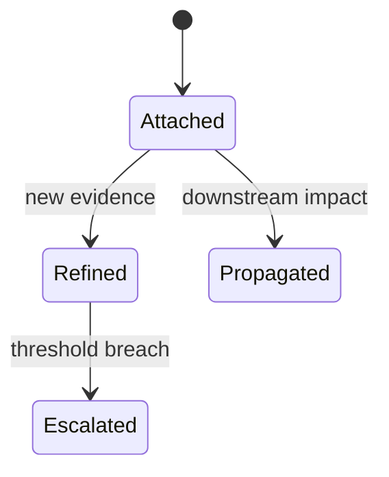
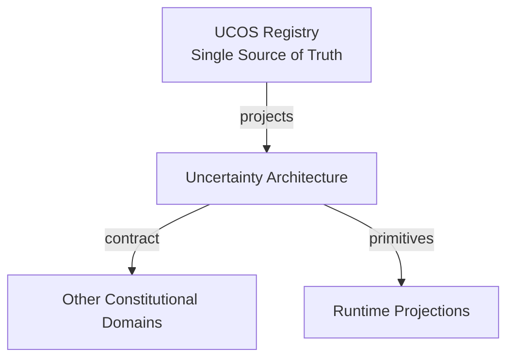
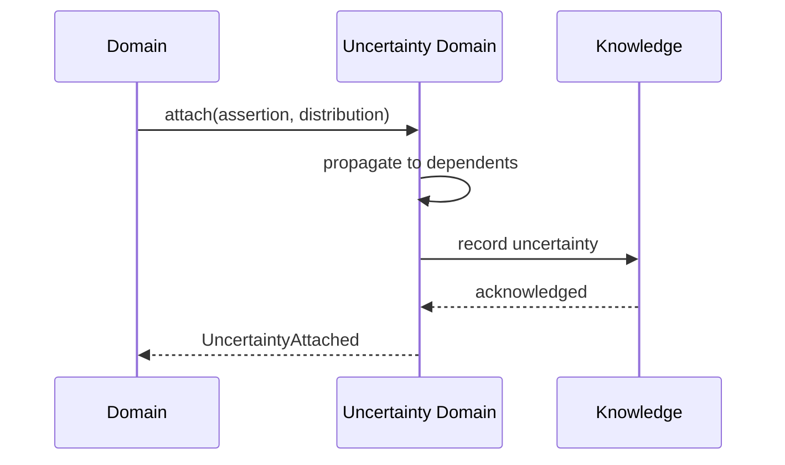
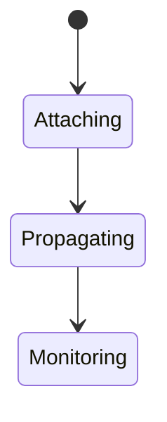
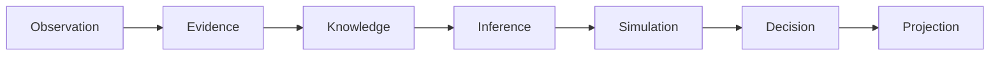
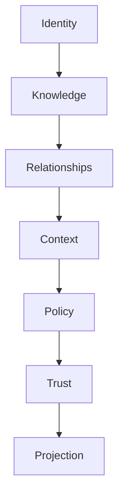

# UCOS-UNC-000001
# Uncertainty Architecture

**Version:** Ω∞.1  |  **Status:** Constitutional Artifact  |  **Authority:** UCOS Ω∞ Constitutional Authority
**Category:** Reality Systems  |  **Source of Truth:** `_registry/` (projected, never hand-authored)

> Constitutional notice: this document is a **projection**. Its truth lives in the registry. Editing this document directly violates Law 002 (Knowledge Once).

---

## 1. Executive Summary

**UCOS-UNC-000001 — Uncertainty Architecture**

This artifact is a constitutionally governed, implementation-ready specification projected from the _UCOS Registry_ single source of truth.
It conforms to the _Immutable Primitive Registry_ (27 frozen primitives) and the _Canonical Terminology Registry_ (31 governed terms).
It contains no hardcoded business, industry, currency, country, or commerce concepts. All such concepts are runtime projections.

---

## 2. Constitutional Purpose

To define the binding contract for **Uncertainty Architecture** such that:
- every concept it names has exactly one owner,
- every capability it exposes has exactly one boundary,
- every boundary is expressed as an explicit contract,
- every contract is enforceable by the Governance Constitution.

---

## 3. Scope

In scope: the primitives, contracts, schemas, events, and policies owned by **Uncertainty Architecture**.
In scope: the projection rules by which this domain exposes its truth to other domains.
In scope: the verification obligations this domain must satisfy before activation.

---

## 4. Out of Scope

Out of scope: any concept owned by another constitutional domain.
Out of scope: business, industry, commerce, country, currency, or language content (all projected).
Out of scope: mutation of another domain’s internal state.

---

## 5. Definitions

All terms in this artifact are used in their canonical sense as defined in the Canonical Terminology Registry.
Where a term appears, its `termId` is normative and its `prohibitedMeanings` are void.

---

## 6. Canonical Terminology

| Term | Canonical Definition | Owner | Prohibited Meanings |
|---|---|---|---|
| Existence | Anything that may exist. | Universal Existence Kernel | business meaning, commercial meaning, operational meaning |
| Entity | Technical representation of an Existence Object. | Identity Domain | existence itself |
| Knowledge | Interpreted information with evidence and meaning. | Knowledge Domain | data, information, evidence |
| Data | Raw observations. | Observation Domain | knowledge, meaning |
| Information | Organized data. | Observation Domain | knowledge |
| Evidence | Proof supporting an assertion. | Evidence Domain | knowledge, trust |
| Trust | Computed confidence in an assertion, derived from evidence. | Trust Domain | evidence, faith |
| Meaning | Semantic interpretation; higher-level understanding. | Semantic Domain | classification, taxonomy, ontology |
| Ontology | What exists. | Semantic Domain | taxonomy, classification |
| Taxonomy | How things are classified. | Semantic Domain | ontology, meaning |
| Classification | Assignment into taxonomy. | Semantic Domain | meaning |
| Relationship | Connection between objects. | Relationship Domain | causality |

---

## 7. Ownership Boundaries

Ownership is recorded in the _Domain Ownership Registry_.

---

## 8. Domain Responsibilities

See the Domain Ownership Registry for the authoritative responsibility list.

---

## 9. Domain Non-Responsibilities

See the Domain Ownership Registry.

---

## 10. Concepts

Uncertainty is first-class. Confidence, probability, ambiguity, competing truths, incomplete knowledge, and unknown knowledge are all modeled explicitly — never hidden behind false precision.

---

## 11. Ontology

Uncertainty attaches to any assertion as a distribution or interval, not a point value. Unknown-ness is a state, not an error: 'we do not know' is a valid, recorded answer.

---

## 12. Taxonomy

By kind: Aleatoric (inherent) / Epistemic (knowledge gap) / Ambiguity (multiple readings) / Conflict (competing truths). By representation: Probability / Interval / Fuzzy / Qualitative.

---

## 13. Registries

This domain is registry-driven. Its registries are entries in the Universal Registry System:

```yaml
RegistryEntry:
  registryId: UCOS-REG-DOMAIN
  owner: Constitutional Authority
  law: Knowledge Once — each concept defined exactly once
```

---

## 14. Data Model

```yaml
Uncertainty:
  uncertaintyId: <Identity>
  subject: <Identity>
  kind: <registry id>
  representation: <Probability|Interval|Fuzzy|Qualitative>
  parameters: <registry expression>
  confidence: <0..1>
  alternatives: [<alternative assertions>]
  ambiguity: <registry measure>
  asOf: <Time>
```

---

## 15. Graph Model

(:Uncertainty)-[:QUALIFIES]->(:Knowledge|:Assertion); (:Uncertainty)-[:ALTERNATIVE]->(:Knowledge); (:Uncertainty)-[:MEASURED_AT]->(:Time)

---

## 16. Schemas

```yaml
# Canonical projection schema for UCOS-UNC-000001
ucos_unc_000001:
  identity:      <Identity primitive>
  intent:        <Intent primitive>
  meaning:       <Meaning primitive>
  knowledge:     <Knowledge primitive>
  registry:      <Registry primitive>
  relationship:  <Relationship primitive>
  context:       <Context primitive>
  policy:        <Policy primitive>
  authority:     <Authority primitive>
  evidence:      <Evidence primitive>
  trust:         <Trust primitive>
  temporal:      <Time primitive>
  metadata:      <Metadata primitive>
```

---

## 17. Contracts

```yaml
DomainContract:
  domain: Uncertainty Architecture
  commands:   []   # registry-driven
  queries:    []   # registry-driven
  events:     []   # registry-driven
  policies:   []   # registry-driven
  permissions: []  # registry-driven
```

Contract law: domains never directly access another domain’s internal structures.

---

## 18. APIs

POST /uncertainty.v1.attach,GET  /uncertainty.v1/{id},GET  /uncertainty.v1.bySubject/{subjectId},POST /uncertainty.v1.propagate

---

## 19. Events

UncertaintyAttached,UncertaintyRefined,UncertaintyPropagated,UncertaintyEscalated

---

## 20. Commands

uncertainty.attach,uncertainty.refine,uncertainty.propagate,uncertainty.escalate

---

## 21. Queries

uncertainty.bySubject,uncertainty.lowConfidence,uncertainty.alternatives,uncertainty.byKind

---

## 22. State Machines



---

## 23. Workflows

attach uncertainty to assertion → propagate through dependents → refine on evidence → escalate on threshold breach

---

## 24. Policies

```yaml
Policy:
  identity: <Identity>
  conditions: []   # registry-driven
  actions:    []   # registry-driven
  priorities: []   # registry-driven
  exceptions: []   # registry-driven
```

All behavior derives from policy. Policy ≠ Rule: policy is behavioral governance; the rule is its executable projection.

---

## 25. Rules

```yaml
Rule:
  ruleId: <Identity>
  derivedFrom: <Policy identity>
  executable: true
  constraint: <registry expression>
```

---

## 26. Authorities

Domain Authority (attachment); escalation routed to the owning domain's governance.

---

## 27. Permissions

uncertainty.attach (domain authority),uncertainty.read (context-scoped)

---

## 28. Security Model

Zero Trust applies: no implicit trust between domains, services, agents, or tenants.
Every call is authenticated, authorized against Policy, and evidenced.
Cryptographic identity is issued by the Identity Domain; keys by the Key Management Architecture.

---

## 29. Privacy Model

Uncertainty over personal subjects uses aggregated parameters; individual-level distributions require consent.

---

## 30. Trust Model

Trust is computed, never assumed. Inputs: evidence, authority, consistency, provenance, confidence.
```yaml
Trust:
  evidenceScore: <0..1>
  authorityScore: <0..1>
  consistencyScore: <0..1>
  provenanceScore: <0..1>
  confidenceScore: <0..1>
```

---

## 31. Audit Model

Every refinement records the evidence that moved the estimate — uncertainty provenance is fully traceable.

---

## 32. Observability Model

Every action emits: What happened? Why? Who authorized it? Which policy allowed it? What evidence supports it? What confidence exists? What alternatives were evaluated?
These are the seven Explainability questions and are mandatory event fields.

---

## 33. Digital Twin Model

Twins expose uncertainty alongside state; a twin that reports certainty without justification is non-compliant.

---

## 34. Agent Model

Uncertainty Agent monitors thresholds and escalates before downstream decisions over-trust weak assertions.

---

## 35. Runtime Model

Propagation is a graph traversal recomputing dependent confidences; cached per assertion version.

---

## 36. Scaling Model

Propagation batches on evidence events; hot assertions are pre-propagated.

---

## 37. Multi-Tenant Model

Uncertainty never crosses tenants; shared assertions carry shared uncertainty.

---

## 38. Geo-Distribution Model

Estimation standards are jurisdiction-aware; regulatory contexts may require conservative bounds.

---

## 39. Failure Model

Propagation cycle, over-precise collapse, threshold storm, contradiction with recorded certainty.

---

## 40. Recovery Model

Estimates recompute from evidence history; attaching uncertainty is reversible by refinement.

---

## 41. Verification Model

Before activation, Uncertainty Architecture must pass identity, knowledge, relationship, context, policy, authority, trust, and reality integrity checks.
Verification is performed by the Formal Verification Architecture (UCOS-FML-000001).

---

## 42. Certification Model

Assertion must declare uncertainty to be used in automated decisions — silent certainty is prohibited.

---

## 43. Migration Model

New kinds/representations are registry additions; existing estimates re-propagate on kind change.

---

## 44. Evolution Model

Evolution is governed and history-preserving. Primitives are frozen; extension occurs through registries, policies, capabilities, contexts, relationships, knowledge, agents, and projections — never through primitive expansion.

---

## 45. Implementation Blueprint

Build order for UNC: (1) define registry entries — this domain owns by kind: aleatoric (inherent) / epistemic (knowledge gap) / ambiguity (multiple readings) / conflict (competing truths) as registry truth, not code; (2) implement the contract surface first (uncertainty.attach, uncertainty.refine, uncertainty.propagate) and validate against UNC boundaries; (3) event-source all state so history is reconstructable; (4) wire the enforcement points — authority check, policy guard, evidence binding, trace — in-line, with no bypass path; (5) add tests per the Testing Architecture, citing evidence per gate; (6) obtain Verification and Certification before activation. Acceptance: the Zero Partial and Law 001 audits pass, every action answers the seven explainability questions, and this domain mutates no other domain internals.

---

## 46. Reference Architecture Diagram



---

## 47. Sequence Diagrams



---

## 48. State Diagrams



---

## 49. Data Flow Diagrams



---

## 50. Dependency Maps



Forbidden: circular dependencies, mutual ownership, cross-domain state mutation.

---

## ∞

Constitutionally governed. Implementation ready. Universally extensible.