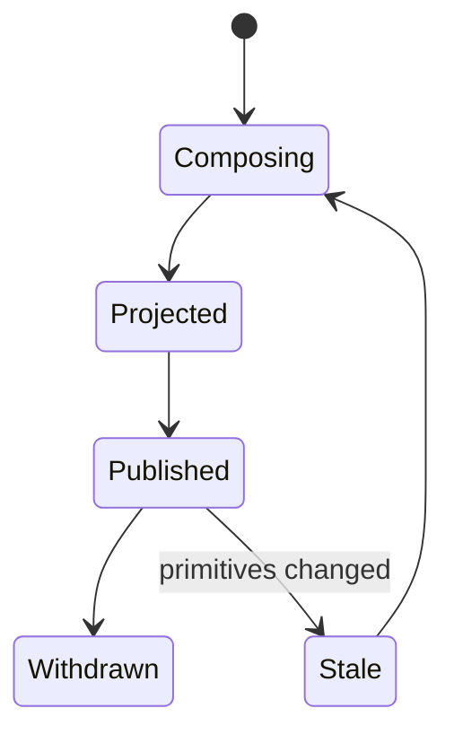
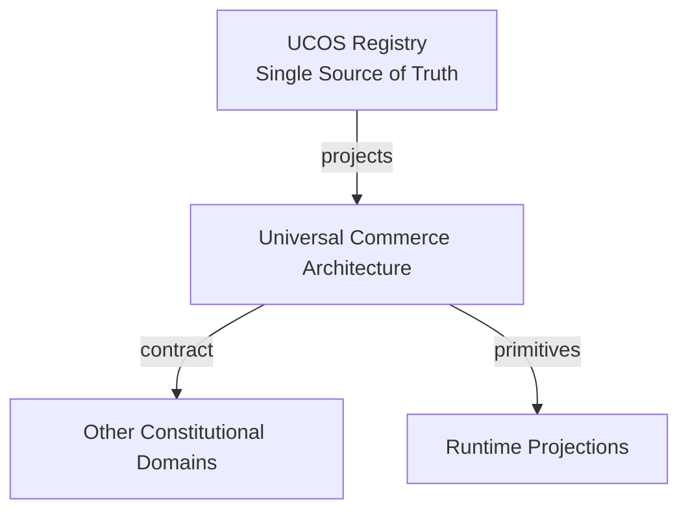
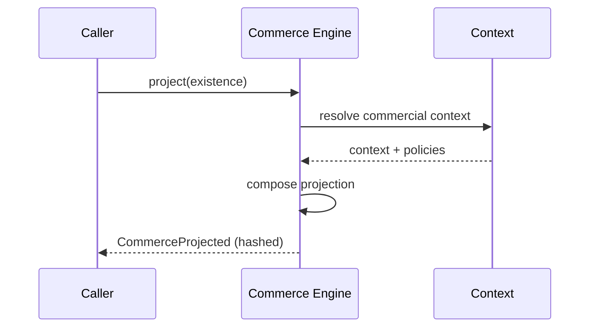
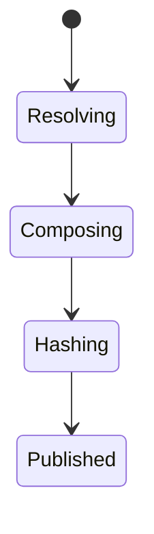
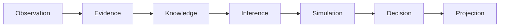
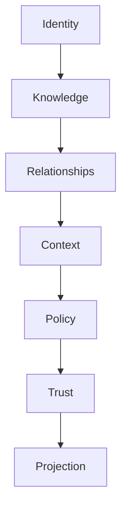

# UCOS-COM-000001
# Universal Commerce Architecture

**Version:** Ω∞.1  |  **Status:** Constitutional Artifact  |  **Authority:** UCOS Ω∞ Constitutional Authority
**Category:** Commerce  |  **Source of Truth:** `_registry/` (projected, never hand-authored)

> Constitutional notice: this document is a **projection**. Its truth lives in the registry. Editing this document directly violates Law 002 (Knowledge Once).

---

## 1. Executive Summary

**UCOS-COM-000001 — Universal Commerce Architecture**

This artifact is a constitutionally governed, implementation-ready specification projected from the _UCOS Registry_ single source of truth.
It conforms to the _Immutable Primitive Registry_ (27 frozen primitives) and the _Canonical Terminology Registry_ (31 governed terms).
It contains no hardcoded business, industry, currency, country, or commerce concepts. All such concepts are runtime projections.

---

## 2. Constitutional Purpose

To define the binding contract for **Universal Commerce Architecture** such that:
- every concept it names has exactly one owner,
- every capability it exposes has exactly one boundary,
- every boundary is expressed as an explicit contract,
- every contract is enforceable by the Governance Constitution.

---

## 3. Scope

In scope: the primitives, contracts, schemas, events, and policies owned by **Universal Commerce Architecture**.
In scope: the projection rules by which this domain exposes its truth to other domains.
In scope: the verification obligations this domain must satisfy before activation.

---

## 4. Out of Scope

Out of scope: any concept owned by another constitutional domain.
Out of scope: business, industry, commerce, country, currency, or language content (all projected).
Out of scope: mutation of another domain’s internal state.

---

## 5. Definitions

All terms in this artifact are used in their canonical sense as defined in the Canonical Terminology Registry.
Where a term appears, its `termId` is normative and its `prohibitedMeanings` are void.

---

## 6. Canonical Terminology

| Term | Canonical Definition | Owner | Prohibited Meanings |
|---|---|---|---|
| Existence | Anything that may exist. | Universal Existence Kernel | business meaning, commercial meaning, operational meaning |
| Entity | Technical representation of an Existence Object. | Identity Domain | existence itself |
| Knowledge | Interpreted information with evidence and meaning. | Knowledge Domain | data, information, evidence |
| Data | Raw observations. | Observation Domain | knowledge, meaning |
| Information | Organized data. | Observation Domain | knowledge |
| Evidence | Proof supporting an assertion. | Evidence Domain | knowledge, trust |
| Trust | Computed confidence in an assertion, derived from evidence. | Trust Domain | evidence, faith |
| Meaning | Semantic interpretation; higher-level understanding. | Semantic Domain | classification, taxonomy, ontology |
| Ontology | What exists. | Semantic Domain | taxonomy, classification |
| Taxonomy | How things are classified. | Semantic Domain | ontology, meaning |
| Classification | Assignment into taxonomy. | Semantic Domain | meaning |
| Relationship | Connection between objects. | Relationship Domain | causality |

---

## 7. Ownership Boundaries

Ownership is recorded in the _Domain Ownership Registry_.

---

## 8. Domain Responsibilities

See the Domain Ownership Registry for the authoritative responsibility list.

---

## 9. Domain Non-Responsibilities

See the Domain Ownership Registry.

---

## 10. Concepts

Universal Commerce projects commercial reality from primitives. A commercial object = Existence + Knowledge + Meaning + Relationships + Context + Policies + Authorities + Time. Products, services, bundles, offers, subscriptions, contracts, licenses, memberships, listings, assets, and experiences are all projections — never stored, never hardcoded.

---

## 11. Ontology

Commerce is a Reality type (Commercial Reality), not a domain of stored objects. Commercial projection is a pure function of primitives resolved within a Context.

---

## 12. Taxonomy

By projection: Product / Service / Bundle / Offer / Subscription / Contract / License / Membership / Listing / Asset / Experience. By model: One-time / Recurring / Usage / Consignment / Marketplace / Hybrid. By channel: Any (channel is a Context, not a type).

---

## 13. Registries

This domain is registry-driven. Its registries are entries in the Universal Registry System:

```yaml
RegistryEntry:
  registryId: UCOS-REG-DOMAIN
  owner: Constitutional Authority
  law: Knowledge Once — each concept defined exactly once
```

---

## 14. Data Model

```yaml
CommercialProjection:
  projectionId: <Identity>
  existence: <Identity>
  knowledge: [<Knowledge>]
  meaning: <SemanticModel>
  relationships: [<Relationship>]
  context: <Context>
  policies: [<Policy>]
  authorities: [<Authority>]
  temporal: {asOf, validIn}
  projectionHash: <content-addressed>
```

---

## 15. Graph Model

(:Projection)-[:PROJECTS]->(:Existence); (:Projection)-[:VALID_IN]->(:Context); (:Projection)-[:PRICED_BY]->(:PricingProjection); (:Projection)-[:OFFERED_AS]->(:OfferProjection)

---

## 16. Schemas

```yaml
# Canonical projection schema for UCOS-COM-000001
ucos_com_000001:
  identity:      <Identity primitive>
  intent:        <Intent primitive>
  meaning:       <Meaning primitive>
  knowledge:     <Knowledge primitive>
  registry:      <Registry primitive>
  relationship:  <Relationship primitive>
  context:       <Context primitive>
  policy:        <Policy primitive>
  authority:     <Authority primitive>
  evidence:      <Evidence primitive>
  trust:         <Trust primitive>
  temporal:      <Time primitive>
  metadata:      <Metadata primitive>
```

---

## 17. Contracts

```yaml
DomainContract:
  domain: Universal Commerce Architecture
  commands:   []   # registry-driven
  queries:    []   # registry-driven
  events:     []   # registry-driven
  policies:   []   # registry-driven
  permissions: []  # registry-driven
```

Contract law: domains never directly access another domain’s internal structures.

---

## 18. APIs

POST /commerce.v1.project,GET  /commerce.v1/{id},POST /commerce.v1.query,GET  /commerce.v1.byContext/{contextId}

---

## 19. Events

CommerceProjected,CommerceReprojected,CommercePublished,CommerceWithdrawn

---

## 20. Commands

commerce.project,commerce.reproject,commerce.publish,commerce.withdraw

---

## 21. Queries

commerce.byId,commerce.byContext,commerce.catalog,commerce.timeline

---

## 22. State Machines



---

## 23. Workflows

resolve existence → gather knowledge + meaning → traverse relationships → apply context + policies → project → publish with hash

---

## 24. Policies

```yaml
Policy:
  identity: <Identity>
  conditions: []   # registry-driven
  actions:    []   # registry-driven
  priorities: []   # registry-driven
  exceptions: []   # registry-driven
```

All behavior derives from policy. Policy ≠ Rule: policy is behavioral governance; the rule is its executable projection.

---

## 25. Rules

```yaml
Rule:
  ruleId: <Identity>
  derivedFrom: <Policy identity>
  executable: true
  constraint: <registry expression>
```

---

## 26. Authorities

Context Authority (what may be projected in scope); Merchant Authority (publication).

---

## 27. Permissions

commerce.project (context-scoped writer),commerce.publish (merchant authority),commerce.read (context-scoped)

---

## 28. Security Model

Zero Trust applies: no implicit trust between domains, services, agents, or tenants.
Every call is authenticated, authorized against Policy, and evidenced.
Cryptographic identity is issued by the Identity Domain; keys by the Key Management Architecture.

---

## 29. Privacy Model

Projections involving personal data minimize via Perspective before publication; commercial identity is pseudonymous by default.

---

## 30. Trust Model

Trust is computed, never assumed. Inputs: evidence, authority, consistency, provenance, confidence.
```yaml
Trust:
  evidenceScore: <0..1>
  authorityScore: <0..1>
  consistencyScore: <0..1>
  provenanceScore: <0..1>
  confidenceScore: <0..1>
```

---

## 31. Audit Model

Every projection records its primitive inputs and hash, so any commercial object is reproducible and its history reconstructable.

---

## 32. Observability Model

Every action emits: What happened? Why? Who authorized it? Which policy allowed it? What evidence supports it? What confidence exists? What alternatives were evaluated?
These are the seven Explainability questions and are mandatory event fields.

---

## 33. Digital Twin Model

Commercial Twin mirrors the real-world commercial state (availability, status, ownership) continuously from observations.

---

## 34. Agent Model

Commerce Agent detects projection staleness when primitives change and re-projects under governance.

---

## 35. Runtime Model

Projections are computed and content-hashed; caching keyed by input primitive versions guarantees consistency.

---

## 36. Scaling Model

Projection is parallelizable per existence; catalog reads serve cached hashes with primitive-version invalidation.

---

## 37. Multi-Tenant Model

Commerce projections are strictly tenant-scoped; cross-tenant catalog requires published marketplace relationship.

---

## 38. Geo-Distribution Model

Contextual distribution is projection-time: language, currency, tax, compliance are applied from the Context registry — never compiled in.

---

## 39. Failure Model

Primitive staleness, context policy conflict, authority gap, hash mismatch on re-projection.

---

## 40. Recovery Model

Projections are pure functions of primitives — recovery is re-derivation, never restore.

---

## 41. Verification Model

Before activation, Universal Commerce Architecture must pass identity, knowledge, relationship, context, policy, authority, trust, and reality integrity checks.
Verification is performed by the Formal Verification Architecture (UCOS-FML-000001).

---

## 42. Certification Model

Projection must pass primitive-conformance (zero hardcoded commerce terms), context validity, and hash reproducibility.

---

## 43. Migration Model

New commercial models are registry additions to projection types; no schema migration ever touches primitives.

---

## 44. Evolution Model

Evolution is governed and history-preserving. Primitives are frozen; extension occurs through registries, policies, capabilities, contexts, relationships, knowledge, agents, and projections — never through primitive expansion.

---

## 45. Implementation Blueprint

Build order for COM: (1) define registry entries — this domain owns by projection: product / service / bundle / offer / subscription / contract / license / membership / listing / asset / experience as registry truth, not code; (2) implement the contract surface first (commerce.project, commerce.reproject, commerce.publish) and validate against COM boundaries; (3) event-source all state so history is reconstructable; (4) wire the enforcement points — authority check, policy guard, evidence binding, trace — in-line, with no bypass path; (5) add tests per the Testing Architecture, citing evidence per gate; (6) obtain Verification and Certification before activation. Acceptance: the Zero Partial and Law 001 audits pass, every action answers the seven explainability questions, and this domain mutates no other domain internals.

---

## 46. Reference Architecture Diagram



---

## 47. Sequence Diagrams



---

## 48. State Diagrams



---

## 49. Data Flow Diagrams



---

## 50. Dependency Maps



Forbidden: circular dependencies, mutual ownership, cross-domain state mutation.

---

## ∞

Constitutionally governed. Implementation ready. Universally extensible.