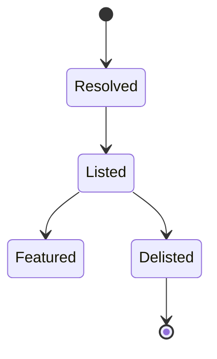
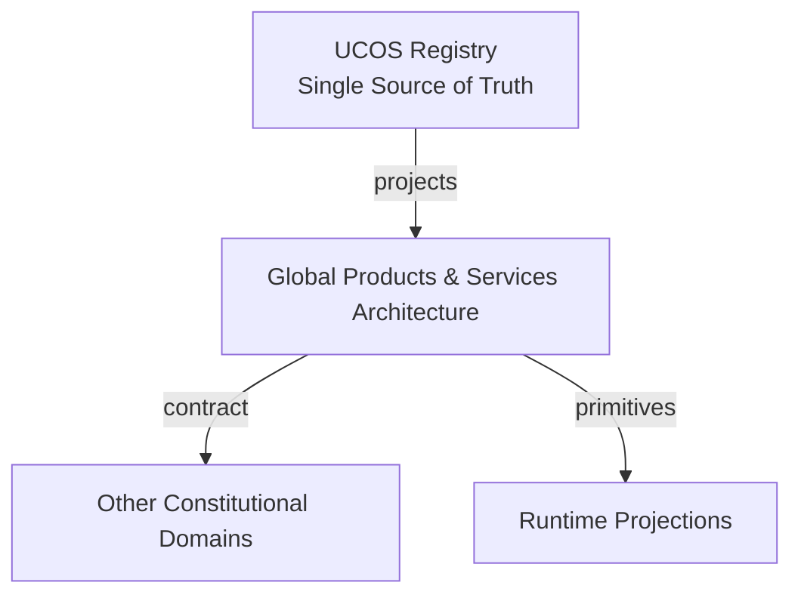
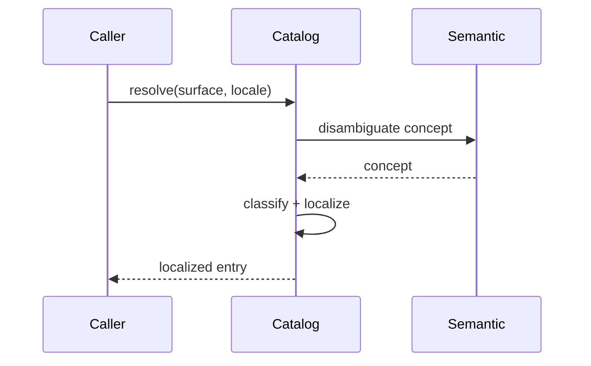
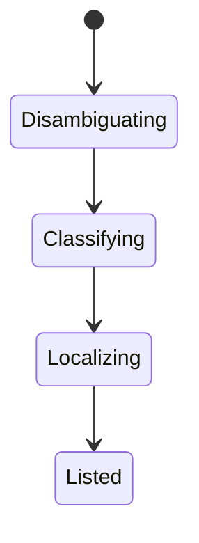
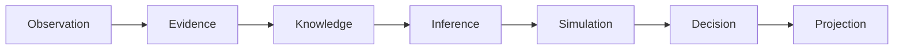
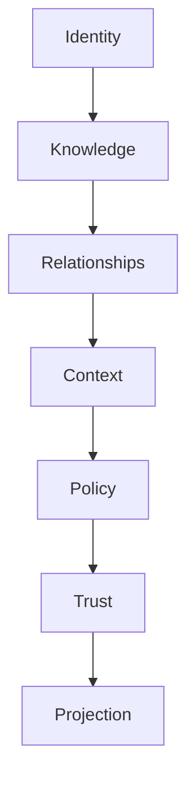

# UCOS-GPS-000001
# Global Products & Services Architecture

**Version:** Ω∞.1  |  **Status:** Constitutional Artifact  |  **Authority:** UCOS Ω∞ Constitutional Authority
**Category:** Commerce  |  **Source of Truth:** `_registry/` (projected, never hand-authored)

> Constitutional notice: this document is a **projection**. Its truth lives in the registry. Editing this document directly violates Law 002 (Knowledge Once).

---

## 1. Executive Summary

**UCOS-GPS-000001 — Global Products & Services Architecture**

This artifact is a constitutionally governed, implementation-ready specification projected from the _UCOS Registry_ single source of truth.
It conforms to the _Immutable Primitive Registry_ (27 frozen primitives) and the _Canonical Terminology Registry_ (31 governed terms).
It contains no hardcoded business, industry, currency, country, or commerce concepts. All such concepts are runtime projections.

---

## 2. Constitutional Purpose

To define the binding contract for **Global Products & Services Architecture** such that:
- every concept it names has exactly one owner,
- every capability it exposes has exactly one boundary,
- every boundary is expressed as an explicit contract,
- every contract is enforceable by the Governance Constitution.

---

## 3. Scope

In scope: the primitives, contracts, schemas, events, and policies owned by **Global Products & Services Architecture**.
In scope: the projection rules by which this domain exposes its truth to other domains.
In scope: the verification obligations this domain must satisfy before activation.

---

## 4. Out of Scope

Out of scope: any concept owned by another constitutional domain.
Out of scope: business, industry, commerce, country, currency, or language content (all projected).
Out of scope: mutation of another domain’s internal state.

---

## 5. Definitions

All terms in this artifact are used in their canonical sense as defined in the Canonical Terminology Registry.
Where a term appears, its `termId` is normative and its `prohibitedMeanings` are void.

---

## 6. Canonical Terminology

| Term | Canonical Definition | Owner | Prohibited Meanings |
|---|---|---|---|
| Existence | Anything that may exist. | Universal Existence Kernel | business meaning, commercial meaning, operational meaning |
| Entity | Technical representation of an Existence Object. | Identity Domain | existence itself |
| Knowledge | Interpreted information with evidence and meaning. | Knowledge Domain | data, information, evidence |
| Data | Raw observations. | Observation Domain | knowledge, meaning |
| Information | Organized data. | Observation Domain | knowledge |
| Evidence | Proof supporting an assertion. | Evidence Domain | knowledge, trust |
| Trust | Computed confidence in an assertion, derived from evidence. | Trust Domain | evidence, faith |
| Meaning | Semantic interpretation; higher-level understanding. | Semantic Domain | classification, taxonomy, ontology |
| Ontology | What exists. | Semantic Domain | taxonomy, classification |
| Taxonomy | How things are classified. | Semantic Domain | ontology, meaning |
| Classification | Assignment into taxonomy. | Semantic Domain | meaning |
| Relationship | Connection between objects. | Relationship Domain | causality |

---

## 7. Ownership Boundaries

Ownership is recorded in the _Domain Ownership Registry_.

---

## 8. Domain Responsibilities

See the Domain Ownership Registry for the authoritative responsibility list.

---

## 9. Domain Non-Responsibilities

See the Domain Ownership Registry.

---

## 10. Concepts

Global Products & Services supports all industries, categories, product types, service types, business models, languages, currencies, regions, countries, territories, marketplaces, channels, and future commercial domains without redesign. This is achieved because none of those concepts exist in the platform — they are registry entries projected at runtime.

---

## 11. Ontology

A product or service is an Existence with commercial projections. Industry, category, brand, and channel are Context and Semantic constructs, not schema fields.

---

## 12. Taxonomy

By projection type: Product / Service / Digital / Physical / Hybrid / Future. By model: any registry-defined commercial model. By reach: Local / National / Global / Future.

---

## 13. Registries

This domain is registry-driven. Its registries are entries in the Universal Registry System:

```yaml
RegistryEntry:
  registryId: UCOS-REG-DOMAIN
  owner: Constitutional Authority
  law: Knowledge Once — each concept defined exactly once
```

---

## 14. Data Model

```yaml
GlobalCatalogEntry:
  existence: <Identity>
  semanticConcept: <SemanticModel>   # 'phone' across all languages
  classifications: [<Taxonomy node>]
  contexts: [<Context>]               # where it is offered
  commercialProjections: [<CommercialProjection>]
  localization: [{locale, projection}]
```

---

## 15. Graph Model

(:Entry)-[:SEMANTIC_CONCEPT]->(:Concept); (:Entry)-[:CLASSIFIED_AS]->(:Category); (:Entry)-[:OFFERED_IN]->(:Context); (:Entry)-[:LOCALIZED_AS]->(:Localization)

---

## 16. Schemas

```yaml
# Canonical projection schema for UCOS-GPS-000001
ucos_gps_000001:
  identity:      <Identity primitive>
  intent:        <Intent primitive>
  meaning:       <Meaning primitive>
  knowledge:     <Knowledge primitive>
  registry:      <Registry primitive>
  relationship:  <Relationship primitive>
  context:       <Context primitive>
  policy:        <Policy primitive>
  authority:     <Authority primitive>
  evidence:      <Evidence primitive>
  trust:         <Trust primitive>
  temporal:      <Time primitive>
  metadata:      <Metadata primitive>
```

---

## 17. Contracts

```yaml
DomainContract:
  domain: Global Products & Services Architecture
  commands:   []   # registry-driven
  queries:    []   # registry-driven
  events:     []   # registry-driven
  policies:   []   # registry-driven
  permissions: []  # registry-driven
```

Contract law: domains never directly access another domain’s internal structures.

---

## 18. APIs

GET  /catalog.v1.entry/{id},POST /catalog.v1.query,GET  /catalog.v1.localized/{id}/{locale},POST /catalog.v1.resolve

---

## 19. Events

CatalogResolved,CatalogLocalized,CatalogDelisted,CatalogFeatured

---

## 20. Commands

catalog.resolve,catalog.localize,catalog.feature,catalog.delist

---

## 21. Queries

catalog.search,catalog.byCategory,catalog.byContext,catalog.timeline

---

## 22. State Machines



---

## 23. Workflows

resolve existence + semantic concept → classify per context → localize per locale → list under context policy

---

## 24. Policies

```yaml
Policy:
  identity: <Identity>
  conditions: []   # registry-driven
  actions:    []   # registry-driven
  priorities: []   # registry-driven
  exceptions: []   # registry-driven
```

All behavior derives from policy. Policy ≠ Rule: policy is behavioral governance; the rule is its executable projection.

---

## 25. Rules

```yaml
Rule:
  ruleId: <Identity>
  derivedFrom: <Policy identity>
  executable: true
  constraint: <registry expression>
```

---

## 26. Authorities

Catalog Authority (listing), Locale Authority (localization validity).

---

## 27. Permissions

catalog.list (catalog authority),catalog.localize (locale authority),catalog.read (context-scoped)

---

## 28. Security Model

Zero Trust applies: no implicit trust between domains, services, agents, or tenants.
Every call is authenticated, authorized against Policy, and evidenced.
Cryptographic identity is issued by the Identity Domain; keys by the Key Management Architecture.

---

## 29. Privacy Model

Catalog entries with personal attribution (e.g., artisan provenance) require consent scope.

---

## 30. Trust Model

Trust is computed, never assumed. Inputs: evidence, authority, consistency, provenance, confidence.
```yaml
Trust:
  evidenceScore: <0..1>
  authorityScore: <0..1>
  consistencyScore: <0..1>
  provenanceScore: <0..1>
  confidenceScore: <0..1>
```

---

## 31. Audit Model

Every listing and localization records authority, context, and semantic version.

---

## 32. Observability Model

Every action emits: What happened? Why? Who authorized it? Which policy allowed it? What evidence supports it? What confidence exists? What alternatives were evaluated?
These are the seven Explainability questions and are mandatory event fields.

---

## 33. Digital Twin Model

Catalog Twin tracks real-world availability and lifecycle state across all contexts.

---

## 34. Agent Model

Catalog Agent auto-completes semantics, detects duplicates across locales, and proposes classifications.

---

## 35. Runtime Model

Resolution is locale-aware with semantic disambiguation; catalog reads are the hottest path and heavily cached.

---

## 36. Scaling Model

Globally replicated read layer; write path is authority-gated and low-throughput.

---

## 37. Multi-Tenant Model

Catalogs are tenant-scoped; a shared marketplace aggregates with explicit published relationship.

---

## 38. Geo-Distribution Model

Localization and compliance projection are per-region; the same existence projects differently per jurisdiction.

---

## 39. Failure Model

Semantic ambiguity across locales, category orphaning, context policy conflict, stale localization.

---

## 40. Recovery Model

Entries re-project from primitives; localization history is versioned and reversible.

---

## 41. Verification Model

Before activation, Global Products & Services Architecture must pass identity, knowledge, relationship, context, policy, authority, trust, and reality integrity checks.
Verification is performed by the Formal Verification Architecture (UCOS-FML-000001).

---

## 42. Certification Model

Entry must pass semantic uniqueness, classification validity, and localization completeness.

---

## 43. Migration Model

New locales/industries are registry additions — zero downtime, zero schema change.

---

## 44. Evolution Model

Evolution is governed and history-preserving. Primitives are frozen; extension occurs through registries, policies, capabilities, contexts, relationships, knowledge, agents, and projections — never through primitive expansion.

---

## 45. Implementation Blueprint

Build order for GPS: (1) define registry entries — this domain owns by projection type: product / service / digital / physical / hybrid / future as registry truth, not code; (2) implement the contract surface first (catalog.resolve, catalog.localize, catalog.feature) and validate against GPS boundaries; (3) event-source all state so history is reconstructable; (4) wire the enforcement points — authority check, policy guard, evidence binding, trace — in-line, with no bypass path; (5) add tests per the Testing Architecture, citing evidence per gate; (6) obtain Verification and Certification before activation. Acceptance: the Zero Partial and Law 001 audits pass, every action answers the seven explainability questions, and this domain mutates no other domain internals.

---

## 46. Reference Architecture Diagram



---

## 47. Sequence Diagrams



---

## 48. State Diagrams



---

## 49. Data Flow Diagrams



---

## 50. Dependency Maps



Forbidden: circular dependencies, mutual ownership, cross-domain state mutation.

---

## ∞

Constitutionally governed. Implementation ready. Universally extensible.