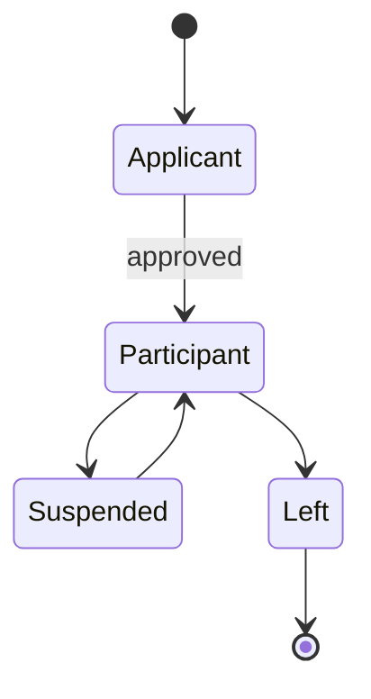
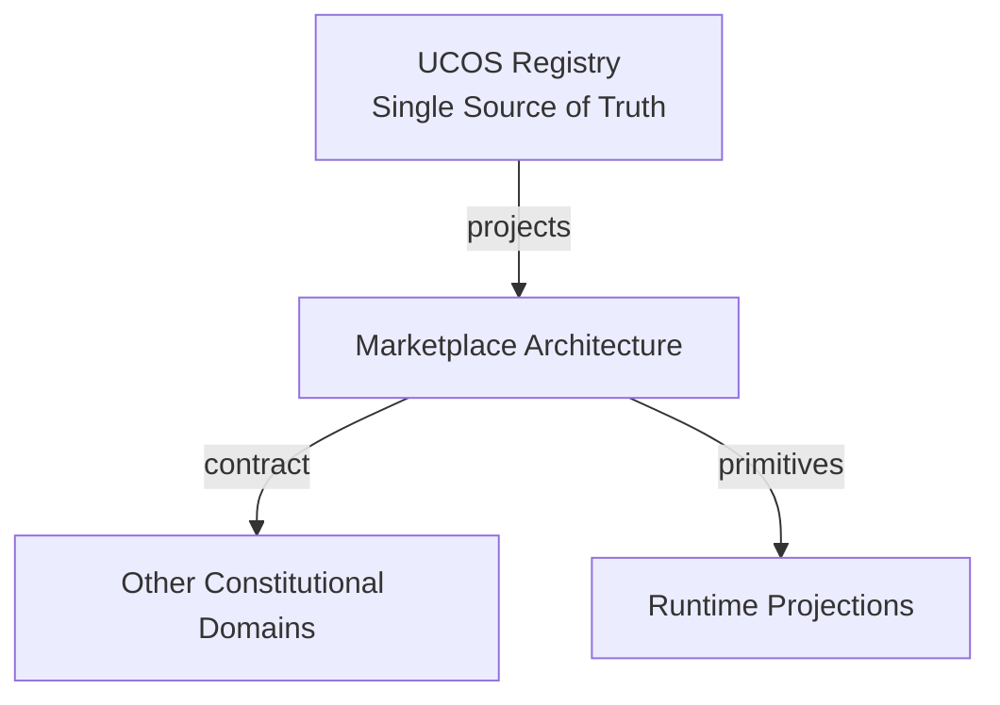
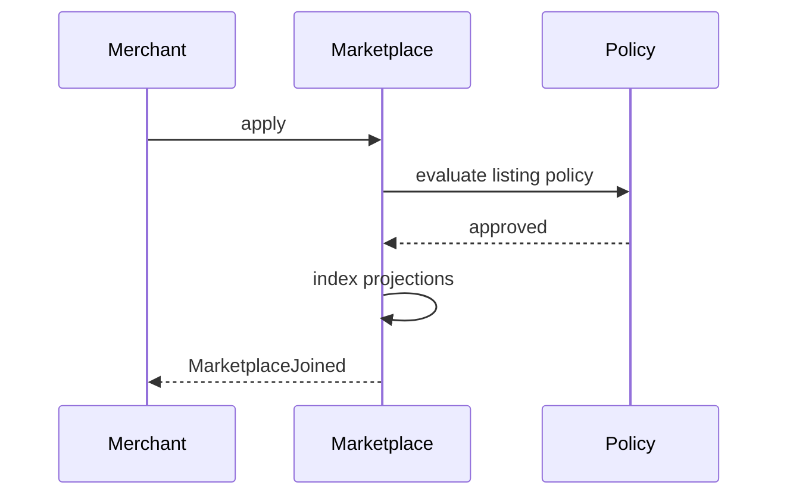
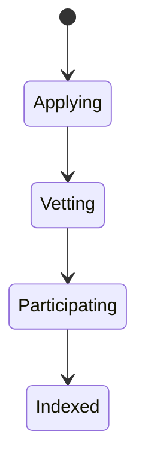
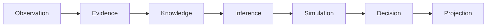
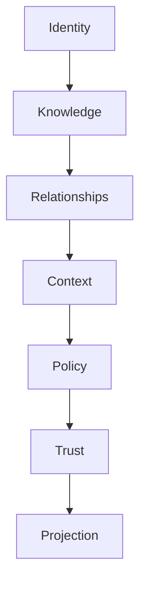

# UCOS-MKT-000001
# Marketplace Architecture

**Version:** Ω∞.1  |  **Status:** Constitutional Artifact  |  **Authority:** UCOS Ω∞ Constitutional Authority
**Category:** Commerce  |  **Source of Truth:** `_registry/` (projected, never hand-authored)

> Constitutional notice: this document is a **projection**. Its truth lives in the registry. Editing this document directly violates Law 002 (Knowledge Once).

---

## 1. Executive Summary

**UCOS-MKT-000001 — Marketplace Architecture**

This artifact is a constitutionally governed, implementation-ready specification projected from the _UCOS Registry_ single source of truth.
It conforms to the _Immutable Primitive Registry_ (27 frozen primitives) and the _Canonical Terminology Registry_ (31 governed terms).
It contains no hardcoded business, industry, currency, country, or commerce concepts. All such concepts are runtime projections.

---

## 2. Constitutional Purpose

To define the binding contract for **Marketplace Architecture** such that:
- every concept it names has exactly one owner,
- every capability it exposes has exactly one boundary,
- every boundary is expressed as an explicit contract,
- every contract is enforceable by the Governance Constitution.

---

## 3. Scope

In scope: the primitives, contracts, schemas, events, and policies owned by **Marketplace Architecture**.
In scope: the projection rules by which this domain exposes its truth to other domains.
In scope: the verification obligations this domain must satisfy before activation.

---

## 4. Out of Scope

Out of scope: any concept owned by another constitutional domain.
Out of scope: business, industry, commerce, country, currency, or language content (all projected).
Out of scope: mutation of another domain’s internal state.

---

## 5. Definitions

All terms in this artifact are used in their canonical sense as defined in the Canonical Terminology Registry.
Where a term appears, its `termId` is normative and its `prohibitedMeanings` are void.

---

## 6. Canonical Terminology

| Term | Canonical Definition | Owner | Prohibited Meanings |
|---|---|---|---|
| Existence | Anything that may exist. | Universal Existence Kernel | business meaning, commercial meaning, operational meaning |
| Entity | Technical representation of an Existence Object. | Identity Domain | existence itself |
| Knowledge | Interpreted information with evidence and meaning. | Knowledge Domain | data, information, evidence |
| Data | Raw observations. | Observation Domain | knowledge, meaning |
| Information | Organized data. | Observation Domain | knowledge |
| Evidence | Proof supporting an assertion. | Evidence Domain | knowledge, trust |
| Trust | Computed confidence in an assertion, derived from evidence. | Trust Domain | evidence, faith |
| Meaning | Semantic interpretation; higher-level understanding. | Semantic Domain | classification, taxonomy, ontology |
| Ontology | What exists. | Semantic Domain | taxonomy, classification |
| Taxonomy | How things are classified. | Semantic Domain | ontology, meaning |
| Classification | Assignment into taxonomy. | Semantic Domain | meaning |
| Relationship | Connection between objects. | Relationship Domain | causality |

---

## 7. Ownership Boundaries

Ownership is recorded in the _Domain Ownership Registry_.

---

## 8. Domain Responsibilities

See the Domain Ownership Registry for the authoritative responsibility list.

---

## 9. Domain Non-Responsibilities

See the Domain Ownership Registry.

---

## 10. Concepts

A Marketplace is a Context type — a governed environment where multiple tenants' projections are visible under a shared policy set. It is not a stored object; it is a scope in which commerce projections aggregate.

---

## 11. Ontology

Marketplace has Participants (tenants with published relationships), Listing policies, Discovery mechanisms, and a governing Context. Participation is governed by relationship, not by code.

---

## 12. Taxonomy

By model: First-party / Third-party / Hybrid / Consignment. By governance: Open / Curated / Invite-only. By scope: Local / National / Global.

---

## 13. Registries

This domain is registry-driven. Its registries are entries in the Universal Registry System:

```yaml
RegistryEntry:
  registryId: UCOS-REG-DOMAIN
  owner: Constitutional Authority
  law: Knowledge Once — each concept defined exactly once
```

---

## 14. Data Model

```yaml
MarketplaceContext:
  marketplaceId: <Identity>
  context: <Context>
  participants: [<Relationship>]
  listingPolicy: <Policy>
  discoveryPolicy: <Policy>
  governance: <Authority>
  temporal: {effectiveFrom}
```

---

## 15. Graph Model

(:Marketplace)-[:PARTICIPATED_IN]->(:Identity); (:Marketplace)-[:LISTED_UNDER]->(:Policy); (:Marketplace)-[:DISCOVERED_VIA]->(:Policy); (:Marketplace)-[:GOVERNED_BY]->(:Authority)

---

## 16. Schemas

```yaml
# Canonical projection schema for UCOS-MKT-000001
ucos_mkt_000001:
  identity:      <Identity primitive>
  intent:        <Intent primitive>
  meaning:       <Meaning primitive>
  knowledge:     <Knowledge primitive>
  registry:      <Registry primitive>
  relationship:  <Relationship primitive>
  context:       <Context primitive>
  policy:        <Policy primitive>
  authority:     <Authority primitive>
  evidence:      <Evidence primitive>
  trust:         <Trust primitive>
  temporal:      <Time primitive>
  metadata:      <Metadata primitive>
```

---

## 17. Contracts

```yaml
DomainContract:
  domain: Marketplace Architecture
  commands:   []   # registry-driven
  queries:    []   # registry-driven
  events:     []   # registry-driven
  policies:   []   # registry-driven
  permissions: []  # registry-driven
```

Contract law: domains never directly access another domain’s internal structures.

---

## 18. APIs

POST /marketplace.v1.join,GET  /marketplace.v1/{id},POST /marketplace.v1.search,POST /marketplace.v1.leave

---

## 19. Events

MarketplaceJoined,MarketplaceLeft,MarketplaceListed,MarketplaceDelisted

---

## 20. Commands

marketplace.join,marketplace.leave,marketplace.list,marketplace.delist

---

## 21. Queries

marketplace.search,marketplace.participants,marketplace.listings,marketplace.timeline

---

## 22. State Machines



---

## 23. Workflows

apply under listing policy → approve via governance relationship → list projections → govern discovery → exit

---

## 24. Policies

```yaml
Policy:
  identity: <Identity>
  conditions: []   # registry-driven
  actions:    []   # registry-driven
  priorities: []   # registry-driven
  exceptions: []   # registry-driven
```

All behavior derives from policy. Policy ≠ Rule: policy is behavioral governance; the rule is its executable projection.

---

## 25. Rules

```yaml
Rule:
  ruleId: <Identity>
  derivedFrom: <Policy identity>
  executable: true
  constraint: <registry expression>
```

---

## 26. Authorities

Marketplace Authority (governance), Merchant Authority (their own listings).

---

## 27. Permissions

marketplace.join (merchant authority + listing policy),marketplace.list (participant),marketplace.read (context-scoped)

---

## 28. Security Model

Zero Trust applies: no implicit trust between domains, services, agents, or tenants.
Every call is authenticated, authorized against Policy, and evidenced.
Cryptographic identity is issued by the Identity Domain; keys by the Key Management Architecture.

---

## 29. Privacy Model

Participant identity exposure follows the marketplace's published privacy policy and participant consent.

---

## 30. Trust Model

Trust is computed, never assumed. Inputs: evidence, authority, consistency, provenance, confidence.
```yaml
Trust:
  evidenceScore: <0..1>
  authorityScore: <0..1>
  consistencyScore: <0..1>
  provenanceScore: <0..1>
  confidenceScore: <0..1>
```

---

## 31. Audit Model

Every listing and governance action records authority and policy version.

---

## 32. Observability Model

Every action emits: What happened? Why? Who authorized it? Which policy allowed it? What evidence supports it? What confidence exists? What alternatives were evaluated?
These are the seven Explainability questions and are mandatory event fields.

---

## 33. Digital Twin Model

Marketplace Twin aggregates participant twins into fleet-level health and emergence monitoring.

---

## 34. Agent Model

Marketplace Agent curates quality, detects policy violations, and proposes discovery optimizations.

---

## 35. Runtime Model

Discovery is a context-filtered search over aggregated projections; ranking is policy-driven.

---

## 36. Scaling Model

Search is the scaling bottleneck — handled by the Search Architecture with context-aware sharding.

---

## 37. Multi-Tenant Model

Marketplace is inherently multi-tenant — the only place projections aggregate, under explicit policy.

---

## 38. Geo-Distribution Model

A marketplace spanning jurisdictions partitions by jurisdiction policy; illegal cross-listings are projected out.

---

## 39. Failure Model

Policy conflict between marketplace and participant, discovery bias, listing spam, governance deadlock.

---

## 40. Recovery Model

Participation is relationship-driven; leaving is clean and reversible by re-application.

---

## 41. Verification Model

Before activation, Marketplace Architecture must pass identity, knowledge, relationship, context, policy, authority, trust, and reality integrity checks.
Verification is performed by the Formal Verification Architecture (UCOS-FML-000001).

---

## 42. Certification Model

Marketplace must publish its listing and discovery policies and prove their enforcement.

---

## 43. Migration Model

New marketplace models are registry additions.

---

## 44. Evolution Model

Evolution is governed and history-preserving. Primitives are frozen; extension occurs through registries, policies, capabilities, contexts, relationships, knowledge, agents, and projections — never through primitive expansion.

---

## 45. Implementation Blueprint

Build order for MKT: (1) define registry entries — this domain owns by model: first-party / third-party / hybrid / consignment as registry truth, not code; (2) implement the contract surface first (marketplace.join, marketplace.leave, marketplace.list) and validate against MKT boundaries; (3) event-source all state so history is reconstructable; (4) wire the enforcement points — authority check, policy guard, evidence binding, trace — in-line, with no bypass path; (5) add tests per the Testing Architecture, citing evidence per gate; (6) obtain Verification and Certification before activation. Acceptance: the Zero Partial and Law 001 audits pass, every action answers the seven explainability questions, and this domain mutates no other domain internals.

---

## 46. Reference Architecture Diagram



---

## 47. Sequence Diagrams



---

## 48. State Diagrams



---

## 49. Data Flow Diagrams



---

## 50. Dependency Maps



Forbidden: circular dependencies, mutual ownership, cross-domain state mutation.

---

## ∞

Constitutionally governed. Implementation ready. Universally extensible.