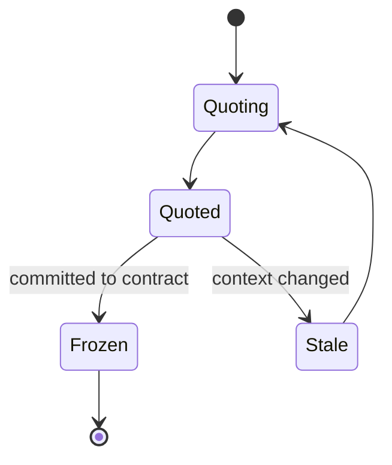
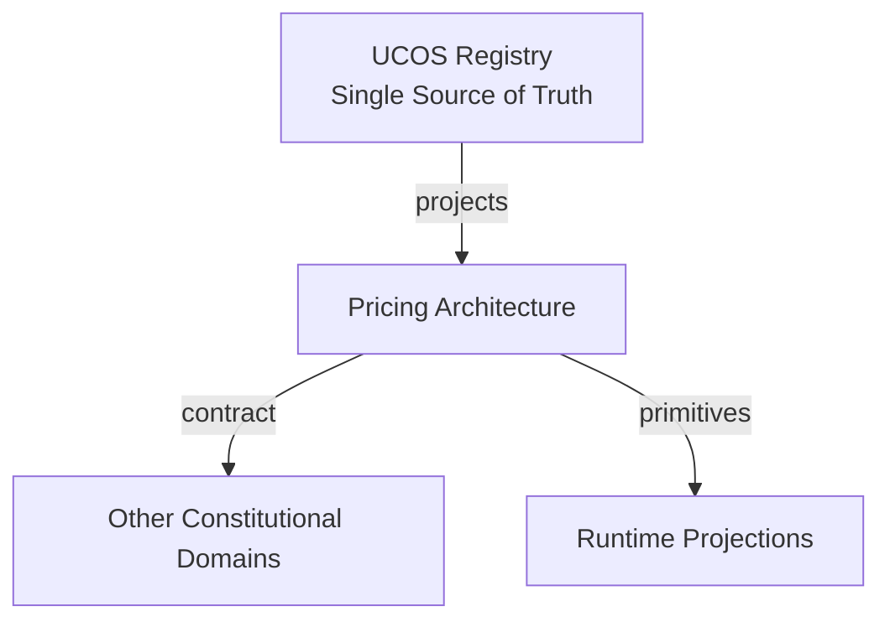
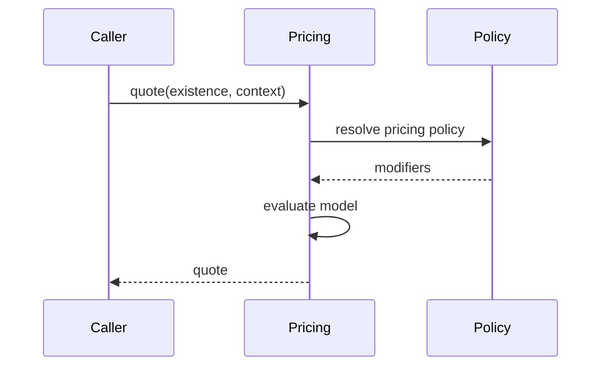
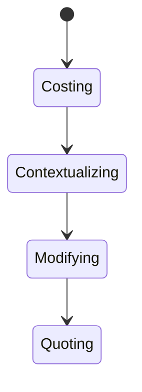
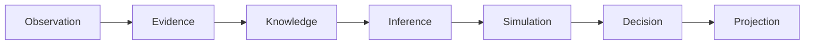
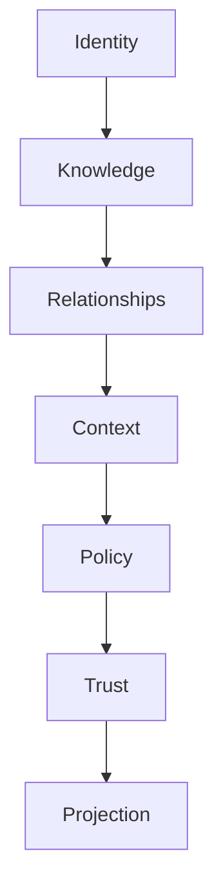

# UCOS-PRC-000001
# Pricing Architecture

**Version:** Ω∞.1  |  **Status:** Constitutional Artifact  |  **Authority:** UCOS Ω∞ Constitutional Authority
**Category:** Commerce  |  **Source of Truth:** `_registry/` (projected, never hand-authored)

> Constitutional notice: this document is a **projection**. Its truth lives in the registry. Editing this document directly violates Law 002 (Knowledge Once).

---

## 1. Executive Summary

**UCOS-PRC-000001 — Pricing Architecture**

This artifact is a constitutionally governed, implementation-ready specification projected from the _UCOS Registry_ single source of truth.
It conforms to the _Immutable Primitive Registry_ (27 frozen primitives) and the _Canonical Terminology Registry_ (31 governed terms).
It contains no hardcoded business, industry, currency, country, or commerce concepts. All such concepts are runtime projections.

---

## 2. Constitutional Purpose

To define the binding contract for **Pricing Architecture** such that:
- every concept it names has exactly one owner,
- every capability it exposes has exactly one boundary,
- every boundary is expressed as an explicit contract,
- every contract is enforceable by the Governance Constitution.

---

## 3. Scope

In scope: the primitives, contracts, schemas, events, and policies owned by **Pricing Architecture**.
In scope: the projection rules by which this domain exposes its truth to other domains.
In scope: the verification obligations this domain must satisfy before activation.

---

## 4. Out of Scope

Out of scope: any concept owned by another constitutional domain.
Out of scope: business, industry, commerce, country, currency, or language content (all projected).
Out of scope: mutation of another domain’s internal state.

---

## 5. Definitions

All terms in this artifact are used in their canonical sense as defined in the Canonical Terminology Registry.
Where a term appears, its `termId` is normative and its `prohibitedMeanings` are void.

---

## 6. Canonical Terminology

| Term | Canonical Definition | Owner | Prohibited Meanings |
|---|---|---|---|
| Existence | Anything that may exist. | Universal Existence Kernel | business meaning, commercial meaning, operational meaning |
| Entity | Technical representation of an Existence Object. | Identity Domain | existence itself |
| Knowledge | Interpreted information with evidence and meaning. | Knowledge Domain | data, information, evidence |
| Data | Raw observations. | Observation Domain | knowledge, meaning |
| Information | Organized data. | Observation Domain | knowledge |
| Evidence | Proof supporting an assertion. | Evidence Domain | knowledge, trust |
| Trust | Computed confidence in an assertion, derived from evidence. | Trust Domain | evidence, faith |
| Meaning | Semantic interpretation; higher-level understanding. | Semantic Domain | classification, taxonomy, ontology |
| Ontology | What exists. | Semantic Domain | taxonomy, classification |
| Taxonomy | How things are classified. | Semantic Domain | ontology, meaning |
| Classification | Assignment into taxonomy. | Semantic Domain | meaning |
| Relationship | Connection between objects. | Relationship Domain | causality |

---

## 7. Ownership Boundaries

Ownership is recorded in the _Domain Ownership Registry_.

---

## 8. Domain Responsibilities

See the Domain Ownership Registry for the authoritative responsibility list.

---

## 9. Domain Non-Responsibilities

See the Domain Ownership Registry.

---

## 10. Concepts

Pricing is a projection of value under context — never a stored attribute. Price depends on cost knowledge, market context, customer context, competitive relationships, time, and policy. The same existence has infinitely many valid prices across contexts.

---

## 11. Ontology

Price is a function: f(cost, market, customer, competitor, time, policy) → monetary expression. Currency is a Context property; tax is a Policy projection.

---

## 12. Taxonomy

By model: Static / Dynamic / Usage / Tiered / Negotiated / Auction / Future model (registry). By dimension: List / Spot / Contract / Promotional.

---

## 13. Registries

This domain is registry-driven. Its registries are entries in the Universal Registry System:

```yaml
RegistryEntry:
  registryId: UCOS-REG-DOMAIN
  owner: Constitutional Authority
  law: Knowledge Once — each concept defined exactly once
```

---

## 14. Data Model

```yaml
PricingProjection:
  existence: <Identity>
  baseExpression: <registry expression>
  modifiers: [<registry modifier>]
  currencyUnit: <Context-derived>
  taxProjection: <Policy-derived>
  context: <Context>
  temporal: {asOf}
  confidence: <0..1>
```

---

## 15. Graph Model

(:Price)-[:PRICES]->(:Existence); (:Price)-[:MODIFIED_BY]->(:Context|:Policy); (:Price)-[:COMPETES_WITH]->(:Price); (:Price)-[:VALID_IN]->(:Context)

---

## 16. Schemas

```yaml
# Canonical projection schema for UCOS-PRC-000001
ucos_prc_000001:
  identity:      <Identity primitive>
  intent:        <Intent primitive>
  meaning:       <Meaning primitive>
  knowledge:     <Knowledge primitive>
  registry:      <Registry primitive>
  relationship:  <Relationship primitive>
  context:       <Context primitive>
  policy:        <Policy primitive>
  authority:     <Authority primitive>
  evidence:      <Evidence primitive>
  trust:         <Trust primitive>
  temporal:      <Time primitive>
  metadata:      <Metadata primitive>
```

---

## 17. Contracts

```yaml
DomainContract:
  domain: Pricing Architecture
  commands:   []   # registry-driven
  queries:    []   # registry-driven
  events:     []   # registry-driven
  policies:   []   # registry-driven
  permissions: []  # registry-driven
```

Contract law: domains never directly access another domain’s internal structures.

---

## 18. APIs

POST /pricing.v1.quote,GET  /pricing.v1.history/{id},POST /pricing.v1.simulate,GET  /pricing.v1.byContext/{contextId}

---

## 19. Events

PricingQuoted,PricingAdjusted,PricingSimulated,PricingFrozen

---

## 20. Commands

pricing.quote,pricing.adjust,pricing.simulate,pricing.freeze

---

## 21. Queries

pricing.history,pricing.byContext,pricing.competitors,pricing.timeline

---

## 22. State Machines



---

## 23. Workflows

resolve cost knowledge → apply market context → apply customer context → apply policy modifiers → project currency + tax → quote

---

## 24. Policies

```yaml
Policy:
  identity: <Identity>
  conditions: []   # registry-driven
  actions:    []   # registry-driven
  priorities: []   # registry-driven
  exceptions: []   # registry-driven
```

All behavior derives from policy. Policy ≠ Rule: policy is behavioral governance; the rule is its executable projection.

---

## 25. Rules

```yaml
Rule:
  ruleId: <Identity>
  derivedFrom: <Policy identity>
  executable: true
  constraint: <registry expression>
```

---

## 26. Authorities

Pricing Authority (model governance); merchant authority sets base within policy bounds.

---

## 27. Permissions

pricing.quote (any authenticated, context-scoped),pricing.adjust (pricing authority),pricing.simulate (simulation authority)

---

## 28. Security Model

Zero Trust applies: no implicit trust between domains, services, agents, or tenants.
Every call is authenticated, authorized against Policy, and evidenced.
Cryptographic identity is issued by the Identity Domain; keys by the Key Management Architecture.

---

## 29. Privacy Model

Customer-specific pricing is personal data; quotes are consent-scoped and retention-limited.

---

## 30. Trust Model

Trust is computed, never assumed. Inputs: evidence, authority, consistency, provenance, confidence.
```yaml
Trust:
  evidenceScore: <0..1>
  authorityScore: <0..1>
  consistencyScore: <0..1>
  provenanceScore: <0..1>
  confidenceScore: <0..1>
```

---

## 31. Audit Model

Every quote records the full input set — cost, context, policy version — so it is reproducible and explainable.

---

## 32. Observability Model

Every action emits: What happened? Why? Who authorized it? Which policy allowed it? What evidence supports it? What confidence exists? What alternatives were evaluated?
These are the seven Explainability questions and are mandatory event fields.

---

## 33. Digital Twin Model

Pricing Twin mirrors real-world price observations (competitor feeds, market data) and flags drift from model output.

---

## 34. Agent Model

Pricing Agent continuously re-quotes on context change and runs simulations before applying adjustments.

---

## 35. Runtime Model

Quoting is a deterministic function evaluation cached by input hash; staleness invalidates on context/policy change.

---

## 36. Scaling Model

Quote caching is the critical path; evaluation is sub-millisecond with precompiled modifier chains.

---

## 37. Multi-Tenant Model

Pricing models are tenant-scoped; a shared marketplace sees only published prices, not competitor internals.

---

## 38. Geo-Distribution Model

Currency, tax, and duty projection are jurisdiction-derived at quote time — never hardcoded per market.

---

## 39. Failure Model

Circular modifier dependencies, policy conflict, stale market feed, currency conversion failure.

---

## 40. Recovery Model

Quotes recompute from inputs; frozen prices are immutable contract artifacts.

---

## 41. Verification Model

Before activation, Pricing Architecture must pass identity, knowledge, relationship, context, policy, authority, trust, and reality integrity checks.
Verification is performed by the Formal Verification Architecture (UCOS-FML-000001).

---

## 42. Certification Model

Pricing model must pass determinism, policy conformance, and currency/tax projection validity.

---

## 43. Migration Model

New pricing models and modifiers are registry additions.

---

## 44. Evolution Model

Evolution is governed and history-preserving. Primitives are frozen; extension occurs through registries, policies, capabilities, contexts, relationships, knowledge, agents, and projections — never through primitive expansion.

---

## 45. Implementation Blueprint

Build order for PRC: (1) define registry entries — this domain owns by model: static / dynamic / usage / tiered / negotiated / auction / future model (registry) as registry truth, not code; (2) implement the contract surface first (pricing.quote, pricing.adjust, pricing.simulate) and validate against PRC boundaries; (3) event-source all state so history is reconstructable; (4) wire the enforcement points — authority check, policy guard, evidence binding, trace — in-line, with no bypass path; (5) add tests per the Testing Architecture, citing evidence per gate; (6) obtain Verification and Certification before activation. Acceptance: the Zero Partial and Law 001 audits pass, every action answers the seven explainability questions, and this domain mutates no other domain internals.

---

## 46. Reference Architecture Diagram



---

## 47. Sequence Diagrams



---

## 48. State Diagrams



---

## 49. Data Flow Diagrams



---

## 50. Dependency Maps



Forbidden: circular dependencies, mutual ownership, cross-domain state mutation.

---

## ∞

Constitutionally governed. Implementation ready. Universally extensible.