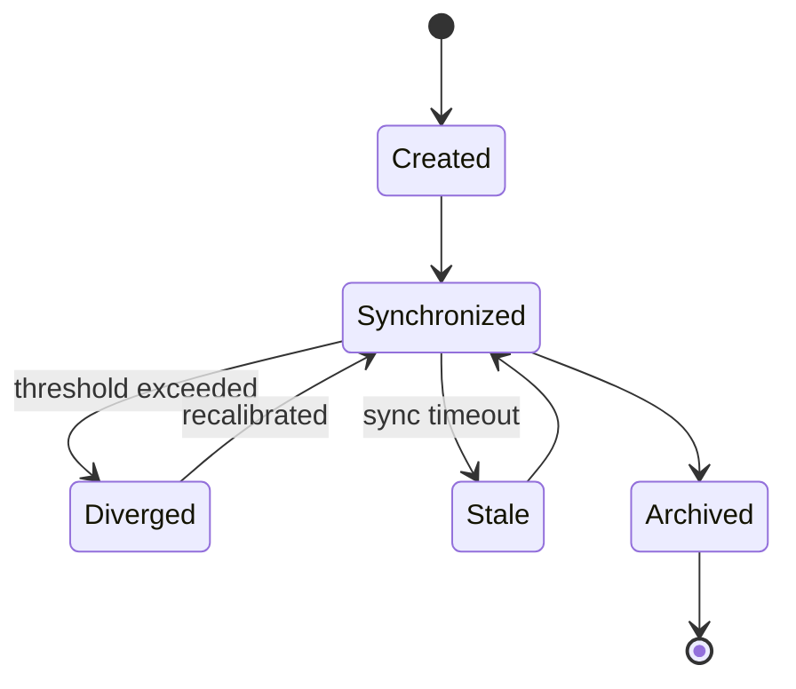
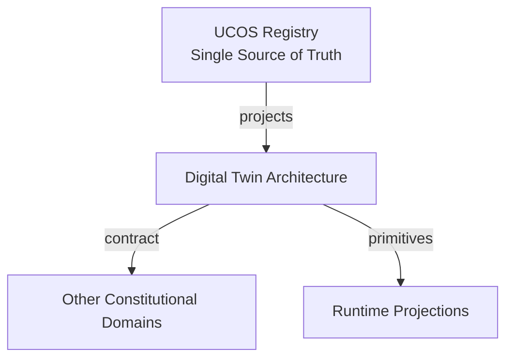
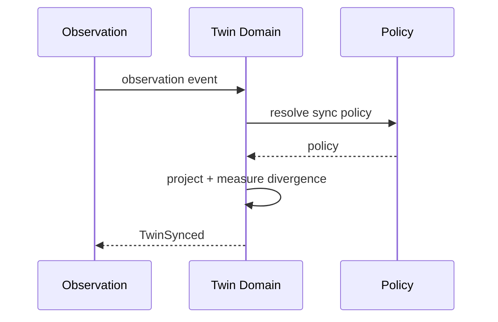
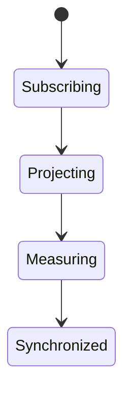
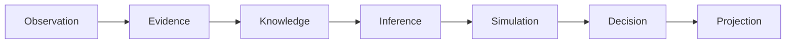
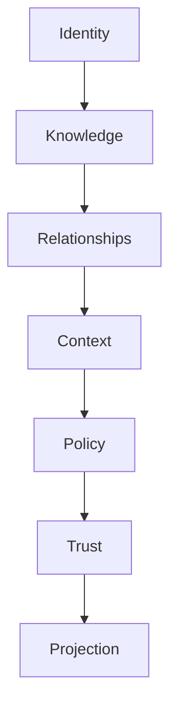

# UCOS-DTW-000001
# Digital Twin Architecture

**Version:** Ω∞.1  |  **Status:** Constitutional Artifact  |  **Authority:** UCOS Ω∞ Constitutional Authority
**Category:** Digital Twins  |  **Source of Truth:** `_registry/` (projected, never hand-authored)

> Constitutional notice: this document is a **projection**. Its truth lives in the registry. Editing this document directly violates Law 002 (Knowledge Once).

---

## 1. Executive Summary

**UCOS-DTW-000001 — Digital Twin Architecture**

This artifact is a constitutionally governed, implementation-ready specification projected from the _UCOS Registry_ single source of truth.
It conforms to the _Immutable Primitive Registry_ (27 frozen primitives) and the _Canonical Terminology Registry_ (31 governed terms).
It contains no hardcoded business, industry, currency, country, or commerce concepts. All such concepts are runtime projections.

---

## 2. Constitutional Purpose

To define the binding contract for **Digital Twin Architecture** such that:
- every concept it names has exactly one owner,
- every capability it exposes has exactly one boundary,
- every boundary is expressed as an explicit contract,
- every contract is enforceable by the Governance Constitution.

---

## 3. Scope

In scope: the primitives, contracts, schemas, events, and policies owned by **Digital Twin Architecture**.
In scope: the projection rules by which this domain exposes its truth to other domains.
In scope: the verification obligations this domain must satisfy before activation.

---

## 4. Out of Scope

Out of scope: any concept owned by another constitutional domain.
Out of scope: business, industry, commerce, country, currency, or language content (all projected).
Out of scope: mutation of another domain’s internal state.

---

## 5. Definitions

All terms in this artifact are used in their canonical sense as defined in the Canonical Terminology Registry.
Where a term appears, its `termId` is normative and its `prohibitedMeanings` are void.

---

## 6. Canonical Terminology

| Term | Canonical Definition | Owner | Prohibited Meanings |
|---|---|---|---|
| Existence | Anything that may exist. | Universal Existence Kernel | business meaning, commercial meaning, operational meaning |
| Entity | Technical representation of an Existence Object. | Identity Domain | existence itself |
| Knowledge | Interpreted information with evidence and meaning. | Knowledge Domain | data, information, evidence |
| Data | Raw observations. | Observation Domain | knowledge, meaning |
| Information | Organized data. | Observation Domain | knowledge |
| Evidence | Proof supporting an assertion. | Evidence Domain | knowledge, trust |
| Trust | Computed confidence in an assertion, derived from evidence. | Trust Domain | evidence, faith |
| Meaning | Semantic interpretation; higher-level understanding. | Semantic Domain | classification, taxonomy, ontology |
| Ontology | What exists. | Semantic Domain | taxonomy, classification |
| Taxonomy | How things are classified. | Semantic Domain | ontology, meaning |
| Classification | Assignment into taxonomy. | Semantic Domain | meaning |
| Relationship | Connection between objects. | Relationship Domain | causality |

---

## 7. Ownership Boundaries

**Owner:** Twin Domain
**Owns:** Digital Twins
**Boundary law:** no domain may modify, bypass, or reinterpret another domain’s internals. All interaction is via contract.

---

## 8. Domain Responsibilities

- Reality Representation
- Synchronization
- Twin Analytics

---

## 9. Domain Non-Responsibilities

- Reality Governance
- Policy Decisions

---

## 10. Concepts

A Digital Twin is a synchronized digital representation of reality. Twin ≠ Reality. Every object may hold multiple twins — operational, financial, commercial, security, compliance, knowledge, experience, lifecycle — each a distinct projection of the same underlying existence.

---

## 11. Ontology

Twin has a subject Existence, a twinType (registry), a synchronization state, a fidelity level, and an observed-vs-projected divergence measure. Twins never govern reality — they represent it.

---

## 12. Taxonomy

By aspect: Operational / Financial / Commercial / Security / Compliance / Knowledge / Experience / Lifecycle / Future aspect. By fidelity: High-fidelity / Approximate / Indicative. By sync: Real-time / Near-real-time / Batch / Event-driven.

---

## 13. Registries

This domain is registry-driven. Its registries are entries in the Universal Registry System:

```yaml
RegistryEntry:
  registryId: UCOS-REG-TWIN
  owner: Twin Domain
  law: Knowledge Once — each concept defined exactly once
```

---

## 14. Data Model

```yaml
DigitalTwin:
  twinId: <Identity>
  subject: <Identity>
  twinType: <registry id>
  state: <projected state snapshot>
  syncState: <registry state>
  divergence: {measure, threshold, lastChecked}
  fidelity: <High|Approximate|Indicative>
  temporal: {asOf}
  context: <Context>
```

---

## 15. Graph Model

(:Twin)-[:TWIN_OF]->(:Identity); (:Twin)-[:SYNCED_FROM]->(:Observation); (:Twin)-[:DIVERGES_FROM]->(:Twin); (:Twin)-[:FED_INTO]->(:TwinFederation)

---

## 16. Schemas

```yaml
# Canonical projection schema for UCOS-DTW-000001
ucos_dtw_000001:
  identity:      <Identity primitive>
  intent:        <Intent primitive>
  meaning:       <Meaning primitive>
  knowledge:     <Knowledge primitive>
  registry:      <Registry primitive>
  relationship:  <Relationship primitive>
  context:       <Context primitive>
  policy:        <Policy primitive>
  authority:     <Authority primitive>
  evidence:      <Evidence primitive>
  trust:         <Trust primitive>
  temporal:      <Time primitive>
  metadata:      <Metadata primitive>
```

---

## 17. Contracts

```yaml
DomainContract:
  domain: Twin
  commands:   []   # registry-driven
  queries:    []   # registry-driven
  events:     []   # registry-driven
  policies:   []   # registry-driven
  permissions: []  # registry-driven
```

Contract law: domains never directly access another domain’s internal structures.

---

## 18. APIs

POST /twin.v1.create,GET  /twin.v1/{id},GET  /twin.v1.bySubject/{subjectId},POST /twin.v1.sync,GET  /twin.v1.divergence/{id}

---

## 19. Events

TwinCreated,TwinSynced,TwinDiverged,TwinRecalibrated,TwinArchived

---

## 20. Commands

twin.create,twin.sync,twin.recalibrate,twin.archive,twin.fork

---

## 21. Queries

twin.bySubject,twin.byType,twin.divergent,twin.timeline

---

## 22. State Machines



---

## 23. Workflows

create twin type → subscribe to observation feed → apply sync policy → measure divergence → recalibrate on threshold → archive on retirement

---

## 24. Policies

```yaml
Policy:
  identity: <Identity>
  conditions: []   # registry-driven
  actions:    []   # registry-driven
  priorities: []   # registry-driven
  exceptions: []   # registry-driven
```

All behavior derives from policy. Policy ≠ Rule: policy is behavioral governance; the rule is its executable projection.

---

## 25. Rules

```yaml
Rule:
  ruleId: <Identity>
  derivedFrom: <Policy identity>
  executable: true
  constraint: <registry expression>
```

---

## 26. Authorities

Subject's Authority owns its twins; Twin Authority governs sync policy.

---

## 27. Permissions

twin.create (subject authority),twin.sync (system),twin.read (context-scoped + perspective-filtered)

---

## 28. Security Model

Zero Trust applies: no implicit trust between domains, services, agents, or tenants.
Every call is authenticated, authorized against Policy, and evidenced.
Cryptographic identity is issued by the Identity Domain; keys by the Key Management Architecture.

---

## 29. Privacy Model

Twins of persons are high-sensitivity; twin data minimization follows the Perspective redaction policy strictly.

---

## 30. Trust Model

Trust is computed, never assumed. Inputs: evidence, authority, consistency, provenance, confidence.
```yaml
Trust:
  evidenceScore: <0..1>
  authorityScore: <0..1>
  consistencyScore: <0..1>
  provenanceScore: <0..1>
  confidenceScore: <0..1>
```

---

## 31. Audit Model

Every sync records observation source, policy version, and divergence measure. Twin history is the audit of what reality was when.

---

## 32. Observability Model

Every action emits: What happened? Why? Who authorized it? Which policy allowed it? What evidence supports it? What confidence exists? What alternatives were evaluated?
These are the seven Explainability questions and are mandatory event fields.

---

## 33. Digital Twin Model

Twins are the architecture's reality mirror — fleet behavior is monitored as Emergence across the federation.

---

## 34. Agent Model

Twin Agent monitors divergence and triggers recalibration or escalation when reality and representation drift.

---

## 35. Runtime Model

Sync is an event-driven projection over the observation stream; state is a versioned snapshot, never mutable in place.

---

## 36. Scaling Model

Twins are sharded by subject; sync load follows observation volume. Cold twins are tiered to cheaper storage.

---

## 37. Multi-Tenant Model

Twins are tenant-scoped; federated twins cross tenants only via published federation policy.

---

## 38. Geo-Distribution Model

Twin data follows the subject's residency; cross-region sync is read-only replica under sovereignty policy.

---

## 39. Failure Model

Observation feed loss, divergence storm, sync conflict across replicas, twin-type drift.

---

## 40. Recovery Model

Twin state recomputes from observation history — a twin is never restored, it is re-derived.

---

## 41. Verification Model

Before activation, Digital Twin Architecture must pass identity, knowledge, relationship, context, policy, authority, trust, and reality integrity checks.
Verification is performed by the Formal Verification Architecture (UCOS-FML-000001).

---

## 42. Certification Model

Twin must declare fidelity, carry a divergence measure, and stay within threshold for certified use.

---

## 43. Migration Model

New twin types are registry additions; existing twins re-project on type version change.

---

## 44. Evolution Model

Evolution is governed and history-preserving. Primitives are frozen; extension occurs through registries, policies, capabilities, contexts, relationships, knowledge, agents, and projections — never through primitive expansion.

---

## 45. Implementation Blueprint

Build order for DTW: (1) define registry entries — this domain owns by aspect: operational / financial / commercial / security / compliance / knowledge / experience / lifecycle / future aspect as registry truth, not code; (2) implement the contract surface first (twin.create, twin.sync, twin.recalibrate) and validate against DTW boundaries; (3) event-source all state so history is reconstructable; (4) wire the enforcement points — authority check, policy guard, evidence binding, trace — in-line, with no bypass path; (5) add tests per the Testing Architecture, citing evidence per gate; (6) obtain Verification and Certification before activation. Acceptance: the Zero Partial and Law 001 audits pass, every action answers the seven explainability questions, and this domain mutates no other domain internals.

---

## 46. Reference Architecture Diagram



---

## 47. Sequence Diagrams



---

## 48. State Diagrams



---

## 49. Data Flow Diagrams



---

## 50. Dependency Maps



Forbidden: circular dependencies, mutual ownership, cross-domain state mutation.

---

## ∞

Constitutionally governed. Implementation ready. Universally extensible.