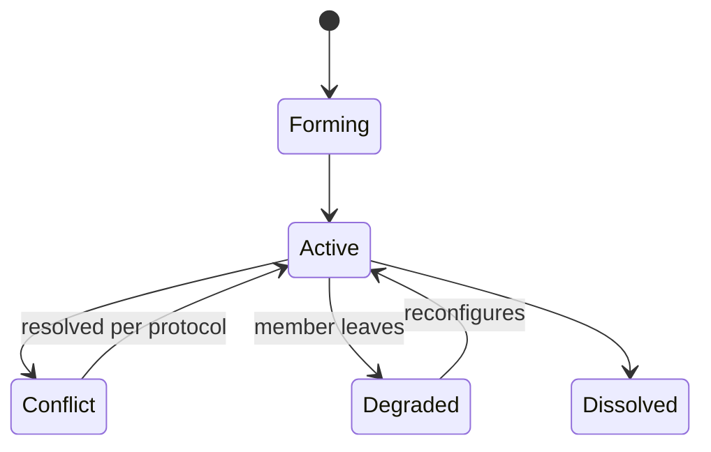
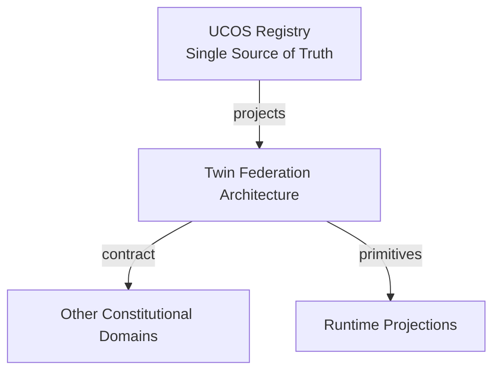
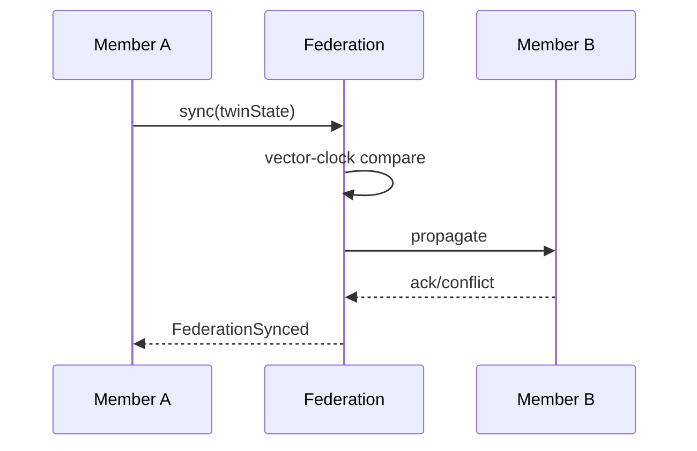
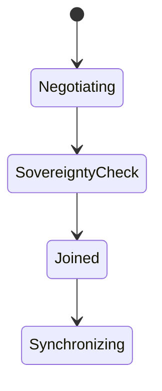
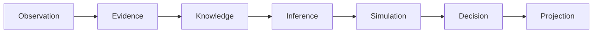
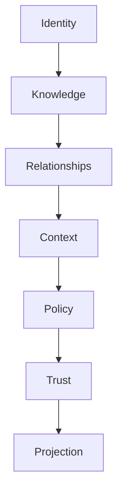

# UCOS-DTW-000002
# Twin Federation Architecture

**Version:** Ω∞.1  |  **Status:** Constitutional Artifact  |  **Authority:** UCOS Ω∞ Constitutional Authority
**Category:** Digital Twins  |  **Source of Truth:** `_registry/` (projected, never hand-authored)

> Constitutional notice: this document is a **projection**. Its truth lives in the registry. Editing this document directly violates Law 002 (Knowledge Once).

---

## 1. Executive Summary

**UCOS-DTW-000002 — Twin Federation Architecture**

This artifact is a constitutionally governed, implementation-ready specification projected from the _UCOS Registry_ single source of truth.
It conforms to the _Immutable Primitive Registry_ (27 frozen primitives) and the _Canonical Terminology Registry_ (31 governed terms).
It contains no hardcoded business, industry, currency, country, or commerce concepts. All such concepts are runtime projections.

---

## 2. Constitutional Purpose

To define the binding contract for **Twin Federation Architecture** such that:
- every concept it names has exactly one owner,
- every capability it exposes has exactly one boundary,
- every boundary is expressed as an explicit contract,
- every contract is enforceable by the Governance Constitution.

---

## 3. Scope

In scope: the primitives, contracts, schemas, events, and policies owned by **Twin Federation Architecture**.
In scope: the projection rules by which this domain exposes its truth to other domains.
In scope: the verification obligations this domain must satisfy before activation.

---

## 4. Out of Scope

Out of scope: any concept owned by another constitutional domain.
Out of scope: business, industry, commerce, country, currency, or language content (all projected).
Out of scope: mutation of another domain’s internal state.

---

## 5. Definitions

All terms in this artifact are used in their canonical sense as defined in the Canonical Terminology Registry.
Where a term appears, its `termId` is normative and its `prohibitedMeanings` are void.

---

## 6. Canonical Terminology

| Term | Canonical Definition | Owner | Prohibited Meanings |
|---|---|---|---|
| Existence | Anything that may exist. | Universal Existence Kernel | business meaning, commercial meaning, operational meaning |
| Entity | Technical representation of an Existence Object. | Identity Domain | existence itself |
| Knowledge | Interpreted information with evidence and meaning. | Knowledge Domain | data, information, evidence |
| Data | Raw observations. | Observation Domain | knowledge, meaning |
| Information | Organized data. | Observation Domain | knowledge |
| Evidence | Proof supporting an assertion. | Evidence Domain | knowledge, trust |
| Trust | Computed confidence in an assertion, derived from evidence. | Trust Domain | evidence, faith |
| Meaning | Semantic interpretation; higher-level understanding. | Semantic Domain | classification, taxonomy, ontology |
| Ontology | What exists. | Semantic Domain | taxonomy, classification |
| Taxonomy | How things are classified. | Semantic Domain | ontology, meaning |
| Classification | Assignment into taxonomy. | Semantic Domain | meaning |
| Relationship | Connection between objects. | Relationship Domain | causality |

---

## 7. Ownership Boundaries

Ownership is recorded in the _Domain Ownership Registry_.

---

## 8. Domain Responsibilities

See the Domain Ownership Registry for the authoritative responsibility list.

---

## 9. Domain Non-Responsibilities

See the Domain Ownership Registry.

---

## 10. Concepts

Twin Federation lets independently governed twins interoperate without merging ownership. A federation is a governed relationship among twin fleets, with a shared consistency model and a sovereignty-preserving protocol.

---

## 11. Ontology

Federation has Member twins/fleets, a consistency model (eventual / strong-per-jurisdiction), a sovereignty policy, and a conflict protocol. Members retain authority; the federation coordinates.

---

## 12. Taxonomy

By topology: Hub / Mesh / Hierarchical / Hybrid. By consistency: Strong / Eventual / Causal. By openness: Closed / Open / Conditional.

---

## 13. Registries

This domain is registry-driven. Its registries are entries in the Universal Registry System:

```yaml
RegistryEntry:
  registryId: UCOS-REG-DOMAIN
  owner: Constitutional Authority
  law: Knowledge Once — each concept defined exactly once
```

---

## 14. Data Model

```yaml
TwinFederation:
  federationId: <Identity>
  members: [<Relationship>]
  consistencyModel: <registry id>
  sovereigntyPolicy: <Policy>
  conflictProtocol: <registry id>
  governance: <Authority>
  temporal: {formedAt}
```

---

## 15. Graph Model

(:Federation)-[:MEMBER]->(:Twin); (:Federation)-[:GOVERNED_BY]->(:Authority); (:Twin)-[:FED_PEER]->(:Twin); (:Federation)-[:CONFLICTS_HANDLED_BY]->(:Policy)

---

## 16. Schemas

```yaml
# Canonical projection schema for UCOS-DTW-000002
ucos_dtw_000002:
  identity:      <Identity primitive>
  intent:        <Intent primitive>
  meaning:       <Meaning primitive>
  knowledge:     <Knowledge primitive>
  registry:      <Registry primitive>
  relationship:  <Relationship primitive>
  context:       <Context primitive>
  policy:        <Policy primitive>
  authority:     <Authority primitive>
  evidence:      <Evidence primitive>
  trust:         <Trust primitive>
  temporal:      <Time primitive>
  metadata:      <Metadata primitive>
```

---

## 17. Contracts

```yaml
DomainContract:
  domain: Twin Federation Architecture
  commands:   []   # registry-driven
  queries:    []   # registry-driven
  events:     []   # registry-driven
  policies:   []   # registry-driven
  permissions: []  # registry-driven
```

Contract law: domains never directly access another domain’s internal structures.

---

## 18. APIs

POST /federation.v1.form,POST /federation.v1.join,GET  /federation.v1/{id},POST /federation.v1.sync,POST /federation.v1.conflict

---

## 19. Events

FederationFormed,FederationJoined,FederationSynced,FederationConflictDetected,FederationMemberLeft

---

## 20. Commands

federation.form,federation.join,federation.leave,federation.sync,federation.resolveConflict

---

## 21. Queries

federation.byId,federation.members,federation.conflicts,federation.consistency

---

## 22. State Machines



---

## 23. Workflows

form under governance → members join via relationship → sync under consistency model → conflicts handled by protocol → dissolve cleanly

---

## 24. Policies

```yaml
Policy:
  identity: <Identity>
  conditions: []   # registry-driven
  actions:    []   # registry-driven
  priorities: []   # registry-driven
  exceptions: []   # registry-driven
```

All behavior derives from policy. Policy ≠ Rule: policy is behavioral governance; the rule is its executable projection.

---

## 25. Rules

```yaml
Rule:
  ruleId: <Identity>
  derivedFrom: <Policy identity>
  executable: true
  constraint: <registry expression>
```

---

## 26. Authorities

Federation Authority (coordination); each member retains its own twin authority — never ceded.

---

## 27. Permissions

federation.form (founding authorities),federation.join (member authority + sovereignty policy),federation.read (member-scoped)

---

## 28. Security Model

Zero Trust applies: no implicit trust between domains, services, agents, or tenants.
Every call is authenticated, authorized against Policy, and evidenced.
Cryptographic identity is issued by the Identity Domain; keys by the Key Management Architecture.

---

## 29. Privacy Model

Federation never pools personal data; cross-member personal data flows require consent covering every member jurisdiction.

---

## 30. Trust Model

Trust is computed, never assumed. Inputs: evidence, authority, consistency, provenance, confidence.
```yaml
Trust:
  evidenceScore: <0..1>
  authorityScore: <0..1>
  consistencyScore: <0..1>
  provenanceScore: <0..1>
  confidenceScore: <0..1>
```

---

## 31. Audit Model

Every cross-member sync and conflict records both sides' authority and the protocol decision.

---

## 32. Observability Model

Every action emits: What happened? Why? Who authorized it? Which policy allowed it? What evidence supports it? What confidence exists? What alternatives were evaluated?
These are the seven Explainability questions and are mandatory event fields.

---

## 33. Digital Twin Model

Federation is how the system models reality at scale — no single twin holds the whole world; the federation holds it together.

---

## 34. Agent Model

Federation Agent monitors consistency health and member drift, proposing protocol tuning under governance.

---

## 35. Runtime Model

Sync is a peer protocol with per-jurisdiction quorum; conflicts are detected by vector-clock divergence, not timestamps alone.

---

## 36. Scaling Model

Federation scales horizontally by adding members; coordination cost is bounded by topology policy.

---

## 37. Multi-Tenant Model

Federation is the only legitimate cross-tenant twin mechanism — and only under published sovereignty policy.

---

## 38. Geo-Distribution Model

Sovereignty is the joining constraint: a member may only federate where its residency policy permits.

---

## 39. Failure Model

Split-brain across jurisdictions, sovereignty violation attempt, vector-clock corruption, member silent exit.

---

## 40. Recovery Model

Conflicts resolve by protocol (last-writer-wins is prohibited for governed state); recovery is protocol-driven reconciliation.

---

## 41. Verification Model

Before activation, Twin Federation Architecture must pass identity, knowledge, relationship, context, policy, authority, trust, and reality integrity checks.
Verification is performed by the Formal Verification Architecture (UCOS-FML-000001).

---

## 42. Certification Model

Federation must publish consistency model, sovereignty policy, and conflict protocol, and prove their enforcement.

---

## 43. Migration Model

New consistency models and topologies are registry additions.

---

## 44. Evolution Model

Evolution is governed and history-preserving. Primitives are frozen; extension occurs through registries, policies, capabilities, contexts, relationships, knowledge, agents, and projections — never through primitive expansion.

---

## 45. Implementation Blueprint

Build order for DTW2: (1) define registry entries — this domain owns by topology: hub / mesh / hierarchical / hybrid as registry truth, not code; (2) implement the contract surface first (federation.form, federation.join, federation.leave) and validate against DTW2 boundaries; (3) event-source all state so history is reconstructable; (4) wire the enforcement points — authority check, policy guard, evidence binding, trace — in-line, with no bypass path; (5) add tests per the Testing Architecture, citing evidence per gate; (6) obtain Verification and Certification before activation. Acceptance: the Zero Partial and Law 001 audits pass, every action answers the seven explainability questions, and this domain mutates no other domain internals.

---

## 46. Reference Architecture Diagram



---

## 47. Sequence Diagrams



---

## 48. State Diagrams



---

## 49. Data Flow Diagrams



---

## 50. Dependency Maps



Forbidden: circular dependencies, mutual ownership, cross-domain state mutation.

---

## ∞

Constitutionally governed. Implementation ready. Universally extensible.