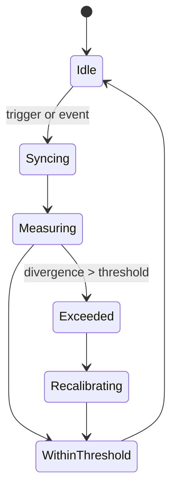
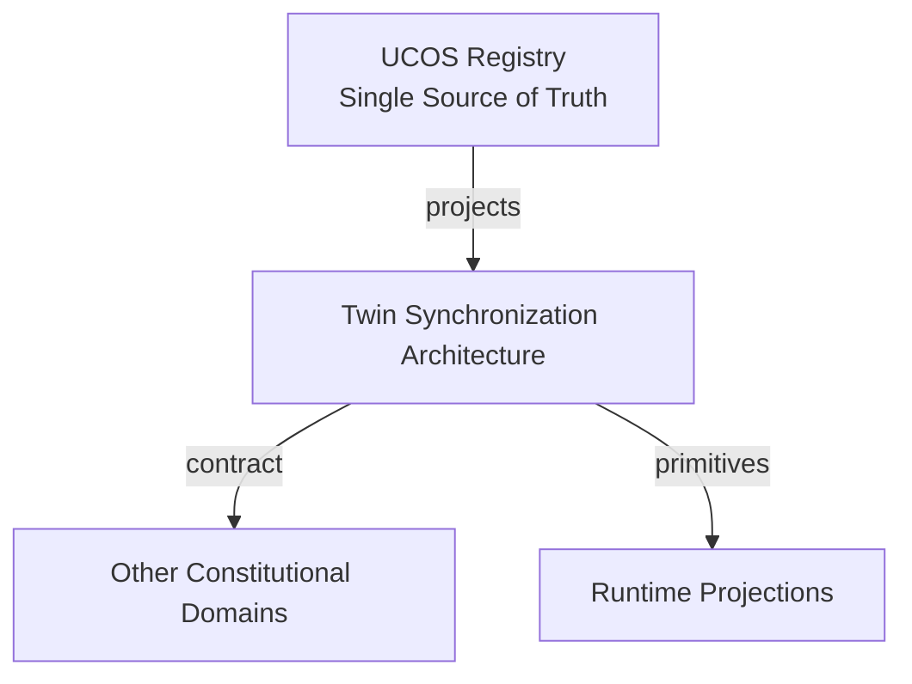
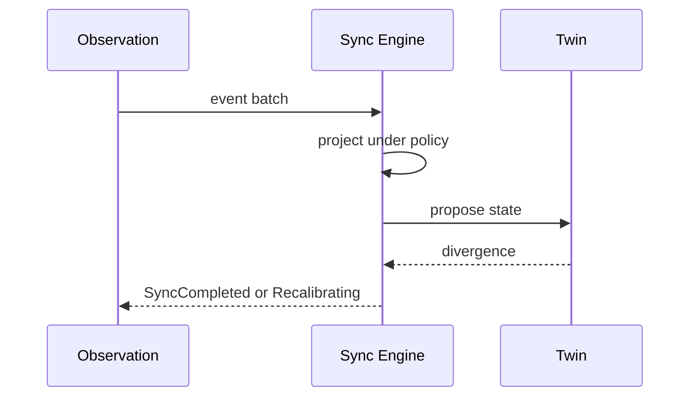
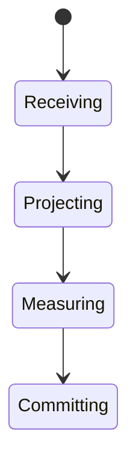
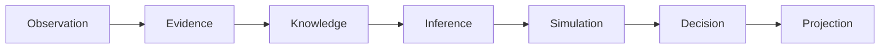
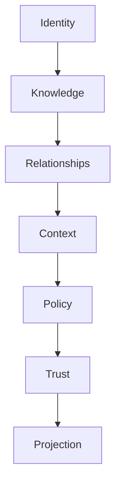

# UCOS-DTW-000003
# Twin Synchronization Architecture

**Version:** Ω∞.1  |  **Status:** Constitutional Artifact  |  **Authority:** UCOS Ω∞ Constitutional Authority
**Category:** Digital Twins  |  **Source of Truth:** `_registry/` (projected, never hand-authored)

> Constitutional notice: this document is a **projection**. Its truth lives in the registry. Editing this document directly violates Law 002 (Knowledge Once).

---

## 1. Executive Summary

**UCOS-DTW-000003 — Twin Synchronization Architecture**

This artifact is a constitutionally governed, implementation-ready specification projected from the _UCOS Registry_ single source of truth.
It conforms to the _Immutable Primitive Registry_ (27 frozen primitives) and the _Canonical Terminology Registry_ (31 governed terms).
It contains no hardcoded business, industry, currency, country, or commerce concepts. All such concepts are runtime projections.

---

## 2. Constitutional Purpose

To define the binding contract for **Twin Synchronization Architecture** such that:
- every concept it names has exactly one owner,
- every capability it exposes has exactly one boundary,
- every boundary is expressed as an explicit contract,
- every contract is enforceable by the Governance Constitution.

---

## 3. Scope

In scope: the primitives, contracts, schemas, events, and policies owned by **Twin Synchronization Architecture**.
In scope: the projection rules by which this domain exposes its truth to other domains.
In scope: the verification obligations this domain must satisfy before activation.

---

## 4. Out of Scope

Out of scope: any concept owned by another constitutional domain.
Out of scope: business, industry, commerce, country, currency, or language content (all projected).
Out of scope: mutation of another domain’s internal state.

---

## 5. Definitions

All terms in this artifact are used in their canonical sense as defined in the Canonical Terminology Registry.
Where a term appears, its `termId` is normative and its `prohibitedMeanings` are void.

---

## 6. Canonical Terminology

| Term | Canonical Definition | Owner | Prohibited Meanings |
|---|---|---|---|
| Existence | Anything that may exist. | Universal Existence Kernel | business meaning, commercial meaning, operational meaning |
| Entity | Technical representation of an Existence Object. | Identity Domain | existence itself |
| Knowledge | Interpreted information with evidence and meaning. | Knowledge Domain | data, information, evidence |
| Data | Raw observations. | Observation Domain | knowledge, meaning |
| Information | Organized data. | Observation Domain | knowledge |
| Evidence | Proof supporting an assertion. | Evidence Domain | knowledge, trust |
| Trust | Computed confidence in an assertion, derived from evidence. | Trust Domain | evidence, faith |
| Meaning | Semantic interpretation; higher-level understanding. | Semantic Domain | classification, taxonomy, ontology |
| Ontology | What exists. | Semantic Domain | taxonomy, classification |
| Taxonomy | How things are classified. | Semantic Domain | ontology, meaning |
| Classification | Assignment into taxonomy. | Semantic Domain | meaning |
| Relationship | Connection between objects. | Relationship Domain | causality |

---

## 7. Ownership Boundaries

Ownership is recorded in the _Domain Ownership Registry_.

---

## 8. Domain Responsibilities

See the Domain Ownership Registry for the authoritative responsibility list.

---

## 9. Domain Non-Responsibilities

See the Domain Ownership Registry.

---

## 10. Concepts

Twin Synchronization is the governed process that keeps a twin aligned with observed reality. It is policy-driven, measured, and never silent: every sync is an evidence-backed, auditable event.

---

## 11. Ontology

Sync has a source Observation stream, a projection function, a divergence measure, and a threshold policy. Sync is continuous where the feed is live; bounded-lag where it is not.

---

## 12. Taxonomy

By trigger: Event-driven / Scheduled / On-demand / Hybrid. By direction: Reality→Twin (primary) / Twin→Simulation (allowed) / Twin→Reality (prohibited). By lag: Real-time / Near-real-time / Batch.

---

## 13. Registries

This domain is registry-driven. Its registries are entries in the Universal Registry System:

```yaml
RegistryEntry:
  registryId: UCOS-REG-DOMAIN
  owner: Constitutional Authority
  law: Knowledge Once — each concept defined exactly once
```

---

## 14. Data Model

```yaml
TwinSync:
  syncId: <Identity>
  twin: <DigitalTwin>
  source: <Observation stream>
  projectionFn: <registry expression>
  divergence: {measure, threshold}
  lag: <duration>
  policy: <Policy>
  temporal: {lastSyncAt}
```

---

## 15. Graph Model

(:Sync)-[:SYNCS]->(:Twin); (:Sync)-[:FROM]->(:Observation); (:Sync)-[:GOVERNED_BY]->(:Policy); (:Sync)-[:MEASURED_BY]->(:DivergenceMeasure)

---

## 16. Schemas

```yaml
# Canonical projection schema for UCOS-DTW-000003
ucos_dtw_000003:
  identity:      <Identity primitive>
  intent:        <Intent primitive>
  meaning:       <Meaning primitive>
  knowledge:     <Knowledge primitive>
  registry:      <Registry primitive>
  relationship:  <Relationship primitive>
  context:       <Context primitive>
  policy:        <Policy primitive>
  authority:     <Authority primitive>
  evidence:      <Evidence primitive>
  trust:         <Trust primitive>
  temporal:      <Time primitive>
  metadata:      <Metadata primitive>
```

---

## 17. Contracts

```yaml
DomainContract:
  domain: Twin Synchronization Architecture
  commands:   []   # registry-driven
  queries:    []   # registry-driven
  events:     []   # registry-driven
  policies:   []   # registry-driven
  permissions: []  # registry-driven
```

Contract law: domains never directly access another domain’s internal structures.

---

## 18. APIs

POST /sync.v1.trigger,GET  /sync.v1.status/{twinId},GET  /sync.v1.lag/{twinId},POST /sync.v1.recalibrate

---

## 19. Events

SyncTriggered,SyncCompleted,SyncFailed,DivergenceExceeded,SyncRecalibrated

---

## 20. Commands

sync.trigger,sync.pause,sync.resume,sync.recalibrate,sync.replay

---

## 21. Queries

sync.status,sync.lag,sync.history,sync.divergent

---

## 22. State Machines



---

## 23. Workflows

receive observation → resolve sync policy → project onto twin state → measure divergence → within threshold? commit : recalibrate

---

## 24. Policies

```yaml
Policy:
  identity: <Identity>
  conditions: []   # registry-driven
  actions:    []   # registry-driven
  priorities: []   # registry-driven
  exceptions: []   # registry-driven
```

All behavior derives from policy. Policy ≠ Rule: policy is behavioral governance; the rule is its executable projection.

---

## 25. Rules

```yaml
Rule:
  ruleId: <Identity>
  derivedFrom: <Policy identity>
  executable: true
  constraint: <registry expression>
```

---

## 26. Authorities

Twin Authority (sync policy), Subject Authority (what may be projected).

---

## 27. Permissions

sync.trigger (system or authorized caller),sync.pause (twin authority),sync.read (twin owner)

---

## 28. Security Model

Zero Trust applies: no implicit trust between domains, services, agents, or tenants.
Every call is authenticated, authorized against Policy, and evidenced.
Cryptographic identity is issued by the Identity Domain; keys by the Key Management Architecture.

---

## 29. Privacy Model

Sync of personal twin data minimizes at projection time — the feed may be detailed, the twin need not be.

---

## 30. Trust Model

Trust is computed, never assumed. Inputs: evidence, authority, consistency, provenance, confidence.
```yaml
Trust:
  evidenceScore: <0..1>
  authorityScore: <0..1>
  consistencyScore: <0..1>
  provenanceScore: <0..1>
  confidenceScore: <0..1>
```

---

## 31. Audit Model

Every sync records observation window, policy version, divergence before/after, and decision rationale.

---

## 32. Observability Model

Every action emits: What happened? Why? Who authorized it? Which policy allowed it? What evidence supports it? What confidence exists? What alternatives were evaluated?
These are the seven Explainability questions and are mandatory event fields.

---

## 33. Digital Twin Model

Sync is the heartbeat of the twin architecture — the mechanism by which digital representation tracks reality.

---

## 34. Agent Model

Sync Agent tunes thresholds from divergence history and flags chronically stale feeds for review.

---

## 35. Runtime Model

Sync is a stream processor with exactly-once semantics over the observation feed; idempotent by projection hash.

---

## 36. Scaling Model

Sync parallelizes by subject; backpressure degrades lag gracefully rather than dropping fidelity silently.

---

## 37. Multi-Tenant Model

Sync never crosses tenants; federated sync goes through the federation protocol, not direct access.

---

## 38. Geo-Distribution Model

Sync lag is measured per region; residency requires the sync to complete in-jurisdiction before propagation.

---

## 39. Failure Model

Feed interruption, projection error, threshold storm, clock skew across sources.

---

## 40. Recovery Model

Sync is replayable from the observation log — lost twin state is re-derived, never restored stale.

---

## 41. Verification Model

Before activation, Twin Synchronization Architecture must pass identity, knowledge, relationship, context, policy, authority, trust, and reality integrity checks.
Verification is performed by the Formal Verification Architecture (UCOS-FML-000001).

---

## 42. Certification Model

Sync must be evidence-backed, policy-versioned, and divergence-measured to certify twin state.

---

## 43. Migration Model

New projection functions are registry additions; replay re-derives history under the new function.

---

## 44. Evolution Model

Evolution is governed and history-preserving. Primitives are frozen; extension occurs through registries, policies, capabilities, contexts, relationships, knowledge, agents, and projections — never through primitive expansion.

---

## 45. Implementation Blueprint

Build order for DTW3: (1) define registry entries — this domain owns by trigger: event-driven / scheduled / on-demand / hybrid as registry truth, not code; (2) implement the contract surface first (sync.trigger, sync.pause, sync.resume) and validate against DTW3 boundaries; (3) event-source all state so history is reconstructable; (4) wire the enforcement points — authority check, policy guard, evidence binding, trace — in-line, with no bypass path; (5) add tests per the Testing Architecture, citing evidence per gate; (6) obtain Verification and Certification before activation. Acceptance: the Zero Partial and Law 001 audits pass, every action answers the seven explainability questions, and this domain mutates no other domain internals.

---

## 46. Reference Architecture Diagram



---

## 47. Sequence Diagrams



---

## 48. State Diagrams



---

## 49. Data Flow Diagrams



---

## 50. Dependency Maps



Forbidden: circular dependencies, mutual ownership, cross-domain state mutation.

---

## ∞

Constitutionally governed. Implementation ready. Universally extensible.