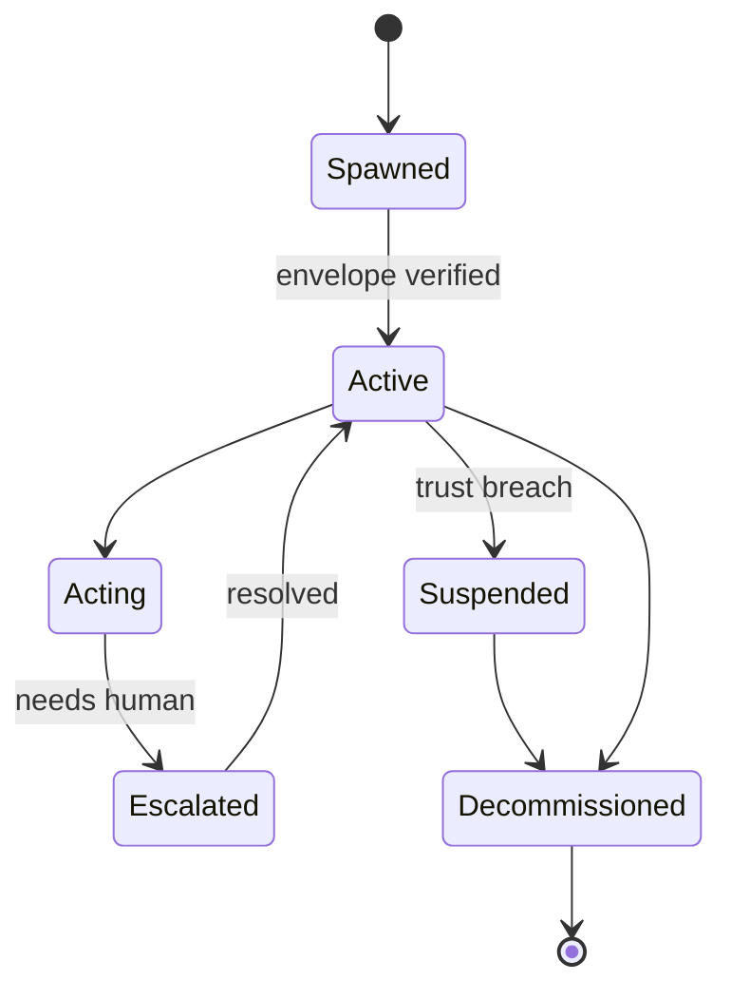
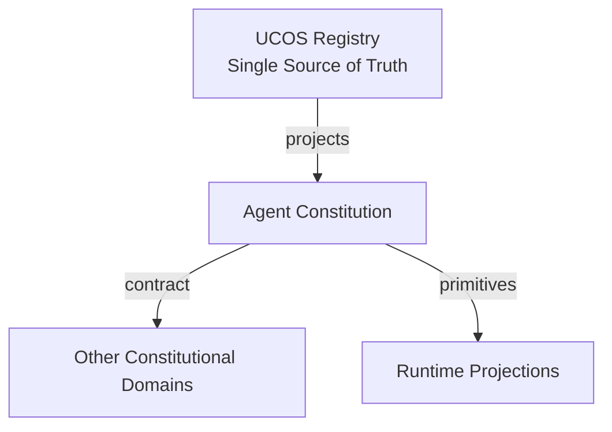
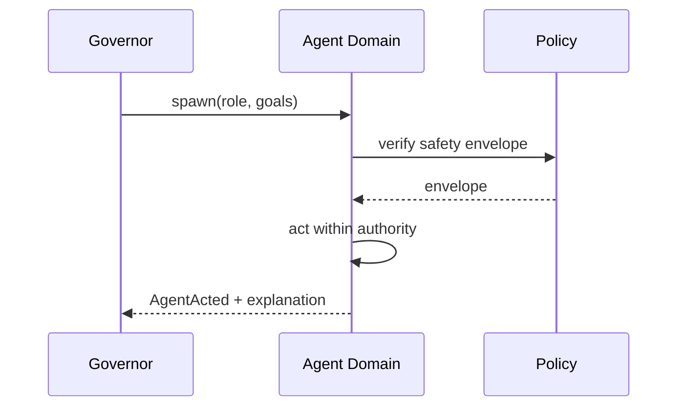
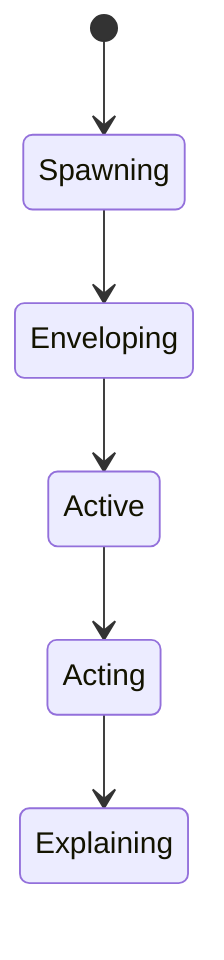
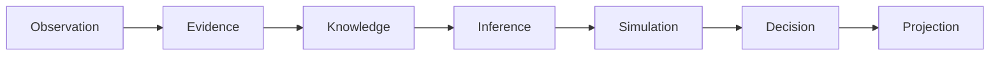
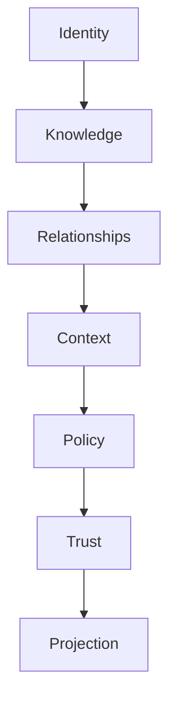

# UCOS-AGT-000001
# Agent Constitution

**Version:** Ω∞.1  |  **Status:** Constitutional Artifact  |  **Authority:** UCOS Ω∞ Constitutional Authority
**Category:** Agents  |  **Source of Truth:** `_registry/` (projected, never hand-authored)

> Constitutional notice: this document is a **projection**. Its truth lives in the registry. Editing this document directly violates Law 002 (Knowledge Once).

---

## 1. Executive Summary

**UCOS-AGT-000001 — Agent Constitution**

This artifact is a constitutionally governed, implementation-ready specification projected from the _UCOS Registry_ single source of truth.
It conforms to the _Immutable Primitive Registry_ (27 frozen primitives) and the _Canonical Terminology Registry_ (31 governed terms).
It contains no hardcoded business, industry, currency, country, or commerce concepts. All such concepts are runtime projections.

---

## 2. Constitutional Purpose

To define the binding contract for **Agent Constitution** such that:
- every concept it names has exactly one owner,
- every capability it exposes has exactly one boundary,
- every boundary is expressed as an explicit contract,
- every contract is enforceable by the Governance Constitution.

---

## 3. Scope

In scope: the primitives, contracts, schemas, events, and policies owned by **Agent Constitution**.
In scope: the projection rules by which this domain exposes its truth to other domains.
In scope: the verification obligations this domain must satisfy before activation.

---

## 4. Out of Scope

Out of scope: any concept owned by another constitutional domain.
Out of scope: business, industry, commerce, country, currency, or language content (all projected).
Out of scope: mutation of another domain’s internal state.

---

## 5. Definitions

All terms in this artifact are used in their canonical sense as defined in the Canonical Terminology Registry.
Where a term appears, its `termId` is normative and its `prohibitedMeanings` are void.

---

## 6. Canonical Terminology

| Term | Canonical Definition | Owner | Prohibited Meanings |
|---|---|---|---|
| Existence | Anything that may exist. | Universal Existence Kernel | business meaning, commercial meaning, operational meaning |
| Entity | Technical representation of an Existence Object. | Identity Domain | existence itself |
| Knowledge | Interpreted information with evidence and meaning. | Knowledge Domain | data, information, evidence |
| Data | Raw observations. | Observation Domain | knowledge, meaning |
| Information | Organized data. | Observation Domain | knowledge |
| Evidence | Proof supporting an assertion. | Evidence Domain | knowledge, trust |
| Trust | Computed confidence in an assertion, derived from evidence. | Trust Domain | evidence, faith |
| Meaning | Semantic interpretation; higher-level understanding. | Semantic Domain | classification, taxonomy, ontology |
| Ontology | What exists. | Semantic Domain | taxonomy, classification |
| Taxonomy | How things are classified. | Semantic Domain | ontology, meaning |
| Classification | Assignment into taxonomy. | Semantic Domain | meaning |
| Relationship | Connection between objects. | Relationship Domain | causality |

---

## 7. Ownership Boundaries

**Owner:** Agent Domain
**Owns:** Agents
**Boundary law:** no domain may modify, bypass, or reinterpret another domain’s internals. All interaction is via contract.

---

## 8. Domain Responsibilities

- Autonomous Execution
- Goal Fulfillment
- Task Completion

---

## 9. Domain Non-Responsibilities

- Must obey: Constitution
- Must obey: Authority
- Must obey: Policy
- Must obey: Trust
- Must obey: Evidence

---

## 10. Concepts

An Agent is an autonomous actor operating under governance. Agent ≠ User, Agent ≠ Service, Agent ≠ Process. Agents are first-class citizens with identity, authority, trust, economics, and safety constraints — and they must always obey the Constitution, Authority, Policy, Trust, and Evidence.

---

## 11. Ontology

Agent has an Identity, a goal (Intent), capabilities (granted), a trust score, an economic account, and a safety envelope. Autonomy is bounded by policy; no agent acts outside its envelope.

---

## 12. Taxonomy

By role: Planner / Architect / Catalog / Pricing / Localization / Compliance / Tax / Trust / Fraud / Knowledge / Simulation / Security / Optimization / Governance / Certification / Evolution / Future role. By autonomy: Supervised / Semi-autonomous / Autonomous / Constituent-of-society.

---

## 13. Registries

This domain is registry-driven. Its registries are entries in the Universal Registry System:

```yaml
RegistryEntry:
  registryId: UCOS-REG-AGENT
  owner: Agent Domain
  law: Knowledge Once — each concept defined exactly once
```

---

## 14. Data Model

```yaml
Agent:
  agentId: <Identity>
  role: <registry id>
  goals: [<Intent>]
  capabilities: [<granted capability>]
  trust: <Trust>
  economics: <account reference>
  safetyEnvelope: <Policy set>
  authority: <Authority>
  status: <Active|Suspended|Decommissioned>
```

---

## 15. Graph Model

(:Agent)-[:CAPABLE_OF]->(:Capability); (:Agent)-[:TRUSTED_AT]->(:Trust); (:Agent)-[:BOUNDED_BY]->(:Policy); (:Agent)-[:ACTS_WITHIN]->(:Authority); (:Agent)-[:MEMBER_OF]->(:AgentSociety)

---

## 16. Schemas

```yaml
# Canonical projection schema for UCOS-AGT-000001
ucos_agt_000001:
  identity:      <Identity primitive>
  intent:        <Intent primitive>
  meaning:       <Meaning primitive>
  knowledge:     <Knowledge primitive>
  registry:      <Registry primitive>
  relationship:  <Relationship primitive>
  context:       <Context primitive>
  policy:        <Policy primitive>
  authority:     <Authority primitive>
  evidence:      <Evidence primitive>
  trust:         <Trust primitive>
  temporal:      <Time primitive>
  metadata:      <Metadata primitive>
```

---

## 17. Contracts

```yaml
DomainContract:
  domain: Agent
  commands:   []   # registry-driven
  queries:    []   # registry-driven
  events:     []   # registry-driven
  policies:   []   # registry-driven
  permissions: []  # registry-driven
```

Contract law: domains never directly access another domain’s internal structures.

---

## 18. APIs

POST /agent.v1.spawn,GET  /agent.v1/{id},POST /agent.v1/{id}/act,GET  /agent.v1/{id}/trust,POST /agent.v1/{id}/suspend

---

## 19. Events

AgentSpawned,AgentActed,AgentSuspended,AgentDecommissioned,AgentTrustChanged,AgentEscalated

---

## 20. Commands

agent.spawn,agent.act,agent.suspend,agent.decommission,agent.delegate,agent.report

---

## 21. Queries

agent.byId,agent.byRole,agent.trust,agent.actions,agent.society

---

## 22. State Machines



---

## 23. Workflows

spawn under governance → verify safety envelope → act within authority → escalate on uncertainty → log with full explainability → suspend on breach

---

## 24. Policies

```yaml
Policy:
  identity: <Identity>
  conditions: []   # registry-driven
  actions:    []   # registry-driven
  priorities: []   # registry-driven
  exceptions: []   # registry-driven
```

All behavior derives from policy. Policy ≠ Rule: policy is behavioral governance; the rule is its executable projection.

---

## 25. Rules

```yaml
Rule:
  ruleId: <Identity>
  derivedFrom: <Policy identity>
  executable: true
  constraint: <registry expression>
```

---

## 26. Authorities

Governance Authority spawns; an agent's authority is a strict delegation, never exceeding its granter.

---

## 27. Permissions

agent.spawn (governance authority),agent.act (agent's own delegated authority),agent.suspend (governance authority)

---

## 28. Security Model

Zero Trust applies: no implicit trust between domains, services, agents, or tenants.
Every call is authenticated, authorized against Policy, and evidenced.
Cryptographic identity is issued by the Identity Domain; keys by the Key Management Architecture.

---

## 29. Privacy Model

Agents over personal data act only under consent scope; agent actions on individuals are auditable by the data subject.

---

## 30. Trust Model

Trust is computed, never assumed. Inputs: evidence, authority, consistency, provenance, confidence.
```yaml
Trust:
  evidenceScore: <0..1>
  authorityScore: <0..1>
  consistencyScore: <0..1>
  provenanceScore: <0..1>
  confidenceScore: <0..1>
```

---

## 31. Audit Model

Every agent action answers all seven explainability questions — autonomous action without explanation is unconstitutional.

---

## 32. Observability Model

Every action emits: What happened? Why? Who authorized it? Which policy allowed it? What evidence supports it? What confidence exists? What alternatives were evaluated?
These are the seven Explainability questions and are mandatory event fields.

---

## 33. Digital Twin Model

Each agent has an operational twin monitoring its behavior against its envelope — drift triggers suspension.

---

## 34. Agent Model

Agents are both governed actors and the governance workforce — the system polices itself through them.

---

## 35. Runtime Model

Actions are policy-guarded at execution time; the safety envelope is enforced, not advisory.

---

## 36. Scaling Model

Agents scale horizontally; per-agent rate limits and economic budgets bound resource use.

---

## 37. Multi-Tenant Model

Agents are tenant-scoped; a cross-tenant agent requires both tenants' authority — rare and heavily audited.

---

## 38. Geo-Distribution Model

Agent authority is jurisdiction-bound; an agent legal in one region may not act in another.

---

## 39. Failure Model

Envelope violation, trust collapse, goal conflict, resource exhaustion, society polarization.

---

## 40. Recovery Model

Suspension is safe-by-default; a suspended agent's in-flight actions are compensated, not abandoned.

---

## 41. Verification Model

Before activation, Agent Constitution must pass identity, knowledge, relationship, context, policy, authority, trust, and reality integrity checks.
Verification is performed by the Formal Verification Architecture (UCOS-FML-000001).

---

## 42. Certification Model

Agent must pass envelope definition, authority traceability, trust threshold, and explainability verification before acting.

---

## 43. Migration Model

New agent roles are registry additions; existing agents keep their envelope version.

---

## 44. Evolution Model

Evolution is governed and history-preserving. Primitives are frozen; extension occurs through registries, policies, capabilities, contexts, relationships, knowledge, agents, and projections — never through primitive expansion.

---

## 45. Implementation Blueprint

Build order for AGT: (1) define registry entries — this domain owns by role: planner / architect / catalog / pricing / localization / compliance / tax / trust / fraud / knowledge / simulation / security / optimization / governance / certification / evolution / future role as registry truth, not code; (2) implement the contract surface first (agent.spawn, agent.act, agent.suspend) and validate against AGT boundaries; (3) event-source all state so history is reconstructable; (4) wire the enforcement points — authority check, policy guard, evidence binding, trace — in-line, with no bypass path; (5) add tests per the Testing Architecture, citing evidence per gate; (6) obtain Verification and Certification before activation. Acceptance: the Zero Partial and Law 001 audits pass, every action answers the seven explainability questions, and this domain mutates no other domain internals.

---

## 46. Reference Architecture Diagram



---

## 47. Sequence Diagrams



---

## 48. State Diagrams



---

## 49. Data Flow Diagrams



---

## 50. Dependency Maps



Forbidden: circular dependencies, mutual ownership, cross-domain state mutation.

---

## ∞

Constitutionally governed. Implementation ready. Universally extensible.