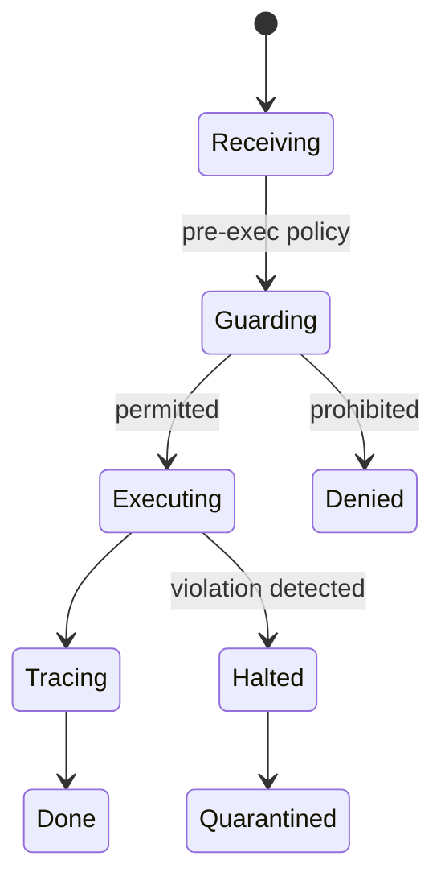
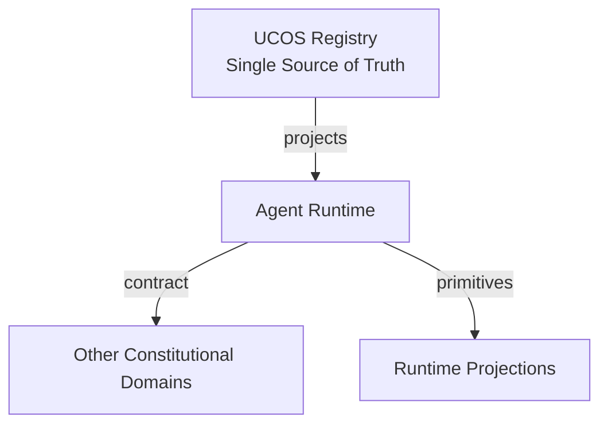
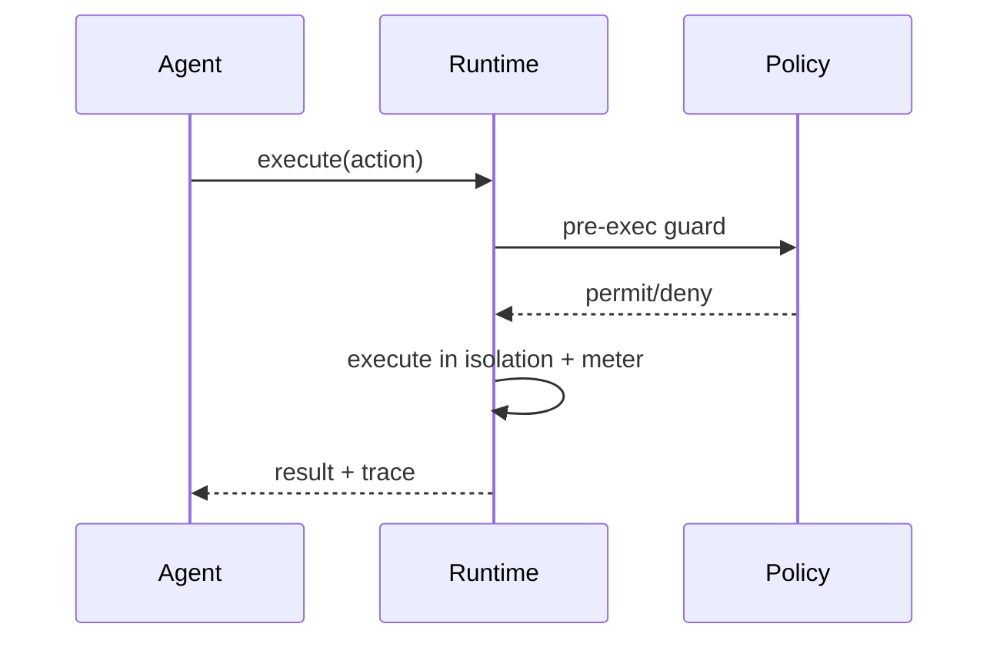
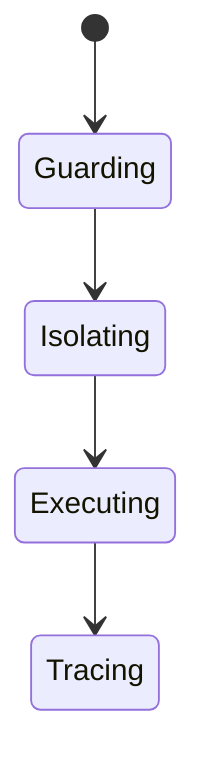
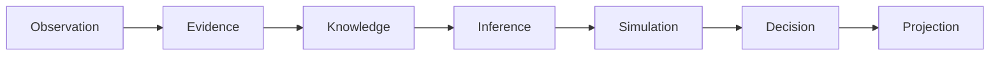
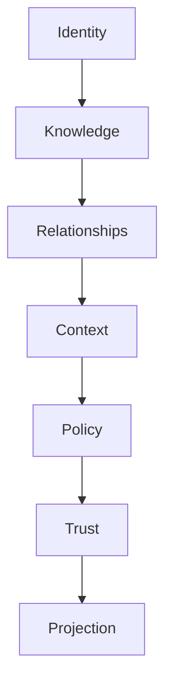

# UCOS-AGT-000002
# Agent Runtime

**Version:** Ω∞.1  |  **Status:** Constitutional Artifact  |  **Authority:** UCOS Ω∞ Constitutional Authority
**Category:** Agents  |  **Source of Truth:** `_registry/` (projected, never hand-authored)

> Constitutional notice: this document is a **projection**. Its truth lives in the registry. Editing this document directly violates Law 002 (Knowledge Once).

---

## 1. Executive Summary

**UCOS-AGT-000002 — Agent Runtime**

This artifact is a constitutionally governed, implementation-ready specification projected from the _UCOS Registry_ single source of truth.
It conforms to the _Immutable Primitive Registry_ (27 frozen primitives) and the _Canonical Terminology Registry_ (31 governed terms).
It contains no hardcoded business, industry, currency, country, or commerce concepts. All such concepts are runtime projections.

---

## 2. Constitutional Purpose

To define the binding contract for **Agent Runtime** such that:
- every concept it names has exactly one owner,
- every capability it exposes has exactly one boundary,
- every boundary is expressed as an explicit contract,
- every contract is enforceable by the Governance Constitution.

---

## 3. Scope

In scope: the primitives, contracts, schemas, events, and policies owned by **Agent Runtime**.
In scope: the projection rules by which this domain exposes its truth to other domains.
In scope: the verification obligations this domain must satisfy before activation.

---

## 4. Out of Scope

Out of scope: any concept owned by another constitutional domain.
Out of scope: business, industry, commerce, country, currency, or language content (all projected).
Out of scope: mutation of another domain’s internal state.

---

## 5. Definitions

All terms in this artifact are used in their canonical sense as defined in the Canonical Terminology Registry.
Where a term appears, its `termId` is normative and its `prohibitedMeanings` are void.

---

## 6. Canonical Terminology

| Term | Canonical Definition | Owner | Prohibited Meanings |
|---|---|---|---|
| Existence | Anything that may exist. | Universal Existence Kernel | business meaning, commercial meaning, operational meaning |
| Entity | Technical representation of an Existence Object. | Identity Domain | existence itself |
| Knowledge | Interpreted information with evidence and meaning. | Knowledge Domain | data, information, evidence |
| Data | Raw observations. | Observation Domain | knowledge, meaning |
| Information | Organized data. | Observation Domain | knowledge |
| Evidence | Proof supporting an assertion. | Evidence Domain | knowledge, trust |
| Trust | Computed confidence in an assertion, derived from evidence. | Trust Domain | evidence, faith |
| Meaning | Semantic interpretation; higher-level understanding. | Semantic Domain | classification, taxonomy, ontology |
| Ontology | What exists. | Semantic Domain | taxonomy, classification |
| Taxonomy | How things are classified. | Semantic Domain | ontology, meaning |
| Classification | Assignment into taxonomy. | Semantic Domain | meaning |
| Relationship | Connection between objects. | Relationship Domain | causality |

---

## 7. Ownership Boundaries

Ownership is recorded in the _Domain Ownership Registry_.

---

## 8. Domain Responsibilities

See the Domain Ownership Registry for the authoritative responsibility list.

---

## 9. Domain Non-Responsibilities

See the Domain Ownership Registry.

---

## 10. Concepts

Agent Runtime is the governed execution environment for autonomous actors. It enforces the safety envelope at instruction granularity — policy is a runtime guard, not a code review.

---

## 11. Ontology

Runtime hosts Agents, enforces envelopes, meters economics, and records full action traces. It is the boundary where intent becomes action — and where unconstitutional action is stopped.

---

## 12. Taxonomy

By isolation: Process / Container / VM / Enclave / Sandbox. By scheduling: Real-time / Best-effort / Batch. By tenancy: Dedicated / Shared.

---

## 13. Registries

This domain is registry-driven. Its registries are entries in the Universal Registry System:

```yaml
RegistryEntry:
  registryId: UCOS-REG-DOMAIN
  owner: Constitutional Authority
  law: Knowledge Once — each concept defined exactly once
```

---

## 14. Data Model

```yaml
AgentRuntime:
  runtimeId: <Identity>
  host: <Identity>
  isolation: <registry id>
  enforcementPoints: [pre-exec, post-exec, resource, network]
  metering: {economic account, rate limits}
  trace: <append-only log ref>
  policyVersion: <version>
```

---

## 15. Graph Model

(:Runtime)-[:HOSTS]->(:Agent); (:Runtime)-[:ENFORCES]->(:Policy); (:Runtime)-[:METERS]->(:EconomicAccount); (:Runtime)-[:TRACES_TO]->(:AuditLog)

---

## 16. Schemas

```yaml
# Canonical projection schema for UCOS-AGT-000002
ucos_agt_000002:
  identity:      <Identity primitive>
  intent:        <Intent primitive>
  meaning:       <Meaning primitive>
  knowledge:     <Knowledge primitive>
  registry:      <Registry primitive>
  relationship:  <Relationship primitive>
  context:       <Context primitive>
  policy:        <Policy primitive>
  authority:     <Authority primitive>
  evidence:      <Evidence primitive>
  trust:         <Trust primitive>
  temporal:      <Time primitive>
  metadata:      <Metadata primitive>
```

---

## 17. Contracts

```yaml
DomainContract:
  domain: Agent Runtime
  commands:   []   # registry-driven
  queries:    []   # registry-driven
  events:     []   # registry-driven
  policies:   []   # registry-driven
  permissions: []  # registry-driven
```

Contract law: domains never directly access another domain’s internal structures.

---

## 18. APIs

POST /runtime.v1.execute,GET  /runtime.v1/trace/{agentId},POST /runtime.v1.halt,GET  /runtime.v1.envelope/{agentId}

---

## 19. Events

ExecutionRequested,ExecutionGuarded,ExecutionHalted,EnvelopeViolated,ResourceExhausted

---

## 20. Commands

runtime.execute,runtime.halt,runtime.quarantine,runtime.trace,runtime.enforce

---

## 21. Queries

runtime.trace,runtime.envelope,runtime.usage,runtime.violations

---

## 22. State Machines



---

## 23. Workflows

receive action → pre-exec policy guard → execute in isolation → meter economics → post-exec trace → halt+quarantine on violation

---

## 24. Policies

```yaml
Policy:
  identity: <Identity>
  conditions: []   # registry-driven
  actions:    []   # registry-driven
  priorities: []   # registry-driven
  exceptions: []   # registry-driven
```

All behavior derives from policy. Policy ≠ Rule: policy is behavioral governance; the rule is its executable projection.

---

## 25. Rules

```yaml
Rule:
  ruleId: <Identity>
  derivedFrom: <Policy identity>
  executable: true
  constraint: <registry expression>
```

---

## 26. Authorities

Runtime Authority (enforcement); agents carry delegated authority verified at guard time.

---

## 27. Permissions

runtime.execute (agent with valid envelope),runtime.halt (governance authority),runtime.trace (auditor)

---

## 28. Security Model

Zero Trust applies: no implicit trust between domains, services, agents, or tenants.
Every call is authenticated, authorized against Policy, and evidenced.
Cryptographic identity is issued by the Identity Domain; keys by the Key Management Architecture.

---

## 29. Privacy Model

Traces of personal-data actions are minimized and consent-scoped; the fact of enforcement is auditable, contents are not.

---

## 30. Trust Model

Trust is computed, never assumed. Inputs: evidence, authority, consistency, provenance, confidence.
```yaml
Trust:
  evidenceScore: <0..1>
  authorityScore: <0..1>
  consistencyScore: <0..1>
  provenanceScore: <0..1>
  confidenceScore: <0..1>
```

---

## 31. Audit Model

Every guarded execution records the policy evaluated, the decision, the economic charge, and the full action trace.

---

## 32. Observability Model

Every action emits: What happened? Why? Who authorized it? Which policy allowed it? What evidence supports it? What confidence exists? What alternatives were evaluated?
These are the seven Explainability questions and are mandatory event fields.

---

## 33. Digital Twin Model

The runtime twin monitors enforcement latency and violation rates as system-health signals.

---

## 34. Agent Model

The runtime is what makes agents safe enough to be first-class citizens — enforcement is architectural, not procedural.

---

## 35. Runtime Model

Enforcement is in-line and mandatory; there is no code path from agent intent to effect that bypasses the guard.

---

## 36. Scaling Model

Runtimes scale horizontally; per-agent quotas prevent noisy-neighbor domination.

---

## 37. Multi-Tenant Model

Runtimes are tenant-isolated at the isolation boundary — no shared execution context across tenants.

---

## 38. Geo-Distribution Model

Execution jurisdiction follows the data's residency; cross-region execution requires sovereignty policy pass.

---

## 39. Failure Model

Guard bypass (must be impossible by construction), quarantine overflow, trace loss, meter drift.

---

## 40. Recovery Model

Halted actions are compensatable via the event log; quarantined agents await governance review, never auto-resume.

---

## 41. Verification Model

Before activation, Agent Runtime must pass identity, knowledge, relationship, context, policy, authority, trust, and reality integrity checks.
Verification is performed by the Formal Verification Architecture (UCOS-FML-000001).

---

## 42. Certification Model

Runtime must prove no bypass path exists — formally verified guard placement is mandatory.

---

## 43. Migration Model

New isolation types are registry additions; guard logic versioned and replayable.

---

## 44. Evolution Model

Evolution is governed and history-preserving. Primitives are frozen; extension occurs through registries, policies, capabilities, contexts, relationships, knowledge, agents, and projections — never through primitive expansion.

---

## 45. Implementation Blueprint

Build order for AGT2: (1) define registry entries — this domain owns by isolation: process / container / vm / enclave / sandbox as registry truth, not code; (2) implement the contract surface first (runtime.execute, runtime.halt, runtime.quarantine) and validate against AGT2 boundaries; (3) event-source all state so history is reconstructable; (4) wire the enforcement points — authority check, policy guard, evidence binding, trace — in-line, with no bypass path; (5) add tests per the Testing Architecture, citing evidence per gate; (6) obtain Verification and Certification before activation. Acceptance: the Zero Partial and Law 001 audits pass, every action answers the seven explainability questions, and this domain mutates no other domain internals.

---

## 46. Reference Architecture Diagram



---

## 47. Sequence Diagrams



---

## 48. State Diagrams



---

## 49. Data Flow Diagrams



---

## 50. Dependency Maps



Forbidden: circular dependencies, mutual ownership, cross-domain state mutation.

---

## ∞

Constitutionally governed. Implementation ready. Universally extensible.