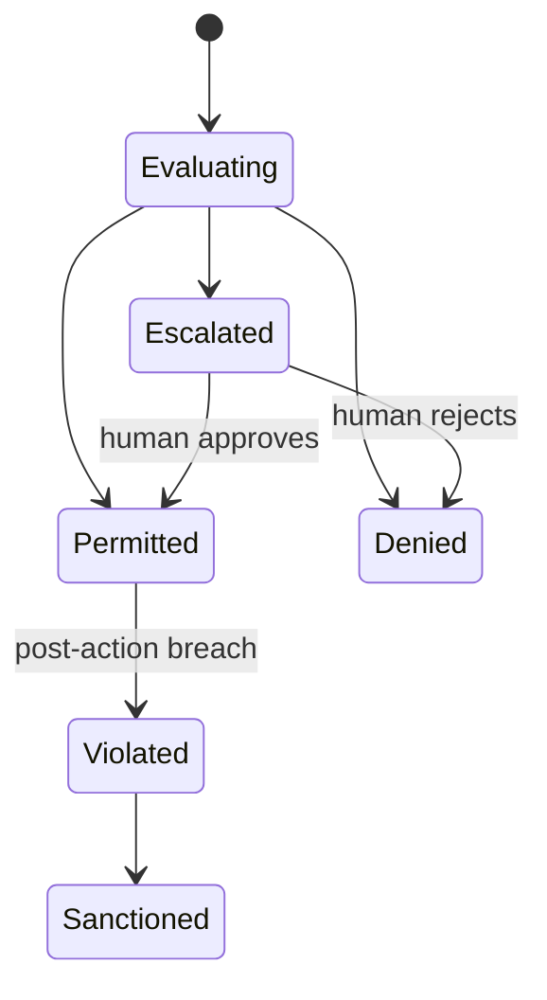
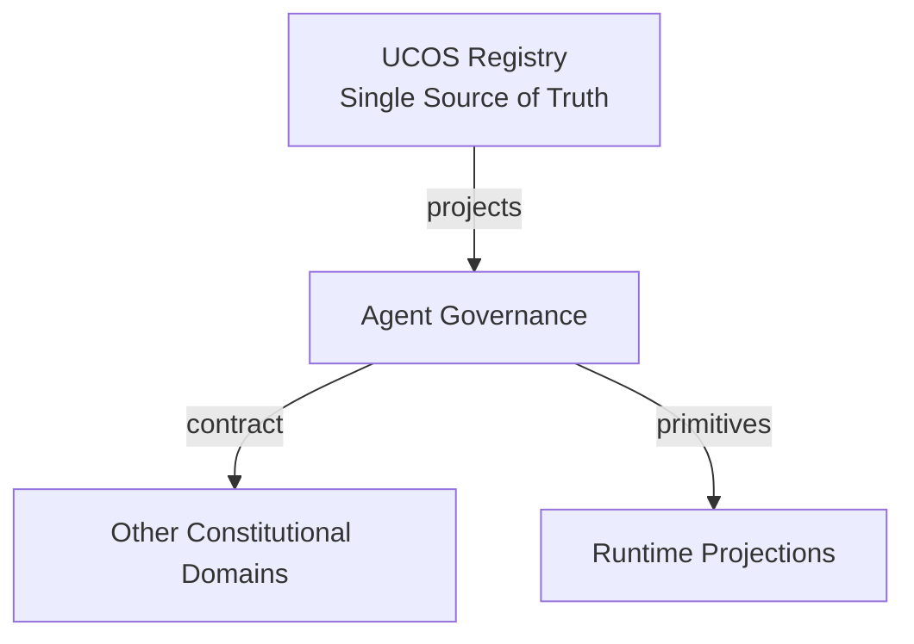
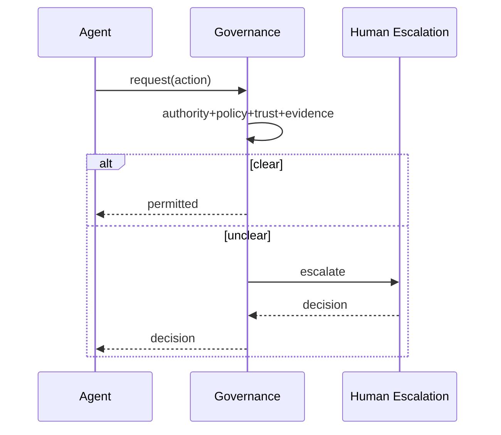
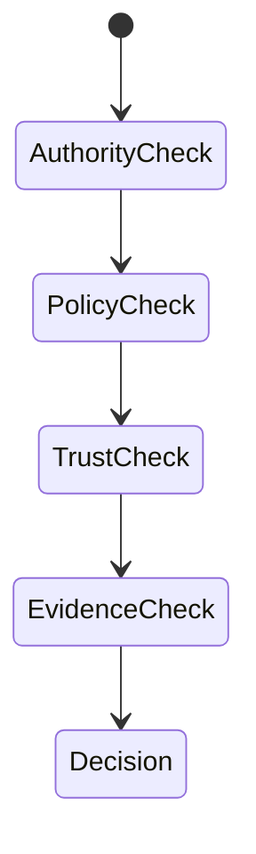
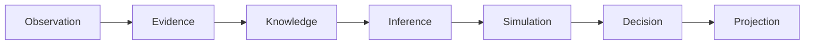
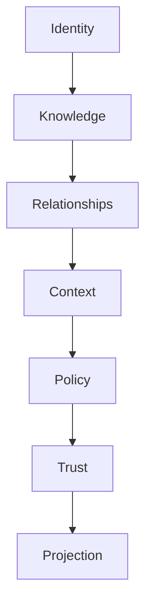

# UCOS-AGT-000003
# Agent Governance

**Version:** Ω∞.1  |  **Status:** Constitutional Artifact  |  **Authority:** UCOS Ω∞ Constitutional Authority
**Category:** Agents  |  **Source of Truth:** `_registry/` (projected, never hand-authored)

> Constitutional notice: this document is a **projection**. Its truth lives in the registry. Editing this document directly violates Law 002 (Knowledge Once).

---

## 1. Executive Summary

**UCOS-AGT-000003 — Agent Governance**

This artifact is a constitutionally governed, implementation-ready specification projected from the _UCOS Registry_ single source of truth.
It conforms to the _Immutable Primitive Registry_ (27 frozen primitives) and the _Canonical Terminology Registry_ (31 governed terms).
It contains no hardcoded business, industry, currency, country, or commerce concepts. All such concepts are runtime projections.

---

## 2. Constitutional Purpose

To define the binding contract for **Agent Governance** such that:
- every concept it names has exactly one owner,
- every capability it exposes has exactly one boundary,
- every boundary is expressed as an explicit contract,
- every contract is enforceable by the Governance Constitution.

---

## 3. Scope

In scope: the primitives, contracts, schemas, events, and policies owned by **Agent Governance**.
In scope: the projection rules by which this domain exposes its truth to other domains.
In scope: the verification obligations this domain must satisfy before activation.

---

## 4. Out of Scope

Out of scope: any concept owned by another constitutional domain.
Out of scope: business, industry, commerce, country, currency, or language content (all projected).
Out of scope: mutation of another domain’s internal state.

---

## 5. Definitions

All terms in this artifact are used in their canonical sense as defined in the Canonical Terminology Registry.
Where a term appears, its `termId` is normative and its `prohibitedMeanings` are void.

---

## 6. Canonical Terminology

| Term | Canonical Definition | Owner | Prohibited Meanings |
|---|---|---|---|
| Existence | Anything that may exist. | Universal Existence Kernel | business meaning, commercial meaning, operational meaning |
| Entity | Technical representation of an Existence Object. | Identity Domain | existence itself |
| Knowledge | Interpreted information with evidence and meaning. | Knowledge Domain | data, information, evidence |
| Data | Raw observations. | Observation Domain | knowledge, meaning |
| Information | Organized data. | Observation Domain | knowledge |
| Evidence | Proof supporting an assertion. | Evidence Domain | knowledge, trust |
| Trust | Computed confidence in an assertion, derived from evidence. | Trust Domain | evidence, faith |
| Meaning | Semantic interpretation; higher-level understanding. | Semantic Domain | classification, taxonomy, ontology |
| Ontology | What exists. | Semantic Domain | taxonomy, classification |
| Taxonomy | How things are classified. | Semantic Domain | ontology, meaning |
| Classification | Assignment into taxonomy. | Semantic Domain | meaning |
| Relationship | Connection between objects. | Relationship Domain | causality |

---

## 7. Ownership Boundaries

Ownership is recorded in the _Domain Ownership Registry_.

---

## 8. Domain Responsibilities

See the Domain Ownership Registry for the authoritative responsibility list.

---

## 9. Domain Non-Responsibilities

See the Domain Ownership Registry.

---

## 10. Concepts

Agent Governance ensures no autonomous actor is ungoverned. Every agent action is authorized, policy-checked, trust-scored, evidenced, explainable, and reversible-or-compensated. Governance is not oversight — it is an execution-time constraint.

---

## 11. Ontology

Governance binds each Agent to: an Authority chain, a Policy envelope, a Trust threshold, an Evidence requirement, and an Explainability contract. All five are checked at action time.

---

## 12. Taxonomy

By stage: Pre-action / In-action / Post-action / Continuous. By severity handling: Auto-permit / Auto-deny / Escalate / Quarantine. By scope: Single-agent / Multi-agent / Society-level.

---

## 13. Registries

This domain is registry-driven. Its registries are entries in the Universal Registry System:

```yaml
RegistryEntry:
  registryId: UCOS-REG-DOMAIN
  owner: Constitutional Authority
  law: Knowledge Once — each concept defined exactly once
```

---

## 14. Data Model

```yaml
AgentGovernance:
  governanceId: <Identity>
  agent: <Identity>
  authorityChain: [<Authority>]
  policyEnvelope: [<Policy>]
  trustThreshold: <0..1>
  evidenceRequirement: <registry id>
  explainabilityContract: <registry id>
  escalationPolicy: <Policy>
```

---

## 15. Graph Model

(:Governance)-[:BINDS]->(:Agent); (:Governance)-[:REQUIRES]->(:Evidence); (:Governance)-[:ESCALATES_TO]->(:Authority); (:Governance)-[:GOVERNED_BY]->(:Policy)

---

## 16. Schemas

```yaml
# Canonical projection schema for UCOS-AGT-000003
ucos_agt_000003:
  identity:      <Identity primitive>
  intent:        <Intent primitive>
  meaning:       <Meaning primitive>
  knowledge:     <Knowledge primitive>
  registry:      <Registry primitive>
  relationship:  <Relationship primitive>
  context:       <Context primitive>
  policy:        <Policy primitive>
  authority:     <Authority primitive>
  evidence:      <Evidence primitive>
  trust:         <Trust primitive>
  temporal:      <Time primitive>
  metadata:      <Metadata primitive>
```

---

## 17. Contracts

```yaml
DomainContract:
  domain: Agent Governance
  commands:   []   # registry-driven
  queries:    []   # registry-driven
  events:     []   # registry-driven
  policies:   []   # registry-driven
  permissions: []  # registry-driven
```

Contract law: domains never directly access another domain’s internal structures.

---

## 18. APIs

POST /governance.v1.evaluate,GET  /governance.v1/{agentId},POST /governance.v1.escalate,GET  /governance.v1.violations

---

## 19. Events

GovernanceEvaluated,GovernanceEscalated,GovernanceViolated,GovernanceRemediated,TrustThresholdBreached

---

## 20. Commands

governance.evaluate,governance.escalate,governance.sanction,governance.remediate

---

## 21. Queries

governance.byAgent,governance.violations,governance.escalations,governance.coverage

---

## 22. State Machines



---

## 23. Workflows

evaluate authority + policy + trust + evidence pre-action → permit/deny/escalate → monitor in-action → post-action audit → sanction on violation

---

## 24. Policies

```yaml
Policy:
  identity: <Identity>
  conditions: []   # registry-driven
  actions:    []   # registry-driven
  priorities: []   # registry-driven
  exceptions: []   # registry-driven
```

All behavior derives from policy. Policy ≠ Rule: policy is behavioral governance; the rule is its executable projection.

---

## 25. Rules

```yaml
Rule:
  ruleId: <Identity>
  derivedFrom: <Policy identity>
  executable: true
  constraint: <registry expression>
```

---

## 26. Authorities

Governance Authority over agents; humans are the escalation target of last resort.

---

## 27. Permissions

governance.evaluate (runtime),governance.escalate (any agent or observer),governance.sanction (governance authority)

---

## 28. Security Model

Zero Trust applies: no implicit trust between domains, services, agents, or tenants.
Every call is authenticated, authorized against Policy, and evidenced.
Cryptographic identity is issued by the Identity Domain; keys by the Key Management Architecture.

---

## 29. Privacy Model

Governance records of personal-data actions are consent-scoped; the governance fact is auditable, subject data minimized.

---

## 30. Trust Model

Trust is computed, never assumed. Inputs: evidence, authority, consistency, provenance, confidence.
```yaml
Trust:
  evidenceScore: <0..1>
  authorityScore: <0..1>
  consistencyScore: <0..1>
  provenanceScore: <0..1>
  confidenceScore: <0..1>
```

---

## 31. Audit Model

The governance record IS the audit artifact — authority chain, policy version, trust score, evidence, and explanation for every action.

---

## 32. Observability Model

Every action emits: What happened? Why? Who authorized it? Which policy allowed it? What evidence supports it? What confidence exists? What alternatives were evaluated?
These are the seven Explainability questions and are mandatory event fields.

---

## 33. Digital Twin Model

Governance twin monitors violation rates and trust drift across the agent fleet as an early-warning system.

---

## 34. Agent Model

Governance is what separates an agent from malware — identical capability, opposite constraint.

---

## 35. Runtime Model

Evaluation is in-line and cached per (agent, action-class, policy-version); escalation queues to humans with SLAs.

---

## 36. Scaling Model

Evaluation is sub-millisecond cached; escalations are human-paced and bounded by queue policy.

---

## 37. Multi-Tenant Model

Governance is tenant-scoped; constitutional governance overrides tenant policy universally.

---

## 38. Geo-Distribution Model

Escalation routes to on-call humans in the acting jurisdiction — accountability is local.

---

## 39. Failure Model

Evaluation timeout (default deny), evidence starvation, escalation queue overflow, trust threshold storm.

---

## 40. Recovery Model

Sanctioned agents are compensatable via action traces; violations are never auto-forgiven — remediation is governed.

---

## 41. Verification Model

Before activation, Agent Governance must pass identity, knowledge, relationship, context, policy, authority, trust, and reality integrity checks.
Verification is performed by the Formal Verification Architecture (UCOS-FML-000001).

---

## 42. Certification Model

Governance must prove 100% action coverage — an ungoverned agent path is a certification failure.

---

## 43. Migration Model

New evaluation strategies are registry additions.

---

## 44. Evolution Model

Evolution is governed and history-preserving. Primitives are frozen; extension occurs through registries, policies, capabilities, contexts, relationships, knowledge, agents, and projections — never through primitive expansion.

---

## 45. Implementation Blueprint

Build order for AGT3: (1) define registry entries — this domain owns by stage: pre-action / in-action / post-action / continuous as registry truth, not code; (2) implement the contract surface first (governance.evaluate, governance.escalate, governance.sanction) and validate against AGT3 boundaries; (3) event-source all state so history is reconstructable; (4) wire the enforcement points — authority check, policy guard, evidence binding, trace — in-line, with no bypass path; (5) add tests per the Testing Architecture, citing evidence per gate; (6) obtain Verification and Certification before activation. Acceptance: the Zero Partial and Law 001 audits pass, every action answers the seven explainability questions, and this domain mutates no other domain internals.

---

## 46. Reference Architecture Diagram



---

## 47. Sequence Diagrams



---

## 48. State Diagrams



---

## 49. Data Flow Diagrams



---

## 50. Dependency Maps



Forbidden: circular dependencies, mutual ownership, cross-domain state mutation.

---

## ∞

Constitutionally governed. Implementation ready. Universally extensible.