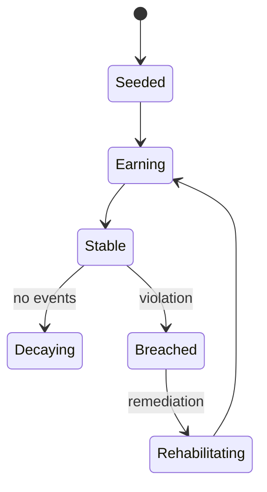
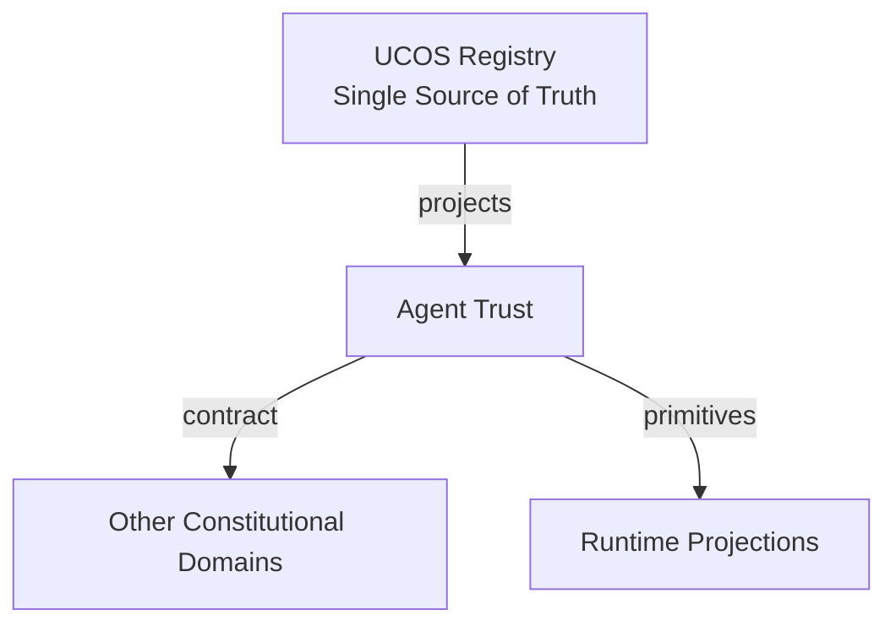
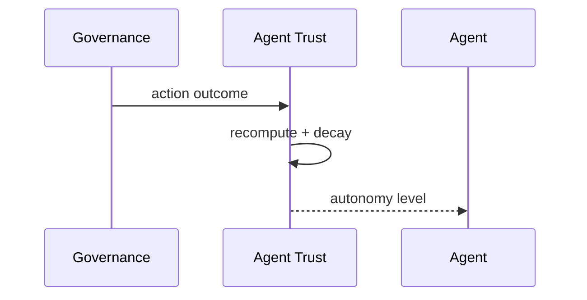
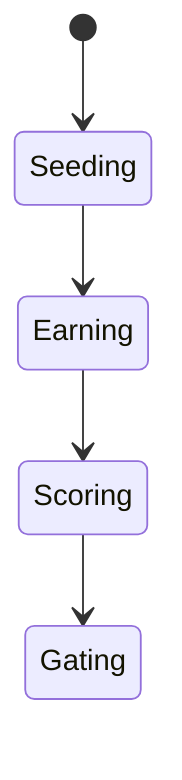
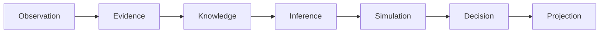
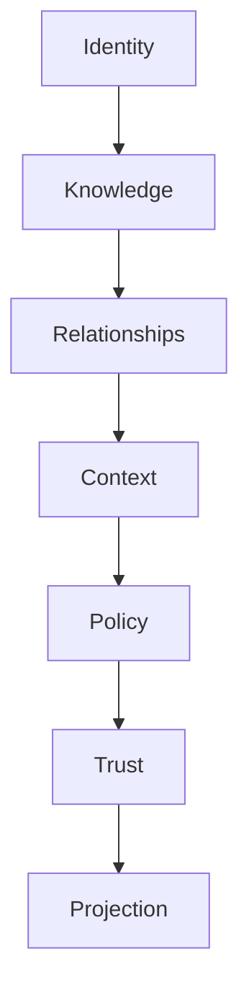

# UCOS-AGT-000004
# Agent Trust

**Version:** Ω∞.1  |  **Status:** Constitutional Artifact  |  **Authority:** UCOS Ω∞ Constitutional Authority
**Category:** Agents  |  **Source of Truth:** `_registry/` (projected, never hand-authored)

> Constitutional notice: this document is a **projection**. Its truth lives in the registry. Editing this document directly violates Law 002 (Knowledge Once).

---

## 1. Executive Summary

**UCOS-AGT-000004 — Agent Trust**

This artifact is a constitutionally governed, implementation-ready specification projected from the _UCOS Registry_ single source of truth.
It conforms to the _Immutable Primitive Registry_ (27 frozen primitives) and the _Canonical Terminology Registry_ (31 governed terms).
It contains no hardcoded business, industry, currency, country, or commerce concepts. All such concepts are runtime projections.

---

## 2. Constitutional Purpose

To define the binding contract for **Agent Trust** such that:
- every concept it names has exactly one owner,
- every capability it exposes has exactly one boundary,
- every boundary is expressed as an explicit contract,
- every contract is enforceable by the Governance Constitution.

---

## 3. Scope

In scope: the primitives, contracts, schemas, events, and policies owned by **Agent Trust**.
In scope: the projection rules by which this domain exposes its truth to other domains.
In scope: the verification obligations this domain must satisfy before activation.

---

## 4. Out of Scope

Out of scope: any concept owned by another constitutional domain.
Out of scope: business, industry, commerce, country, currency, or language content (all projected).
Out of scope: mutation of another domain’s internal state.

---

## 5. Definitions

All terms in this artifact are used in their canonical sense as defined in the Canonical Terminology Registry.
Where a term appears, its `termId` is normative and its `prohibitedMeanings` are void.

---

## 6. Canonical Terminology

| Term | Canonical Definition | Owner | Prohibited Meanings |
|---|---|---|---|
| Existence | Anything that may exist. | Universal Existence Kernel | business meaning, commercial meaning, operational meaning |
| Entity | Technical representation of an Existence Object. | Identity Domain | existence itself |
| Knowledge | Interpreted information with evidence and meaning. | Knowledge Domain | data, information, evidence |
| Data | Raw observations. | Observation Domain | knowledge, meaning |
| Information | Organized data. | Observation Domain | knowledge |
| Evidence | Proof supporting an assertion. | Evidence Domain | knowledge, trust |
| Trust | Computed confidence in an assertion, derived from evidence. | Trust Domain | evidence, faith |
| Meaning | Semantic interpretation; higher-level understanding. | Semantic Domain | classification, taxonomy, ontology |
| Ontology | What exists. | Semantic Domain | taxonomy, classification |
| Taxonomy | How things are classified. | Semantic Domain | ontology, meaning |
| Classification | Assignment into taxonomy. | Semantic Domain | meaning |
| Relationship | Connection between objects. | Relationship Domain | causality |

---

## 7. Ownership Boundaries

Ownership is recorded in the _Domain Ownership Registry_.

---

## 8. Domain Responsibilities

See the Domain Ownership Registry for the authoritative responsibility list.

---

## 9. Domain Non-Responsibilities

See the Domain Ownership Registry.

---

## 10. Concepts

Agent Trust is the computed confidence that an agent will act within its envelope. It is earned through evidenced behavior, decayed by time and violation, and never assumed from role or title.

---

## 11. Ontology

Agent Trust aggregates action outcomes, violation history, governance evaluations, and peer attestations into a per-context score. Trust gates autonomy: low trust means escalation, not elimination.

---

## 12. Taxonomy

By input: Outcome-based / Violation-weighted / Peer-attested / Authority-attested. By decay: Time-decay / Event-decay / Violation-decay. By use: Autonomy gate / Escalation trigger / Budget cap.

---

## 13. Registries

This domain is registry-driven. Its registries are entries in the Universal Registry System:

```yaml
RegistryEntry:
  registryId: UCOS-REG-DOMAIN
  owner: Constitutional Authority
  law: Knowledge Once — each concept defined exactly once
```

---

## 14. Data Model

```yaml
AgentTrust:
  agentTrustId: <Identity>
  agent: <Identity>
  outcomeScore: <0..1>
  violationPenalty: <0..1>
  peerAttestation: <0..1>
  authorityAttestation: <0..1>
  composite: <0..1, registry formula>
  decayState: {lastEvent, halfLife}
  context: <Context>
```

---

## 15. Graph Model

(:AgentTrust)-[:SCORES]->(:Agent); (:AgentTrust)-[:DERIVED_FROM]->(:GovernanceRecord); (:AgentTrust)-[:ATTESTED_BY]->(:Authority|:Agent); (:AgentTrust)-[:GATES]->(:Autonomy)

---

## 16. Schemas

```yaml
# Canonical projection schema for UCOS-AGT-000004
ucos_agt_000004:
  identity:      <Identity primitive>
  intent:        <Intent primitive>
  meaning:       <Meaning primitive>
  knowledge:     <Knowledge primitive>
  registry:      <Registry primitive>
  relationship:  <Relationship primitive>
  context:       <Context primitive>
  policy:        <Policy primitive>
  authority:     <Authority primitive>
  evidence:      <Evidence primitive>
  trust:         <Trust primitive>
  temporal:      <Time primitive>
  metadata:      <Metadata primitive>
```

---

## 17. Contracts

```yaml
DomainContract:
  domain: Agent Trust
  commands:   []   # registry-driven
  queries:    []   # registry-driven
  events:     []   # registry-driven
  policies:   []   # registry-driven
  permissions: []  # registry-driven
```

Contract law: domains never directly access another domain’s internal structures.

---

## 18. APIs

GET  /agent-trust.v1/{agentId},POST /agent-trust.v1.attest,GET  /agent-trust.v1.history/{agentId},POST /agent-trust.v1.recompute

---

## 19. Events

AgentTrustComputed,AgentTrustDecayed,AgentTrustBreached,AgentTrustAttested,AgentTrustReset

---

## 20. Commands

agentTrust.attest,agentTrust.recompute,agentTrust.dispute,agentTrust.reset

---

## 21. Queries

agentTrust.byAgent,agentTrust.low,agentTrust.history,agentTrust.byContext

---

## 22. State Machines



---

## 23. Workflows

seed from spawn attestation → earn from evidenced outcomes → decay over time → breach on violation → rehabilitate through governed remediation

---

## 24. Policies

```yaml
Policy:
  identity: <Identity>
  conditions: []   # registry-driven
  actions:    []   # registry-driven
  priorities: []   # registry-driven
  exceptions: []   # registry-driven
```

All behavior derives from policy. Policy ≠ Rule: policy is behavioral governance; the rule is its executable projection.

---

## 25. Rules

```yaml
Rule:
  ruleId: <Identity>
  derivedFrom: <Policy identity>
  executable: true
  constraint: <registry expression>
```

---

## 26. Authorities

Trust Domain computes; Governance Authority attests; no agent attests its own trust.

---

## 27. Permissions

agentTrust.attest (authority or peer agent),agentTrust.recompute (system),agentTrust.read (governance + agent owner)

---

## 28. Security Model

Zero Trust applies: no implicit trust between domains, services, agents, or tenants.
Every call is authenticated, authorized against Policy, and evidenced.
Cryptographic identity is issued by the Identity Domain; keys by the Key Management Architecture.

---

## 29. Privacy Model

Trust records reference action classes, not personal data contents — minimization by construction.

---

## 30. Trust Model

Trust is computed, never assumed. Inputs: evidence, authority, consistency, provenance, confidence.
```yaml
Trust:
  evidenceScore: <0..1>
  authorityScore: <0..1>
  consistencyScore: <0..1>
  provenanceScore: <0..1>
  confidenceScore: <0..1>
```

---

## 31. Audit Model

Every score change records the event, formula version, and attestations — fully reproducible.

---

## 32. Observability Model

Every action emits: What happened? Why? Who authorized it? Which policy allowed it? What evidence supports it? What confidence exists? What alternatives were evaluated?
These are the seven Explainability questions and are mandatory event fields.

---

## 33. Digital Twin Model

Agent trust twin tracks the fleet's trust distribution as a systemic health indicator.

---

## 34. Agent Model

Trust is the currency of autonomy — an agent with no trust escalates everything, which is safe by design.

---

## 35. Runtime Model

Trust is a read-side projection recomputed on governance events; checks are cached per (agent, action-class).

---

## 36. Scaling Model

Recomputation is a stream job over governance records; scores cached with event invalidation.

---

## 37. Multi-Tenant Model

Agent trust is tenant-scoped; cross-tenant attestation requires published relationship.

---

## 38. Geo-Distribution Model

Trust thresholds are jurisdiction-tunable — stricter regimes demand higher autonomy gates.

---

## 39. Failure Model

Attestation cartel, decay stall, formula drift, trust inflation without evidence.

---

## 40. Recovery Model

Trust recomputes from governance history — reset is a governed fresh start, not an amnesty.

---

## 41. Verification Model

Before activation, Agent Trust must pass identity, knowledge, relationship, context, policy, authority, trust, and reality integrity checks.
Verification is performed by the Formal Verification Architecture (UCOS-FML-000001).

---

## 42. Certification Model

Agent trust must be evidence-backed, decay-aware, and threshold-enforced for any autonomy grant.

---

## 43. Migration Model

Formula evolves by registry version; recomputation replays history under the new formula.

---

## 44. Evolution Model

Evolution is governed and history-preserving. Primitives are frozen; extension occurs through registries, policies, capabilities, contexts, relationships, knowledge, agents, and projections — never through primitive expansion.

---

## 45. Implementation Blueprint

Build order for AGT4: (1) define registry entries — this domain owns by input: outcome-based / violation-weighted / peer-attested / authority-attested as registry truth, not code; (2) implement the contract surface first (agentTrust.attest, agentTrust.recompute, agentTrust.dispute) and validate against AGT4 boundaries; (3) event-source all state so history is reconstructable; (4) wire the enforcement points — authority check, policy guard, evidence binding, trace — in-line, with no bypass path; (5) add tests per the Testing Architecture, citing evidence per gate; (6) obtain Verification and Certification before activation. Acceptance: the Zero Partial and Law 001 audits pass, every action answers the seven explainability questions, and this domain mutates no other domain internals.

---

## 46. Reference Architecture Diagram



---

## 47. Sequence Diagrams



---

## 48. State Diagrams



---

## 49. Data Flow Diagrams



---

## 50. Dependency Maps



Forbidden: circular dependencies, mutual ownership, cross-domain state mutation.

---

## ∞

Constitutionally governed. Implementation ready. Universally extensible.