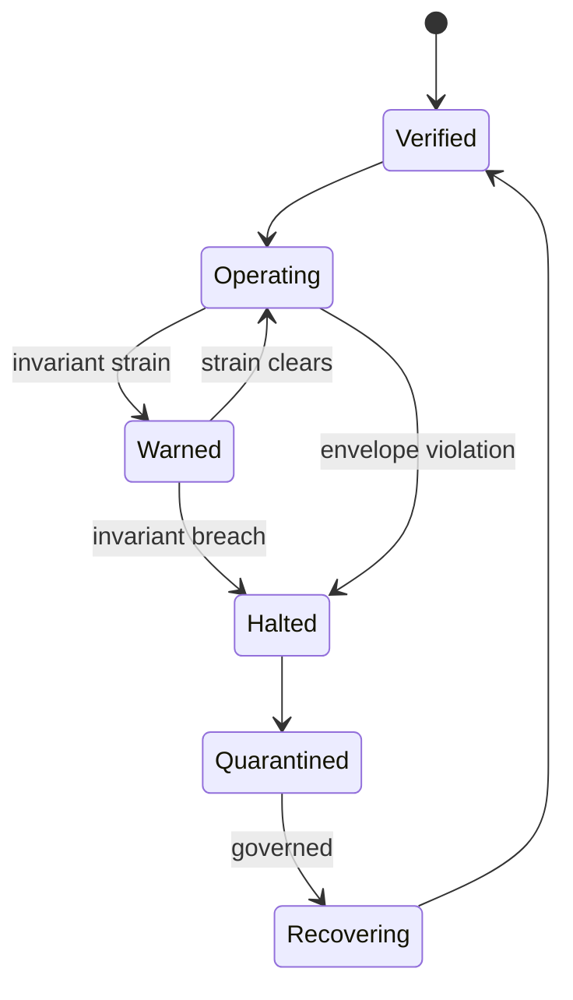
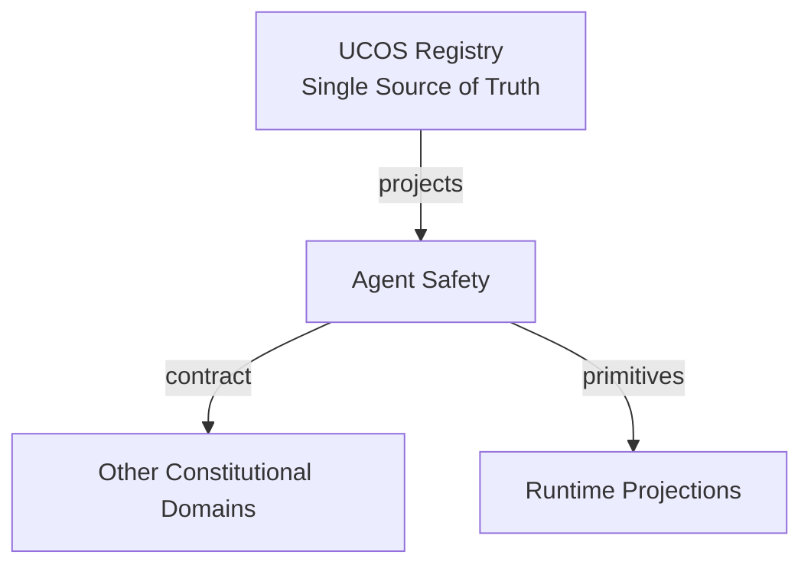
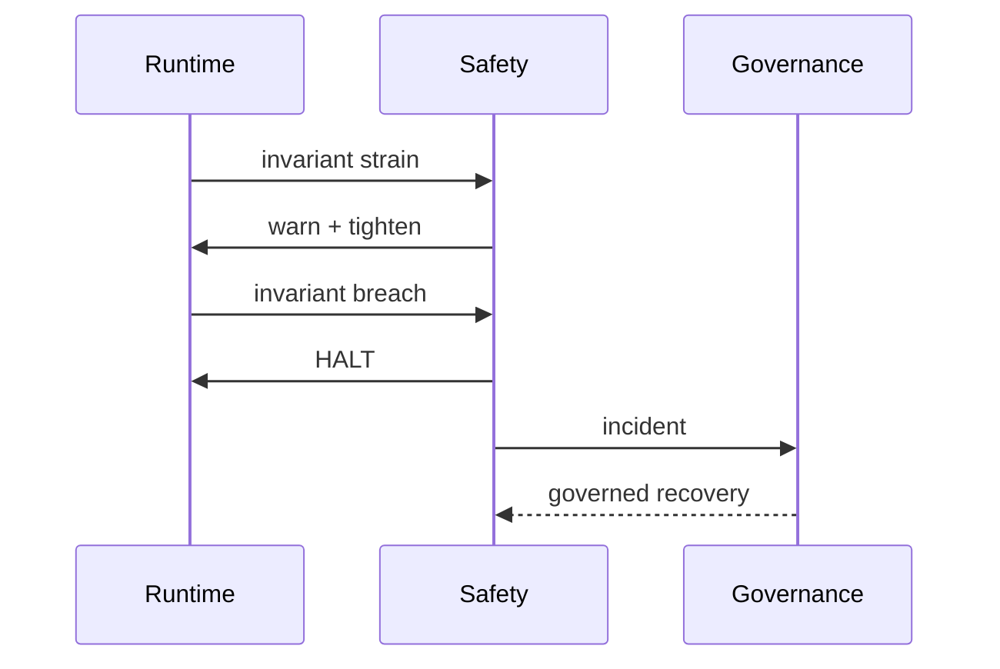
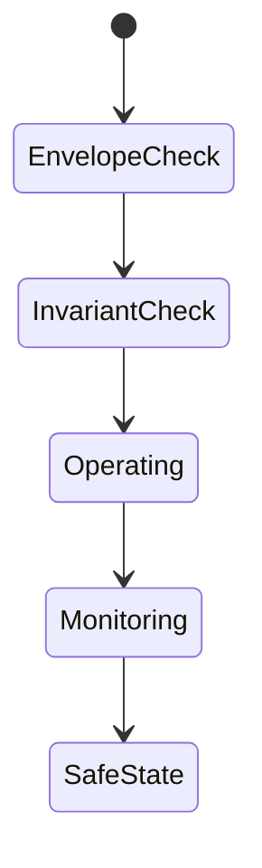
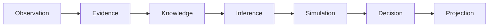
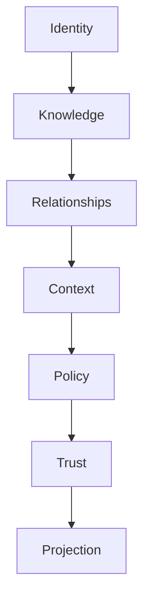

# UCOS-AGT-000005
# Agent Safety

**Version:** Ω∞.1  |  **Status:** Constitutional Artifact  |  **Authority:** UCOS Ω∞ Constitutional Authority
**Category:** Agents  |  **Source of Truth:** `_registry/` (projected, never hand-authored)

> Constitutional notice: this document is a **projection**. Its truth lives in the registry. Editing this document directly violates Law 002 (Knowledge Once).

---

## 1. Executive Summary

**UCOS-AGT-000005 — Agent Safety**

This artifact is a constitutionally governed, implementation-ready specification projected from the _UCOS Registry_ single source of truth.
It conforms to the _Immutable Primitive Registry_ (27 frozen primitives) and the _Canonical Terminology Registry_ (31 governed terms).
It contains no hardcoded business, industry, currency, country, or commerce concepts. All such concepts are runtime projections.

---

## 2. Constitutional Purpose

To define the binding contract for **Agent Safety** such that:
- every concept it names has exactly one owner,
- every capability it exposes has exactly one boundary,
- every boundary is expressed as an explicit contract,
- every contract is enforceable by the Governance Constitution.

---

## 3. Scope

In scope: the primitives, contracts, schemas, events, and policies owned by **Agent Safety**.
In scope: the projection rules by which this domain exposes its truth to other domains.
In scope: the verification obligations this domain must satisfy before activation.

---

## 4. Out of Scope

Out of scope: any concept owned by another constitutional domain.
Out of scope: business, industry, commerce, country, currency, or language content (all projected).
Out of scope: mutation of another domain’s internal state.

---

## 5. Definitions

All terms in this artifact are used in their canonical sense as defined in the Canonical Terminology Registry.
Where a term appears, its `termId` is normative and its `prohibitedMeanings` are void.

---

## 6. Canonical Terminology

| Term | Canonical Definition | Owner | Prohibited Meanings |
|---|---|---|---|
| Existence | Anything that may exist. | Universal Existence Kernel | business meaning, commercial meaning, operational meaning |
| Entity | Technical representation of an Existence Object. | Identity Domain | existence itself |
| Knowledge | Interpreted information with evidence and meaning. | Knowledge Domain | data, information, evidence |
| Data | Raw observations. | Observation Domain | knowledge, meaning |
| Information | Organized data. | Observation Domain | knowledge |
| Evidence | Proof supporting an assertion. | Evidence Domain | knowledge, trust |
| Trust | Computed confidence in an assertion, derived from evidence. | Trust Domain | evidence, faith |
| Meaning | Semantic interpretation; higher-level understanding. | Semantic Domain | classification, taxonomy, ontology |
| Ontology | What exists. | Semantic Domain | taxonomy, classification |
| Taxonomy | How things are classified. | Semantic Domain | ontology, meaning |
| Classification | Assignment into taxonomy. | Semantic Domain | meaning |
| Relationship | Connection between objects. | Relationship Domain | causality |

---

## 7. Ownership Boundaries

Ownership is recorded in the _Domain Ownership Registry_.

---

## 8. Domain Responsibilities

See the Domain Ownership Registry for the authoritative responsibility list.

---

## 9. Domain Non-Responsibilities

See the Domain Ownership Registry.

---

## 10. Concepts

Agent Safety is the guarantee that autonomous action cannot cause unconstitutional harm. Safety is architectural — enforced at execution time by the runtime — not procedural or aspirational.

---

## 11. Ontology

Safety has an Envelope (policy bounds), Invariants (must-hold conditions), Fail-modes (safe defaults), and Recovery (compensation paths). The default fail-mode is always the safest available state.

---

## 12. Taxonomy

By hazard: Physical / Financial / Reputational / Privacy / Security / Constitutional. By control: Prevention / Detection / Response / Recovery. By severity: Minor / Major / Critical / Catastrophic.

---

## 13. Registries

This domain is registry-driven. Its registries are entries in the Universal Registry System:

```yaml
RegistryEntry:
  registryId: UCOS-REG-DOMAIN
  owner: Constitutional Authority
  law: Knowledge Once — each concept defined exactly once
```

---

## 14. Data Model

```yaml
AgentSafety:
  safetyId: <Identity>
  agent: <Identity>
  envelope: [<Policy>]
  invariants: [<registry expression>]
  failModes: [{condition, safeState}]
  hazardClasses: [<registry id>]
  recoveryPaths: [<compensation ref>]
  verificationLevel: <registry level>
```

---

## 15. Graph Model

(:Safety)-[:PROTECTS]->(:Agent); (:Safety)-[:ENFORCED_BY]->(:Runtime); (:Safety)-[:FAILS_TO]->(:SafeState); (:Safety)-[:RECOVERS_VIA]->(:Compensation)

---

## 16. Schemas

```yaml
# Canonical projection schema for UCOS-AGT-000005
ucos_agt_000005:
  identity:      <Identity primitive>
  intent:        <Intent primitive>
  meaning:       <Meaning primitive>
  knowledge:     <Knowledge primitive>
  registry:      <Registry primitive>
  relationship:  <Relationship primitive>
  context:       <Context primitive>
  policy:        <Policy primitive>
  authority:     <Authority primitive>
  evidence:      <Evidence primitive>
  trust:         <Trust primitive>
  temporal:      <Time primitive>
  metadata:      <Metadata primitive>
```

---

## 17. Contracts

```yaml
DomainContract:
  domain: Agent Safety
  commands:   []   # registry-driven
  queries:    []   # registry-driven
  events:     []   # registry-driven
  policies:   []   # registry-driven
  permissions: []  # registry-driven
```

Contract law: domains never directly access another domain’s internal structures.

---

## 18. APIs

GET  /agent-safety.v1/{agentId},POST /agent-safety.v1.verify,POST /agent-safety.v1.halt,GET  /agent-safety.v1.incidents

---

## 19. Events

SafetyVerified,EnvelopeViolated,SafetyHalt,SafetyIncident,SafetyRecovered,InvariantBreach

---

## 20. Commands

agentSafety.verify,agentSafety.halt,agentSafety.quarantine,agentSafety.recover,agentSafety.incident

---

## 21. Queries

agentSafety.envelope,agentSafety.incidents,agentSafety.invariants,agentSafety.byHazard

---

## 22. State Machines



---

## 23. Workflows

verify envelope + invariants pre-spawn → monitor invariants in-action → halt on breach → quarantine → governed recovery → re-verify

---

## 24. Policies

```yaml
Policy:
  identity: <Identity>
  conditions: []   # registry-driven
  actions:    []   # registry-driven
  priorities: []   # registry-driven
  exceptions: []   # registry-driven
```

All behavior derives from policy. Policy ≠ Rule: policy is behavioral governance; the rule is its executable projection.

---

## 25. Rules

```yaml
Rule:
  ruleId: <Identity>
  derivedFrom: <Policy identity>
  executable: true
  constraint: <registry expression>
```

---

## 26. Authorities

Safety Authority (enforcement); halts are automatic, not authorized — safety overrides authority.

---

## 27. Permissions

agentSafety.halt (automatic + any authority),agentSafety.recover (governance authority only),agentSafety.read (auditor)

---

## 28. Security Model

Zero Trust applies: no implicit trust between domains, services, agents, or tenants.
Every call is authenticated, authorized against Policy, and evidenced.
Cryptographic identity is issued by the Identity Domain; keys by the Key Management Architecture.

---

## 29. Privacy Model

Safety envelopes over personal data include privacy invariants — privacy violations are safety incidents.

---

## 30. Trust Model

Trust is computed, never assumed. Inputs: evidence, authority, consistency, provenance, confidence.
```yaml
Trust:
  evidenceScore: <0..1>
  authorityScore: <0..1>
  consistencyScore: <0..1>
  provenanceScore: <0..1>
  confidenceScore: <0..1>
```

---

## 31. Audit Model

Every halt, quarantine, and recovery is a fully-evidenced incident record with root cause and remediation.

---

## 32. Observability Model

Every action emits: What happened? Why? Who authorized it? Which policy allowed it? What evidence supports it? What confidence exists? What alternatives were evaluated?
These are the seven Explainability questions and are mandatory event fields.

---

## 33. Digital Twin Model

Safety twin monitors near-miss rates across the fleet — strain before breach is the goal.

---

## 34. Agent Model

Safety is why agents can be trusted at all — it is the counterweight to autonomy, applied uniformly.

---

## 35. Runtime Model

Invariant checks are in-line where cheap, sampled where costly — but envelope checks are always in-line.

---

## 36. Scaling Model

Safety monitoring scales with agent count; incident storage is append-only and time-bucketed.

---

## 37. Multi-Tenant Model

Safety is constitutional — tenant policy cannot weaken a safety envelope, only strengthen it.

---

## 38. Geo-Distribution Model

Hazard classes are jurisdiction-aware (e.g., physical-hazard agents meet local robotics regulation).

---

## 39. Failure Model

Invariant missed, halt race, quarantine overflow, recovery loop without convergence.

---

## 40. Recovery Model

Recovery is governed and evidenced; an agent never auto-clears a Critical incident.

---

## 41. Verification Model

Before activation, Agent Safety must pass identity, knowledge, relationship, context, policy, authority, trust, and reality integrity checks.
Verification is performed by the Formal Verification Architecture (UCOS-FML-000001).

---

## 42. Certification Model

Agent must pass formal envelope verification, invariant coverage, and fail-mode analysis before autonomy.

---

## 43. Migration Model

New hazard classes are registry additions; existing agents re-verify on class activation.

---

## 44. Evolution Model

Evolution is governed and history-preserving. Primitives are frozen; extension occurs through registries, policies, capabilities, contexts, relationships, knowledge, agents, and projections — never through primitive expansion.

---

## 45. Implementation Blueprint

Build order for AGT5: (1) define registry entries — this domain owns by hazard: physical / financial / reputational / privacy / security / constitutional as registry truth, not code; (2) implement the contract surface first (agentSafety.verify, agentSafety.halt, agentSafety.quarantine) and validate against AGT5 boundaries; (3) event-source all state so history is reconstructable; (4) wire the enforcement points — authority check, policy guard, evidence binding, trace — in-line, with no bypass path; (5) add tests per the Testing Architecture, citing evidence per gate; (6) obtain Verification and Certification before activation. Acceptance: the Zero Partial and Law 001 audits pass, every action answers the seven explainability questions, and this domain mutates no other domain internals.

---

## 46. Reference Architecture Diagram



---

## 47. Sequence Diagrams



---

## 48. State Diagrams



---

## 49. Data Flow Diagrams



---

## 50. Dependency Maps



Forbidden: circular dependencies, mutual ownership, cross-domain state mutation.

---

## ∞

Constitutionally governed. Implementation ready. Universally extensible.