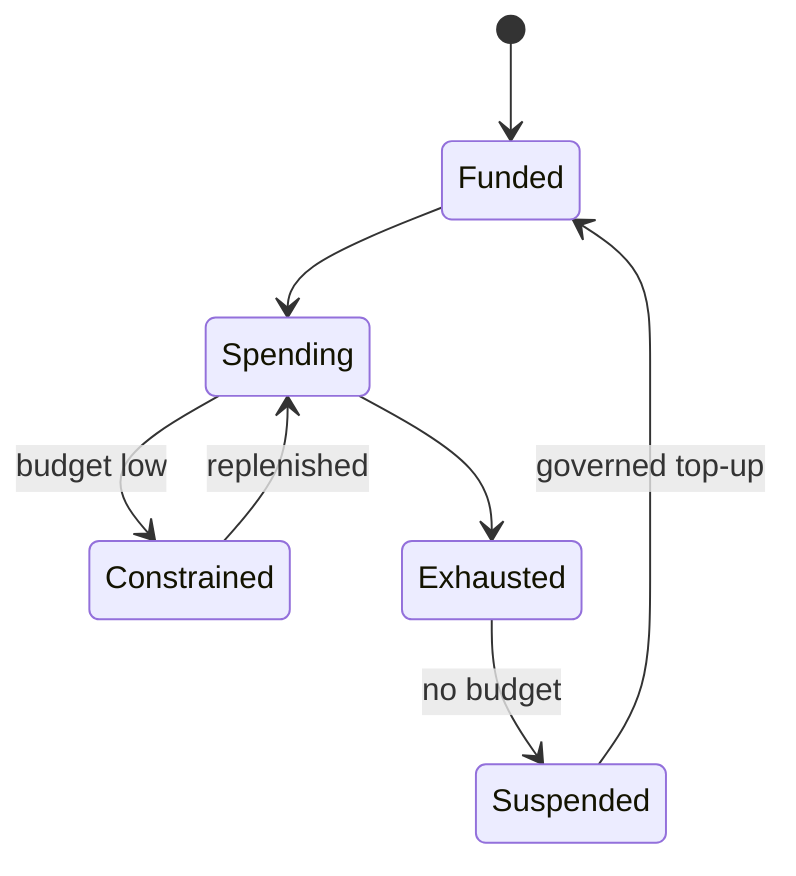
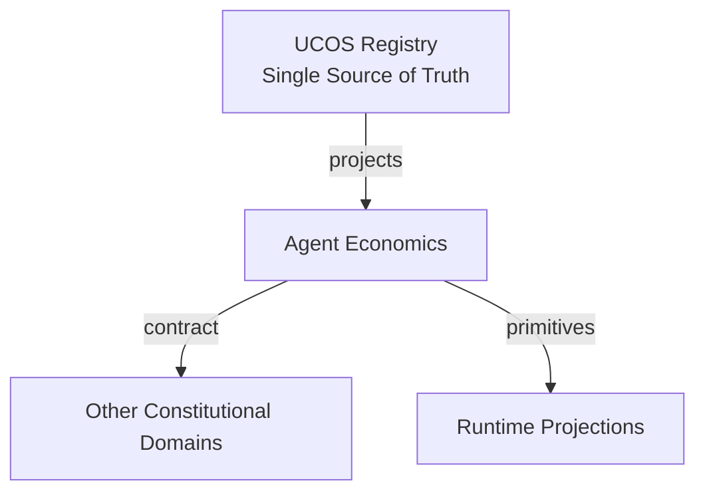
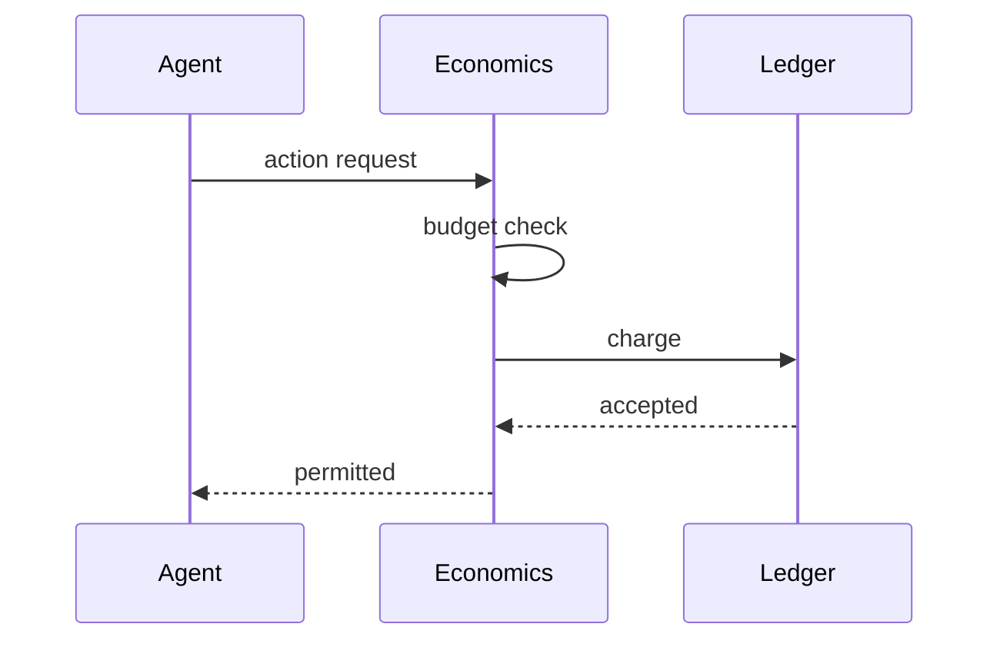
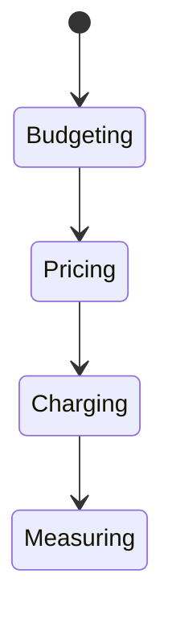
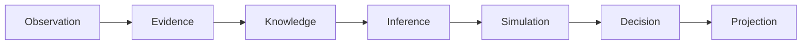
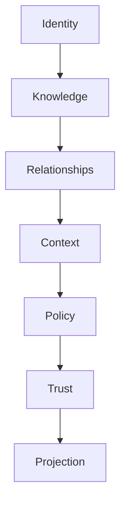

# UCOS-AGT-000006
# Agent Economics

**Version:** Ω∞.1  |  **Status:** Constitutional Artifact  |  **Authority:** UCOS Ω∞ Constitutional Authority
**Category:** Agents  |  **Source of Truth:** `_registry/` (projected, never hand-authored)

> Constitutional notice: this document is a **projection**. Its truth lives in the registry. Editing this document directly violates Law 002 (Knowledge Once).

---

## 1. Executive Summary

**UCOS-AGT-000006 — Agent Economics**

This artifact is a constitutionally governed, implementation-ready specification projected from the _UCOS Registry_ single source of truth.
It conforms to the _Immutable Primitive Registry_ (27 frozen primitives) and the _Canonical Terminology Registry_ (31 governed terms).
It contains no hardcoded business, industry, currency, country, or commerce concepts. All such concepts are runtime projections.

---

## 2. Constitutional Purpose

To define the binding contract for **Agent Economics** such that:
- every concept it names has exactly one owner,
- every capability it exposes has exactly one boundary,
- every boundary is expressed as an explicit contract,
- every contract is enforceable by the Governance Constitution.

---

## 3. Scope

In scope: the primitives, contracts, schemas, events, and policies owned by **Agent Economics**.
In scope: the projection rules by which this domain exposes its truth to other domains.
In scope: the verification obligations this domain must satisfy before activation.

---

## 4. Out of Scope

Out of scope: any concept owned by another constitutional domain.
Out of scope: business, industry, commerce, country, currency, or language content (all projected).
Out of scope: mutation of another domain’s internal state.

---

## 5. Definitions

All terms in this artifact are used in their canonical sense as defined in the Canonical Terminology Registry.
Where a term appears, its `termId` is normative and its `prohibitedMeanings` are void.

---

## 6. Canonical Terminology

| Term | Canonical Definition | Owner | Prohibited Meanings |
|---|---|---|---|
| Existence | Anything that may exist. | Universal Existence Kernel | business meaning, commercial meaning, operational meaning |
| Entity | Technical representation of an Existence Object. | Identity Domain | existence itself |
| Knowledge | Interpreted information with evidence and meaning. | Knowledge Domain | data, information, evidence |
| Data | Raw observations. | Observation Domain | knowledge, meaning |
| Information | Organized data. | Observation Domain | knowledge |
| Evidence | Proof supporting an assertion. | Evidence Domain | knowledge, trust |
| Trust | Computed confidence in an assertion, derived from evidence. | Trust Domain | evidence, faith |
| Meaning | Semantic interpretation; higher-level understanding. | Semantic Domain | classification, taxonomy, ontology |
| Ontology | What exists. | Semantic Domain | taxonomy, classification |
| Taxonomy | How things are classified. | Semantic Domain | ontology, meaning |
| Classification | Assignment into taxonomy. | Semantic Domain | meaning |
| Relationship | Connection between objects. | Relationship Domain | causality |

---

## 7. Ownership Boundaries

Ownership is recorded in the _Domain Ownership Registry_.

---

## 8. Domain Responsibilities

See the Domain Ownership Registry for the authoritative responsibility list.

---

## 9. Domain Non-Responsibilities

See the Domain Ownership Registry.

---

## 10. Concepts

Agent Economics gives every autonomous actor a bounded budget and a priced action space. Agents are economically constrained — they cannot consume without accounting, and their incentives are aligned with constitutional value, not raw throughput.

---

## 11. Ontology

Agent Economics has an Account, priced actions, a budget policy, a value measure, and a sustainability weight. Spending is governed; value is measured; waste is penalized by policy.

---

## 12. Taxonomy

By budget: Fixed / Replenishing / Performance-based / Mission-based. By pricing: Flat / Marginal / Peak / Externalized-cost-inclusive. By measure: Financial / Computational / Carbon-weighted / Value-weighted.

---

## 13. Registries

This domain is registry-driven. Its registries are entries in the Universal Registry System:

```yaml
RegistryEntry:
  registryId: UCOS-REG-DOMAIN
  owner: Constitutional Authority
  law: Knowledge Once — each concept defined exactly once
```

---

## 14. Data Model

```yaml
AgentEconomics:
  economicsId: <Identity>
  agent: <Identity>
  account: <ledger ref>
  budgetPolicy: <Policy>
  pricedActions: [{actionClass, price}]
  valueMeasure: <registry expression>
  sustainabilityWeight: <registry factor>
  period: {resetAt}
```

---

## 15. Graph Model

(:Economics)-[:FUNDS]->(:Agent); (:Economics)-[:SPENDS_ON]->(:ActionClass); (:Economics)-[:PRICED_BY]->(:Policy); (:Economics)-[:MEASURED_IN]->(:ValueMeasure)

---

## 16. Schemas

```yaml
# Canonical projection schema for UCOS-AGT-000006
ucos_agt_000006:
  identity:      <Identity primitive>
  intent:        <Intent primitive>
  meaning:       <Meaning primitive>
  knowledge:     <Knowledge primitive>
  registry:      <Registry primitive>
  relationship:  <Relationship primitive>
  context:       <Context primitive>
  policy:        <Policy primitive>
  authority:     <Authority primitive>
  evidence:      <Evidence primitive>
  trust:         <Trust primitive>
  temporal:      <Time primitive>
  metadata:      <Metadata primitive>
```

---

## 17. Contracts

```yaml
DomainContract:
  domain: Agent Economics
  commands:   []   # registry-driven
  queries:    []   # registry-driven
  events:     []   # registry-driven
  policies:   []   # registry-driven
  permissions: []  # registry-driven
```

Contract law: domains never directly access another domain’s internal structures.

---

## 18. APIs

GET  /agent-economics.v1/{agentId},POST /agent-economics.v1.charge,GET  /agent-economics.v1.budget/{agentId},POST /agent-economics.v1.reprice

---

## 19. Events

AgentCharged,BudgetExhausted,BudgetReplenished,AgentRepriced,ValueAssessed

---

## 20. Commands

agentEconomics.charge,agentEconomics.budget.set,agentEconomics.reprice,agentEconomics.refund

---

## 21. Queries

agentEconomics.spend,agentEconomics.budget,agentEconomics.value,agentEconomics.efficiency

---

## 22. State Machines



---

## 23. Workflows

allocate budget under policy → charge per priced action → measure value created → adjust price and budget → suspend on exhaustion

---

## 24. Policies

```yaml
Policy:
  identity: <Identity>
  conditions: []   # registry-driven
  actions:    []   # registry-driven
  priorities: []   # registry-driven
  exceptions: []   # registry-driven
```

All behavior derives from policy. Policy ≠ Rule: policy is behavioral governance; the rule is its executable projection.

---

## 25. Rules

```yaml
Rule:
  ruleId: <Identity>
  derivedFrom: <Policy identity>
  executable: true
  constraint: <registry expression>
```

---

## 26. Authorities

Economic Authority (pricing policy), Agent Owner (budget allocation).

---

## 27. Permissions

agentEconomics.charge (runtime metering),agentEconomics.budget.set (agent owner),agentEconomics.read (owner + governance)

---

## 28. Security Model

Zero Trust applies: no implicit trust between domains, services, agents, or tenants.
Every call is authenticated, authorized against Policy, and evidenced.
Cryptographic identity is issued by the Identity Domain; keys by the Key Management Architecture.

---

## 29. Privacy Model

Economic records are agent-scoped, not personal — charges reference action classes only.

---

## 30. Trust Model

Trust is computed, never assumed. Inputs: evidence, authority, consistency, provenance, confidence.
```yaml
Trust:
  evidenceScore: <0..1>
  authorityScore: <0..1>
  consistencyScore: <0..1>
  provenanceScore: <0..1>
  confidenceScore: <0..1>
```

---

## 31. Audit Model

Every charge records action class, price version, budget state — agent spending is fully reconstructable.

---

## 32. Observability Model

Every action emits: What happened? Why? Who authorized it? Which policy allowed it? What evidence supports it? What confidence exists? What alternatives were evaluated?
These are the seven Explainability questions and are mandatory event fields.

---

## 33. Digital Twin Model

Economics twin tracks fleet spend efficiency and flags waste patterns for optimization agents.

---

## 34. Agent Model

Economics makes agents frugal by construction — a budgetless agent is a liability the constitution forbids.

---

## 35. Runtime Model

Charging is synchronous with execution; budget check is a pre-exec guard (zero spend beyond budget).

---

## 36. Scaling Model

Metering is a high-throughput append ledger; aggregation is a stream job.

---

## 37. Multi-Tenant Model

Agent economics are tenant-accounted; cross-tenant agent spending requires both owners' authority.

---

## 38. Geo-Distribution Model

Pricing includes externalized costs per jurisdiction — carbon-weighted where regulated, always measured.

---

## 39. Failure Model

Meter drift, budget race, negative balance, price version skew.

---

## 40. Recovery Model

The ledger is append-only; refunds are compensating entries, never deletes. Suspend-on-exhaustion is safe by default.

---

## 41. Verification Model

Before activation, Agent Economics must pass identity, knowledge, relationship, context, policy, authority, trust, and reality integrity checks.
Verification is performed by the Formal Verification Architecture (UCOS-FML-000001).

---

## 42. Certification Model

Agent must have a bounded budget, priced actions, and a measured value function to operate autonomously.

---

## 43. Migration Model

New pricing models and value measures are registry additions.

---

## 44. Evolution Model

Evolution is governed and history-preserving. Primitives are frozen; extension occurs through registries, policies, capabilities, contexts, relationships, knowledge, agents, and projections — never through primitive expansion.

---

## 45. Implementation Blueprint

Build order for AGT6: (1) define registry entries — this domain owns by budget: fixed / replenishing / performance-based / mission-based as registry truth, not code; (2) implement the contract surface first (agentEconomics.charge, agentEconomics.budget.set, agentEconomics.reprice) and validate against AGT6 boundaries; (3) event-source all state so history is reconstructable; (4) wire the enforcement points — authority check, policy guard, evidence binding, trace — in-line, with no bypass path; (5) add tests per the Testing Architecture, citing evidence per gate; (6) obtain Verification and Certification before activation. Acceptance: the Zero Partial and Law 001 audits pass, every action answers the seven explainability questions, and this domain mutates no other domain internals.

---

## 46. Reference Architecture Diagram



---

## 47. Sequence Diagrams



---

## 48. State Diagrams



---

## 49. Data Flow Diagrams



---

## 50. Dependency Maps



Forbidden: circular dependencies, mutual ownership, cross-domain state mutation.

---

## ∞

Constitutionally governed. Implementation ready. Universally extensible.