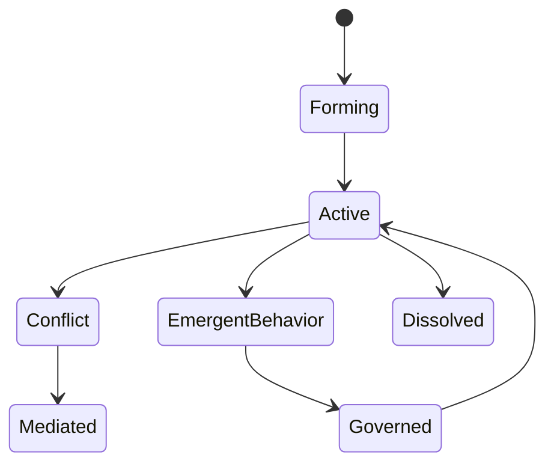
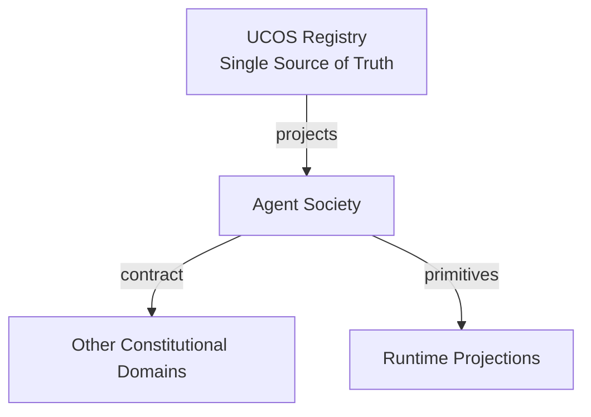
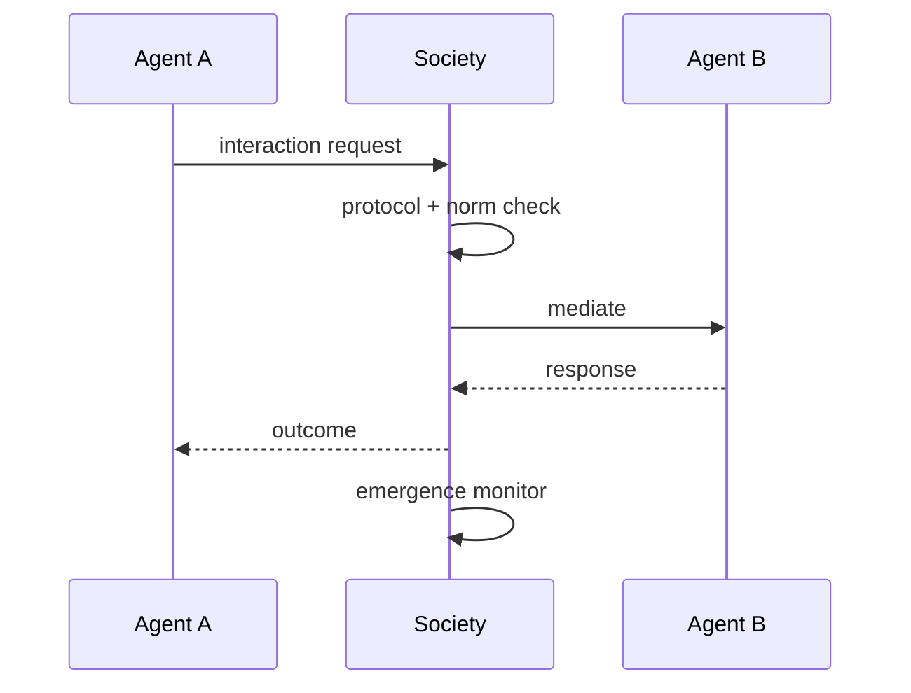
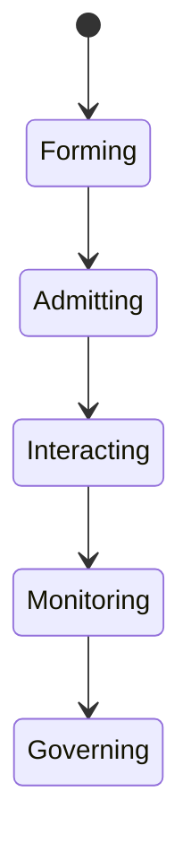
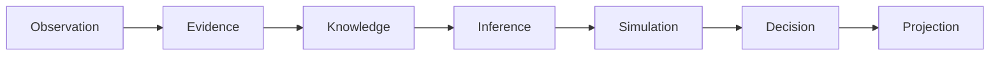
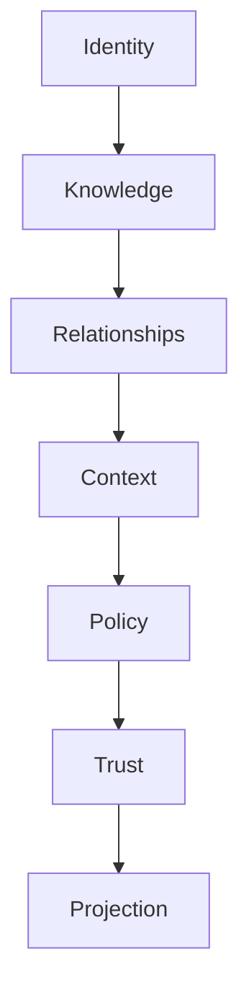

# UCOS-AGT-000007
# Agent Society

**Version:** Ω∞.1  |  **Status:** Constitutional Artifact  |  **Authority:** UCOS Ω∞ Constitutional Authority
**Category:** Agents  |  **Source of Truth:** `_registry/` (projected, never hand-authored)

> Constitutional notice: this document is a **projection**. Its truth lives in the registry. Editing this document directly violates Law 002 (Knowledge Once).

---

## 1. Executive Summary

**UCOS-AGT-000007 — Agent Society**

This artifact is a constitutionally governed, implementation-ready specification projected from the _UCOS Registry_ single source of truth.
It conforms to the _Immutable Primitive Registry_ (27 frozen primitives) and the _Canonical Terminology Registry_ (31 governed terms).
It contains no hardcoded business, industry, currency, country, or commerce concepts. All such concepts are runtime projections.

---

## 2. Constitutional Purpose

To define the binding contract for **Agent Society** such that:
- every concept it names has exactly one owner,
- every capability it exposes has exactly one boundary,
- every boundary is expressed as an explicit contract,
- every contract is enforceable by the Governance Constitution.

---

## 3. Scope

In scope: the primitives, contracts, schemas, events, and policies owned by **Agent Society**.
In scope: the projection rules by which this domain exposes its truth to other domains.
In scope: the verification obligations this domain must satisfy before activation.

---

## 4. Out of Scope

Out of scope: any concept owned by another constitutional domain.
Out of scope: business, industry, commerce, country, currency, or language content (all projected).
Out of scope: mutation of another domain’s internal state.

---

## 5. Definitions

All terms in this artifact are used in their canonical sense as defined in the Canonical Terminology Registry.
Where a term appears, its `termId` is normative and its `prohibitedMeanings` are void.

---

## 6. Canonical Terminology

| Term | Canonical Definition | Owner | Prohibited Meanings |
|---|---|---|---|
| Existence | Anything that may exist. | Universal Existence Kernel | business meaning, commercial meaning, operational meaning |
| Entity | Technical representation of an Existence Object. | Identity Domain | existence itself |
| Knowledge | Interpreted information with evidence and meaning. | Knowledge Domain | data, information, evidence |
| Data | Raw observations. | Observation Domain | knowledge, meaning |
| Information | Organized data. | Observation Domain | knowledge |
| Evidence | Proof supporting an assertion. | Evidence Domain | knowledge, trust |
| Trust | Computed confidence in an assertion, derived from evidence. | Trust Domain | evidence, faith |
| Meaning | Semantic interpretation; higher-level understanding. | Semantic Domain | classification, taxonomy, ontology |
| Ontology | What exists. | Semantic Domain | taxonomy, classification |
| Taxonomy | How things are classified. | Semantic Domain | ontology, meaning |
| Classification | Assignment into taxonomy. | Semantic Domain | meaning |
| Relationship | Connection between objects. | Relationship Domain | causality |

---

## 7. Ownership Boundaries

Ownership is recorded in the _Domain Ownership Registry_.

---

## 8. Domain Responsibilities

See the Domain Ownership Registry for the authoritative responsibility list.

---

## 9. Domain Non-Responsibilities

See the Domain Ownership Registry.

---

## 10. Concepts

Agent Society is the governed ecosystem in which multiple agents cooperate, compete, negotiate, and collectively behave. Society is where emergence lives — and where emergent behavior is governed rather than suppressed.

---

## 11. Ontology

Society has Members (agents), Roles (registry), Interaction protocols, Norms (policies), and an Emergence monitor. Society-level behavior is monitored as Emergence and governed accordingly.

---

## 12. Taxonomy

By structure: Hierarchical / Flat / Market / Coalition / Hybrid. By interaction: Cooperative / Competitive / Negotiative / Delegative. By governance: Centrally-governed / Norm-governed / Constitution-first.

---

## 13. Registries

This domain is registry-driven. Its registries are entries in the Universal Registry System:

```yaml
RegistryEntry:
  registryId: UCOS-REG-DOMAIN
  owner: Constitutional Authority
  law: Knowledge Once — each concept defined exactly once
```

---

## 14. Data Model

```yaml
AgentSociety:
  societyId: <Identity>
  members: [<Relationship>]
  roles: [<registry role>]
  protocols: [<registry interaction id>]
  norms: [<Policy>]
  emergenceMonitor: <Emergence config>
  governance: <Authority>
  temporal: {formedAt}
```

---

## 15. Graph Model

(:Society)-[:MEMBER]->(:Agent); (:Agent)-[:INTERACTS_WITH]->(:Agent); (:Society)-[:GOVERNED_BY]->(:Policy); (:Society)-[:MONITORED_BY]->(:Emergence)

---

## 16. Schemas

```yaml
# Canonical projection schema for UCOS-AGT-000007
ucos_agt_000007:
  identity:      <Identity primitive>
  intent:        <Intent primitive>
  meaning:       <Meaning primitive>
  knowledge:     <Knowledge primitive>
  registry:      <Registry primitive>
  relationship:  <Relationship primitive>
  context:       <Context primitive>
  policy:        <Policy primitive>
  authority:     <Authority primitive>
  evidence:      <Evidence primitive>
  trust:         <Trust primitive>
  temporal:      <Time primitive>
  metadata:      <Metadata primitive>
```

---

## 17. Contracts

```yaml
DomainContract:
  domain: Agent Society
  commands:   []   # registry-driven
  queries:    []   # registry-driven
  events:     []   # registry-driven
  policies:   []   # registry-driven
  permissions: []  # registry-driven
```

Contract law: domains never directly access another domain’s internal structures.

---

## 18. APIs

POST /society.v1.form,POST /society.v1.admit,GET  /society.v1/{id},POST /society.v1.mediate,GET  /society.v1.emergence/{id}

---

## 19. Events

SocietyFormed,MemberAdmitted,MemberExpelled,InteractionRecorded,SocietyEmergence,SocietyDissolved

---

## 20. Commands

society.form,society.admit,society.expel,society.mediate,society.dissolve

---

## 21. Queries

society.byId,society.members,society.interactions,society.emergence,society.norms

---

## 22. State Machines



---

## 23. Workflows

form under governance → admit members by role → interactions recorded per protocol → monitor emergence → govern emergent behavior → mediate conflicts

---

## 24. Policies

```yaml
Policy:
  identity: <Identity>
  conditions: []   # registry-driven
  actions:    []   # registry-driven
  priorities: []   # registry-driven
  exceptions: []   # registry-driven
```

All behavior derives from policy. Policy ≠ Rule: policy is behavioral governance; the rule is its executable projection.

---

## 25. Rules

```yaml
Rule:
  ruleId: <Identity>
  derivedFrom: <Policy identity>
  executable: true
  constraint: <registry expression>
```

---

## 26. Authorities

Society Governance Authority; constitutional norms override all society policy.

---

## 27. Permissions

society.form (governance authority),society.admit (society authority),society.interact (member agent)

---

## 28. Security Model

Zero Trust applies: no implicit trust between domains, services, agents, or tenants.
Every call is authenticated, authorized against Policy, and evidenced.
Cryptographic identity is issued by the Identity Domain; keys by the Key Management Architecture.

---

## 29. Privacy Model

Society interactions over personal data require consent covering all participating agents' scopes.

---

## 30. Trust Model

Trust is computed, never assumed. Inputs: evidence, authority, consistency, provenance, confidence.
```yaml
Trust:
  evidenceScore: <0..1>
  authorityScore: <0..1>
  consistencyScore: <0..1>
  provenanceScore: <0..1>
  confidenceScore: <0..1>
```

---

## 31. Audit Model

Every interaction is recorded with protocol, norms applied, and outcome — multi-agent behavior is fully traceable.

---

## 32. Observability Model

Every action emits: What happened? Why? Who authorized it? Which policy allowed it? What evidence supports it? What confidence exists? What alternatives were evaluated?
These are the seven Explainability questions and are mandatory event fields.

---

## 33. Digital Twin Model

Society twin monitors interaction health, conflict rates, and emergence signals across the fleet.

---

## 34. Agent Model

Society is where the system becomes more than its agents — and where that 'more' is kept safe.

---

## 35. Runtime Model

Interactions are protocol-mediated; off-protocol agent-to-agent contact is a policy violation by construction.

---

## 36. Scaling Model

Societies scale to fleet size; emergence monitoring is a stream job over interaction events.

---

## 37. Multi-Tenant Model

Societies are tenant-scoped; cross-tenant societies require federation-level governance.

---

## 38. Geo-Distribution Model

Norms are jurisdiction-aware; a society spanning regions carries the strictest applicable norm set.

---

## 39. Failure Model

Norm conflict, emergence runaway, collusion, society polarization, protocol deadlock.

---

## 40. Recovery Model

Dissolution is clean and governed; agents return to their envelopes unchanged.

---

## 41. Verification Model

Before activation, Agent Society must pass identity, knowledge, relationship, context, policy, authority, trust, and reality integrity checks.
Verification is performed by the Formal Verification Architecture (UCOS-FML-000001).

---

## 42. Certification Model

Society must publish protocols, norms, and emergence governance to operate.

---

## 43. Migration Model

New interaction protocols are registry additions.

---

## 44. Evolution Model

Evolution is governed and history-preserving. Primitives are frozen; extension occurs through registries, policies, capabilities, contexts, relationships, knowledge, agents, and projections — never through primitive expansion.

---

## 45. Implementation Blueprint

Build order for AGT7: (1) define registry entries — this domain owns by structure: hierarchical / flat / market / coalition / hybrid as registry truth, not code; (2) implement the contract surface first (society.form, society.admit, society.expel) and validate against AGT7 boundaries; (3) event-source all state so history is reconstructable; (4) wire the enforcement points — authority check, policy guard, evidence binding, trace — in-line, with no bypass path; (5) add tests per the Testing Architecture, citing evidence per gate; (6) obtain Verification and Certification before activation. Acceptance: the Zero Partial and Law 001 audits pass, every action answers the seven explainability questions, and this domain mutates no other domain internals.

---

## 46. Reference Architecture Diagram



---

## 47. Sequence Diagrams



---

## 48. State Diagrams



---

## 49. Data Flow Diagrams



---

## 50. Dependency Maps



Forbidden: circular dependencies, mutual ownership, cross-domain state mutation.

---

## ∞

Constitutionally governed. Implementation ready. Universally extensible.