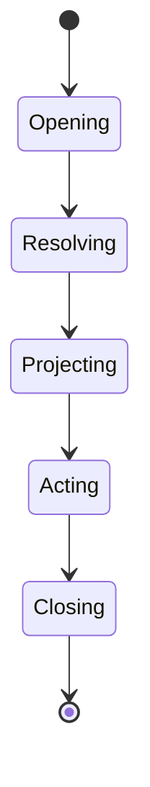
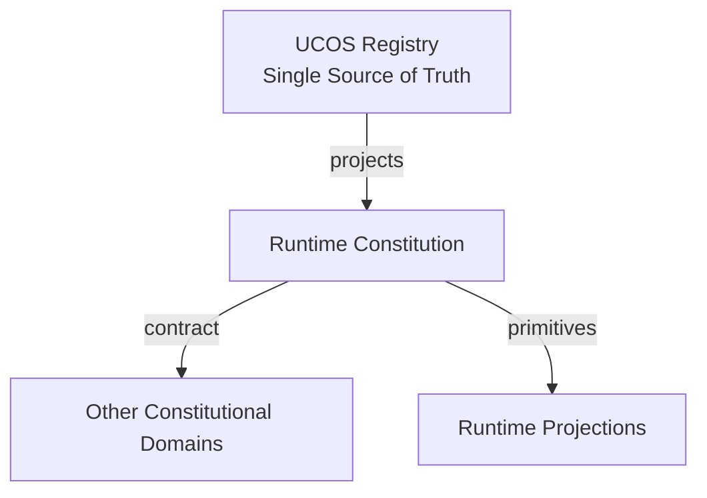
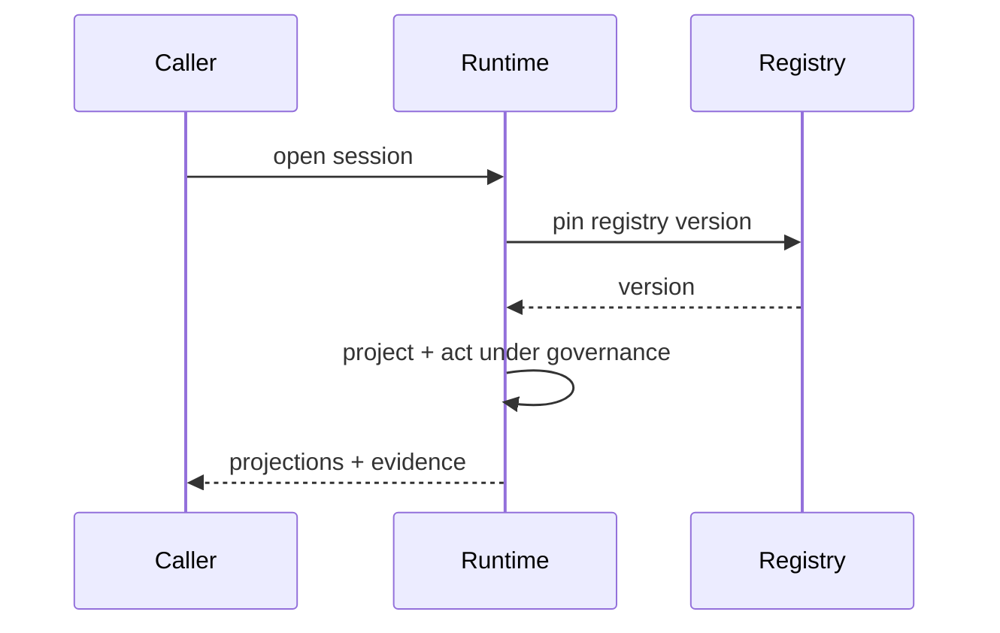
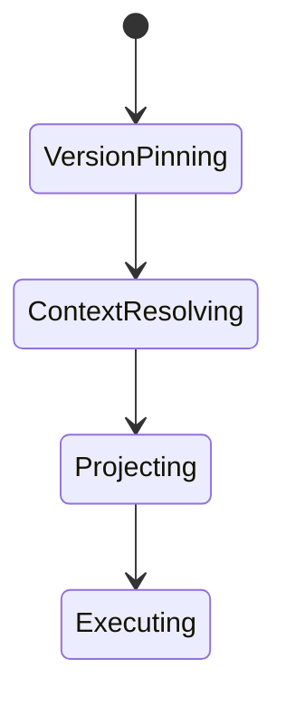
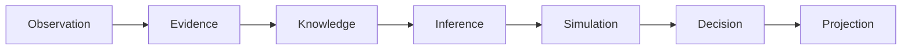
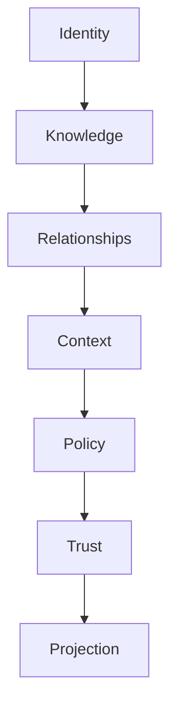

# UCOS-RUN-000001
# Runtime Constitution

**Version:** Ω∞.1  |  **Status:** Constitutional Artifact  |  **Authority:** UCOS Ω∞ Constitutional Authority
**Category:** Runtime  |  **Source of Truth:** `_registry/` (projected, never hand-authored)

> Constitutional notice: this document is a **projection**. Its truth lives in the registry. Editing this document directly violates Law 002 (Knowledge Once).

---

## 1. Executive Summary

**UCOS-RUN-000001 — Runtime Constitution**

This artifact is a constitutionally governed, implementation-ready specification projected from the _UCOS Registry_ single source of truth.
It conforms to the _Immutable Primitive Registry_ (27 frozen primitives) and the _Canonical Terminology Registry_ (31 governed terms).
It contains no hardcoded business, industry, currency, country, or commerce concepts. All such concepts are runtime projections.

---

## 2. Constitutional Purpose

To define the binding contract for **Runtime Constitution** such that:
- every concept it names has exactly one owner,
- every capability it exposes has exactly one boundary,
- every boundary is expressed as an explicit contract,
- every contract is enforceable by the Governance Constitution.

---

## 3. Scope

In scope: the primitives, contracts, schemas, events, and policies owned by **Runtime Constitution**.
In scope: the projection rules by which this domain exposes its truth to other domains.
In scope: the verification obligations this domain must satisfy before activation.

---

## 4. Out of Scope

Out of scope: any concept owned by another constitutional domain.
Out of scope: business, industry, commerce, country, currency, or language content (all projected).
Out of scope: mutation of another domain’s internal state.

---

## 5. Definitions

All terms in this artifact are used in their canonical sense as defined in the Canonical Terminology Registry.
Where a term appears, its `termId` is normative and its `prohibitedMeanings` are void.

---

## 6. Canonical Terminology

| Term | Canonical Definition | Owner | Prohibited Meanings |
|---|---|---|---|
| Existence | Anything that may exist. | Universal Existence Kernel | business meaning, commercial meaning, operational meaning |
| Entity | Technical representation of an Existence Object. | Identity Domain | existence itself |
| Knowledge | Interpreted information with evidence and meaning. | Knowledge Domain | data, information, evidence |
| Data | Raw observations. | Observation Domain | knowledge, meaning |
| Information | Organized data. | Observation Domain | knowledge |
| Evidence | Proof supporting an assertion. | Evidence Domain | knowledge, trust |
| Trust | Computed confidence in an assertion, derived from evidence. | Trust Domain | evidence, faith |
| Meaning | Semantic interpretation; higher-level understanding. | Semantic Domain | classification, taxonomy, ontology |
| Ontology | What exists. | Semantic Domain | taxonomy, classification |
| Taxonomy | How things are classified. | Semantic Domain | ontology, meaning |
| Classification | Assignment into taxonomy. | Semantic Domain | meaning |
| Relationship | Connection between objects. | Relationship Domain | causality |

---

## 7. Ownership Boundaries

Ownership is recorded in the _Domain Ownership Registry_.

---

## 8. Domain Responsibilities

See the Domain Ownership Registry for the authoritative responsibility list.

---

## 9. Domain Non-Responsibilities

See the Domain Ownership Registry.

---

## 10. Concepts

The Runtime Constitution defines how derived reality executes. Constitution defines truth; Domains manage truth; Runtime derives reality; Agents execute reality; Applications consume reality. The runtime never owns truth — it computes projections of it.

---

## 11. Ontology

Runtime is a pure function over registry state. Inputs: primitives + registry. Outputs: projections. Side effects: only governed, evidenced actions. The runtime is stateless with respect to truth.

---

## 12. Taxonomy

By layer: Projection / Orchestration / Execution / Interaction. By mode: Interactive / Batch / Streaming / Event-driven. By ownership: Platform / Tenant / Edge.

---

## 13. Registries

This domain is registry-driven. Its registries are entries in the Universal Registry System:

```yaml
RegistryEntry:
  registryId: UCOS-REG-DOMAIN
  owner: Constitutional Authority
  law: Knowledge Once — each concept defined exactly once
```

---

## 14. Data Model

```yaml
RuntimeSession:
  sessionId: <Identity>
  inputs: {primitives: [<ref>], registryVersion: <version>}
  projections: [<content-addressed ref>]
  actions: [<governed action ref>]
  temporal: {startedAt, endedAt}
  context: <Context>
  evidence: [<Evidence>]
```

---

## 15. Graph Model

(:Session)-[:INPUTS_FROM]->(:Registry); (:Session)-[:PROJECTS]->(:Projection); (:Session)-[:EMITS]->(:Event); (:Session)-[:GOVERNED_BY]->(:Policy)

---

## 16. Schemas

```yaml
# Canonical projection schema for UCOS-RUN-000001
ucos_run_000001:
  identity:      <Identity primitive>
  intent:        <Intent primitive>
  meaning:       <Meaning primitive>
  knowledge:     <Knowledge primitive>
  registry:      <Registry primitive>
  relationship:  <Relationship primitive>
  context:       <Context primitive>
  policy:        <Policy primitive>
  authority:     <Authority primitive>
  evidence:      <Evidence primitive>
  trust:         <Trust primitive>
  temporal:      <Time primitive>
  metadata:      <Metadata primitive>
```

---

## 17. Contracts

```yaml
DomainContract:
  domain: Runtime Constitution
  commands:   []   # registry-driven
  queries:    []   # registry-driven
  events:     []   # registry-driven
  policies:   []   # registry-driven
  permissions: []  # registry-driven
```

Contract law: domains never directly access another domain’s internal structures.

---

## 18. APIs

POST /runtime.v1.session,GET  /runtime.v1/{id},POST /runtime.v1.project,POST /runtime.v1.act

---

## 19. Events

SessionOpened,ProjectionComputed,ActionExecuted,SessionClosed,RuntimeViolation

---

## 20. Commands

runtime.session.open,runtime.project,runtime.act,runtime.session.close

---

## 21. Queries

runtime.session,runtime.projections,runtime.actions,runtime.health

---

## 22. State Machines



---

## 23. Workflows

open session with registry version → resolve context → compute projections → execute governed actions → close with full evidence

---

## 24. Policies

```yaml
Policy:
  identity: <Identity>
  conditions: []   # registry-driven
  actions:    []   # registry-driven
  priorities: []   # registry-driven
  exceptions: []   # registry-driven
```

All behavior derives from policy. Policy ≠ Rule: policy is behavioral governance; the rule is its executable projection.

---

## 25. Rules

```yaml
Rule:
  ruleId: <Identity>
  derivedFrom: <Policy identity>
  executable: true
  constraint: <registry expression>
```

---

## 26. Authorities

Runtime Authority (execution); every action carries the acting domain's delegated authority.

---

## 27. Permissions

runtime.session (authenticated),runtime.act (action-class authority),runtime.read (session-scoped)

---

## 28. Security Model

Zero Trust applies: no implicit trust between domains, services, agents, or tenants.
Every call is authenticated, authorized against Policy, and evidenced.
Cryptographic identity is issued by the Identity Domain; keys by the Key Management Architecture.

---

## 29. Privacy Model

Sessions over personal data are consent-scoped and retention-bounded by policy.

---

## 30. Trust Model

Trust is computed, never assumed. Inputs: evidence, authority, consistency, provenance, confidence.
```yaml
Trust:
  evidenceScore: <0..1>
  authorityScore: <0..1>
  consistencyScore: <0..1>
  provenanceScore: <0..1>
  confidenceScore: <0..1>
```

---

## 31. Audit Model

Every session is a complete audit artifact — inputs, registry version, projections, actions, and evidence form an unbroken chain.

---

## 32. Observability Model

Every action emits: What happened? Why? Who authorized it? Which policy allowed it? What evidence supports it? What confidence exists? What alternatives were evaluated?
These are the seven Explainability questions and are mandatory event fields.

---

## 33. Digital Twin Model

Runtime twin monitors projection latency and violation rates as platform health.

---

## 34. Agent Model

Agents execute within the runtime; their actions are governed at the same enforcement points as everything else.

---

## 35. Runtime Model

The runtime is deliberately stateless about truth — all truth is re-derived from the registry per session, guaranteeing consistency.

---

## 36. Scaling Model

Sessions are independent and horizontally scalable; registry version pinning makes projections reproducible at any scale.

---

## 37. Multi-Tenant Model

Sessions are tenant-isolated; cross-tenant projection requires published relationship and both authorities.

---

## 38. Geo-Distribution Model

Sessions run in-jurisdiction for regulated data; registry versions replicate for local resolution.

---

## 39. Failure Model

Registry version skew, projection timeout, evidence gap mid-session, policy version race.

---

## 40. Recovery Model

Sessions are replayable from registry state — a failed session re-derives identically. In-flight actions are idempotent.

---

## 41. Verification Model

Before activation, Runtime Constitution must pass identity, knowledge, relationship, context, policy, authority, trust, and reality integrity checks.
Verification is performed by the Formal Verification Architecture (UCOS-FML-000001).

---

## 42. Certification Model

Runtime must prove every output is a deterministic function of registry state — no hidden state, no bypass paths.

---

## 43. Migration Model

Runtime evolves by registry version; old sessions remain reproducible at their pinned version.

---

## 44. Evolution Model

Evolution is governed and history-preserving. Primitives are frozen; extension occurs through registries, policies, capabilities, contexts, relationships, knowledge, agents, and projections — never through primitive expansion.

---

## 45. Implementation Blueprint

Build order for RUN: (1) define registry entries — this domain owns by layer: projection / orchestration / execution / interaction as registry truth, not code; (2) implement the contract surface first (runtime.session.open, runtime.project, runtime.act) and validate against RUN boundaries; (3) event-source all state so history is reconstructable; (4) wire the enforcement points — authority check, policy guard, evidence binding, trace — in-line, with no bypass path; (5) add tests per the Testing Architecture, citing evidence per gate; (6) obtain Verification and Certification before activation. Acceptance: the Zero Partial and Law 001 audits pass, every action answers the seven explainability questions, and this domain mutates no other domain internals.

---

## 46. Reference Architecture Diagram



---

## 47. Sequence Diagrams



---

## 48. State Diagrams



---

## 49. Data Flow Diagrams



---

## 50. Dependency Maps



Forbidden: circular dependencies, mutual ownership, cross-domain state mutation.

---

## ∞

Constitutionally governed. Implementation ready. Universally extensible.