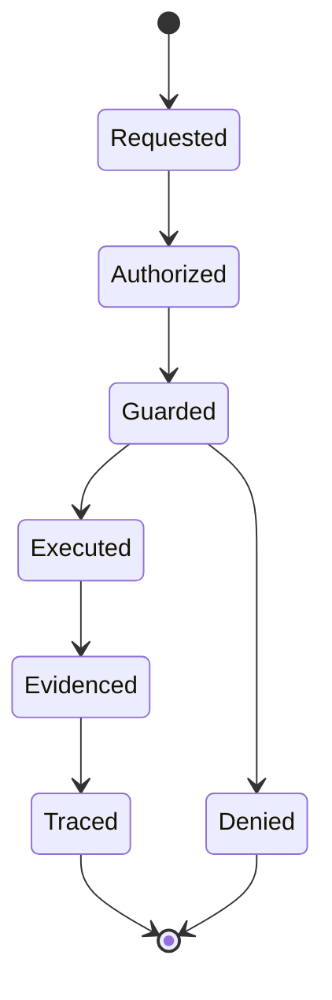
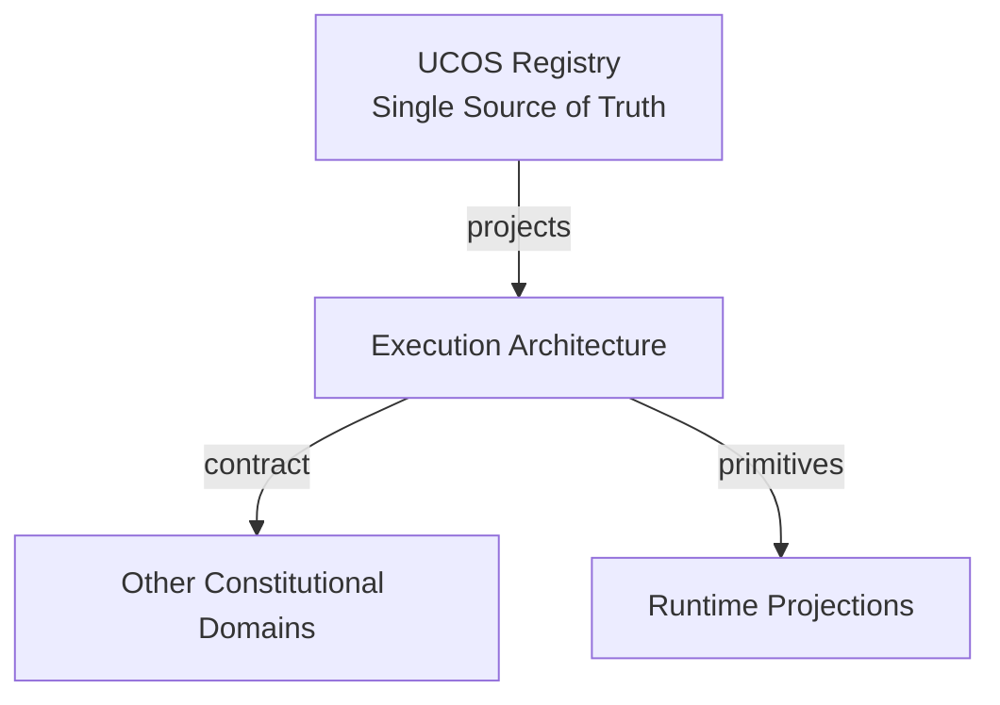
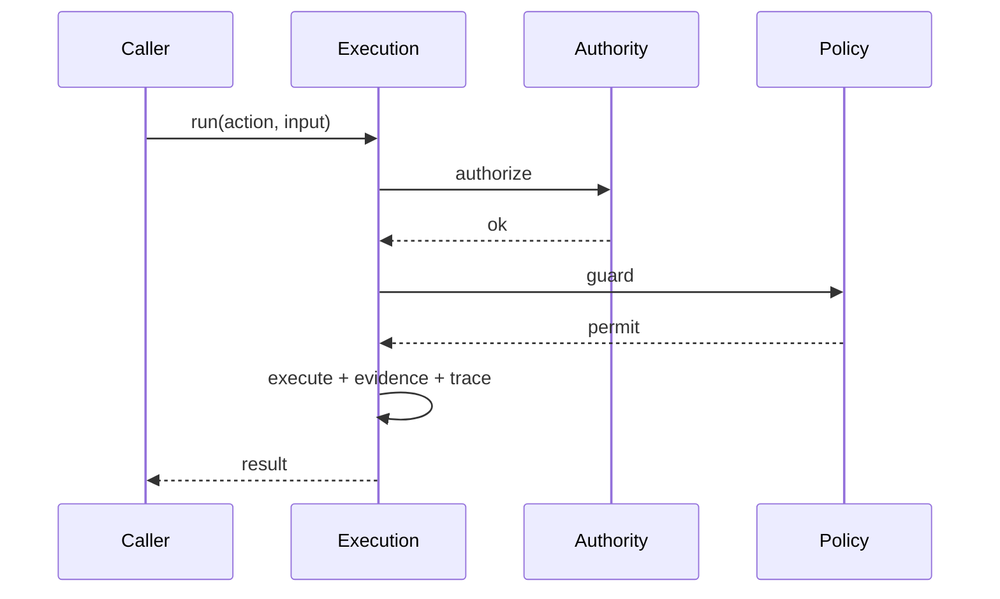
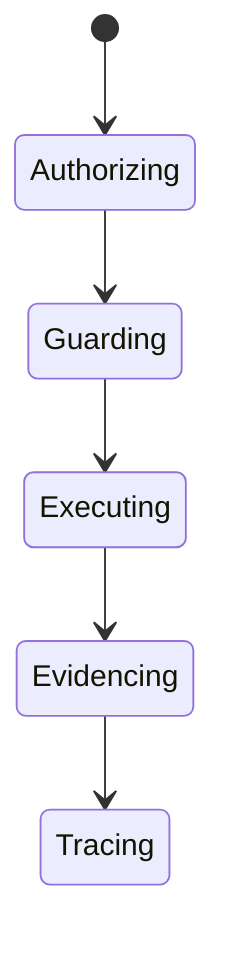
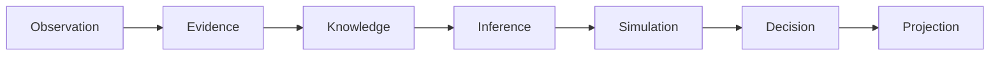
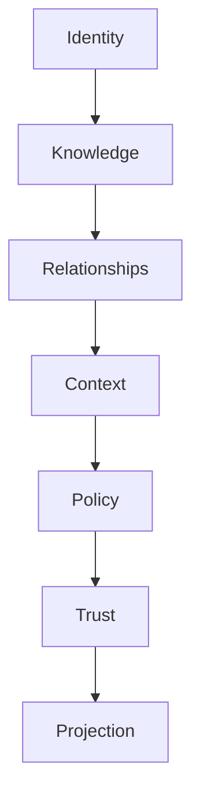

# UCOS-RUN-000002
# Execution Architecture

**Version:** Ω∞.1  |  **Status:** Constitutional Artifact  |  **Authority:** UCOS Ω∞ Constitutional Authority
**Category:** Runtime  |  **Source of Truth:** `_registry/` (projected, never hand-authored)

> Constitutional notice: this document is a **projection**. Its truth lives in the registry. Editing this document directly violates Law 002 (Knowledge Once).

---

## 1. Executive Summary

**UCOS-RUN-000002 — Execution Architecture**

This artifact is a constitutionally governed, implementation-ready specification projected from the _UCOS Registry_ single source of truth.
It conforms to the _Immutable Primitive Registry_ (27 frozen primitives) and the _Canonical Terminology Registry_ (31 governed terms).
It contains no hardcoded business, industry, currency, country, or commerce concepts. All such concepts are runtime projections.

---

## 2. Constitutional Purpose

To define the binding contract for **Execution Architecture** such that:
- every concept it names has exactly one owner,
- every capability it exposes has exactly one boundary,
- every boundary is expressed as an explicit contract,
- every contract is enforceable by the Governance Constitution.

---

## 3. Scope

In scope: the primitives, contracts, schemas, events, and policies owned by **Execution Architecture**.
In scope: the projection rules by which this domain exposes its truth to other domains.
In scope: the verification obligations this domain must satisfy before activation.

---

## 4. Out of Scope

Out of scope: any concept owned by another constitutional domain.
Out of scope: business, industry, commerce, country, currency, or language content (all projected).
Out of scope: mutation of another domain’s internal state.

---

## 5. Definitions

All terms in this artifact are used in their canonical sense as defined in the Canonical Terminology Registry.
Where a term appears, its `termId` is normative and its `prohibitedMeanings` are void.

---

## 6. Canonical Terminology

| Term | Canonical Definition | Owner | Prohibited Meanings |
|---|---|---|---|
| Existence | Anything that may exist. | Universal Existence Kernel | business meaning, commercial meaning, operational meaning |
| Entity | Technical representation of an Existence Object. | Identity Domain | existence itself |
| Knowledge | Interpreted information with evidence and meaning. | Knowledge Domain | data, information, evidence |
| Data | Raw observations. | Observation Domain | knowledge, meaning |
| Information | Organized data. | Observation Domain | knowledge |
| Evidence | Proof supporting an assertion. | Evidence Domain | knowledge, trust |
| Trust | Computed confidence in an assertion, derived from evidence. | Trust Domain | evidence, faith |
| Meaning | Semantic interpretation; higher-level understanding. | Semantic Domain | classification, taxonomy, ontology |
| Ontology | What exists. | Semantic Domain | taxonomy, classification |
| Taxonomy | How things are classified. | Semantic Domain | ontology, meaning |
| Classification | Assignment into taxonomy. | Semantic Domain | meaning |
| Relationship | Connection between objects. | Relationship Domain | causality |

---

## 7. Ownership Boundaries

Ownership is recorded in the _Domain Ownership Registry_.

---

## 8. Domain Responsibilities

See the Domain Ownership Registry for the authoritative responsibility list.

---

## 9. Domain Non-Responsibilities

See the Domain Ownership Registry.

---

## 10. Concepts

Execution Architecture defines how a single governed action runs. Every action passes authority check, policy guard, evidence binding, and trace recording — in that order, with no bypass.

---

## 11. Ontology

Execution is a pipeline: Authorize → Guard → Execute → Evidence → Trace. Each stage is mandatory and independently verifiable. A skipped stage is a constitutional violation.

---

## 12. Taxonomy

By synchronicity: Synchronous / Asynchronous / Deferred. By isolation: Shared / Isolated / Enclave. By idempotency: Idempotent / At-most-once / Compensatable.

---

## 13. Registries

This domain is registry-driven. Its registries are entries in the Universal Registry System:

```yaml
RegistryEntry:
  registryId: UCOS-REG-DOMAIN
  owner: Constitutional Authority
  law: Knowledge Once — each concept defined exactly once
```

---

## 14. Data Model

```yaml
Execution:
  executionId: <Identity>
  actionClass: <registry id>
  authority: <Authority>
  policyVersion: <version>
  input: <content-addressed>
  output: <content-addressed>
  evidence: [<Evidence>]
  trace: <append-only ref>
  temporal: {at}
  idempotencyKey: <hash>
```

---

## 15. Graph Model

(:Execution)-[:AUTHORIZED_BY]->(:Authority); (:Execution)-[:GUARDED_BY]->(:Policy); (:Execution)-[:EVIDENCED_BY]->(:Evidence); (:Execution)-[:TRACED_IN]->(:AuditLog)

---

## 16. Schemas

```yaml
# Canonical projection schema for UCOS-RUN-000002
ucos_run_000002:
  identity:      <Identity primitive>
  intent:        <Intent primitive>
  meaning:       <Meaning primitive>
  knowledge:     <Knowledge primitive>
  registry:      <Registry primitive>
  relationship:  <Relationship primitive>
  context:       <Context primitive>
  policy:        <Policy primitive>
  authority:     <Authority primitive>
  evidence:      <Evidence primitive>
  trust:         <Trust primitive>
  temporal:      <Time primitive>
  metadata:      <Metadata primitive>
```

---

## 17. Contracts

```yaml
DomainContract:
  domain: Execution Architecture
  commands:   []   # registry-driven
  queries:    []   # registry-driven
  events:     []   # registry-driven
  policies:   []   # registry-driven
  permissions: []  # registry-driven
```

Contract law: domains never directly access another domain’s internal structures.

---

## 18. APIs

POST /execution.v1.run,GET  /execution.v1/{id},GET  /execution.v1.trace/{id},POST /execution.v1.compensate

---

## 19. Events

ExecutionRequested,ExecutionAuthorized,ExecutionGuarded,ExecutionCompleted,ExecutionFailed,ExecutionCompensated

---

## 20. Commands

execution.run,execution.compensate,execution.replay,execution.audit

---

## 21. Queries

execution.byId,execution.trace,execution.byActionClass,execution.violations

---

## 22. State Machines



---

## 23. Workflows

authorize (authority chain) → guard (policy evaluation) → execute (isolated) → bind evidence → append trace

---

## 24. Policies

```yaml
Policy:
  identity: <Identity>
  conditions: []   # registry-driven
  actions:    []   # registry-driven
  priorities: []   # registry-driven
  exceptions: []   # registry-driven
```

All behavior derives from policy. Policy ≠ Rule: policy is behavioral governance; the rule is its executable projection.

---

## 25. Rules

```yaml
Rule:
  ruleId: <Identity>
  derivedFrom: <Policy identity>
  executable: true
  constraint: <registry expression>
```

---

## 26. Authorities

The action class's owning authority; verified, never assumed.

---

## 27. Permissions

execution.run (holder of action-class authority),execution.compensate (governance),execution.read (auditor)

---

## 28. Security Model

Zero Trust applies: no implicit trust between domains, services, agents, or tenants.
Every call is authenticated, authorized against Policy, and evidenced.
Cryptographic identity is issued by the Identity Domain; keys by the Key Management Architecture.

---

## 29. Privacy Model

Traces minimize personal data; the enforcement facts are retained, subject contents are not.

---

## 30. Trust Model

Trust is computed, never assumed. Inputs: evidence, authority, consistency, provenance, confidence.
```yaml
Trust:
  evidenceScore: <0..1>
  authorityScore: <0..1>
  consistencyScore: <0..1>
  provenanceScore: <0..1>
  confidenceScore: <0..1>
```

---

## 31. Audit Model

The trace is the audit — every stage is a signed, timestamped, append-only entry. Replay reproduces identical outcome.

---

## 32. Observability Model

Every action emits: What happened? Why? Who authorized it? Which policy allowed it? What evidence supports it? What confidence exists? What alternatives were evaluated?
These are the seven Explainability questions and are mandatory event fields.

---

## 33. Digital Twin Model

Execution twin monitors pipeline latency and denial rates as governance health.

---

## 34. Agent Model

Agent actions run through the identical pipeline — agents get no shortcut, by constitutional design.

---

## 35. Runtime Model

The pipeline is in-process for latency, with each stage writing to an append-only log before the next begins.

---

## 36. Scaling Model

Executions are independent; the append-only trace is the serialization point and is sharded by execution id.

---

## 37. Multi-Tenant Model

Executions are tenant-isolated; cross-tenant action classes require both authorities.

---

## 38. Geo-Distribution Model

Execution locality follows data residency; traces stay in-jurisdiction.

---

## 39. Failure Model

Stage skip (must be impossible), evidence failure post-execution, trace write failure, idempotency collision.

---

## 40. Recovery Model

Failed executions compensate via recorded compensating actions — the pipeline is never left half-executed by design.

---

## 41. Verification Model

Before activation, Execution Architecture must pass identity, knowledge, relationship, context, policy, authority, trust, and reality integrity checks.
Verification is performed by the Formal Verification Architecture (UCOS-FML-000001).

---

## 42. Certification Model

Pipeline completeness must be formally provable — a bypass path voids certification of the entire platform.

---

## 43. Migration Model

New action classes are registry additions; the pipeline schema is frozen.

---

## 44. Evolution Model

Evolution is governed and history-preserving. Primitives are frozen; extension occurs through registries, policies, capabilities, contexts, relationships, knowledge, agents, and projections — never through primitive expansion.

---

## 45. Implementation Blueprint

Build order for RUN2: (1) define registry entries — this domain owns by synchronicity: synchronous / asynchronous / deferred as registry truth, not code; (2) implement the contract surface first (execution.run, execution.compensate, execution.replay) and validate against RUN2 boundaries; (3) event-source all state so history is reconstructable; (4) wire the enforcement points — authority check, policy guard, evidence binding, trace — in-line, with no bypass path; (5) add tests per the Testing Architecture, citing evidence per gate; (6) obtain Verification and Certification before activation. Acceptance: the Zero Partial and Law 001 audits pass, every action answers the seven explainability questions, and this domain mutates no other domain internals.

---

## 46. Reference Architecture Diagram



---

## 47. Sequence Diagrams



---

## 48. State Diagrams



---

## 49. Data Flow Diagrams



---

## 50. Dependency Maps



Forbidden: circular dependencies, mutual ownership, cross-domain state mutation.

---

## ∞

Constitutionally governed. Implementation ready. Universally extensible.