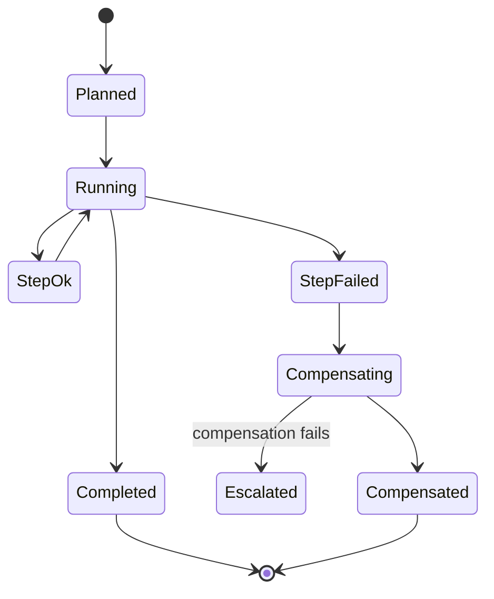
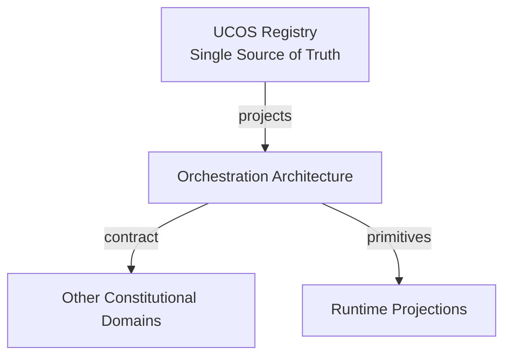
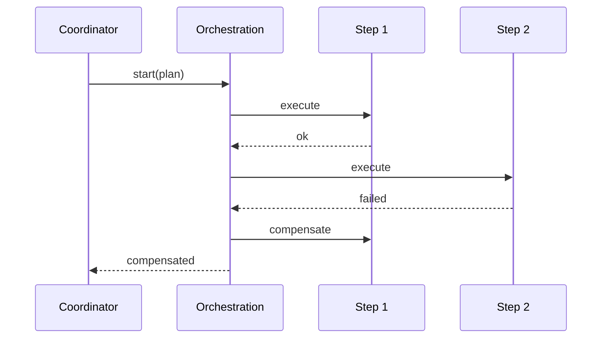
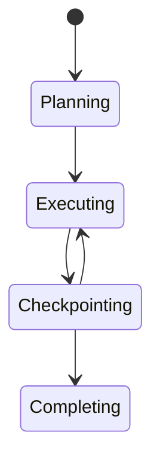
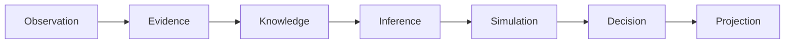
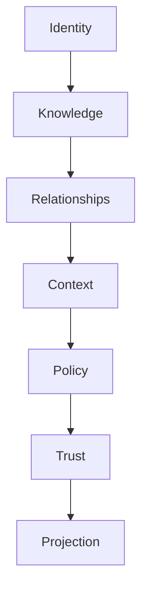

# UCOS-RUN-000003
# Orchestration Architecture

**Version:** Ω∞.1  |  **Status:** Constitutional Artifact  |  **Authority:** UCOS Ω∞ Constitutional Authority
**Category:** Runtime  |  **Source of Truth:** `_registry/` (projected, never hand-authored)

> Constitutional notice: this document is a **projection**. Its truth lives in the registry. Editing this document directly violates Law 002 (Knowledge Once).

---

## 1. Executive Summary

**UCOS-RUN-000003 — Orchestration Architecture**

This artifact is a constitutionally governed, implementation-ready specification projected from the _UCOS Registry_ single source of truth.
It conforms to the _Immutable Primitive Registry_ (27 frozen primitives) and the _Canonical Terminology Registry_ (31 governed terms).
It contains no hardcoded business, industry, currency, country, or commerce concepts. All such concepts are runtime projections.

---

## 2. Constitutional Purpose

To define the binding contract for **Orchestration Architecture** such that:
- every concept it names has exactly one owner,
- every capability it exposes has exactly one boundary,
- every boundary is expressed as an explicit contract,
- every contract is enforceable by the Governance Constitution.

---

## 3. Scope

In scope: the primitives, contracts, schemas, events, and policies owned by **Orchestration Architecture**.
In scope: the projection rules by which this domain exposes its truth to other domains.
In scope: the verification obligations this domain must satisfy before activation.

---

## 4. Out of Scope

Out of scope: any concept owned by another constitutional domain.
Out of scope: business, industry, commerce, country, currency, or language content (all projected).
Out of scope: mutation of another domain’s internal state.

---

## 5. Definitions

All terms in this artifact are used in their canonical sense as defined in the Canonical Terminology Registry.
Where a term appears, its `termId` is normative and its `prohibitedMeanings` are void.

---

## 6. Canonical Terminology

| Term | Canonical Definition | Owner | Prohibited Meanings |
|---|---|---|---|
| Existence | Anything that may exist. | Universal Existence Kernel | business meaning, commercial meaning, operational meaning |
| Entity | Technical representation of an Existence Object. | Identity Domain | existence itself |
| Knowledge | Interpreted information with evidence and meaning. | Knowledge Domain | data, information, evidence |
| Data | Raw observations. | Observation Domain | knowledge, meaning |
| Information | Organized data. | Observation Domain | knowledge |
| Evidence | Proof supporting an assertion. | Evidence Domain | knowledge, trust |
| Trust | Computed confidence in an assertion, derived from evidence. | Trust Domain | evidence, faith |
| Meaning | Semantic interpretation; higher-level understanding. | Semantic Domain | classification, taxonomy, ontology |
| Ontology | What exists. | Semantic Domain | taxonomy, classification |
| Taxonomy | How things are classified. | Semantic Domain | ontology, meaning |
| Classification | Assignment into taxonomy. | Semantic Domain | meaning |
| Relationship | Connection between objects. | Relationship Domain | causality |

---

## 7. Ownership Boundaries

Ownership is recorded in the _Domain Ownership Registry_.

---

## 8. Domain Responsibilities

See the Domain Ownership Registry for the authoritative responsibility list.

---

## 9. Domain Non-Responsibilities

See the Domain Ownership Registry.

---

## 10. Concepts

Orchestration coordinates multiple governed executions into coherent outcomes without introducing a coordination truth of its own. The orchestrator holds no state — it holds a plan, and the plan is itself a governed projection.

---

## 11. Ontology

Orchestration has a Plan (workflow projection), Steps (executions), Dependencies (registry expressions), and Compensation logic. Sagas are first-class; distributed transactions across domains are prohibited (they'd create shared mutable truth).

---

## 12. Taxonomy

By pattern: Saga / Pipeline / Fan-out-fan-in / Stateful-coordination / Event-choreography. By duration: Request-scale / Minutes / Hours / Days. By failure mode: Compensatable / Retryable / Escalating.

---

## 13. Registries

This domain is registry-driven. Its registries are entries in the Universal Registry System:

```yaml
RegistryEntry:
  registryId: UCOS-REG-DOMAIN
  owner: Constitutional Authority
  law: Knowledge Once — each concept defined exactly once
```

---

## 14. Data Model

```yaml
Orchestration:
  orchestrationId: <Identity>
  plan: <workflow projection ref>
  steps: [{executionRef, dependsOn}]
  compensationPlan: [{step, compensatingAction}]
  state: <registry state>
  context: <Context>
  temporal: {startedAt}
```

---

## 15. Graph Model

(:Orchestration)-[:EXECUTES]->(:Execution); (:Orchestration)-[:PLAN_FROM]->(:Workflow); (:Orchestration)-[:COMPENSATES]->(:Execution); (:Orchestration)-[:SCOPED_IN]->(:Context)

---

## 16. Schemas

```yaml
# Canonical projection schema for UCOS-RUN-000003
ucos_run_000003:
  identity:      <Identity primitive>
  intent:        <Intent primitive>
  meaning:       <Meaning primitive>
  knowledge:     <Knowledge primitive>
  registry:      <Registry primitive>
  relationship:  <Relationship primitive>
  context:       <Context primitive>
  policy:        <Policy primitive>
  authority:     <Authority primitive>
  evidence:      <Evidence primitive>
  trust:         <Trust primitive>
  temporal:      <Time primitive>
  metadata:      <Metadata primitive>
```

---

## 17. Contracts

```yaml
DomainContract:
  domain: Orchestration Architecture
  commands:   []   # registry-driven
  queries:    []   # registry-driven
  events:     []   # registry-driven
  policies:   []   # registry-driven
  permissions: []  # registry-driven
```

Contract law: domains never directly access another domain’s internal structures.

---

## 18. APIs

POST /orchestration.v1.start,GET  /orchestration.v1/{id},POST /orchestration.v1/{id}/compensate,GET  /orchestration.v1.status/{id}

---

## 19. Events

OrchestrationStarted,StepCompleted,StepFailed,OrchestrationCompleted,OrchestrationCompensating,OrchestrationSuspended

---

## 20. Commands

orchestration.start,orchestration.compensate,orchestration.suspend,orchestration.resume

---

## 21. Queries

orchestration.byId,orchestration.status,orchestration.active,orchestration.timeline

---

## 22. State Machines



---

## 23. Workflows

materialize plan → execute steps per dependency → on failure: compensate in reverse → escalate if compensation fails

---

## 24. Policies

```yaml
Policy:
  identity: <Identity>
  conditions: []   # registry-driven
  actions:    []   # registry-driven
  priorities: []   # registry-driven
  exceptions: []   # registry-driven
```

All behavior derives from policy. Policy ≠ Rule: policy is behavioral governance; the rule is its executable projection.

---

## 25. Rules

```yaml
Rule:
  ruleId: <Identity>
  derivedFrom: <Policy identity>
  executable: true
  constraint: <registry expression>
```

---

## 26. Authorities

Orchestration Authority (coordination); each step carries its own action-class authority.

---

## 27. Permissions

orchestration.start (plan owner),orchestration.compensate (governance),orchestration.read (participant)

---

## 28. Security Model

Zero Trust applies: no implicit trust between domains, services, agents, or tenants.
Every call is authenticated, authorized against Policy, and evidenced.
Cryptographic identity is issued by the Identity Domain; keys by the Key Management Architecture.

---

## 29. Privacy Model

Orchestration over personal data inherits the strictest consent scope among its steps.

---

## 30. Trust Model

Trust is computed, never assumed. Inputs: evidence, authority, consistency, provenance, confidence.
```yaml
Trust:
  evidenceScore: <0..1>
  authorityScore: <0..1>
  consistencyScore: <0..1>
  provenanceScore: <0..1>
  confidenceScore: <0..1>
```

---

## 31. Audit Model

Every step and compensation is traced; the orchestration is replayable end-to-end from the plan + step traces.

---

## 32. Observability Model

Every action emits: What happened? Why? Who authorized it? Which policy allowed it? What evidence supports it? What confidence exists? What alternatives were evaluated?
These are the seven Explainability questions and are mandatory event fields.

---

## 33. Digital Twin Model

Orchestration twin tracks in-flight plans and predicts failure cascades before compensation is needed.

---

## 34. Agent Model

Planner agents materialize plans; orchestration executes them — planning and execution are separated by constitution.

---

## 35. Runtime Model

Sagas with explicit compensation; no two-phase commit across domains — eventual consistency within a context window.

---

## 36. Scaling Model

Orchestrations are independent; long-running plans checkpoint to the event store and resume.

---

## 37. Multi-Tenant Model

Orchestration never crosses tenants; marketplace flows are explicit multi-party plans with both authorities.

---

## 38. Geo-Distribution Model

Cross-region orchestration respects sovereignty — a step touching regulated data runs in-jurisdiction.

---

## 39. Failure Model

Step failure cascade, compensation failure, plan version drift, orphaned orchestration.

---

## 40. Recovery Model

Compensation is the recovery mechanism; escalation routes to governance. Orphaned plans are reaped by policy.

---

## 41. Verification Model

Before activation, Orchestration Architecture must pass identity, knowledge, relationship, context, policy, authority, trust, and reality integrity checks.
Verification is performed by the Formal Verification Architecture (UCOS-FML-000001).

---

## 42. Certification Model

Plan must be compensatable — non-compensatable distributed steps are uncertifiable.

---

## 43. Migration Model

New patterns are registry additions to the workflow registry.

---

## 44. Evolution Model

Evolution is governed and history-preserving. Primitives are frozen; extension occurs through registries, policies, capabilities, contexts, relationships, knowledge, agents, and projections — never through primitive expansion.

---

## 45. Implementation Blueprint

Build order for RUN3: (1) define registry entries — this domain owns by pattern: saga / pipeline / fan-out-fan-in / stateful-coordination / event-choreography as registry truth, not code; (2) implement the contract surface first (orchestration.start, orchestration.compensate, orchestration.suspend) and validate against RUN3 boundaries; (3) event-source all state so history is reconstructable; (4) wire the enforcement points — authority check, policy guard, evidence binding, trace — in-line, with no bypass path; (5) add tests per the Testing Architecture, citing evidence per gate; (6) obtain Verification and Certification before activation. Acceptance: the Zero Partial and Law 001 audits pass, every action answers the seven explainability questions, and this domain mutates no other domain internals.

---

## 46. Reference Architecture Diagram



---

## 47. Sequence Diagrams



---

## 48. State Diagrams



---

## 49. Data Flow Diagrams



---

## 50. Dependency Maps



Forbidden: circular dependencies, mutual ownership, cross-domain state mutation.

---

## ∞

Constitutionally governed. Implementation ready. Universally extensible.