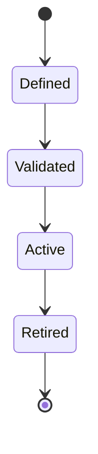
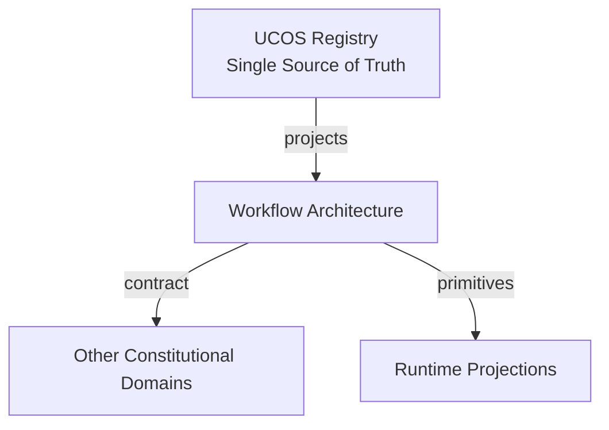
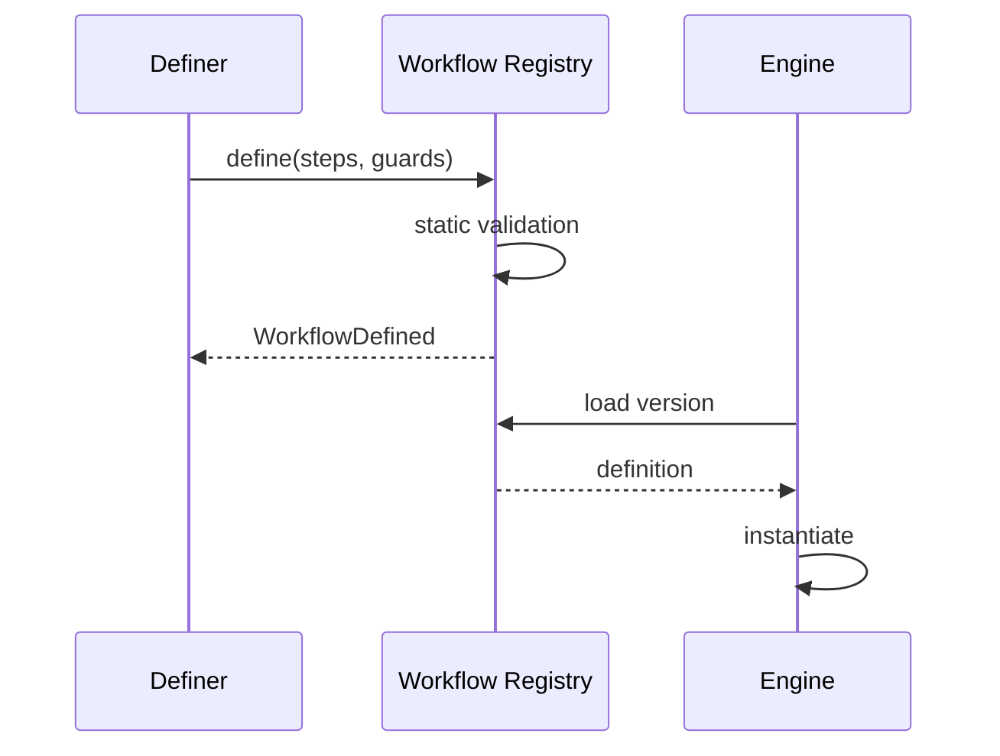
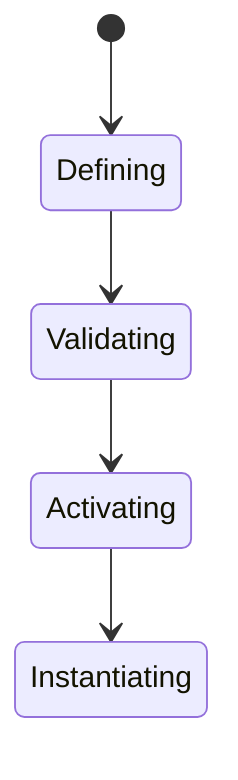
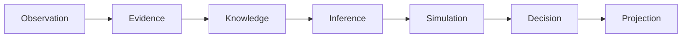
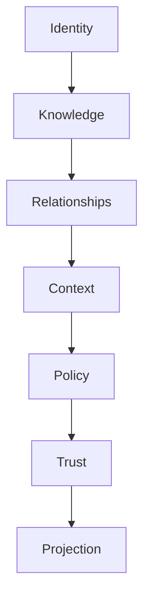

# UCOS-RUN-000004
# Workflow Architecture

**Version:** Ω∞.1  |  **Status:** Constitutional Artifact  |  **Authority:** UCOS Ω∞ Constitutional Authority
**Category:** Runtime  |  **Source of Truth:** `_registry/` (projected, never hand-authored)

> Constitutional notice: this document is a **projection**. Its truth lives in the registry. Editing this document directly violates Law 002 (Knowledge Once).

---

## 1. Executive Summary

**UCOS-RUN-000004 — Workflow Architecture**

This artifact is a constitutionally governed, implementation-ready specification projected from the _UCOS Registry_ single source of truth.
It conforms to the _Immutable Primitive Registry_ (27 frozen primitives) and the _Canonical Terminology Registry_ (31 governed terms).
It contains no hardcoded business, industry, currency, country, or commerce concepts. All such concepts are runtime projections.

---

## 2. Constitutional Purpose

To define the binding contract for **Workflow Architecture** such that:
- every concept it names has exactly one owner,
- every capability it exposes has exactly one boundary,
- every boundary is expressed as an explicit contract,
- every contract is enforceable by the Governance Constitution.

---

## 3. Scope

In scope: the primitives, contracts, schemas, events, and policies owned by **Workflow Architecture**.
In scope: the projection rules by which this domain exposes its truth to other domains.
In scope: the verification obligations this domain must satisfy before activation.

---

## 4. Out of Scope

Out of scope: any concept owned by another constitutional domain.
Out of scope: business, industry, commerce, country, currency, or language content (all projected).
Out of scope: mutation of another domain’s internal state.

---

## 5. Definitions

All terms in this artifact are used in their canonical sense as defined in the Canonical Terminology Registry.
Where a term appears, its `termId` is normative and its `prohibitedMeanings` are void.

---

## 6. Canonical Terminology

| Term | Canonical Definition | Owner | Prohibited Meanings |
|---|---|---|---|
| Existence | Anything that may exist. | Universal Existence Kernel | business meaning, commercial meaning, operational meaning |
| Entity | Technical representation of an Existence Object. | Identity Domain | existence itself |
| Knowledge | Interpreted information with evidence and meaning. | Knowledge Domain | data, information, evidence |
| Data | Raw observations. | Observation Domain | knowledge, meaning |
| Information | Organized data. | Observation Domain | knowledge |
| Evidence | Proof supporting an assertion. | Evidence Domain | knowledge, trust |
| Trust | Computed confidence in an assertion, derived from evidence. | Trust Domain | evidence, faith |
| Meaning | Semantic interpretation; higher-level understanding. | Semantic Domain | classification, taxonomy, ontology |
| Ontology | What exists. | Semantic Domain | taxonomy, classification |
| Taxonomy | How things are classified. | Semantic Domain | ontology, meaning |
| Classification | Assignment into taxonomy. | Semantic Domain | meaning |
| Relationship | Connection between objects. | Relationship Domain | causality |

---

## 7. Ownership Boundaries

Ownership is recorded in the _Domain Ownership Registry_.

---

## 8. Domain Responsibilities

See the Domain Ownership Registry for the authoritative responsibility list.

---

## 9. Domain Non-Responsibilities

See the Domain Ownership Registry.

---

## 10. Concepts

Workflow Architecture defines process orchestration as a governed, registry-defined projection. Workflows are not code — they are declarations in the workflow registry, executed by the orchestration engine.

---

## 11. Ontology

Workflow has Steps (action classes), Transitions (registry expressions), Guards (policies), and a state machine. Defining a workflow is a registry act, not a deployment act.

---

## 12. Taxonomy

By structure: Sequential / Branching / Parallel / Loop / Event-driven / Hybrid. By mutability: Frozen-versioned / Governed-evolving. By scope: Universal / Domain / Tenant / Instance.

---

## 13. Registries

This domain is registry-driven. Its registries are entries in the Universal Registry System:

```yaml
RegistryEntry:
  registryId: UCOS-REG-DOMAIN
  owner: Constitutional Authority
  law: Knowledge Once — each concept defined exactly once
```

---

## 14. Data Model

```yaml
Workflow:
  workflowId: <registry id>
  version: <int>
  steps: [{actionClass, guards: [Policy]}]
  transitions: [{from, to, condition}]
  stateMachine: <registry ref>
  compensationPlan: [{step, compensatingAction}]
  temporal: {effectiveFrom, effectiveTo}
```

---

## 15. Graph Model

(:Workflow)-[:HAS_STEP]->(:ActionClass); (:Workflow)-[:GUARDED_BY]->(:Policy); (:Workflow)-[:VERSION_OF]->(:Workflow); (:Workflow)-[:EXECUTED_AS]->(:Orchestration)

---

## 16. Schemas

```yaml
# Canonical projection schema for UCOS-RUN-000004
ucos_run_000004:
  identity:      <Identity primitive>
  intent:        <Intent primitive>
  meaning:       <Meaning primitive>
  knowledge:     <Knowledge primitive>
  registry:      <Registry primitive>
  relationship:  <Relationship primitive>
  context:       <Context primitive>
  policy:        <Policy primitive>
  authority:     <Authority primitive>
  evidence:      <Evidence primitive>
  trust:         <Trust primitive>
  temporal:      <Time primitive>
  metadata:      <Metadata primitive>
```

---

## 17. Contracts

```yaml
DomainContract:
  domain: Workflow Architecture
  commands:   []   # registry-driven
  queries:    []   # registry-driven
  events:     []   # registry-driven
  policies:   []   # registry-driven
  permissions: []  # registry-driven
```

Contract law: domains never directly access another domain’s internal structures.

---

## 18. APIs

POST /workflow.v1.define,GET  /workflow.v1/{id},GET  /workflow.v1.versions/{id},POST /workflow.v1.validate

---

## 19. Events

WorkflowDefined,WorkflowValidated,WorkflowRetired,WorkflowInstantiated

---

## 20. Commands

workflow.define,workflow.validate,workflow.version.retire,workflow.instantiate

---

## 21. Queries

workflow.byId,workflow.versions,workflow.byStep,workflow.active

---

## 22. State Machines



---

## 23. Workflows

define in registry → static validation (guards, compensatability, state machine sanity) → activate → instantiate per execution

---

## 24. Policies

```yaml
Policy:
  identity: <Identity>
  conditions: []   # registry-driven
  actions:    []   # registry-driven
  priorities: []   # registry-driven
  exceptions: []   # registry-driven
```

All behavior derives from policy. Policy ≠ Rule: policy is behavioral governance; the rule is its executable projection.

---

## 25. Rules

```yaml
Rule:
  ruleId: <Identity>
  derivedFrom: <Policy identity>
  executable: true
  constraint: <registry expression>
```

---

## 26. Authorities

Workflow Authority (registry governance); step authorities are inherited from action classes.

---

## 27. Permissions

workflow.define (workflow authority),workflow.instantiate (plan owner),workflow.read (any authenticated)

---

## 28. Security Model

Zero Trust applies: no implicit trust between domains, services, agents, or tenants.
Every call is authenticated, authorized against Policy, and evidenced.
Cryptographic identity is issued by the Identity Domain; keys by the Key Management Architecture.

---

## 29. Privacy Model

Workflows over personal data carry consent scope as a first-class guard, not an afterthought.

---

## 30. Trust Model

Trust is computed, never assumed. Inputs: evidence, authority, consistency, provenance, confidence.
```yaml
Trust:
  evidenceScore: <0..1>
  authorityScore: <0..1>
  consistencyScore: <0..1>
  provenanceScore: <0..1>
  confidenceScore: <0..1>
```

---

## 31. Audit Model

Every instantiation records the workflow version — history is replayable because the version is immutable.

---

## 32. Observability Model

Every action emits: What happened? Why? Who authorized it? Which policy allowed it? What evidence supports it? What confidence exists? What alternatives were evaluated?
These are the seven Explainability questions and are mandatory event fields.

---

## 33. Digital Twin Model

Workflow twin tracks execution distributions and bottleneck steps across instances.

---

## 34. Agent Model

Agents may define workflow proposals, but only the Workflow Authority activates them.

---

## 35. Runtime Model

Workflow is data interpreted by the orchestration engine — the engine has zero workflow-specific code.

---

## 36. Scaling Model

Definitions are few and globally cached; instances scale with orchestration.

---

## 37. Multi-Tenant Model

Universal workflows are shared; tenant workflows are registry entries scoped to the tenant.

---

## 38. Geo-Distribution Model

Workflow guards include jurisdiction policy — the same workflow may be legal in one region, blocked in another.

---

## 39. Failure Model

Invalid guard reference, uncompensatable step, transition deadlock, version retirement with live instances.

---

## 40. Recovery Model

Versions are immutable; retirement prevents new instances, and live ones complete on their pinned version.

---

## 41. Verification Model

Before activation, Workflow Architecture must pass identity, knowledge, relationship, context, policy, authority, trust, and reality integrity checks.
Verification is performed by the Formal Verification Architecture (UCOS-FML-000001).

---

## 42. Certification Model

Workflow must pass static validation: guard completeness, state-machine reachability, and compensatability.

---

## 43. Migration Model

Workflow evolution is versioned registry evolution — there is no separate migration path.

---

## 44. Evolution Model

Evolution is governed and history-preserving. Primitives are frozen; extension occurs through registries, policies, capabilities, contexts, relationships, knowledge, agents, and projections — never through primitive expansion.

---

## 45. Implementation Blueprint

Build order for RUN4: (1) define registry entries — this domain owns by structure: sequential / branching / parallel / loop / event-driven / hybrid as registry truth, not code; (2) implement the contract surface first (workflow.define, workflow.validate, workflow.version.retire) and validate against RUN4 boundaries; (3) event-source all state so history is reconstructable; (4) wire the enforcement points — authority check, policy guard, evidence binding, trace — in-line, with no bypass path; (5) add tests per the Testing Architecture, citing evidence per gate; (6) obtain Verification and Certification before activation. Acceptance: the Zero Partial and Law 001 audits pass, every action answers the seven explainability questions, and this domain mutates no other domain internals.

---

## 46. Reference Architecture Diagram



---

## 47. Sequence Diagrams



---

## 48. State Diagrams



---

## 49. Data Flow Diagrams



---

## 50. Dependency Maps



Forbidden: circular dependencies, mutual ownership, cross-domain state mutation.

---

## ∞

Constitutionally governed. Implementation ready. Universally extensible.