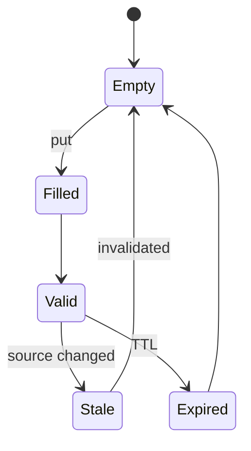
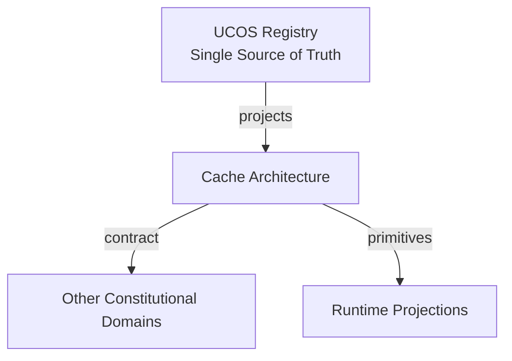
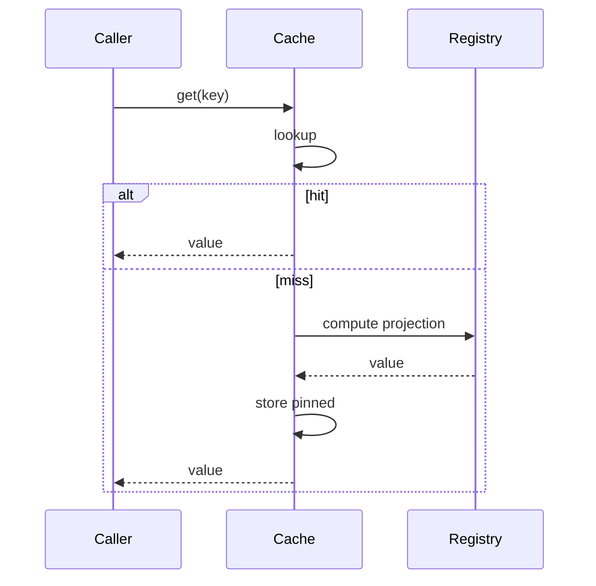
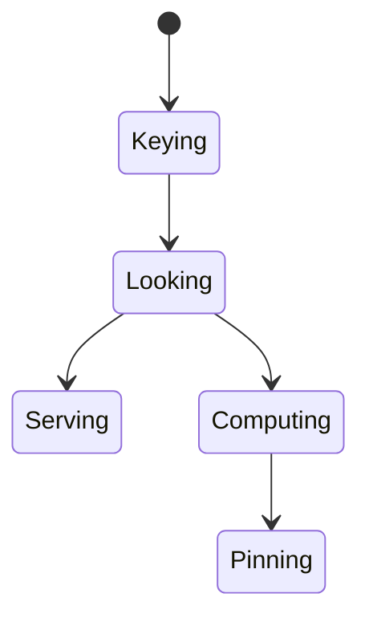
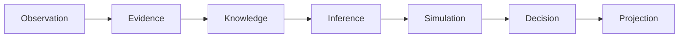
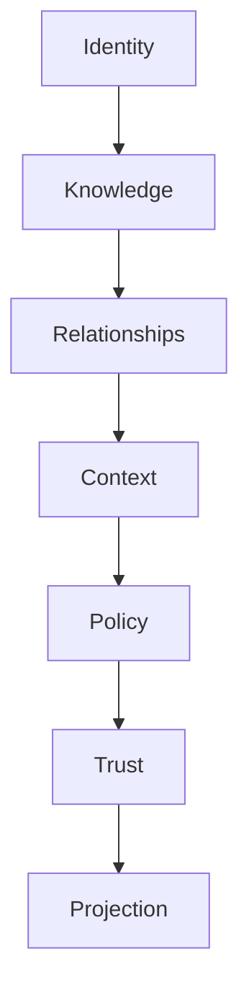

# UCOS-CCH-000001
# Cache Architecture

**Version:** Ω∞.1  |  **Status:** Constitutional Artifact  |  **Authority:** UCOS Ω∞ Constitutional Authority
**Category:** Data  |  **Source of Truth:** `_registry/` (projected, never hand-authored)

> Constitutional notice: this document is a **projection**. Its truth lives in the registry. Editing this document directly violates Law 002 (Knowledge Once).

---

## 1. Executive Summary

**UCOS-CCH-000001 — Cache Architecture**

This artifact is a constitutionally governed, implementation-ready specification projected from the _UCOS Registry_ single source of truth.
It conforms to the _Immutable Primitive Registry_ (27 frozen primitives) and the _Canonical Terminology Registry_ (31 governed terms).
It contains no hardcoded business, industry, currency, country, or commerce concepts. All such concepts are runtime projections.

---

## 2. Constitutional Purpose

To define the binding contract for **Cache Architecture** such that:
- every concept it names has exactly one owner,
- every capability it exposes has exactly one boundary,
- every boundary is expressed as an explicit contract,
- every contract is enforceable by the Governance Constitution.

---

## 3. Scope

In scope: the primitives, contracts, schemas, events, and policies owned by **Cache Architecture**.
In scope: the projection rules by which this domain exposes its truth to other domains.
In scope: the verification obligations this domain must satisfy before activation.

---

## 4. Out of Scope

Out of scope: any concept owned by another constitutional domain.
Out of scope: business, industry, commerce, country, currency, or language content (all projected).
Out of scope: mutation of another domain’s internal state.

---

## 5. Definitions

All terms in this artifact are used in their canonical sense as defined in the Canonical Terminology Registry.
Where a term appears, its `termId` is normative and its `prohibitedMeanings` are void.

---

## 6. Canonical Terminology

| Term | Canonical Definition | Owner | Prohibited Meanings |
|---|---|---|---|
| Existence | Anything that may exist. | Universal Existence Kernel | business meaning, commercial meaning, operational meaning |
| Entity | Technical representation of an Existence Object. | Identity Domain | existence itself |
| Knowledge | Interpreted information with evidence and meaning. | Knowledge Domain | data, information, evidence |
| Data | Raw observations. | Observation Domain | knowledge, meaning |
| Information | Organized data. | Observation Domain | knowledge |
| Evidence | Proof supporting an assertion. | Evidence Domain | knowledge, trust |
| Trust | Computed confidence in an assertion, derived from evidence. | Trust Domain | evidence, faith |
| Meaning | Semantic interpretation; higher-level understanding. | Semantic Domain | classification, taxonomy, ontology |
| Ontology | What exists. | Semantic Domain | taxonomy, classification |
| Taxonomy | How things are classified. | Semantic Domain | ontology, meaning |
| Classification | Assignment into taxonomy. | Semantic Domain | meaning |
| Relationship | Connection between objects. | Relationship Domain | causality |

---

## 7. Ownership Boundaries

Ownership is recorded in the _Domain Ownership Registry_.

---

## 8. Domain Responsibilities

See the Domain Ownership Registry for the authoritative responsibility list.

---

## 9. Domain Non-Responsibilities

See the Domain Ownership Registry.

---

## 10. Concepts

Cache Architecture makes projections fast. Everything cached is derived and disposable — a cache is never a source of truth, and its consistency with the registry is a first-class concern.

---

## 11. Ontology

Cache has a Key (content or semantic), a Source projection, an Invalidation policy, and a Consistency level. The invariant: a cache hit must be indistinguishable from recomputation under the pinned registry version.

---

## 12. Taxonomy

By key: Content-addressed / Semantic / Query. By level: Request / Node / Cluster / Edge. By invalidation: Event-driven / TTL / Version-pinned / Hybrid.

---

## 13. Registries

This domain is registry-driven. Its registries are entries in the Universal Registry System:

```yaml
RegistryEntry:
  registryId: UCOS-REG-DOMAIN
  owner: Constitutional Authority
  law: Knowledge Once — each concept defined exactly once
```

---

## 14. Data Model

```yaml
CacheEntry:
  cacheKey: <hash or semantic key>
  sourceProjection: <content-addressed>
  registryVersion: <version>
  invalidationPolicy: <Policy>
  consistency: <Strong|Eventually>
  temporal: {cachedAt, expiresAt}
  provenance: <computation ref>
```

---

## 15. Graph Model

(:Cache)-[:DERIVED_FROM]->(:Projection); (:Cache)-[:INVALIDATED_BY]->(:Policy|:Event); (:Cache)-[:PINNED_TO]->(:RegistryVersion)

---

## 16. Schemas

```yaml
# Canonical projection schema for UCOS-CCH-000001
ucos_cch_000001:
  identity:      <Identity primitive>
  intent:        <Intent primitive>
  meaning:       <Meaning primitive>
  knowledge:     <Knowledge primitive>
  registry:      <Registry primitive>
  relationship:  <Relationship primitive>
  context:       <Context primitive>
  policy:        <Policy primitive>
  authority:     <Authority primitive>
  evidence:      <Evidence primitive>
  trust:         <Trust primitive>
  temporal:      <Time primitive>
  metadata:      <Metadata primitive>
```

---

## 17. Contracts

```yaml
DomainContract:
  domain: Cache Architecture
  commands:   []   # registry-driven
  queries:    []   # registry-driven
  events:     []   # registry-driven
  policies:   []   # registry-driven
  permissions: []  # registry-driven
```

Contract law: domains never directly access another domain’s internal structures.

---

## 18. APIs

POST /cache.v1.get,POST /cache.v1.put,POST /cache.v1.invalidate,GET  /cache.v1.consistency

---

## 19. Events

CacheHit,CacheMiss,CacheInvalidated,CacheWarming,ConsistencyViolation

---

## 20. Commands

cache.put,cache.invalidate,cache.warm,cache.flush

---

## 21. Queries

cache.hitRate,cache.consistency,cache.size,cache.hotKeys

---

## 22. State Machines



---

## 23. Workflows

compute key → check cache → on miss compute from registry → store with pinned version → invalidate on source event or TTL

---

## 24. Policies

```yaml
Policy:
  identity: <Identity>
  conditions: []   # registry-driven
  actions:    []   # registry-driven
  priorities: []   # registry-driven
  exceptions: []   # registry-driven
```

All behavior derives from policy. Policy ≠ Rule: policy is behavioral governance; the rule is its executable projection.

---

## 25. Rules

```yaml
Rule:
  ruleId: <Identity>
  derivedFrom: <Policy identity>
  executable: true
  constraint: <registry expression>
```

---

## 26. Authorities

Cache Authority (infrastructure); invalidation policy is governed per projection type.

---

## 27. Permissions

cache.write (system),cache.invalidate (source domain or policy),cache.flush (infrastructure authority)

---

## 28. Security Model

Zero Trust applies: no implicit trust between domains, services, agents, or tenants.
Every call is authenticated, authorized against Policy, and evidenced.
Cryptographic identity is issued by the Identity Domain; keys by the Key Management Architecture.

---

## 29. Privacy Model

Personal-data caches are consent-scoped and subject to erasure invalidation — a purge propagates to all caches.

---

## 30. Trust Model

Trust is computed, never assumed. Inputs: evidence, authority, consistency, provenance, confidence.
```yaml
Trust:
  evidenceScore: <0..1>
  authorityScore: <0..1>
  consistencyScore: <0..1>
  provenanceScore: <0..1>
  confidenceScore: <0..1>
```

---

## 31. Audit Model

Consistency sampling proves cache matches recomputation; violations are events, not silent corrections.

---

## 32. Observability Model

Every action emits: What happened? Why? Who authorized it? Which policy allowed it? What evidence supports it? What confidence exists? What alternatives were evaluated?
These are the seven Explainability questions and are mandatory event fields.

---

## 33. Digital Twin Model

Cache twin monitors hit rates, eviction storms, and consistency-sample failures.

---

## 34. Agent Model

Cache agent warms predicted-hot keys and identifies low-value entries for eviction.

---

## 35. Runtime Model

Invalidation is event-driven from the source domains; edge caches are eventually consistent with staleness bounds.

---

## 36. Scaling Model

Multi-tier: request → node → cluster → edge; each tier bounded by its invalidation latency.

---

## 37. Multi-Tenant Model

Cache keys are tenant-namespaced — cross-tenant key collision is impossible by construction.

---

## 38. Geo-Distribution Model

Edge caches serve locality; regulated data's caches stay in-jurisdiction per residency policy.

---

## 39. Failure Model

Stale-serve, invalidation loss, cache stampede, hot-key hotspot.

---

## 40. Recovery Model

Caches are disposable — flush and recompute is always a safe recovery; no truth is ever cached-only.

---

## 41. Verification Model

Before activation, Cache Architecture must pass identity, knowledge, relationship, context, policy, authority, trust, and reality integrity checks.
Verification is performed by the Formal Verification Architecture (UCOS-FML-000001).

---

## 42. Certification Model

Cache must declare consistency level and prove invalidation latency within policy bound.

---

## 43. Migration Model

New invalidation strategies are registry additions.

---

## 44. Evolution Model

Evolution is governed and history-preserving. Primitives are frozen; extension occurs through registries, policies, capabilities, contexts, relationships, knowledge, agents, and projections — never through primitive expansion.

---

## 45. Implementation Blueprint

Build order for CCH: (1) define registry entries — this domain owns by key: content-addressed / semantic / query as registry truth, not code; (2) implement the contract surface first (cache.put, cache.invalidate, cache.warm) and validate against CCH boundaries; (3) event-source all state so history is reconstructable; (4) wire the enforcement points — authority check, policy guard, evidence binding, trace — in-line, with no bypass path; (5) add tests per the Testing Architecture, citing evidence per gate; (6) obtain Verification and Certification before activation. Acceptance: the Zero Partial and Law 001 audits pass, every action answers the seven explainability questions, and this domain mutates no other domain internals.

---

## 46. Reference Architecture Diagram



---

## 47. Sequence Diagrams



---

## 48. State Diagrams



---

## 49. Data Flow Diagrams



---

## 50. Dependency Maps



Forbidden: circular dependencies, mutual ownership, cross-domain state mutation.

---

## ∞

Constitutionally governed. Implementation ready. Universally extensible.