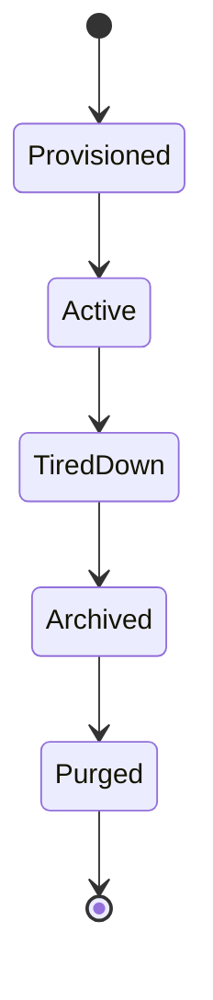
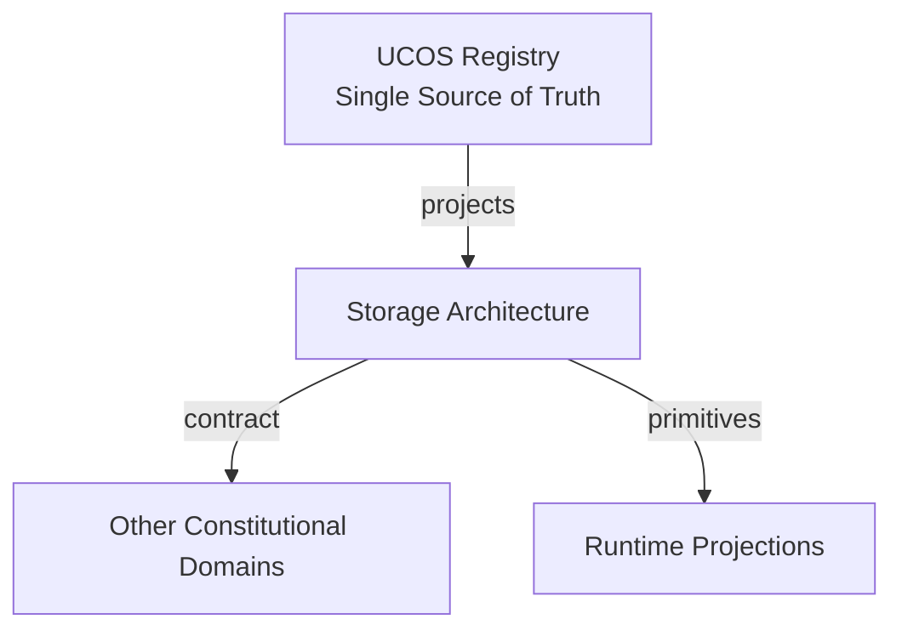
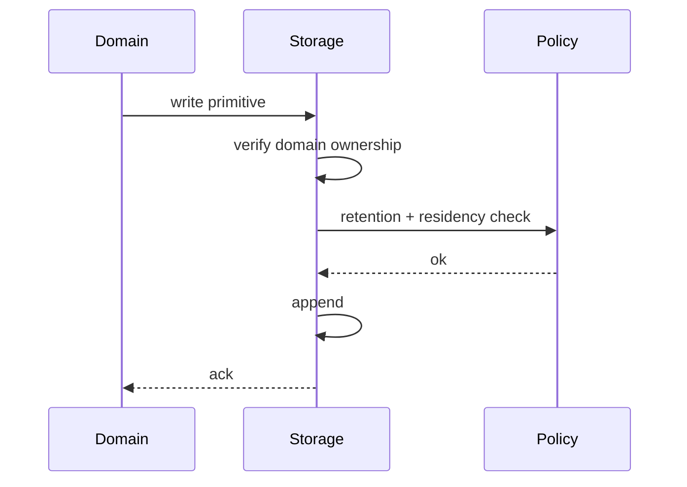
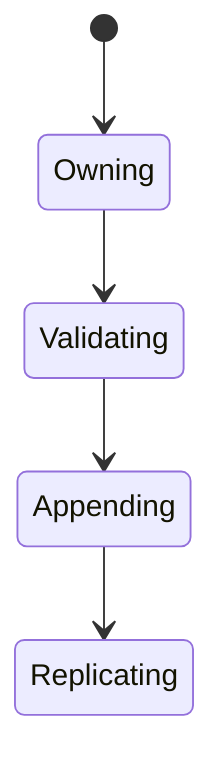
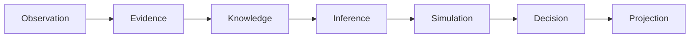
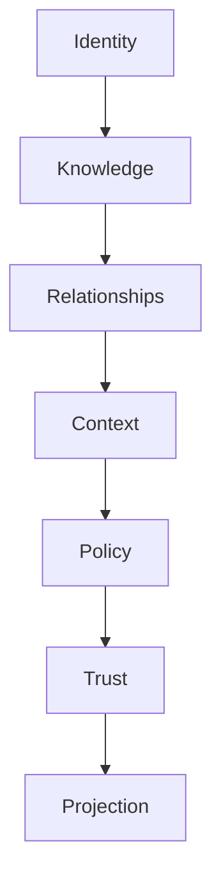

# UCOS-DB-000001
# Storage Architecture

**Version:** Ω∞.1  |  **Status:** Constitutional Artifact  |  **Authority:** UCOS Ω∞ Constitutional Authority
**Category:** Data  |  **Source of Truth:** `_registry/` (projected, never hand-authored)

> Constitutional notice: this document is a **projection**. Its truth lives in the registry. Editing this document directly violates Law 002 (Knowledge Once).

---

## 1. Executive Summary

**UCOS-DB-000001 — Storage Architecture**

This artifact is a constitutionally governed, implementation-ready specification projected from the _UCOS Registry_ single source of truth.
It conforms to the _Immutable Primitive Registry_ (27 frozen primitives) and the _Canonical Terminology Registry_ (31 governed terms).
It contains no hardcoded business, industry, currency, country, or commerce concepts. All such concepts are runtime projections.

---

## 2. Constitutional Purpose

To define the binding contract for **Storage Architecture** such that:
- every concept it names has exactly one owner,
- every capability it exposes has exactly one boundary,
- every boundary is expressed as an explicit contract,
- every contract is enforceable by the Governance Constitution.

---

## 3. Scope

In scope: the primitives, contracts, schemas, events, and policies owned by **Storage Architecture**.
In scope: the projection rules by which this domain exposes its truth to other domains.
In scope: the verification obligations this domain must satisfy before activation.

---

## 4. Out of Scope

Out of scope: any concept owned by another constitutional domain.
Out of scope: business, industry, commerce, country, currency, or language content (all projected).
Out of scope: mutation of another domain’s internal state.

---

## 5. Definitions

All terms in this artifact are used in their canonical sense as defined in the Canonical Terminology Registry.
Where a term appears, its `termId` is normative and its `prohibitedMeanings` are void.

---

## 6. Canonical Terminology

| Term | Canonical Definition | Owner | Prohibited Meanings |
|---|---|---|---|
| Existence | Anything that may exist. | Universal Existence Kernel | business meaning, commercial meaning, operational meaning |
| Entity | Technical representation of an Existence Object. | Identity Domain | existence itself |
| Knowledge | Interpreted information with evidence and meaning. | Knowledge Domain | data, information, evidence |
| Data | Raw observations. | Observation Domain | knowledge, meaning |
| Information | Organized data. | Observation Domain | knowledge |
| Evidence | Proof supporting an assertion. | Evidence Domain | knowledge, trust |
| Trust | Computed confidence in an assertion, derived from evidence. | Trust Domain | evidence, faith |
| Meaning | Semantic interpretation; higher-level understanding. | Semantic Domain | classification, taxonomy, ontology |
| Ontology | What exists. | Semantic Domain | taxonomy, classification |
| Taxonomy | How things are classified. | Semantic Domain | ontology, meaning |
| Classification | Assignment into taxonomy. | Semantic Domain | meaning |
| Relationship | Connection between objects. | Relationship Domain | causality |

---

## 7. Ownership Boundaries

Ownership is recorded in the _Domain Ownership Registry_.

---

## 8. Domain Responsibilities

See the Domain Ownership Registry for the authoritative responsibility list.

---

## 9. Domain Non-Responsibilities

See the Domain Ownership Registry.

---

## 10. Concepts

Storage Architecture holds primitives and registry truth — nothing else. Commerce objects, products, offers, and projections are never stored; they are computed. The store is the memory of the constitution, not the memory of the business.

---

## 11. Ontology

Storage is partitioned by domain ownership: each domain owns its tables/shards exclusively. Cross-domain access is via contract, never via shared table. Append-only for truth; projections are cached, not stored.

---

## 12. Taxonomy

By truth: Authoritative (primitive/registry) / Derived (projection cache) / Ephemeral (session). By shape: Relational / Document / Graph / Blob / Time-series. By tier: Hot / Warm / Cold / Archive.

---

## 13. Registries

This domain is registry-driven. Its registries are entries in the Universal Registry System:

```yaml
RegistryEntry:
  registryId: UCOS-REG-DOMAIN
  owner: Constitutional Authority
  law: Knowledge Once — each concept defined exactly once
```

---

## 14. Data Model

```yaml
StoragePartition:
  partitionId: <Identity>
  ownerDomain: <Domain>
  storeType: <registry id>
  tier: <Hot|Warm|Cold|Archive>
  residency: <Context jurisdiction>
  retentionPolicy: <Policy>
  encryptionState: <registry id>
```

---

## 15. Graph Model

(:Partition)-[:OWNED_BY]->(:Domain); (:Partition)-[:RESIDES_IN]->(:Context); (:Partition)-[:RETAINED_PER]->(:Policy); (:Partition)-[:REPLICATED_TO]->(:Partition)

---

## 16. Schemas

```yaml
# Canonical projection schema for UCOS-DB-000001
ucos_db_000001:
  identity:      <Identity primitive>
  intent:        <Intent primitive>
  meaning:       <Meaning primitive>
  knowledge:     <Knowledge primitive>
  registry:      <Registry primitive>
  relationship:  <Relationship primitive>
  context:       <Context primitive>
  policy:        <Policy primitive>
  authority:     <Authority primitive>
  evidence:      <Evidence primitive>
  trust:         <Trust primitive>
  temporal:      <Time primitive>
  metadata:      <Metadata primitive>
```

---

## 17. Contracts

```yaml
DomainContract:
  domain: Storage Architecture
  commands:   []   # registry-driven
  queries:    []   # registry-driven
  events:     []   # registry-driven
  policies:   []   # registry-driven
  permissions: []  # registry-driven
```

Contract law: domains never directly access another domain’s internal structures.

---

## 18. APIs

POST /storage.v1.partition,GET  /storage.v1/partition/{id},POST /storage.v1.tier,GET  /storage.v1.residency/{subjectId}

---

## 19. Events

PartitionCreated,TierMoved,Archived,Purged,ReplicaAdded,ResidencyViolation

---

## 20. Commands

storage.partition.create,storage.tier.move,storage.archive,storage.purge,storage.replicate

---

## 21. Queries

storage.partition,storage.residency,storage.retention,storage.footprint

---

## 22. State Machines



---

## 23. Workflows

provision under domain ownership → write primitives only → tier by access pattern → archive per retention → purge under governance

---

## 24. Policies

```yaml
Policy:
  identity: <Identity>
  conditions: []   # registry-driven
  actions:    []   # registry-driven
  priorities: []   # registry-driven
  exceptions: []   # registry-driven
```

All behavior derives from policy. Policy ≠ Rule: policy is behavioral governance; the rule is its executable projection.

---

## 25. Rules

```yaml
Rule:
  ruleId: <Identity>
  derivedFrom: <Policy identity>
  executable: true
  constraint: <registry expression>
```

---

## 26. Authorities

Domain Authority owns its partitions; Storage Authority governs infrastructure policy.

---

## 27. Permissions

storage.write (domain, to its own partition only),storage.purge (governance authority),storage.read (domain-scoped)

---

## 28. Security Model

Zero Trust applies: no implicit trust between domains, services, agents, or tenants.
Every call is authenticated, authorized against Policy, and evidenced.
Cryptographic identity is issued by the Identity Domain; keys by the Key Management Architecture.

---

## 29. Privacy Model

Retention and purge are policy-driven per data class; erasure requests execute as governed purges with certificates.

---

## 30. Trust Model

Trust is computed, never assumed. Inputs: evidence, authority, consistency, provenance, confidence.
```yaml
Trust:
  evidenceScore: <0..1>
  authorityScore: <0..1>
  consistencyScore: <0..1>
  provenanceScore: <0..1>
  confidenceScore: <0..1>
```

---

## 31. Audit Model

Every tier move, archive, and purge is recorded; storage operations are as audited as business actions.

---

## 32. Observability Model

Every action emits: What happened? Why? Who authorized it? Which policy allowed it? What evidence supports it? What confidence exists? What alternatives were evaluated?
These are the seven Explainability questions and are mandatory event fields.

---

## 33. Digital Twin Model

Storage twin monitors capacity, tier efficacy, and purge backlog as platform health.

---

## 34. Agent Model

Storage agent proposes tiering and retention adjustments from access patterns, under governance.

---

## 35. Runtime Model

Writes are domain-scoped and schema-validated against the registry; reads route by domain contract.

---

## 36. Scaling Model

Partitions scale independently per domain — no global bottleneck, no cross-domain coupling.

---

## 37. Multi-Tenant Model

Tenant data isolation at the partition level; shared infrastructure never implies shared data.

---

## 38. Geo-Distribution Model

Residency is a partition property — regulated data's partition physically resides in-jurisdiction.

---

## 39. Failure Model

Cross-domain write attempt (must be rejected), residency violation, retention policy conflict, tier thrash.

---

## 40. Recovery Model

Authoritative truth is append-only and replicated; projection caches are disposable and re-derived.

---

## 41. Verification Model

Before activation, Storage Architecture must pass identity, knowledge, relationship, context, policy, authority, trust, and reality integrity checks.
Verification is performed by the Formal Verification Architecture (UCOS-FML-000001).

---

## 42. Certification Model

Partition must pass ownership binding, residency compliance, encryption state, and retention policy.

---

## 43. Migration Model

Storage engines are pluggable via the registry; migrating engines never touches domain logic.

---

## 44. Evolution Model

Evolution is governed and history-preserving. Primitives are frozen; extension occurs through registries, policies, capabilities, contexts, relationships, knowledge, agents, and projections — never through primitive expansion.

---

## 45. Implementation Blueprint

Build order for DB: (1) define registry entries — this domain owns by truth: authoritative (primitive/registry) / derived (projection cache) / ephemeral (session) as registry truth, not code; (2) implement the contract surface first (storage.partition.create, storage.tier.move, storage.archive) and validate against DB boundaries; (3) event-source all state so history is reconstructable; (4) wire the enforcement points — authority check, policy guard, evidence binding, trace — in-line, with no bypass path; (5) add tests per the Testing Architecture, citing evidence per gate; (6) obtain Verification and Certification before activation. Acceptance: the Zero Partial and Law 001 audits pass, every action answers the seven explainability questions, and this domain mutates no other domain internals.

---

## 46. Reference Architecture Diagram



---

## 47. Sequence Diagrams



---

## 48. State Diagrams



---

## 49. Data Flow Diagrams



---

## 50. Dependency Maps



Forbidden: circular dependencies, mutual ownership, cross-domain state mutation.

---

## ∞

Constitutionally governed. Implementation ready. Universally extensible.