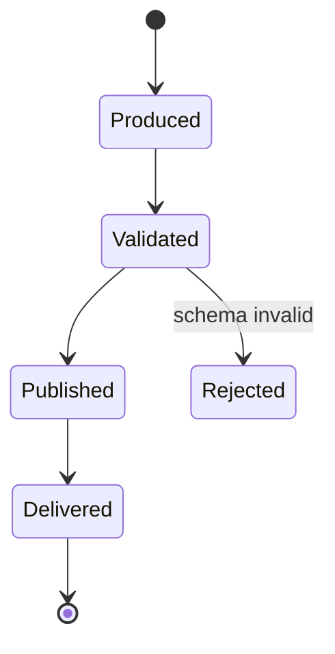
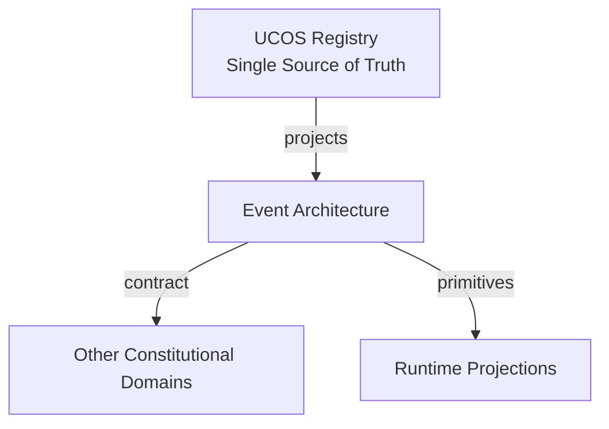
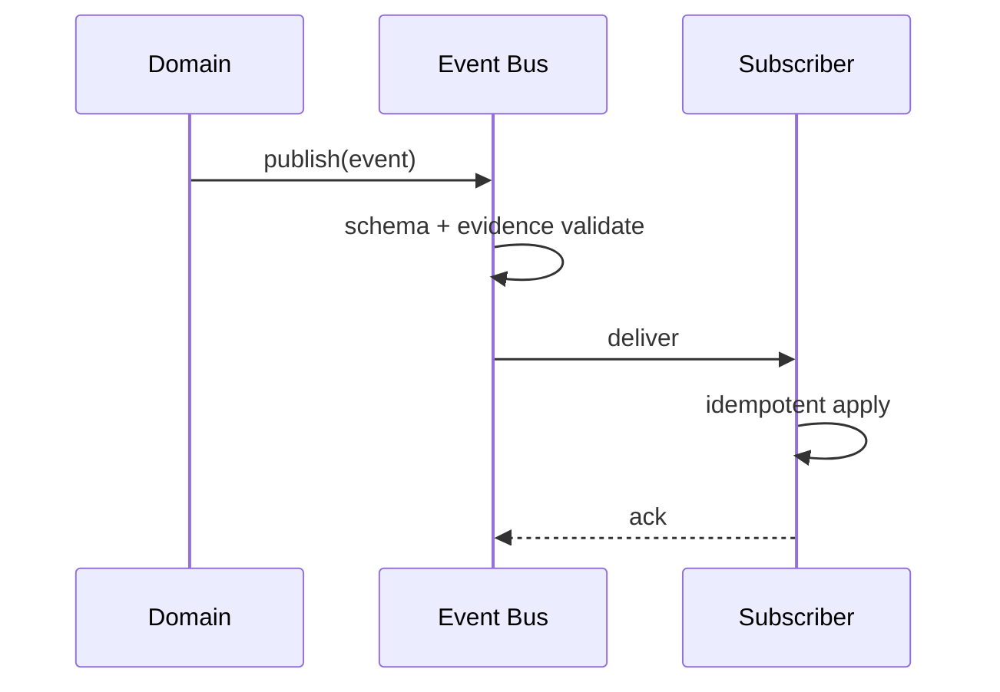
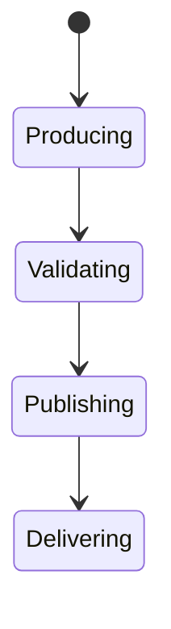
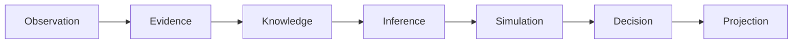
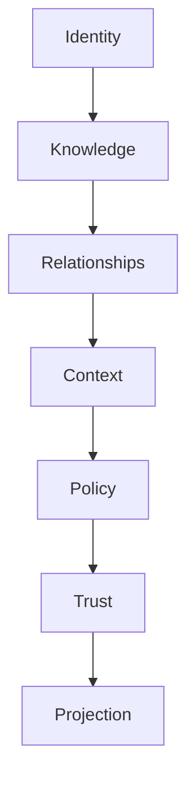

# UCOS-EVT-000001
# Event Architecture

**Version:** Ω∞.1  |  **Status:** Constitutional Artifact  |  **Authority:** UCOS Ω∞ Constitutional Authority
**Category:** Data  |  **Source of Truth:** `_registry/` (projected, never hand-authored)

> Constitutional notice: this document is a **projection**. Its truth lives in the registry. Editing this document directly violates Law 002 (Knowledge Once).

---

## 1. Executive Summary

**UCOS-EVT-000001 — Event Architecture**

This artifact is a constitutionally governed, implementation-ready specification projected from the _UCOS Registry_ single source of truth.
It conforms to the _Immutable Primitive Registry_ (27 frozen primitives) and the _Canonical Terminology Registry_ (31 governed terms).
It contains no hardcoded business, industry, currency, country, or commerce concepts. All such concepts are runtime projections.

---

## 2. Constitutional Purpose

To define the binding contract for **Event Architecture** such that:
- every concept it names has exactly one owner,
- every capability it exposes has exactly one boundary,
- every boundary is expressed as an explicit contract,
- every contract is enforceable by the Governance Constitution.

---

## 3. Scope

In scope: the primitives, contracts, schemas, events, and policies owned by **Event Architecture**.
In scope: the projection rules by which this domain exposes its truth to other domains.
In scope: the verification obligations this domain must satisfy before activation.

---

## 4. Out of Scope

Out of scope: any concept owned by another constitutional domain.
Out of scope: business, industry, commerce, country, currency, or language content (all projected).
Out of scope: mutation of another domain’s internal state.

---

## 5. Definitions

All terms in this artifact are used in their canonical sense as defined in the Canonical Terminology Registry.
Where a term appears, its `termId` is normative and its `prohibitedMeanings` are void.

---

## 6. Canonical Terminology

| Term | Canonical Definition | Owner | Prohibited Meanings |
|---|---|---|---|
| Existence | Anything that may exist. | Universal Existence Kernel | business meaning, commercial meaning, operational meaning |
| Entity | Technical representation of an Existence Object. | Identity Domain | existence itself |
| Knowledge | Interpreted information with evidence and meaning. | Knowledge Domain | data, information, evidence |
| Data | Raw observations. | Observation Domain | knowledge, meaning |
| Information | Organized data. | Observation Domain | knowledge |
| Evidence | Proof supporting an assertion. | Evidence Domain | knowledge, trust |
| Trust | Computed confidence in an assertion, derived from evidence. | Trust Domain | evidence, faith |
| Meaning | Semantic interpretation; higher-level understanding. | Semantic Domain | classification, taxonomy, ontology |
| Ontology | What exists. | Semantic Domain | taxonomy, classification |
| Taxonomy | How things are classified. | Semantic Domain | ontology, meaning |
| Classification | Assignment into taxonomy. | Semantic Domain | meaning |
| Relationship | Connection between objects. | Relationship Domain | causality |

---

## 7. Ownership Boundaries

Ownership is recorded in the _Domain Ownership Registry_.

---

## 8. Domain Responsibilities

See the Domain Ownership Registry for the authoritative responsibility list.

---

## 9. Domain Non-Responsibilities

See the Domain Ownership Registry.

---

## 10. Concepts

Event Architecture is the platform's nervous system — every state change is an immutable, evidenced, well-schema'd event. Events are how domains communicate without coupling; they are the only legitimate cross-domain broadcast.

---

## 11. Ontology

Event has a Type (registry), a Payload (schema-versioned), a Causation id, a Correlation id, an Authority, and Evidence. Events are facts that occurred — immutable once published.

---

## 12. Taxonomy

By scope: Domain / Cross-domain / Platform / External. By delivery: At-least-once / Exactly-once (projected) / Best-effort. By tempo: Real-time / Batched / Scheduled.

---

## 13. Registries

This domain is registry-driven. Its registries are entries in the Universal Registry System:

```yaml
RegistryEntry:
  registryId: UCOS-REG-DOMAIN
  owner: Constitutional Authority
  law: Knowledge Once — each concept defined exactly once
```

---

## 14. Data Model

```yaml
Event:
  eventId: <Identity>
  eventType: <registry id>
  schemaVersion: <version>
  payload: <schema-validated>
  causationId: <Event|null>
  correlationId: <Identity>
  authority: <Authority>
  evidence: <Evidence ref>
  temporal: {at}
  context: <Context>
```

---

## 15. Graph Model

(:Event)-[:CAUSED_BY]->(:Event); (:Event)-[:PUBLISHED_BY]->(:Domain); (:Event)-[:SCHEMA_FROM]->(:RegistryEntry); (:Event)-[:EVIDENCED_BY]->(:Evidence)

---

## 16. Schemas

```yaml
# Canonical projection schema for UCOS-EVT-000001
ucos_evt_000001:
  identity:      <Identity primitive>
  intent:        <Intent primitive>
  meaning:       <Meaning primitive>
  knowledge:     <Knowledge primitive>
  registry:      <Registry primitive>
  relationship:  <Relationship primitive>
  context:       <Context primitive>
  policy:        <Policy primitive>
  authority:     <Authority primitive>
  evidence:      <Evidence primitive>
  trust:         <Trust primitive>
  temporal:      <Time primitive>
  metadata:      <Metadata primitive>
```

---

## 17. Contracts

```yaml
DomainContract:
  domain: Event Architecture
  commands:   []   # registry-driven
  queries:    []   # registry-driven
  events:     []   # registry-driven
  policies:   []   # registry-driven
  permissions: []  # registry-driven
```

Contract law: domains never directly access another domain’s internal structures.

---

## 18. APIs

POST /event.v1.publish,GET  /event.v1/{id},POST /event.v1.subscribe,GET  /event.v1.replay

---

## 19. Events

EventPublished,EventSchemaChanged,EventReplayed,SubscriptionCreated

---

## 20. Commands

event.publish,event.subscribe,event.replay,event.compact

---

## 21. Queries

event.byId,event.byType,event.byCorrelation,event.timeline

---

## 22. State Machines



---

## 23. Workflows

produce → validate against registry schema → attach evidence + authority → publish → deliver to subscribers → retain per policy

---

## 24. Policies

```yaml
Policy:
  identity: <Identity>
  conditions: []   # registry-driven
  actions:    []   # registry-driven
  priorities: []   # registry-driven
  exceptions: []   # registry-driven
```

All behavior derives from policy. Policy ≠ Rule: policy is behavioral governance; the rule is its executable projection.

---

## 25. Rules

```yaml
Rule:
  ruleId: <Identity>
  derivedFrom: <Policy identity>
  executable: true
  constraint: <registry expression>
```

---

## 26. Authorities

Publishing domain's authority; subscribers verify, never trust.

---

## 27. Permissions

event.publish (domain, its own types only),event.subscribe (authenticated, topic-scoped),event.replay (governance)

---

## 28. Security Model

Zero Trust applies: no implicit trust between domains, services, agents, or tenants.
Every call is authenticated, authorized against Policy, and evidenced.
Cryptographic identity is issued by the Identity Domain; keys by the Key Management Architecture.

---

## 29. Privacy Model

Event payloads minimize personal data; sensitive types carry consent scope and are redactable in projections, never in the log itself.

---

## 30. Trust Model

Trust is computed, never assumed. Inputs: evidence, authority, consistency, provenance, confidence.
```yaml
Trust:
  evidenceScore: <0..1>
  authorityScore: <0..1>
  consistencyScore: <0..1>
  provenanceScore: <0..1>
  confidenceScore: <0..1>
```

---

## 31. Audit Model

The event log is the audit spine — causation chains reconstruct any state of the system at any time.

---

## 32. Observability Model

Every action emits: What happened? Why? Who authorized it? Which policy allowed it? What evidence supports it? What confidence exists? What alternatives were evaluated?
These are the seven Explainability questions and are mandatory event fields.

---

## 33. Digital Twin Model

Event twin monitors throughput, schema-rejection rates, and subscriber lag as platform health.

---

## 34. Agent Model

Event agents detect anomalies in event flows (drops, surges, schema drift) and alert.

---

## 35. Runtime Model

At-least-once delivery with idempotent consumers; exactly-once is projected at the consumer via dedup keys.

---

## 36. Scaling Model

Partition by event type + correlation hash; replay is a first-class operation for recovery.

---

## 37. Multi-Tenant Model

Events are tenant-namespaced; cross-tenant subscription requires published relationship and policy.

---

## 38. Geo-Distribution Model

Event logs reside in the publishing domain's jurisdiction; cross-region replication respects residency.

---

## 39. Failure Model

Schema rejection storm, subscriber lag, causation cycle, replay divergence.

---

## 40. Recovery Model

Replay rebuilds any projection; the log is the recovery source. Compaction preserves causation, never facts.

---

## 41. Verification Model

Before activation, Event Architecture must pass identity, knowledge, relationship, context, policy, authority, trust, and reality integrity checks.
Verification is performed by the Formal Verification Architecture (UCOS-FML-000001).

---

## 42. Certification Model

Event must carry schema version, authority, and evidence to be published — unverifiable events are rejected.

---

## 43. Migration Model

New types are registry additions; schema evolution is versioned with backward-compatible readers.

---

## 44. Evolution Model

Evolution is governed and history-preserving. Primitives are frozen; extension occurs through registries, policies, capabilities, contexts, relationships, knowledge, agents, and projections — never through primitive expansion.

---

## 45. Implementation Blueprint

Build order for EVT: (1) define registry entries — this domain owns by scope: domain / cross-domain / platform / external as registry truth, not code; (2) implement the contract surface first (event.publish, event.subscribe, event.replay) and validate against EVT boundaries; (3) event-source all state so history is reconstructable; (4) wire the enforcement points — authority check, policy guard, evidence binding, trace — in-line, with no bypass path; (5) add tests per the Testing Architecture, citing evidence per gate; (6) obtain Verification and Certification before activation. Acceptance: the Zero Partial and Law 001 audits pass, every action answers the seven explainability questions, and this domain mutates no other domain internals.

---

## 46. Reference Architecture Diagram



---

## 47. Sequence Diagrams



---

## 48. State Diagrams



---

## 49. Data Flow Diagrams



---

## 50. Dependency Maps



Forbidden: circular dependencies, mutual ownership, cross-domain state mutation.

---

## ∞

Constitutionally governed. Implementation ready. Universally extensible.