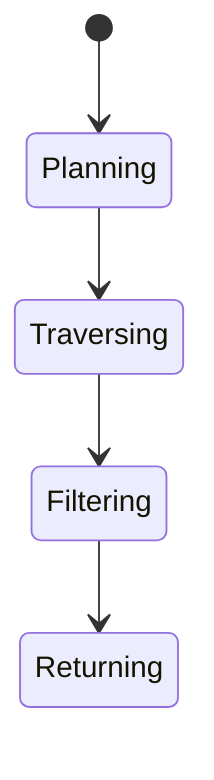
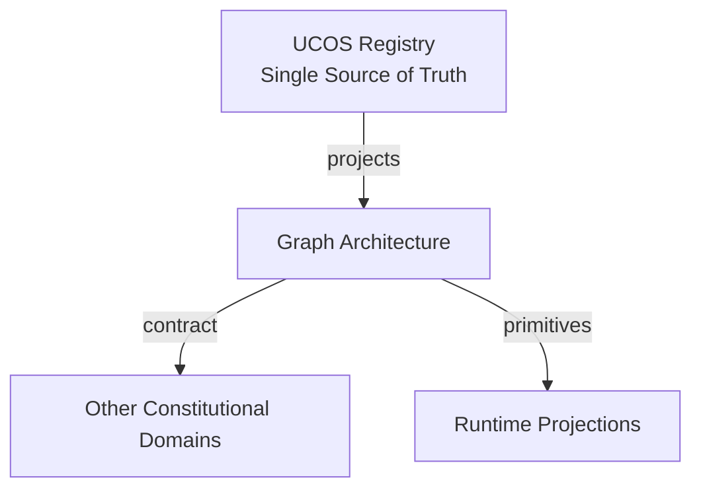
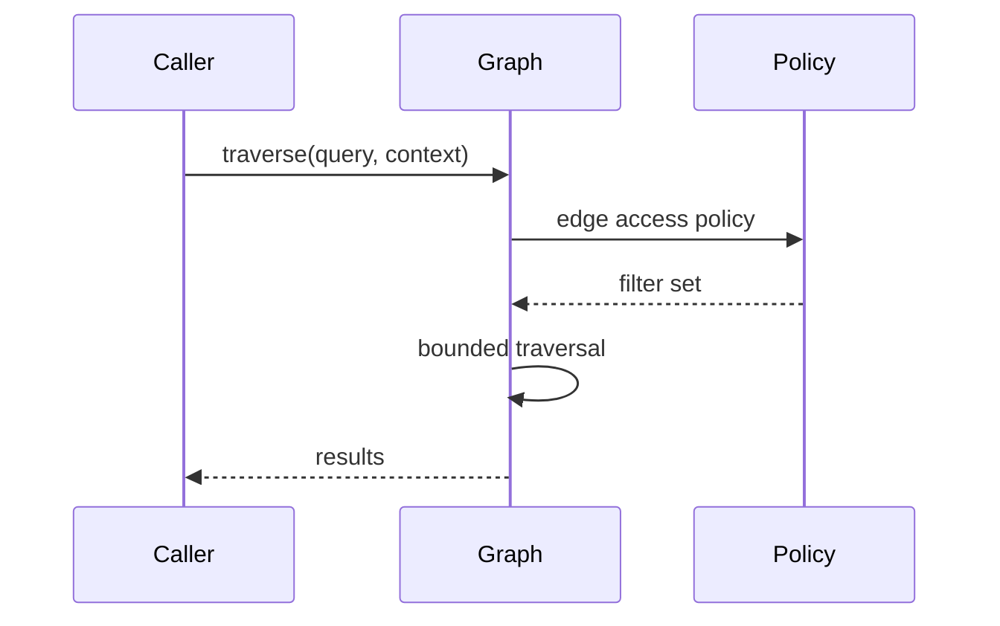
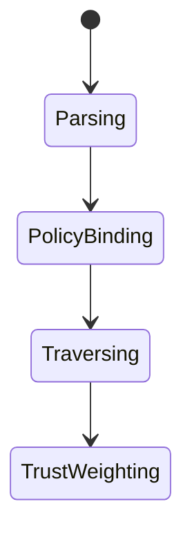
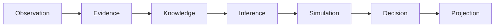
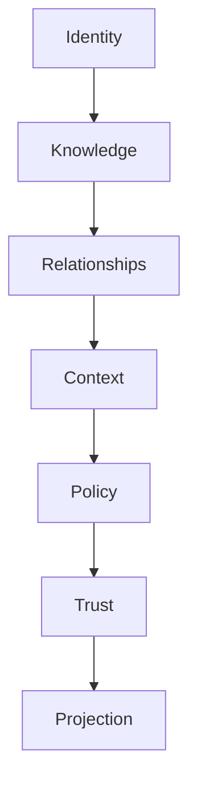

# UCOS-GRF-000001
# Graph Architecture

**Version:** Ω∞.1  |  **Status:** Constitutional Artifact  |  **Authority:** UCOS Ω∞ Constitutional Authority
**Category:** Data  |  **Source of Truth:** `_registry/` (projected, never hand-authored)

> Constitutional notice: this document is a **projection**. Its truth lives in the registry. Editing this document directly violates Law 002 (Knowledge Once).

---

## 1. Executive Summary

**UCOS-GRF-000001 — Graph Architecture**

This artifact is a constitutionally governed, implementation-ready specification projected from the _UCOS Registry_ single source of truth.
It conforms to the _Immutable Primitive Registry_ (27 frozen primitives) and the _Canonical Terminology Registry_ (31 governed terms).
It contains no hardcoded business, industry, currency, country, or commerce concepts. All such concepts are runtime projections.

---

## 2. Constitutional Purpose

To define the binding contract for **Graph Architecture** such that:
- every concept it names has exactly one owner,
- every capability it exposes has exactly one boundary,
- every boundary is expressed as an explicit contract,
- every contract is enforceable by the Governance Constitution.

---

## 3. Scope

In scope: the primitives, contracts, schemas, events, and policies owned by **Graph Architecture**.
In scope: the projection rules by which this domain exposes its truth to other domains.
In scope: the verification obligations this domain must satisfy before activation.

---

## 4. Out of Scope

Out of scope: any concept owned by another constitutional domain.
Out of scope: business, industry, commerce, country, currency, or language content (all projected).
Out of scope: mutation of another domain’s internal state.

---

## 5. Definitions

All terms in this artifact are used in their canonical sense as defined in the Canonical Terminology Registry.
Where a term appears, its `termId` is normative and its `prohibitedMeanings` are void.

---

## 6. Canonical Terminology

| Term | Canonical Definition | Owner | Prohibited Meanings |
|---|---|---|---|
| Existence | Anything that may exist. | Universal Existence Kernel | business meaning, commercial meaning, operational meaning |
| Entity | Technical representation of an Existence Object. | Identity Domain | existence itself |
| Knowledge | Interpreted information with evidence and meaning. | Knowledge Domain | data, information, evidence |
| Data | Raw observations. | Observation Domain | knowledge, meaning |
| Information | Organized data. | Observation Domain | knowledge |
| Evidence | Proof supporting an assertion. | Evidence Domain | knowledge, trust |
| Trust | Computed confidence in an assertion, derived from evidence. | Trust Domain | evidence, faith |
| Meaning | Semantic interpretation; higher-level understanding. | Semantic Domain | classification, taxonomy, ontology |
| Ontology | What exists. | Semantic Domain | taxonomy, classification |
| Taxonomy | How things are classified. | Semantic Domain | ontology, meaning |
| Classification | Assignment into taxonomy. | Semantic Domain | meaning |
| Relationship | Connection between objects. | Relationship Domain | causality |

---

## 7. Ownership Boundaries

Ownership is recorded in the _Domain Ownership Registry_.

---

## 8. Domain Responsibilities

See the Domain Ownership Registry for the authoritative responsibility list.

---

## 9. Domain Non-Responsibilities

See the Domain Ownership Registry.

---

## 10. Concepts

Graph Architecture is the native shape of the platform — reality emerges through relationships. The graph stores primitives and their relationships; everything queryable about reality is a traversal.

---

## 11. Ontology

Graph has Nodes (primitives/projections) and Edges (typed, contextualized, temporal). Traversal is context-filtered and trust-weighted. The graph is the substrate for Relationship, Causality, Discovery, and Emergence.

---

## 12. Taxonomy

By content: Primitive-graph / Projection-graph / Meta-graph. By traversal: Local / Multi-hop / Global-pattern. By store: Native-graph / Relational-emulated / Distributed.

---

## 13. Registries

This domain is registry-driven. Its registries are entries in the Universal Registry System:

```yaml
RegistryEntry:
  registryId: UCOS-REG-DOMAIN
  owner: Constitutional Authority
  law: Knowledge Once — each concept defined exactly once
```

---

## 14. Data Model

```yaml
GraphPartition:
  partitionId: <Identity>
  shardKey: <registry expression>
  nodes: <count>
  edges: <count>
  traversalPolicy: <Policy>
  residency: <Context>
  version: <int>
```

---

## 15. Graph Model

(:Graph)-[:SHARDED_BY]->(:Expression); (:Graph)-[:TRAVERSED_PER]->(:Policy); (:Graph)-[:REPLICATED_TO]->(:Graph); (:Graph)-[:RESIDES_IN]->(:Context)

---

## 16. Schemas

```yaml
# Canonical projection schema for UCOS-GRF-000001
ucos_grf_000001:
  identity:      <Identity primitive>
  intent:        <Intent primitive>
  meaning:       <Meaning primitive>
  knowledge:     <Knowledge primitive>
  registry:      <Registry primitive>
  relationship:  <Relationship primitive>
  context:       <Context primitive>
  policy:        <Policy primitive>
  authority:     <Authority primitive>
  evidence:      <Evidence primitive>
  trust:         <Trust primitive>
  temporal:      <Time primitive>
  metadata:      <Metadata primitive>
```

---

## 17. Contracts

```yaml
DomainContract:
  domain: Graph Architecture
  commands:   []   # registry-driven
  queries:    []   # registry-driven
  events:     []   # registry-driven
  policies:   []   # registry-driven
  permissions: []  # registry-driven
```

Contract law: domains never directly access another domain’s internal structures.

---

## 18. APIs

POST /graph.v1.traverse,POST /graph.v1.neighbors,GET  /graph.v1.path,POST /graph.v1.pattern

---

## 19. Events

TraversalExecuted,HotspotDetected,PartitionRebalanced,GraphVersionChanged

---

## 20. Commands

graph.traverse,graph.neighbors,graph.path,graph.pattern.match,graph.rebalance

---

## 21. Queries

graph.byId,graph.neighbors,graph.path,graph.pattern,graph.density

---

## 22. State Machines



---

## 23. Workflows

parse query → plan traversal under policy → execute with context filter → trust-weight results → return

---

## 24. Policies

```yaml
Policy:
  identity: <Identity>
  conditions: []   # registry-driven
  actions:    []   # registry-driven
  priorities: []   # registry-driven
  exceptions: []   # registry-driven
```

All behavior derives from policy. Policy ≠ Rule: policy is behavioral governance; the rule is its executable projection.

---

## 25. Rules

```yaml
Rule:
  ruleId: <Identity>
  derivedFrom: <Policy identity>
  executable: true
  constraint: <registry expression>
```

---

## 26. Authorities

Graph Authority (infrastructure); traversal policy enforces each domain's access contract.

---

## 27. Permissions

graph.traverse (context-scoped, edge-policy-checked),graph.read (domain-scoped nodes),graph.admin (graph authority)

---

## 28. Security Model

Zero Trust applies: no implicit trust between domains, services, agents, or tenants.
Every call is authenticated, authorized against Policy, and evidenced.
Cryptographic identity is issued by the Identity Domain; keys by the Key Management Architecture.

---

## 29. Privacy Model

Sensitive edges are filtered at traversal — never returned then hidden. Hidden-edge traversal attempts are logged.

---

## 30. Trust Model

Trust is computed, never assumed. Inputs: evidence, authority, consistency, provenance, confidence.
```yaml
Trust:
  evidenceScore: <0..1>
  authorityScore: <0..1>
  consistencyScore: <0..1>
  provenanceScore: <0..1>
  confidenceScore: <0..1>
```

---

## 31. Audit Model

Every traversal records the query, context, policies applied, and edge count — the basis of data-access audit.

---

## 32. Observability Model

Every action emits: What happened? Why? Who authorized it? Which policy allowed it? What evidence supports it? What confidence exists? What alternatives were evaluated?
These are the seven Explainability questions and are mandatory event fields.

---

## 33. Digital Twin Model

Graph twin monitors degree distribution and hotspot formation as structural health.

---

## 34. Agent Model

Discovery agents traverse for inference; every traversal is policy-checked like any other access.

---

## 35. Runtime Model

Traversal is bounded by policy hop-limit and trust floor; hot vertices are served from projections.

---

## 36. Scaling Model

Sharded by source-node hash; multi-hop traversals are bounded and parallel across shards.

---

## 37. Multi-Tenant Model

Edges never cross tenants implicitly; cross-tenant edges are explicit published relationships.

---

## 38. Geo-Distribution Model

Graph residency follows node sovereignty; replicas are read-only and policy-filtered.

---

## 39. Failure Model

Hotspot overload, traversal timeout, edge-type drift, orphaned nodes.

---

## 40. Recovery Model

The graph is rebuilt from the Relationship Domain's append-only log — it is a projection, never primary truth.

---

## 41. Verification Model

Before activation, Graph Architecture must pass identity, knowledge, relationship, context, policy, authority, trust, and reality integrity checks.
Verification is performed by the Formal Verification Architecture (UCOS-FML-000001).

---

## 42. Certification Model

Traversal must prove policy enforcement on every edge touched — no bypass, no post-filter leak.

---

## 43. Migration Model

New edge types are registry additions; the graph re-indexes without downtime.

---

## 44. Evolution Model

Evolution is governed and history-preserving. Primitives are frozen; extension occurs through registries, policies, capabilities, contexts, relationships, knowledge, agents, and projections — never through primitive expansion.

---

## 45. Implementation Blueprint

Build order for GRF: (1) define registry entries — this domain owns by content: primitive-graph / projection-graph / meta-graph as registry truth, not code; (2) implement the contract surface first (graph.traverse, graph.neighbors, graph.path) and validate against GRF boundaries; (3) event-source all state so history is reconstructable; (4) wire the enforcement points — authority check, policy guard, evidence binding, trace — in-line, with no bypass path; (5) add tests per the Testing Architecture, citing evidence per gate; (6) obtain Verification and Certification before activation. Acceptance: the Zero Partial and Law 001 audits pass, every action answers the seven explainability questions, and this domain mutates no other domain internals.

---

## 46. Reference Architecture Diagram



---

## 47. Sequence Diagrams



---

## 48. State Diagrams



---

## 49. Data Flow Diagrams



---

## 50. Dependency Maps



Forbidden: circular dependencies, mutual ownership, cross-domain state mutation.

---

## ∞

Constitutionally governed. Implementation ready. Universally extensible.