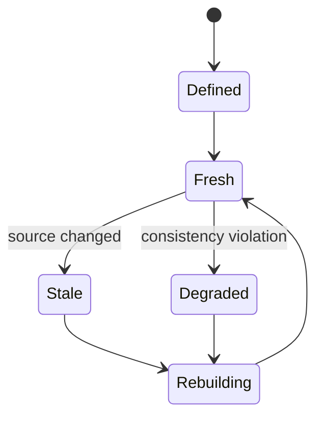
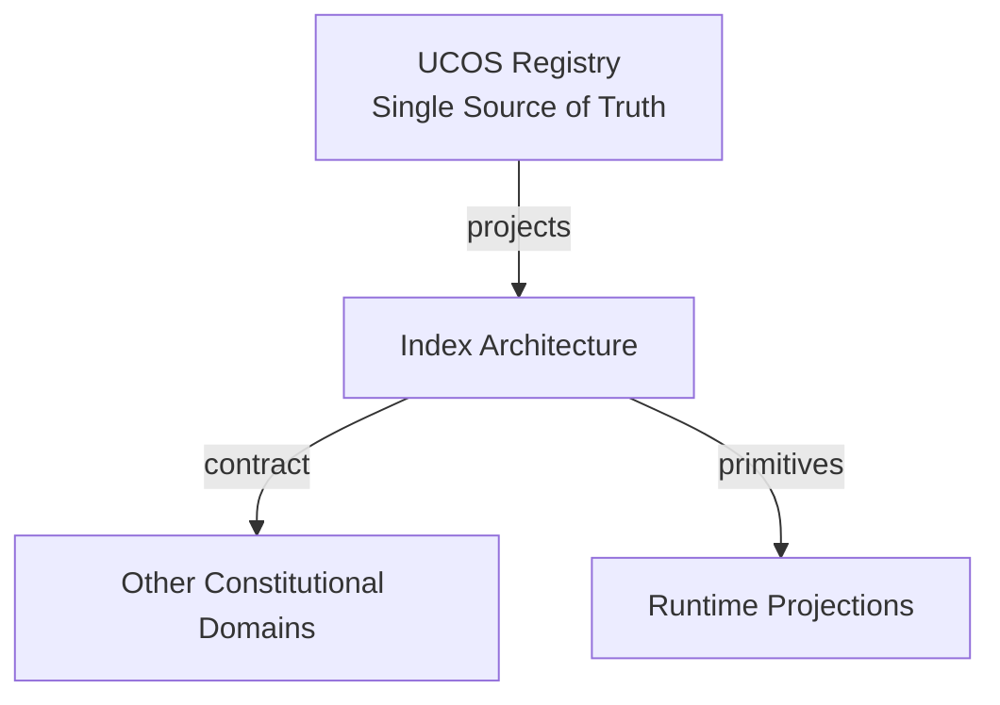
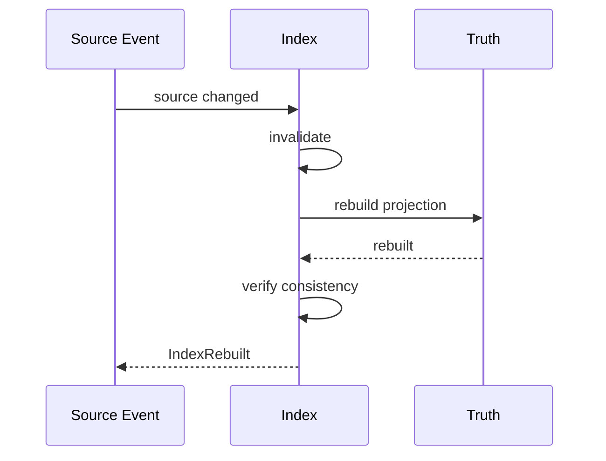
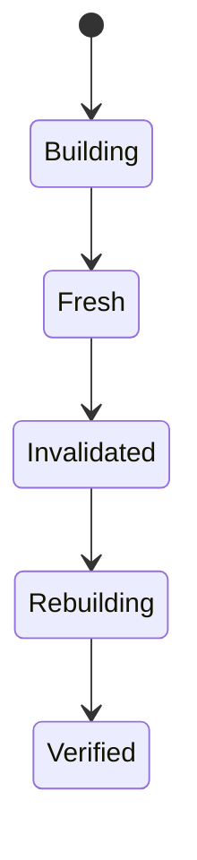
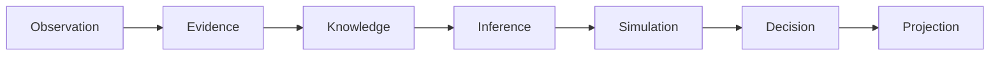
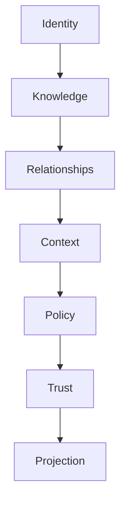

# UCOS-IDX-000001
# Index Architecture

**Version:** Ω∞.1  |  **Status:** Constitutional Artifact  |  **Authority:** UCOS Ω∞ Constitutional Authority
**Category:** Data  |  **Source of Truth:** `_registry/` (projected, never hand-authored)

> Constitutional notice: this document is a **projection**. Its truth lives in the registry. Editing this document directly violates Law 002 (Knowledge Once).

---

## 1. Executive Summary

**UCOS-IDX-000001 — Index Architecture**

This artifact is a constitutionally governed, implementation-ready specification projected from the _UCOS Registry_ single source of truth.
It conforms to the _Immutable Primitive Registry_ (27 frozen primitives) and the _Canonical Terminology Registry_ (31 governed terms).
It contains no hardcoded business, industry, currency, country, or commerce concepts. All such concepts are runtime projections.

---

## 2. Constitutional Purpose

To define the binding contract for **Index Architecture** such that:
- every concept it names has exactly one owner,
- every capability it exposes has exactly one boundary,
- every boundary is expressed as an explicit contract,
- every contract is enforceable by the Governance Constitution.

---

## 3. Scope

In scope: the primitives, contracts, schemas, events, and policies owned by **Index Architecture**.
In scope: the projection rules by which this domain exposes its truth to other domains.
In scope: the verification obligations this domain must satisfy before activation.

---

## 4. Out of Scope

Out of scope: any concept owned by another constitutional domain.
Out of scope: business, industry, commerce, country, currency, or language content (all projected).
Out of scope: mutation of another domain’s internal state.

---

## 5. Definitions

All terms in this artifact are used in their canonical sense as defined in the Canonical Terminology Registry.
Where a term appears, its `termId` is normative and its `prohibitedMeanings` are void.

---

## 6. Canonical Terminology

| Term | Canonical Definition | Owner | Prohibited Meanings |
|---|---|---|---|
| Existence | Anything that may exist. | Universal Existence Kernel | business meaning, commercial meaning, operational meaning |
| Entity | Technical representation of an Existence Object. | Identity Domain | existence itself |
| Knowledge | Interpreted information with evidence and meaning. | Knowledge Domain | data, information, evidence |
| Data | Raw observations. | Observation Domain | knowledge, meaning |
| Information | Organized data. | Observation Domain | knowledge |
| Evidence | Proof supporting an assertion. | Evidence Domain | knowledge, trust |
| Trust | Computed confidence in an assertion, derived from evidence. | Trust Domain | evidence, faith |
| Meaning | Semantic interpretation; higher-level understanding. | Semantic Domain | classification, taxonomy, ontology |
| Ontology | What exists. | Semantic Domain | taxonomy, classification |
| Taxonomy | How things are classified. | Semantic Domain | ontology, meaning |
| Classification | Assignment into taxonomy. | Semantic Domain | meaning |
| Relationship | Connection between objects. | Relationship Domain | causality |

---

## 7. Ownership Boundaries

Ownership is recorded in the _Domain Ownership Registry_.

---

## 8. Domain Responsibilities

See the Domain Ownership Registry for the authoritative responsibility list.

---

## 9. Domain Non-Responsibilities

See the Domain Ownership Registry.

---

## 10. Concepts

Index Architecture makes the platform queryable at scale. Indexes are derived projections — rebuilt from truth, never authoritative — and their consistency with the source is continuously verified.

---

## 11. Ontology

Index has a Source (domain truth), a Projection function, a Consistency model, and a Rebuild policy. An index that diverges from truth is a defect, not an optimization.

---

## 12. Taxonomy

By structure: Inverted / B-tree / Hash / Graph / Vector / Hybrid. By consistency: Strong / Eventually / Snapshot. By trigger: Real-time / Batch / Scheduled.

---

## 13. Registries

This domain is registry-driven. Its registries are entries in the Universal Registry System:

```yaml
RegistryEntry:
  registryId: UCOS-REG-DOMAIN
  owner: Constitutional Authority
  law: Knowledge Once — each concept defined exactly once
```

---

## 14. Data Model

```yaml
Index:
  indexId: <Identity>
  source: <domain partition>
  projectionFn: <registry expression>
  consistencyModel: <registry id>
  rebuildPolicy: <Policy>
  state: <Fresh|Stale|Rebuilding|Degraded>
  version: <int>
```

---

## 15. Graph Model

(:Index)-[:DERIVED_FROM]->(:Partition); (:Index)-[:REBUILT_PER]->(:Policy); (:Index)-[:CONSISTENT_WITH]->(:Partition); (:Index)-[:SERVES]->(:Query)

---

## 16. Schemas

```yaml
# Canonical projection schema for UCOS-IDX-000001
ucos_idx_000001:
  identity:      <Identity primitive>
  intent:        <Intent primitive>
  meaning:       <Meaning primitive>
  knowledge:     <Knowledge primitive>
  registry:      <Registry primitive>
  relationship:  <Relationship primitive>
  context:       <Context primitive>
  policy:        <Policy primitive>
  authority:     <Authority primitive>
  evidence:      <Evidence primitive>
  trust:         <Trust primitive>
  temporal:      <Time primitive>
  metadata:      <Metadata primitive>
```

---

## 17. Contracts

```yaml
DomainContract:
  domain: Index Architecture
  commands:   []   # registry-driven
  queries:    []   # registry-driven
  events:     []   # registry-driven
  policies:   []   # registry-driven
  permissions: []  # registry-driven
```

Contract law: domains never directly access another domain’s internal structures.

---

## 18. APIs

POST /index.v1.define,GET  /index.v1/{id},POST /index.v1.rebuild,GET  /index.v1.consistency/{id}

---

## 19. Events

IndexChanged,IndexRebuilt,IndexInvalidated,ConsistencyViolation,IndexDegraded

---

## 20. Commands

index.define,index.rebuild,index.invalidate,index.drop

---

## 21. Queries

index.byId,index.consistency,index.lag,index.coverage

---

## 22. State Machines



---

## 23. Workflows

define projection → build → invalidate on source change → rebuild per policy → verify consistency

---

## 24. Policies

```yaml
Policy:
  identity: <Identity>
  conditions: []   # registry-driven
  actions:    []   # registry-driven
  priorities: []   # registry-driven
  exceptions: []   # registry-driven
```

All behavior derives from policy. Policy ≠ Rule: policy is behavioral governance; the rule is its executable projection.

---

## 25. Rules

```yaml
Rule:
  ruleId: <Identity>
  derivedFrom: <Policy identity>
  executable: true
  constraint: <registry expression>
```

---

## 26. Authorities

Index Authority (infrastructure); projection function must respect domain access contracts.

---

## 27. Permissions

index.define (index authority),index.rebuild (system),index.read (query-scoped, still policy-checked)

---

## 28. Security Model

Zero Trust applies: no implicit trust between domains, services, agents, or tenants.
Every call is authenticated, authorized against Policy, and evidenced.
Cryptographic identity is issued by the Identity Domain; keys by the Key Management Architecture.

---

## 29. Privacy Model

Indexes over personal data inherit consent scope at build time — no index of unseen data.

---

## 30. Trust Model

Trust is computed, never assumed. Inputs: evidence, authority, consistency, provenance, confidence.
```yaml
Trust:
  evidenceScore: <0..1>
  authorityScore: <0..1>
  consistencyScore: <0..1>
  provenanceScore: <0..1>
  confidenceScore: <0..1>
```

---

## 31. Audit Model

Consistency verification is continuous; violations are events with source and index versions recorded.

---

## 32. Observability Model

Every action emits: What happened? Why? Who authorized it? Which policy allowed it? What evidence supports it? What confidence exists? What alternatives were evaluated?
These are the seven Explainability questions and are mandatory event fields.

---

## 33. Digital Twin Model

Index twin monitors lag and rebuild success rates across the fleet.

---

## 34. Agent Model

Index agent detects query patterns and proposes new indexes, and flags unused ones for retirement.

---

## 35. Runtime Model

Invalidation is event-driven from the source domain; queries to stale indexes are served with a staleness marker, never silently.

---

## 36. Scaling Model

Indexes partition alongside their sources; rebuilds are incremental where the projection permits.

---

## 37. Multi-Tenant Model

Indexes are tenant-scoped; a shared index over published data respects each source's policy.

---

## 38. Geo-Distribution Model

Indexes replicate for read locality; the authoritative build stays in the source's jurisdiction.

---

## 39. Failure Model

Consistency violation, rebuild failure, invalidation storm, projection drift after schema evolution.

---

## 40. Recovery Model

Indexes are disposable — a corrupt index is dropped and rebuilt from truth, never repaired in place.

---

## 41. Verification Model

Before activation, Index Architecture must pass identity, knowledge, relationship, context, policy, authority, trust, and reality integrity checks.
Verification is performed by the Formal Verification Architecture (UCOS-FML-000001).

---

## 42. Certification Model

Index must carry a consistency guarantee level and prove verification runs on schedule.

---

## 43. Migration Model

New index types are registry additions; schema evolution triggers governed rebuilds.

---

## 44. Evolution Model

Evolution is governed and history-preserving. Primitives are frozen; extension occurs through registries, policies, capabilities, contexts, relationships, knowledge, agents, and projections — never through primitive expansion.

---

## 45. Implementation Blueprint

Build order for IDX: (1) define registry entries — this domain owns by structure: inverted / b-tree / hash / graph / vector / hybrid as registry truth, not code; (2) implement the contract surface first (index.define, index.rebuild, index.invalidate) and validate against IDX boundaries; (3) event-source all state so history is reconstructable; (4) wire the enforcement points — authority check, policy guard, evidence binding, trace — in-line, with no bypass path; (5) add tests per the Testing Architecture, citing evidence per gate; (6) obtain Verification and Certification before activation. Acceptance: the Zero Partial and Law 001 audits pass, every action answers the seven explainability questions, and this domain mutates no other domain internals.

---

## 46. Reference Architecture Diagram



---

## 47. Sequence Diagrams



---

## 48. State Diagrams



---

## 49. Data Flow Diagrams



---

## 50. Dependency Maps



Forbidden: circular dependencies, mutual ownership, cross-domain state mutation.

---

## ∞

Constitutionally governed. Implementation ready. Universally extensible.