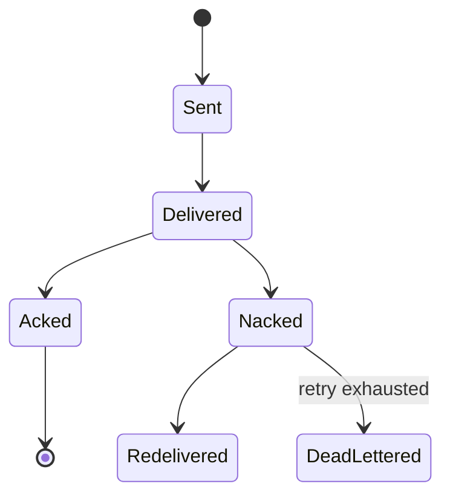
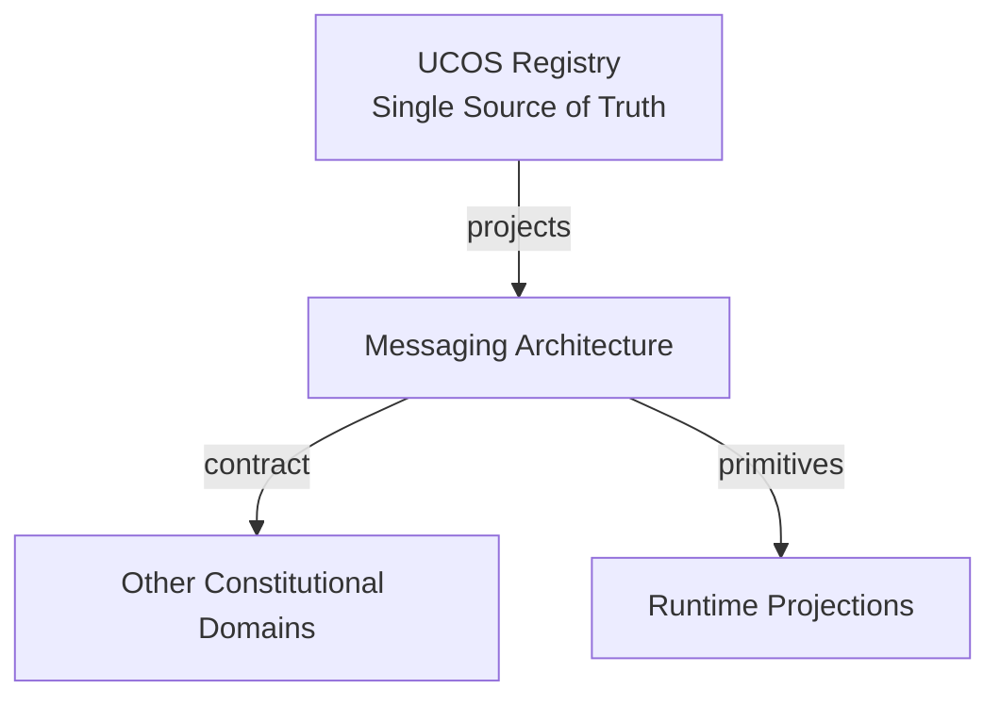
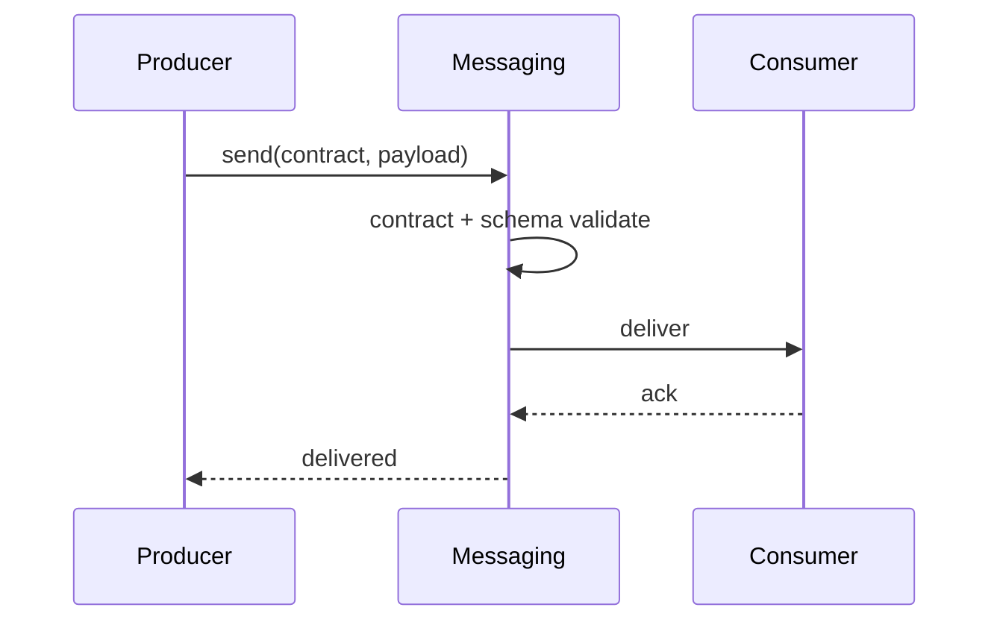
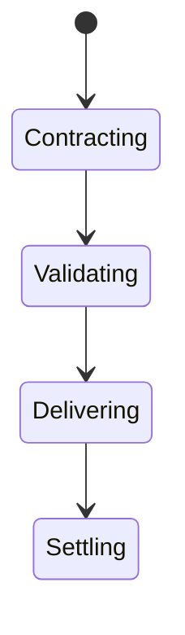
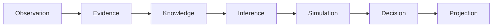
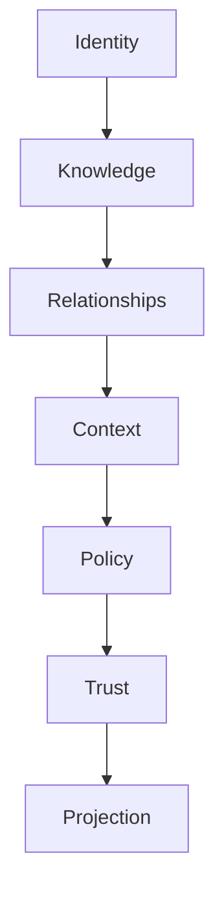

# UCOS-MSG-000001
# Messaging Architecture

**Version:** Ω∞.1  |  **Status:** Constitutional Artifact  |  **Authority:** UCOS Ω∞ Constitutional Authority
**Category:** Data  |  **Source of Truth:** `_registry/` (projected, never hand-authored)

> Constitutional notice: this document is a **projection**. Its truth lives in the registry. Editing this document directly violates Law 002 (Knowledge Once).

---

## 1. Executive Summary

**UCOS-MSG-000001 — Messaging Architecture**

This artifact is a constitutionally governed, implementation-ready specification projected from the _UCOS Registry_ single source of truth.
It conforms to the _Immutable Primitive Registry_ (27 frozen primitives) and the _Canonical Terminology Registry_ (31 governed terms).
It contains no hardcoded business, industry, currency, country, or commerce concepts. All such concepts are runtime projections.

---

## 2. Constitutional Purpose

To define the binding contract for **Messaging Architecture** such that:
- every concept it names has exactly one owner,
- every capability it exposes has exactly one boundary,
- every boundary is expressed as an explicit contract,
- every contract is enforceable by the Governance Constitution.

---

## 3. Scope

In scope: the primitives, contracts, schemas, events, and policies owned by **Messaging Architecture**.
In scope: the projection rules by which this domain exposes its truth to other domains.
In scope: the verification obligations this domain must satisfy before activation.

---

## 4. Out of Scope

Out of scope: any concept owned by another constitutional domain.
Out of scope: business, industry, commerce, country, currency, or language content (all projected).
Out of scope: mutation of another domain’s internal state.

---

## 5. Definitions

All terms in this artifact are used in their canonical sense as defined in the Canonical Terminology Registry.
Where a term appears, its `termId` is normative and its `prohibitedMeanings` are void.

---

## 6. Canonical Terminology

| Term | Canonical Definition | Owner | Prohibited Meanings |
|---|---|---|---|
| Existence | Anything that may exist. | Universal Existence Kernel | business meaning, commercial meaning, operational meaning |
| Entity | Technical representation of an Existence Object. | Identity Domain | existence itself |
| Knowledge | Interpreted information with evidence and meaning. | Knowledge Domain | data, information, evidence |
| Data | Raw observations. | Observation Domain | knowledge, meaning |
| Information | Organized data. | Observation Domain | knowledge |
| Evidence | Proof supporting an assertion. | Evidence Domain | knowledge, trust |
| Trust | Computed confidence in an assertion, derived from evidence. | Trust Domain | evidence, faith |
| Meaning | Semantic interpretation; higher-level understanding. | Semantic Domain | classification, taxonomy, ontology |
| Ontology | What exists. | Semantic Domain | taxonomy, classification |
| Taxonomy | How things are classified. | Semantic Domain | ontology, meaning |
| Classification | Assignment into taxonomy. | Semantic Domain | meaning |
| Relationship | Connection between objects. | Relationship Domain | causality |

---

## 7. Ownership Boundaries

Ownership is recorded in the _Domain Ownership Registry_.

---

## 8. Domain Responsibilities

See the Domain Ownership Registry for the authoritative responsibility list.

---

## 9. Domain Non-Responsibilities

See the Domain Ownership Registry.

---

## 10. Concepts

Messaging Architecture provides reliable, contract-governed communication between domains, services, and external systems. Messaging is the point-to-point complement to events — directed, contracted, and confirmed.

---

## 11. Ontology

Message has a Contract (registry), a Payload, a Delivery guarantee, and a Dead-letter path. Every queue is owned; every topic is governed; no anonymous producers or consumers exist.

---

## 12. Taxonomy

By pattern: Queue / Topic / Stream / Request-reply. By guarantee: At-most-once / At-least-once / Exactly-once-projected. By scope: Intra-domain / Cross-domain / External.

---

## 13. Registries

This domain is registry-driven. Its registries are entries in the Universal Registry System:

```yaml
RegistryEntry:
  registryId: UCOS-REG-DOMAIN
  owner: Constitutional Authority
  law: Knowledge Once — each concept defined exactly once
```

---

## 14. Data Model

```yaml
Message:
  messageId: <Identity>
  contractId: <registry contract>
  payload: <schema-validated>
  deliveryGuarantee: <registry id>
  authority: <Authority>
  temporal: {sentAt, deliveredAt}
  deadLetter: <DeadLetter ref|null>
```

---

## 15. Graph Model

(:Message)-[:CONFORMS_TO]->(:Contract); (:Message)-[:SENT_BY]->(:Domain); (:Message)-[:DELIVERED_TO]->(:Domain); (:Message)-[:DEAD_LETTERED_TO]->(:DeadLetter)

---

## 16. Schemas

```yaml
# Canonical projection schema for UCOS-MSG-000001
ucos_msg_000001:
  identity:      <Identity primitive>
  intent:        <Intent primitive>
  meaning:       <Meaning primitive>
  knowledge:     <Knowledge primitive>
  registry:      <Registry primitive>
  relationship:  <Relationship primitive>
  context:       <Context primitive>
  policy:        <Policy primitive>
  authority:     <Authority primitive>
  evidence:      <Evidence primitive>
  trust:         <Trust primitive>
  temporal:      <Time primitive>
  metadata:      <Metadata primitive>
```

---

## 17. Contracts

```yaml
DomainContract:
  domain: Messaging Architecture
  commands:   []   # registry-driven
  queries:    []   # registry-driven
  events:     []   # registry-driven
  policies:   []   # registry-driven
  permissions: []  # registry-driven
```

Contract law: domains never directly access another domain’s internal structures.

---

## 18. APIs

POST /msg.v1.send,POST /msg.v1.subscribe,GET  /msg.v1/{id},POST /msg.v1.redeliver,GET  /msg.v1.deadletter

---

## 19. Events

MessageSent,MessageDelivered,MessageAcked,MessageDeadLettered,ContractViolation

---

## 20. Commands

msg.send,msg.ack,msg.nack,msg.redeliver,msg.deadletter

---

## 21. Queries

msg.byId,msg.depth,msg.lag,msg.deadletters

---

## 22. State Machines



---

## 23. Workflows

send under contract → validate schema → deliver → ack/nack → redeliver with backoff → dead-letter on exhaustion

---

## 24. Policies

```yaml
Policy:
  identity: <Identity>
  conditions: []   # registry-driven
  actions:    []   # registry-driven
  priorities: []   # registry-driven
  exceptions: []   # registry-driven
```

All behavior derives from policy. Policy ≠ Rule: policy is behavioral governance; the rule is its executable projection.

---

## 25. Rules

```yaml
Rule:
  ruleId: <Identity>
  derivedFrom: <Policy identity>
  executable: true
  constraint: <registry expression>
```

---

## 26. Authorities

Contract Authority (defines allowed interactions); producer and consumer domains each hold authority.

---

## 27. Permissions

msg.send (contract-permitted producer),msg.subscribe (contract-permitted consumer),msg.read (participant)

---

## 28. Security Model

Zero Trust applies: no implicit trust between domains, services, agents, or tenants.
Every call is authenticated, authorized against Policy, and evidenced.
Cryptographic identity is issued by the Identity Domain; keys by the Key Management Architecture.

---

## 29. Privacy Model

Personal-data messages are consent-scoped; dead-letters are purged per retention policy with evidence.

---

## 30. Trust Model

Trust is computed, never assumed. Inputs: evidence, authority, consistency, provenance, confidence.
```yaml
Trust:
  evidenceScore: <0..1>
  authorityScore: <0..1>
  consistencyScore: <0..1>
  provenanceScore: <0..1>
  confidenceScore: <0..1>
```

---

## 31. Audit Model

Every message records contract version, authority, and delivery path — integration audit is complete.

---

## 32. Observability Model

Every action emits: What happened? Why? Who authorized it? Which policy allowed it? What evidence supports it? What confidence exists? What alternatives were evaluated?
These are the seven Explainability questions and are mandatory event fields.

---

## 33. Digital Twin Model

Messaging twin monitors depth, lag, and dead-letter rates across all contracts.

---

## 34. Agent Model

Messaging agent detects contract drift and poison-message patterns, proposing contract fixes under governance.

---

## 35. Runtime Model

Consumers are idempotent by contract requirement; backoff is exponential with jitter; dead-letters alert.

---

## 36. Scaling Model

Partitions by contract; consumers scale per queue depth with policy bounds.

---

## 37. Multi-Tenant Model

Queues are tenant-namespaced; cross-tenant messaging requires a published contract and both authorities.

---

## 38. Geo-Distribution Model

Cross-region messaging respects residency; external egress is policy-governed and audited.

---

## 39. Failure Model

Poison message, contract violation, consumer starvation, dead-letter overflow.

---

## 40. Recovery Model

Dead-letters are replayable after governed fix; acked messages are immutable facts.

---

## 41. Verification Model

Before activation, Messaging Architecture must pass identity, knowledge, relationship, context, policy, authority, trust, and reality integrity checks.
Verification is performed by the Formal Verification Architecture (UCOS-FML-000001).

---

## 42. Certification Model

Contract must exist and both parties must be authorized — unsigned traffic is dropped at the edge.

---

## 43. Migration Model

New contracts are registry additions; contract evolution is versioned with compatibility windows.

---

## 44. Evolution Model

Evolution is governed and history-preserving. Primitives are frozen; extension occurs through registries, policies, capabilities, contexts, relationships, knowledge, agents, and projections — never through primitive expansion.

---

## 45. Implementation Blueprint

Build order for MSG: (1) define registry entries — this domain owns by pattern: queue / topic / stream / request-reply as registry truth, not code; (2) implement the contract surface first (msg.send, msg.ack, msg.nack) and validate against MSG boundaries; (3) event-source all state so history is reconstructable; (4) wire the enforcement points — authority check, policy guard, evidence binding, trace — in-line, with no bypass path; (5) add tests per the Testing Architecture, citing evidence per gate; (6) obtain Verification and Certification before activation. Acceptance: the Zero Partial and Law 001 audits pass, every action answers the seven explainability questions, and this domain mutates no other domain internals.

---

## 46. Reference Architecture Diagram



---

## 47. Sequence Diagrams



---

## 48. State Diagrams



---

## 49. Data Flow Diagrams



---

## 50. Dependency Maps



Forbidden: circular dependencies, mutual ownership, cross-domain state mutation.

---

## ∞

Constitutionally governed. Implementation ready. Universally extensible.