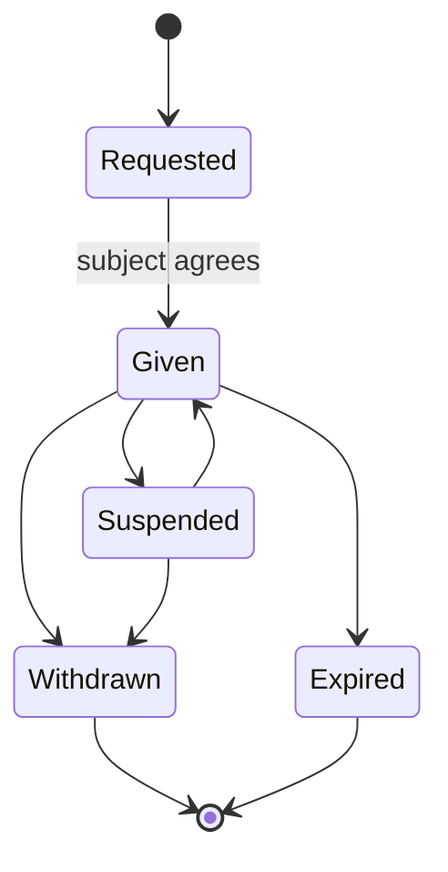
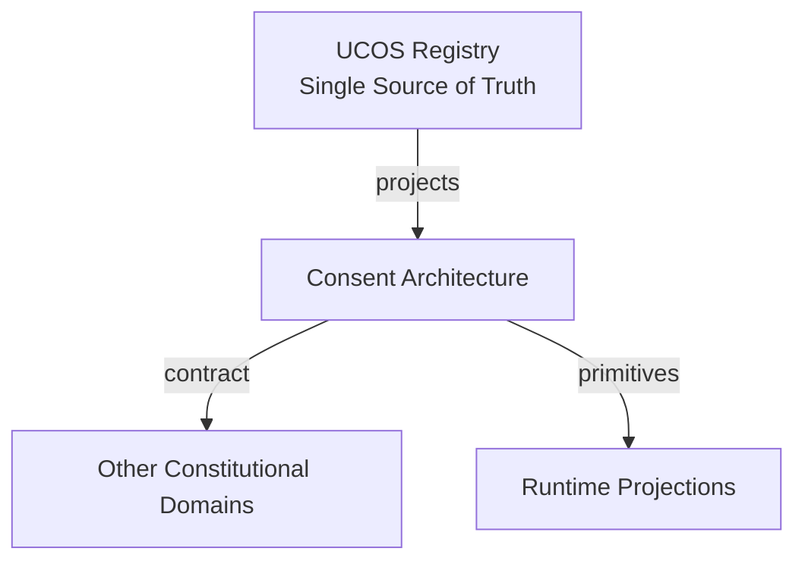
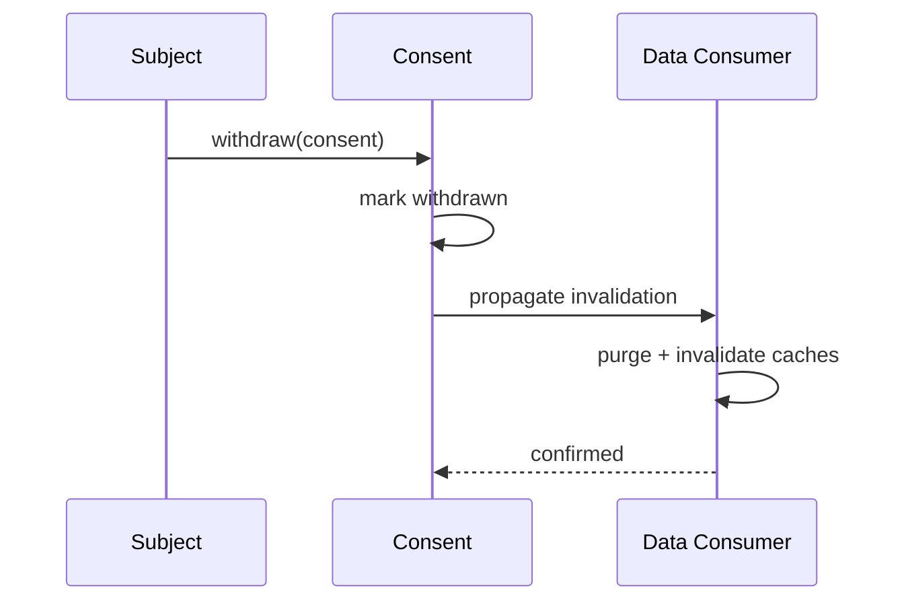
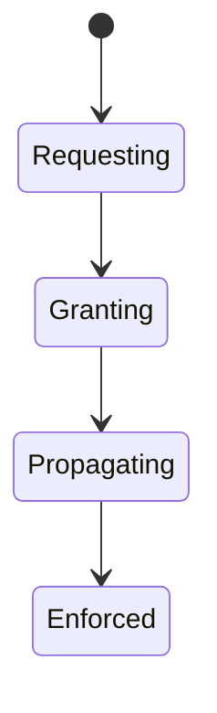
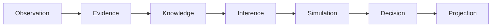
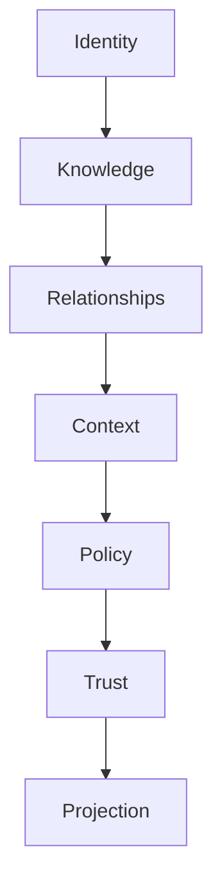

# UCOS-CNS-000001
# Consent Architecture

**Version:** Ω∞.1  |  **Status:** Constitutional Artifact  |  **Authority:** UCOS Ω∞ Constitutional Authority
**Category:** Security  |  **Source of Truth:** `_registry/` (projected, never hand-authored)

> Constitutional notice: this document is a **projection**. Its truth lives in the registry. Editing this document directly violates Law 002 (Knowledge Once).

---

## 1. Executive Summary

**UCOS-CNS-000001 — Consent Architecture**

This artifact is a constitutionally governed, implementation-ready specification projected from the _UCOS Registry_ single source of truth.
It conforms to the _Immutable Primitive Registry_ (27 frozen primitives) and the _Canonical Terminology Registry_ (31 governed terms).
It contains no hardcoded business, industry, currency, country, or commerce concepts. All such concepts are runtime projections.

---

## 2. Constitutional Purpose

To define the binding contract for **Consent Architecture** such that:
- every concept it names has exactly one owner,
- every capability it exposes has exactly one boundary,
- every boundary is expressed as an explicit contract,
- every contract is enforceable by the Governance Constitution.

---

## 3. Scope

In scope: the primitives, contracts, schemas, events, and policies owned by **Consent Architecture**.
In scope: the projection rules by which this domain exposes its truth to other domains.
In scope: the verification obligations this domain must satisfy before activation.

---

## 4. Out of Scope

Out of scope: any concept owned by another constitutional domain.
Out of scope: business, industry, commerce, country, currency, or language content (all projected).
Out of scope: mutation of another domain’s internal state.

---

## 5. Definitions

All terms in this artifact are used in their canonical sense as defined in the Canonical Terminology Registry.
Where a term appears, its `termId` is normative and its `prohibitedMeanings` are void.

---

## 6. Canonical Terminology

| Term | Canonical Definition | Owner | Prohibited Meanings |
|---|---|---|---|
| Existence | Anything that may exist. | Universal Existence Kernel | business meaning, commercial meaning, operational meaning |
| Entity | Technical representation of an Existence Object. | Identity Domain | existence itself |
| Knowledge | Interpreted information with evidence and meaning. | Knowledge Domain | data, information, evidence |
| Data | Raw observations. | Observation Domain | knowledge, meaning |
| Information | Organized data. | Observation Domain | knowledge |
| Evidence | Proof supporting an assertion. | Evidence Domain | knowledge, trust |
| Trust | Computed confidence in an assertion, derived from evidence. | Trust Domain | evidence, faith |
| Meaning | Semantic interpretation; higher-level understanding. | Semantic Domain | classification, taxonomy, ontology |
| Ontology | What exists. | Semantic Domain | taxonomy, classification |
| Taxonomy | How things are classified. | Semantic Domain | ontology, meaning |
| Classification | Assignment into taxonomy. | Semantic Domain | meaning |
| Relationship | Connection between objects. | Relationship Domain | causality |

---

## 7. Ownership Boundaries

Ownership is recorded in the _Domain Ownership Registry_.

---

## 8. Domain Responsibilities

See the Domain Ownership Registry for the authoritative responsibility list.

---

## 9. Domain Non-Responsibilities

See the Domain Ownership Registry.

---

## 10. Concepts

Consent Architecture makes personal-data use a governed, revocable, auditable grant — not a clause. Consent is a first-class object with scope, purpose, duration, and a one-action revocation path.

---

## 11. Ontology

Consent has a Subject (person), a Scope (data classes), a Purpose, a Grantee, a Duration, and a State. Consent scopes chain: withdrawn consent invalidates everything downstream, immediately and automatically.

---

## 12. Taxonomy

By basis: Opt-in / Contract / Legal-obligation / Vital-interest / Legitimate-interest-governed. By scope: Broad / Purpose-specific / Narrow. By state: Given / Suspended / Withdrawn / Expired.

---

## 13. Registries

This domain is registry-driven. Its registries are entries in the Universal Registry System:

```yaml
RegistryEntry:
  registryId: UCOS-REG-DOMAIN
  owner: Constitutional Authority
  law: Knowledge Once — each concept defined exactly once
```

---

## 14. Data Model

```yaml
Consent:
  consentId: <Identity>
  subject: <Identity>
  scope: [<registry data class>]
  purpose: <registry id>
  grantee: <Identity>
  basis: <registry id>
  temporal: {givenAt, expiresAt}
  state: <Given|Suspended|Withdrawn|Expired>
  lineage: {derivedFrom: <Consent|null>}
```

---

## 15. Graph Model

(:Consent)-[:GRANTED_BY]->(:Identity); (:Consent)-[:SCOPES]->(:DataClass); (:Consent)-[:FOR_PURPOSE]->(:Purpose); (:Consent)-[:DERIVED_FROM]->(:Consent)

---

## 16. Schemas

```yaml
# Canonical projection schema for UCOS-CNS-000001
ucos_cns_000001:
  identity:      <Identity primitive>
  intent:        <Intent primitive>
  meaning:       <Meaning primitive>
  knowledge:     <Knowledge primitive>
  registry:      <Registry primitive>
  relationship:  <Relationship primitive>
  context:       <Context primitive>
  policy:        <Policy primitive>
  authority:     <Authority primitive>
  evidence:      <Evidence primitive>
  trust:         <Trust primitive>
  temporal:      <Time primitive>
  metadata:      <Metadata primitive>
```

---

## 17. Contracts

```yaml
DomainContract:
  domain: Consent Architecture
  commands:   []   # registry-driven
  queries:    []   # registry-driven
  events:     []   # registry-driven
  policies:   []   # registry-driven
  permissions: []  # registry-driven
```

Contract law: domains never directly access another domain’s internal structures.

---

## 18. APIs

POST /consent.v1.give,POST /consent.v1.withdraw,GET  /consent.v1/{id},GET  /consent.v1.bySubject/{subjectId},POST /consent.v1.check

---

## 19. Events

ConsentGiven,ConsentWithdrawn,ConsentSuspended,ConsentExpired,ConsentPropagated

---

## 20. Commands

consent.give,consent.withdraw,consent.suspend,consent.check,consent.propagate

---

## 21. Queries

consent.bySubject,consent.byGrantee,consent.active,consent.history,consent.audit

---

## 22. State Machines



---

## 23. Workflows

request with purpose + scope → subject grants → propagate to all consumers → withdrawal cascades immediately → verify before every use

---

## 24. Policies

```yaml
Policy:
  identity: <Identity>
  conditions: []   # registry-driven
  actions:    []   # registry-driven
  priorities: []   # registry-driven
  exceptions: []   # registry-driven
```

All behavior derives from policy. Policy ≠ Rule: policy is behavioral governance; the rule is its executable projection.

---

## 25. Rules

```yaml
Rule:
  ruleId: <Identity>
  derivedFrom: <Policy identity>
  executable: true
  constraint: <registry expression>
```

---

## 26. Authorities

Subject's own authority is supreme over their consent — no platform authority overrides withdrawal.

---

## 27. Permissions

consent.give (subject),consent.withdraw (subject),consent.check (any consumer, per-use),consent.read (subject + governance)

---

## 28. Security Model

Zero Trust applies: no implicit trust between domains, services, agents, or tenants.
Every call is authenticated, authorized against Policy, and evidenced.
Cryptographic identity is issued by the Identity Domain; keys by the Key Management Architecture.

---

## 29. Privacy Model

Consent IS the privacy control — purpose limitation is enforced at check time, not in policy prose.

---

## 30. Trust Model

Trust is computed, never assumed. Inputs: evidence, authority, consistency, provenance, confidence.
```yaml
Trust:
  evidenceScore: <0..1>
  authorityScore: <0..1>
  consistencyScore: <0..1>
  provenanceScore: <0..1>
  confidenceScore: <0..1>
```

---

## 31. Audit Model

Every grant and withdrawal is logged with scope, purpose, and basis. Use-without-consent is a logged violation, not an error.

---

## 32. Observability Model

Every action emits: What happened? Why? Who authorized it? Which policy allowed it? What evidence supports it? What confidence exists? What alternatives were evaluated?
These are the seven Explainability questions and are mandatory event fields.

---

## 33. Digital Twin Model

Consent twin monitors expiry waves and withdrawal-propagation latency as privacy-health signals.

---

## 34. Agent Model

Consent agent detects scope creep (use beyond granted purpose) and flags it for governance.

---

## 35. Runtime Model

Checks are in-line before personal-data use; withdrawal invalidates caches and projections downstream.

---

## 36. Scaling Model

Check is the hot path — cached per (subject, grantee, purpose) with event-driven invalidation on withdrawal.

---

## 37. Multi-Tenant Model

Consent is subject-scoped, binding on all tenants holding the subject's data.

---

## 38. Geo-Distribution Model

Consent follows the subject's jurisdiction — withdrawal propagates globally regardless of data location.

---

## 39. Failure Model

Withdrawal propagation gap, scope ambiguity, expiry storm, missing basis.

---

## 40. Recovery Model

Withdrawal is immediate and complete — any delayed propagation is treated as a violation with remediation.

---

## 41. Verification Model

Before activation, Consent Architecture must pass identity, knowledge, relationship, context, policy, authority, trust, and reality integrity checks.
Verification is performed by the Formal Verification Architecture (UCOS-FML-000001).

---

## 42. Certification Model

Every personal-data use must cite a valid consent or legal basis — uncited use fails certification.

---

## 43. Migration Model

New purposes and bases are registry additions.

---

## 44. Evolution Model

Evolution is governed and history-preserving. Primitives are frozen; extension occurs through registries, policies, capabilities, contexts, relationships, knowledge, agents, and projections — never through primitive expansion.

---

## 45. Implementation Blueprint

Build order for CNS: (1) define registry entries — this domain owns by basis: opt-in / contract / legal-obligation / vital-interest / legitimate-interest-governed as registry truth, not code; (2) implement the contract surface first (consent.give, consent.withdraw, consent.suspend) and validate against CNS boundaries; (3) event-source all state so history is reconstructable; (4) wire the enforcement points — authority check, policy guard, evidence binding, trace — in-line, with no bypass path; (5) add tests per the Testing Architecture, citing evidence per gate; (6) obtain Verification and Certification before activation. Acceptance: the Zero Partial and Law 001 audits pass, every action answers the seven explainability questions, and this domain mutates no other domain internals.

---

## 46. Reference Architecture Diagram



---

## 47. Sequence Diagrams



---

## 48. State Diagrams



---

## 49. Data Flow Diagrams



---

## 50. Dependency Maps



Forbidden: circular dependencies, mutual ownership, cross-domain state mutation.

---

## ∞

Constitutionally governed. Implementation ready. Universally extensible.