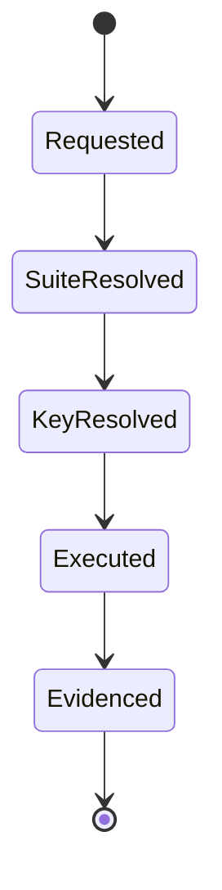
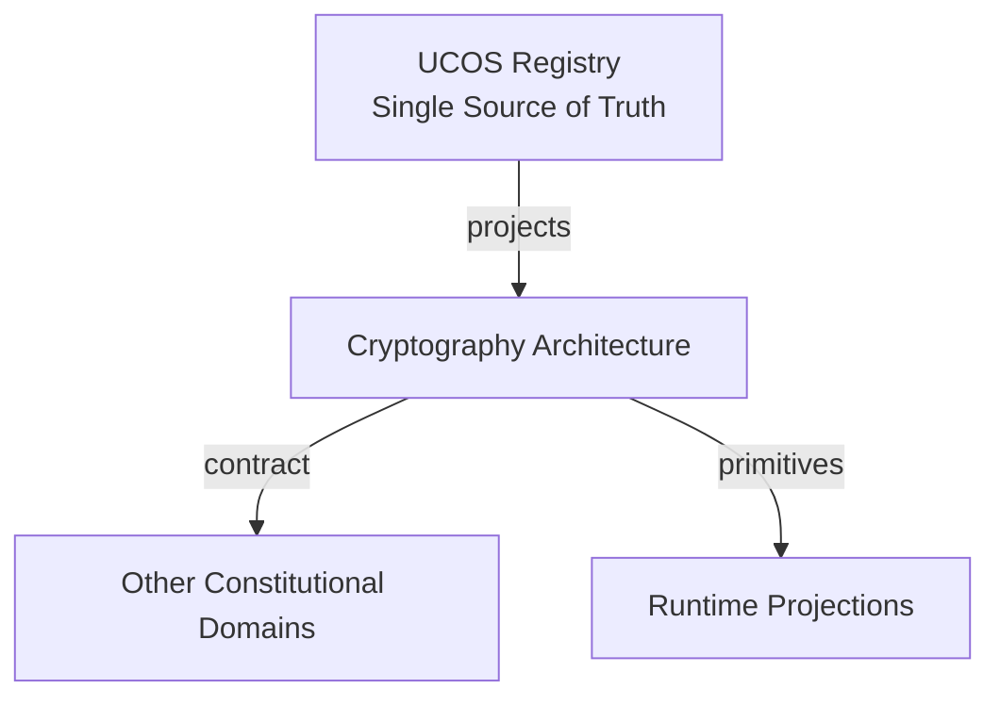
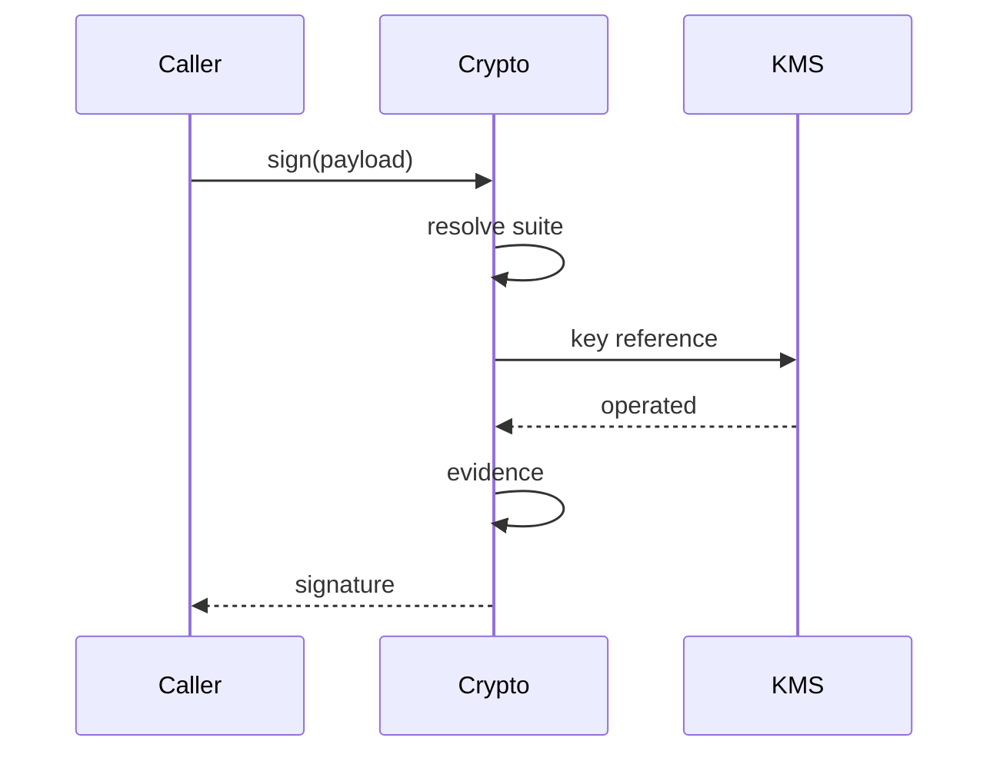
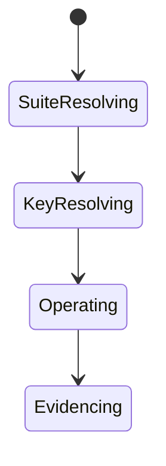
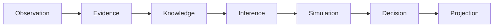
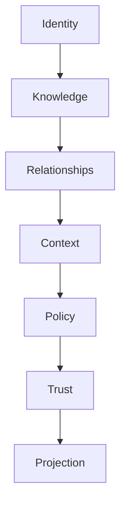

# UCOS-CRY-000001
# Cryptography Architecture

**Version:** Ω∞.1  |  **Status:** Constitutional Artifact  |  **Authority:** UCOS Ω∞ Constitutional Authority
**Category:** Security  |  **Source of Truth:** `_registry/` (projected, never hand-authored)

> Constitutional notice: this document is a **projection**. Its truth lives in the registry. Editing this document directly violates Law 002 (Knowledge Once).

---

## 1. Executive Summary

**UCOS-CRY-000001 — Cryptography Architecture**

This artifact is a constitutionally governed, implementation-ready specification projected from the _UCOS Registry_ single source of truth.
It conforms to the _Immutable Primitive Registry_ (27 frozen primitives) and the _Canonical Terminology Registry_ (31 governed terms).
It contains no hardcoded business, industry, currency, country, or commerce concepts. All such concepts are runtime projections.

---

## 2. Constitutional Purpose

To define the binding contract for **Cryptography Architecture** such that:
- every concept it names has exactly one owner,
- every capability it exposes has exactly one boundary,
- every boundary is expressed as an explicit contract,
- every contract is enforceable by the Governance Constitution.

---

## 3. Scope

In scope: the primitives, contracts, schemas, events, and policies owned by **Cryptography Architecture**.
In scope: the projection rules by which this domain exposes its truth to other domains.
In scope: the verification obligations this domain must satisfy before activation.

---

## 4. Out of Scope

Out of scope: any concept owned by another constitutional domain.
Out of scope: business, industry, commerce, country, currency, or language content (all projected).
Out of scope: mutation of another domain’s internal state.

---

## 5. Definitions

All terms in this artifact are used in their canonical sense as defined in the Canonical Terminology Registry.
Where a term appears, its `termId` is normative and its `prohibitedMeanings` are void.

---

## 6. Canonical Terminology

| Term | Canonical Definition | Owner | Prohibited Meanings |
|---|---|---|---|
| Existence | Anything that may exist. | Universal Existence Kernel | business meaning, commercial meaning, operational meaning |
| Entity | Technical representation of an Existence Object. | Identity Domain | existence itself |
| Knowledge | Interpreted information with evidence and meaning. | Knowledge Domain | data, information, evidence |
| Data | Raw observations. | Observation Domain | knowledge, meaning |
| Information | Organized data. | Observation Domain | knowledge |
| Evidence | Proof supporting an assertion. | Evidence Domain | knowledge, trust |
| Trust | Computed confidence in an assertion, derived from evidence. | Trust Domain | evidence, faith |
| Meaning | Semantic interpretation; higher-level understanding. | Semantic Domain | classification, taxonomy, ontology |
| Ontology | What exists. | Semantic Domain | taxonomy, classification |
| Taxonomy | How things are classified. | Semantic Domain | ontology, meaning |
| Classification | Assignment into taxonomy. | Semantic Domain | meaning |
| Relationship | Connection between objects. | Relationship Domain | causality |

---

## 7. Ownership Boundaries

Ownership is recorded in the _Domain Ownership Registry_.

---

## 8. Domain Responsibilities

See the Domain Ownership Registry for the authoritative responsibility list.

---

## 9. Domain Non-Responsibilities

See the Domain Ownership Registry.

---

## 10. Concepts

Cryptography Architecture provides the mathematical foundations: confidentiality, integrity, authenticity, non-repudiation. Cryptographic agility is constitutional — algorithms are registry entries, not constants, so the platform re-keys and re-algorithms without redesign.

---

## 11. Ontology

Cryptography has Algorithm suites (registry), Key references (never raw keys), Operations (sign/verify/encrypt/decrypt/hash/kdf/mac), and Agility policy (rotation schedule, sunset triggers).

---

## 12. Taxonomy

By purpose: Signing / Encryption / Hashing / KDF / MAC / Key-agreement / Zero-knowledge. By agility: Fixed-schedule / Event-triggered / Quantum-ready. By scope: Platform / Tenant / Context.

---

## 13. Registries

This domain is registry-driven. Its registries are entries in the Universal Registry System:

```yaml
RegistryEntry:
  registryId: UCOS-REG-DOMAIN
  owner: Constitutional Authority
  law: Knowledge Once — each concept defined exactly once
```

---

## 14. Data Model

```yaml
CryptoOperation:
  opId: <Identity>
  operation: <registry id>
  algorithmSuite: <registry id, versioned>
  keyRef: <KMS reference, never raw>
  inputRef: <content-addressed>
  outputRef: <content-addressed>
  temporal: {at}
  evidence: <Evidence>
```

---

## 15. Graph Model

(:Operation)-[:USES_SUITE]->(:AlgorithmSuite); (:Operation)-[:REFERENCES]->(:Key); (:Suite)-[:SUNSET_PER]->(:Policy); (:Operation)-[:EVIDENCED_BY]->(:Evidence)

---

## 16. Schemas

```yaml
# Canonical projection schema for UCOS-CRY-000001
ucos_cry_000001:
  identity:      <Identity primitive>
  intent:        <Intent primitive>
  meaning:       <Meaning primitive>
  knowledge:     <Knowledge primitive>
  registry:      <Registry primitive>
  relationship:  <Relationship primitive>
  context:       <Context primitive>
  policy:        <Policy primitive>
  authority:     <Authority primitive>
  evidence:      <Evidence primitive>
  trust:         <Trust primitive>
  temporal:      <Time primitive>
  metadata:      <Metadata primitive>
```

---

## 17. Contracts

```yaml
DomainContract:
  domain: Cryptography Architecture
  commands:   []   # registry-driven
  queries:    []   # registry-driven
  events:     []   # registry-driven
  policies:   []   # registry-driven
  permissions: []  # registry-driven
```

Contract law: domains never directly access another domain’s internal structures.

---

## 18. APIs

POST /crypto.v1.sign,POST /crypto.v1.verify,POST /crypto.v1.encrypt,POST /crypto.v1.decrypt,POST /crypto.v1.hash,GET  /crypto.v1.algorithms

---

## 19. Events

CryptoOperation,KeyRotated,AlgorithmSunset,VerificationFailed,CryptoViolation

---

## 20. Commands

crypto.sign,crypto.verify,crypto.encrypt,crypto.decrypt,crypto.hash,crypto.rotate

---

## 21. Queries

crypto.algorithms,crypto.suites,crypto.operations,crypto.sunsets

---

## 22. State Machines



---

## 23. Workflows

resolve suite from registry → resolve key reference → execute → record evidence → never expose raw key material

---

## 24. Policies

```yaml
Policy:
  identity: <Identity>
  conditions: []   # registry-driven
  actions:    []   # registry-driven
  priorities: []   # registry-driven
  exceptions: []   # registry-driven
```

All behavior derives from policy. Policy ≠ Rule: policy is behavioral governance; the rule is its executable projection.

---

## 25. Rules

```yaml
Rule:
  ruleId: <Identity>
  derivedFrom: <Policy identity>
  executable: true
  constraint: <registry expression>
```

---

## 26. Authorities

Cryptography Authority (suite governance); keys are held by KMS and referenced, never handled.

---

## 27. Permissions

crypto.sign (key-authorized principal),crypto.verify (any authenticated),crypto.rotate (key authority)

---

## 28. Security Model

Zero Trust applies: no implicit trust between domains, services, agents, or tenants.
Every call is authenticated, authorized against Policy, and evidenced.
Cryptographic identity is issued by the Identity Domain; keys by the Key Management Architecture.

---

## 29. Privacy Model

Encryption is the baseline for personal data at rest and in transit; plaintext personal data must never exist outside an enclave.

---

## 30. Trust Model

Trust is computed, never assumed. Inputs: evidence, authority, consistency, provenance, confidence.
```yaml
Trust:
  evidenceScore: <0..1>
  authorityScore: <0..1>
  consistencyScore: <0..1>
  provenanceScore: <0..1>
  confidenceScore: <0..1>
```

---

## 31. Audit Model

Every operation records suite version, key reference, and result — without ever recording key material.

---

## 32. Observability Model

Every action emits: What happened? Why? Who authorized it? Which policy allowed it? What evidence supports it? What confidence exists? What alternatives were evaluated?
These are the seven Explainability questions and are mandatory event fields.

---

## 33. Digital Twin Model

Cryptography twin monitors algorithm usage distribution and sunset exposure across the fleet.

---

## 34. Agent Model

Cryptography agent detects weak-suite usage and tracks sunset deadlines, driving rotation under governance.

---

## 35. Runtime Model

Operations are stateless and content-addressed; raw keys never enter process memory outside the KMS boundary.

---

## 36. Scaling Model

Signing/verification are the hot path — batched and hardware-accelerated where available.

---

## 37. Multi-Tenant Model

Keys are tenant-isolated in KMS; cryptographic separation is a boundary, not an assumption.

---

## 38. Geo-Distribution Model

Key residency follows data residency; cross-region crypto respects sovereignty (e.g., sovereign-key requirements).

---

## 39. Failure Model

Suite deprecation, key compromise, verification failure storm, agility gap.

---

## 40. Recovery Model

Compromise triggers governed rotation + re-signing of affected content-addressed artifacts.

---

## 41. Verification Model

Before activation, Cryptography Architecture must pass identity, knowledge, relationship, context, policy, authority, trust, and reality integrity checks.
Verification is performed by the Formal Verification Architecture (UCOS-FML-000001).

---

## 42. Certification Model

Every suite in use must be registry-approved and not sunset; raw-key exposure is a critical certification failure.

---

## 43. Migration Model

Agility is the point — new suites are registry additions, and rotation is a scheduled, not emergency, act.

---

## 44. Evolution Model

Evolution is governed and history-preserving. Primitives are frozen; extension occurs through registries, policies, capabilities, contexts, relationships, knowledge, agents, and projections — never through primitive expansion.

---

## 45. Implementation Blueprint

Build order for CRY: (1) define registry entries — this domain owns by purpose: signing / encryption / hashing / kdf / mac / key-agreement / zero-knowledge as registry truth, not code; (2) implement the contract surface first (crypto.sign, crypto.verify, crypto.encrypt) and validate against CRY boundaries; (3) event-source all state so history is reconstructable; (4) wire the enforcement points — authority check, policy guard, evidence binding, trace — in-line, with no bypass path; (5) add tests per the Testing Architecture, citing evidence per gate; (6) obtain Verification and Certification before activation. Acceptance: the Zero Partial and Law 001 audits pass, every action answers the seven explainability questions, and this domain mutates no other domain internals.

---

## 46. Reference Architecture Diagram



---

## 47. Sequence Diagrams



---

## 48. State Diagrams



---

## 49. Data Flow Diagrams



---

## 50. Dependency Maps



Forbidden: circular dependencies, mutual ownership, cross-domain state mutation.

---

## ∞

Constitutionally governed. Implementation ready. Universally extensible.