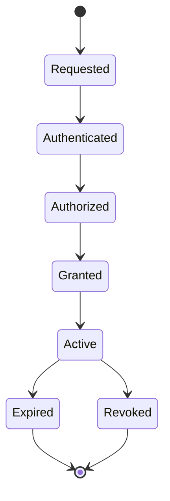
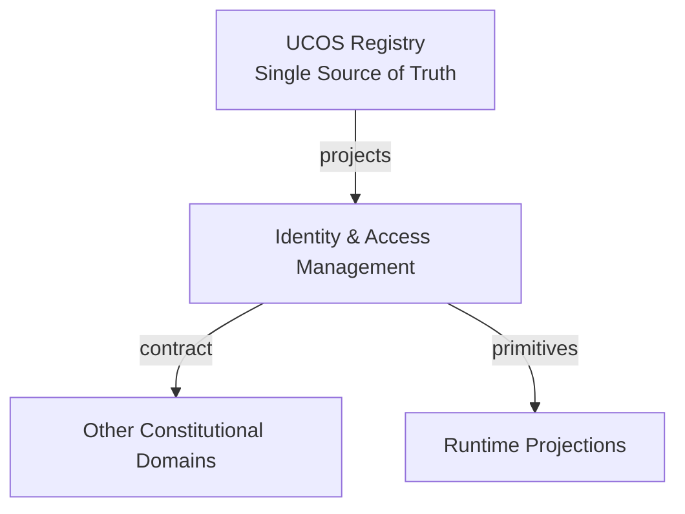
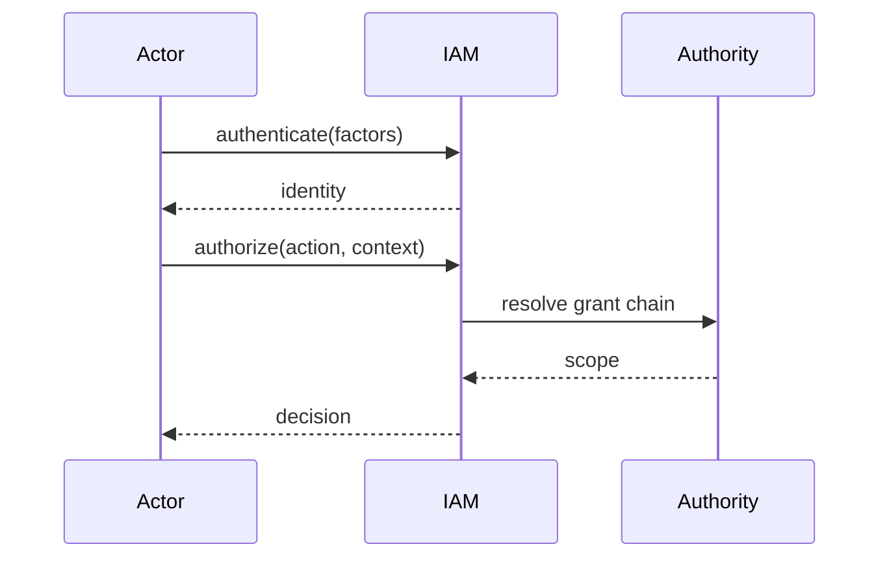
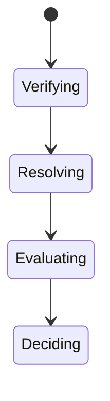
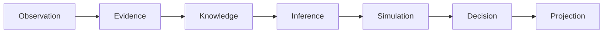
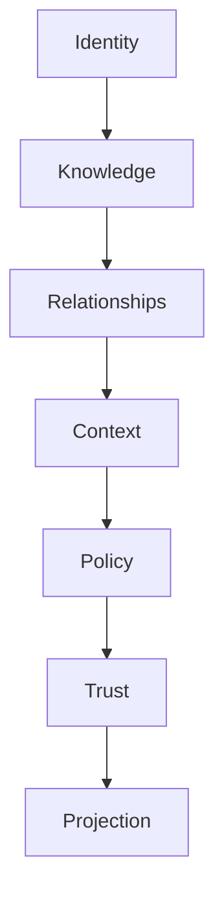

# UCOS-IAM-000001
# Identity & Access Management

**Version:** Ω∞.1  |  **Status:** Constitutional Artifact  |  **Authority:** UCOS Ω∞ Constitutional Authority
**Category:** Security  |  **Source of Truth:** `_registry/` (projected, never hand-authored)

> Constitutional notice: this document is a **projection**. Its truth lives in the registry. Editing this document directly violates Law 002 (Knowledge Once).

---

## 1. Executive Summary

**UCOS-IAM-000001 — Identity & Access Management**

This artifact is a constitutionally governed, implementation-ready specification projected from the _UCOS Registry_ single source of truth.
It conforms to the _Immutable Primitive Registry_ (27 frozen primitives) and the _Canonical Terminology Registry_ (31 governed terms).
It contains no hardcoded business, industry, currency, country, or commerce concepts. All such concepts are runtime projections.

---

## 2. Constitutional Purpose

To define the binding contract for **Identity & Access Management** such that:
- every concept it names has exactly one owner,
- every capability it exposes has exactly one boundary,
- every boundary is expressed as an explicit contract,
- every contract is enforceable by the Governance Constitution.

---

## 3. Scope

In scope: the primitives, contracts, schemas, events, and policies owned by **Identity & Access Management**.
In scope: the projection rules by which this domain exposes its truth to other domains.
In scope: the verification obligations this domain must satisfy before activation.

---

## 4. Out of Scope

Out of scope: any concept owned by another constitutional domain.
Out of scope: business, industry, commerce, country, currency, or language content (all projected).
Out of scope: mutation of another domain’s internal state.

---

## 5. Definitions

All terms in this artifact are used in their canonical sense as defined in the Canonical Terminology Registry.
Where a term appears, its `termId` is normative and its `prohibitedMeanings` are void.

---

## 6. Canonical Terminology

| Term | Canonical Definition | Owner | Prohibited Meanings |
|---|---|---|---|
| Existence | Anything that may exist. | Universal Existence Kernel | business meaning, commercial meaning, operational meaning |
| Entity | Technical representation of an Existence Object. | Identity Domain | existence itself |
| Knowledge | Interpreted information with evidence and meaning. | Knowledge Domain | data, information, evidence |
| Data | Raw observations. | Observation Domain | knowledge, meaning |
| Information | Organized data. | Observation Domain | knowledge |
| Evidence | Proof supporting an assertion. | Evidence Domain | knowledge, trust |
| Trust | Computed confidence in an assertion, derived from evidence. | Trust Domain | evidence, faith |
| Meaning | Semantic interpretation; higher-level understanding. | Semantic Domain | classification, taxonomy, ontology |
| Ontology | What exists. | Semantic Domain | taxonomy, classification |
| Taxonomy | How things are classified. | Semantic Domain | ontology, meaning |
| Classification | Assignment into taxonomy. | Semantic Domain | meaning |
| Relationship | Connection between objects. | Relationship Domain | causality |

---

## 7. Ownership Boundaries

Ownership is recorded in the _Domain Ownership Registry_.

---

## 8. Domain Responsibilities

See the Domain Ownership Registry for the authoritative responsibility list.

---

## 9. Domain Non-Responsibilities

See the Domain Ownership Registry.

---

## 10. Concepts

Identity & Access Management authenticates every actor and authorizes every action. There is no unauthenticated path and no unaudited grant. Identity (who you are), Authentication (proof), Authorization (what you may do), and Delegation (on whose behalf) are four separate, governed concerns.

---

## 11. Ontology

IAM binds an Identity to Authentication evidence to an Authority scope to a Permission set. Permissions are granted, never assumed; every grant is reversible and traceable to its granter.

---

## 12. Taxonomy

By actor: Human / Agent / Service / System. By factor: Passwordless / MFA / Hardware-key / Certificate / Token / Biometric. By scope: Platform / Tenant / Context / Instance.

---

## 13. Registries

This domain is registry-driven. Its registries are entries in the Universal Registry System:

```yaml
RegistryEntry:
  registryId: UCOS-REG-DOMAIN
  owner: Constitutional Authority
  law: Knowledge Once — each concept defined exactly once
```

---

## 14. Data Model

```yaml
AccessGrant:
  grantId: <Identity>
  subject: <Identity>
  authority: <Authority>
  permissions: [<registry permission>]
  scope: <Context>
  temporal: {grantedAt, expiresAt}
  delegatedFrom: <Grant|null>
  conditions: [<registry expression>]
```

---

## 15. Graph Model

(:Grant)-[:TO]->(:Identity); (:Grant)-[:WITHIN]->(:Context); (:Grant)-[:DELEGATED_FROM]->(:Grant); (:Grant)-[:REVOKED_BY]->(:Authority)

---

## 16. Schemas

```yaml
# Canonical projection schema for UCOS-IAM-000001
ucos_iam_000001:
  identity:      <Identity primitive>
  intent:        <Intent primitive>
  meaning:       <Meaning primitive>
  knowledge:     <Knowledge primitive>
  registry:      <Registry primitive>
  relationship:  <Relationship primitive>
  context:       <Context primitive>
  policy:        <Policy primitive>
  authority:     <Authority primitive>
  evidence:      <Evidence primitive>
  trust:         <Trust primitive>
  temporal:      <Time primitive>
  metadata:      <Metadata primitive>
```

---

## 17. Contracts

```yaml
DomainContract:
  domain: Identity & Access Management
  commands:   []   # registry-driven
  queries:    []   # registry-driven
  events:     []   # registry-driven
  policies:   []   # registry-driven
  permissions: []  # registry-driven
```

Contract law: domains never directly access another domain’s internal structures.

---

## 18. APIs

POST /iam.v1.authenticate,POST /iam.v1.authorize,POST /iam.v1.grant,POST /iam.v1.revoke,GET  /iam.v1.grants/{subjectId}

---

## 19. Events

Authenticated,Authorized,Granted,Revoked,Delegated,GrantExpired,AuthFailure

---

## 20. Commands

iam.authenticate,iam.authorize,iam.grant,iam.revoke,iam.delegate

---

## 21. Queries

iam.grants,iam.subject,iam.permissions,iam.effective,iam.audit

---

## 22. State Machines



---

## 23. Workflows

authenticate with registered factors → resolve authority scope → evaluate permissions under context → grant with expiry → revoke on demand or expiry

---

## 24. Policies

```yaml
Policy:
  identity: <Identity>
  conditions: []   # registry-driven
  actions:    []   # registry-driven
  priorities: []   # registry-driven
  exceptions: []   # registry-driven
```

All behavior derives from policy. Policy ≠ Rule: policy is behavioral governance; the rule is its executable projection.

---

## 25. Rules

```yaml
Rule:
  ruleId: <Identity>
  derivedFrom: <Policy identity>
  executable: true
  constraint: <registry expression>
```

---

## 26. Authorities

IAM Authority issues grants; granter's authority bounds the grant — rights are monotone-decreasing down the delegation chain.

---

## 27. Permissions

iam.grant (holder of the right),iam.revoke (granter or higher),iam.read (subject or governance)

---

## 28. Security Model

Zero Trust applies: no implicit trust between domains, services, agents, or tenants.
Every call is authenticated, authorized against Policy, and evidenced.
Cryptographic identity is issued by the Identity Domain; keys by the Key Management Architecture.

---

## 29. Privacy Model

Authentication evidence is never stored in plaintext; biometrics never leave the device enclave. Grants reference scopes, not personal contents.

---

## 30. Trust Model

Trust is computed, never assumed. Inputs: evidence, authority, consistency, provenance, confidence.
```yaml
Trust:
  evidenceScore: <0..1>
  authorityScore: <0..1>
  consistencyScore: <0..1>
  provenanceScore: <0..1>
  confidenceScore: <0..1>
```

---

## 31. Audit Model

Every authentication and authorization is logged with factor strength, grant chain, and decision rationale.

---

## 32. Observability Model

Every action emits: What happened? Why? Who authorized it? Which policy allowed it? What evidence supports it? What confidence exists? What alternatives were evaluated?
These are the seven Explainability questions and are mandatory event fields.

---

## 33. Digital Twin Model

IAM twin monitors grant sprawl, stale grants, and authentication failure patterns as security signals.

---

## 34. Agent Model

Security agent detects anomalous grant patterns and over-broad delegations, revoking or escalating under policy.

---

## 35. Runtime Model

Authorization is evaluated per request, cached per (subject, permission, policy-version) with event-driven invalidation on revoke.

---

## 36. Scaling Model

Auth is the hottest security path — token verification is stateless; grant resolution is cached and short-TTL.

---

## 37. Multi-Tenant Model

Grants are tenant-scoped; cross-tenant grants require both tenants' authorities and are heavily audited.

---

## 38. Geo-Distribution Model

Authentication evidence and grant logs reside in-jurisdiction; cross-region auth respects residency.

---

## 39. Failure Model

Grant cycle, rights inflation, stale grant after revocation storm, factor unavailability.

---

## 40. Recovery Model

Grants are event-sourced; revocation cascades to all derived grants immediately.

---

## 41. Verification Model

Before activation, Identity & Access Management must pass identity, knowledge, relationship, context, policy, authority, trust, and reality integrity checks.
Verification is performed by the Formal Verification Architecture (UCOS-FML-000001).

---

## 42. Certification Model

Every grant must be traceable to constitutional authority — untraceable grants are denied by default.

---

## 43. Migration Model

New factors and permission types are registry additions.

---

## 44. Evolution Model

Evolution is governed and history-preserving. Primitives are frozen; extension occurs through registries, policies, capabilities, contexts, relationships, knowledge, agents, and projections — never through primitive expansion.

---

## 45. Implementation Blueprint

Build order for IAM: (1) define registry entries — this domain owns by actor: human / agent / service / system as registry truth, not code; (2) implement the contract surface first (iam.authenticate, iam.authorize, iam.grant) and validate against IAM boundaries; (3) event-source all state so history is reconstructable; (4) wire the enforcement points — authority check, policy guard, evidence binding, trace — in-line, with no bypass path; (5) add tests per the Testing Architecture, citing evidence per gate; (6) obtain Verification and Certification before activation. Acceptance: the Zero Partial and Law 001 audits pass, every action answers the seven explainability questions, and this domain mutates no other domain internals.

---

## 46. Reference Architecture Diagram



---

## 47. Sequence Diagrams



---

## 48. State Diagrams



---

## 49. Data Flow Diagrams



---

## 50. Dependency Maps



Forbidden: circular dependencies, mutual ownership, cross-domain state mutation.

---

## ∞

Constitutionally governed. Implementation ready. Universally extensible.