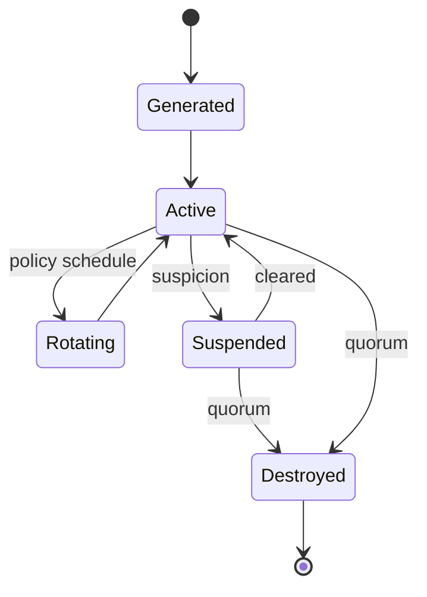
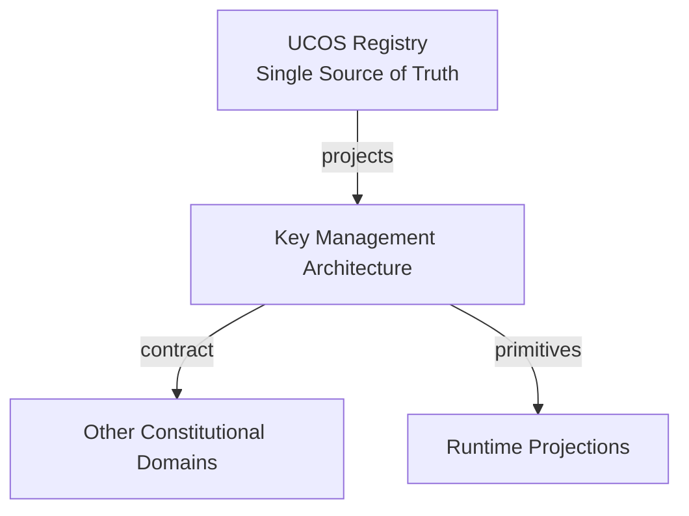
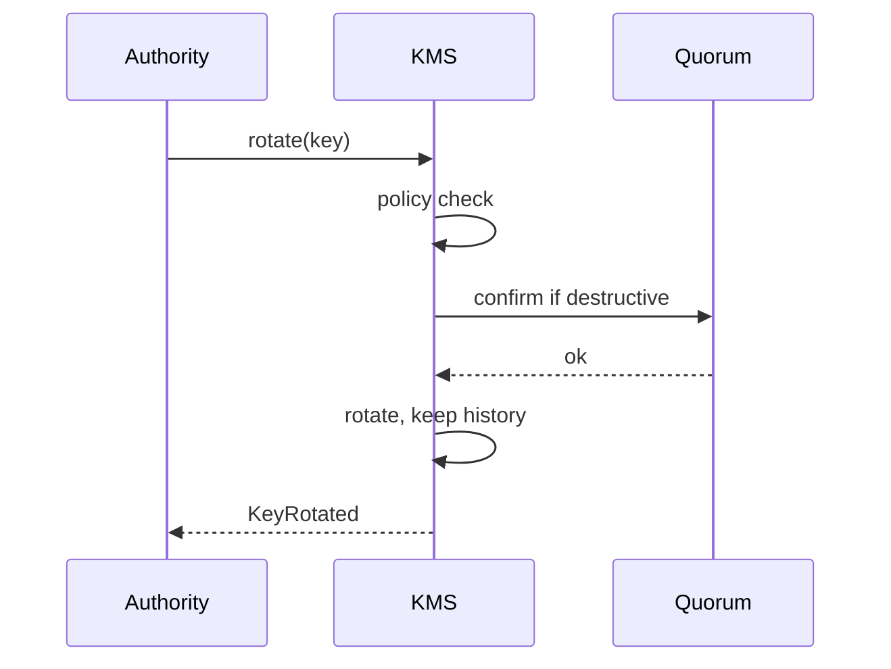
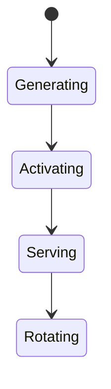
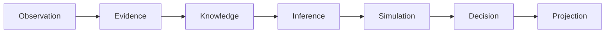
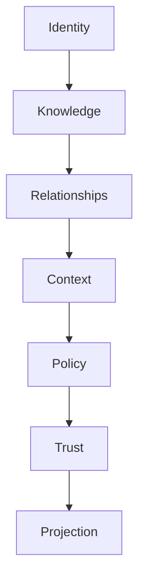

# UCOS-KMS-000001
# Key Management Architecture

**Version:** Ω∞.1  |  **Status:** Constitutional Artifact  |  **Authority:** UCOS Ω∞ Constitutional Authority
**Category:** Security  |  **Source of Truth:** `_registry/` (projected, never hand-authored)

> Constitutional notice: this document is a **projection**. Its truth lives in the registry. Editing this document directly violates Law 002 (Knowledge Once).

---

## 1. Executive Summary

**UCOS-KMS-000001 — Key Management Architecture**

This artifact is a constitutionally governed, implementation-ready specification projected from the _UCOS Registry_ single source of truth.
It conforms to the _Immutable Primitive Registry_ (27 frozen primitives) and the _Canonical Terminology Registry_ (31 governed terms).
It contains no hardcoded business, industry, currency, country, or commerce concepts. All such concepts are runtime projections.

---

## 2. Constitutional Purpose

To define the binding contract for **Key Management Architecture** such that:
- every concept it names has exactly one owner,
- every capability it exposes has exactly one boundary,
- every boundary is expressed as an explicit contract,
- every contract is enforceable by the Governance Constitution.

---

## 3. Scope

In scope: the primitives, contracts, schemas, events, and policies owned by **Key Management Architecture**.
In scope: the projection rules by which this domain exposes its truth to other domains.
In scope: the verification obligations this domain must satisfy before activation.

---

## 4. Out of Scope

Out of scope: any concept owned by another constitutional domain.
Out of scope: business, industry, commerce, country, currency, or language content (all projected).
Out of scope: mutation of another domain’s internal state.

---

## 5. Definitions

All terms in this artifact are used in their canonical sense as defined in the Canonical Terminology Registry.
Where a term appears, its `termId` is normative and its `prohibitedMeanings` are void.

---

## 6. Canonical Terminology

| Term | Canonical Definition | Owner | Prohibited Meanings |
|---|---|---|---|
| Existence | Anything that may exist. | Universal Existence Kernel | business meaning, commercial meaning, operational meaning |
| Entity | Technical representation of an Existence Object. | Identity Domain | existence itself |
| Knowledge | Interpreted information with evidence and meaning. | Knowledge Domain | data, information, evidence |
| Data | Raw observations. | Observation Domain | knowledge, meaning |
| Information | Organized data. | Observation Domain | knowledge |
| Evidence | Proof supporting an assertion. | Evidence Domain | knowledge, trust |
| Trust | Computed confidence in an assertion, derived from evidence. | Trust Domain | evidence, faith |
| Meaning | Semantic interpretation; higher-level understanding. | Semantic Domain | classification, taxonomy, ontology |
| Ontology | What exists. | Semantic Domain | taxonomy, classification |
| Taxonomy | How things are classified. | Semantic Domain | ontology, meaning |
| Classification | Assignment into taxonomy. | Semantic Domain | meaning |
| Relationship | Connection between objects. | Relationship Domain | causality |

---

## 7. Ownership Boundaries

Ownership is recorded in the _Domain Ownership Registry_.

---

## 8. Domain Responsibilities

See the Domain Ownership Registry for the authoritative responsibility list.

---

## 9. Domain Non-Responsibilities

See the Domain Ownership Registry.

---

## 10. Concepts

Key Management Architecture holds the platform's most sensitive primitive — the keys that make evidence trustworthy. Raw keys never leave KMS; everything else holds references. Key lifecycle is governed, audited, and recoverable only under quorum.

---

## 11. Ontology

Key has an Identity, an Algorithm suite, a Policy (usage, rotation, sunset), a State, and a Custody model. Keys are generated in KMS, referenced everywhere, rotated by policy, destroyed by quorum.

---

## 12. Taxonomy

By custody: Platform / Tenant / Sovereign / Customer-held / HSM-backed. By lifetime: Ephemeral / Short-lived / Long-lived / Eternal. By usage: Signing / Encryption / Wrapping / Derived.

---

## 13. Registries

This domain is registry-driven. Its registries are entries in the Universal Registry System:

```yaml
RegistryEntry:
  registryId: UCOS-REG-DOMAIN
  owner: Constitutional Authority
  law: Knowledge Once — each concept defined exactly once
```

---

## 14. Data Model

```yaml
Key:
  keyId: <Identity>
  algorithmSuite: <registry id>
  custody: <registry id>
  usagePolicy: <Policy>
  rotationPolicy: <Policy>
  state: <Active|Rotating|Suspended|Destroyed>
  temporal: {createdAt, rotatesAt, sunsetsAt}
  quorum: {destroyRequires: <n>}
```

---

## 15. Graph Model

(:Key)-[:SUITE]->(:AlgorithmSuite); (:Key)-[:USED_PER]->(:Policy); (:Key)-[:ROTATES_ON]->(:Policy); (:Key)-[:REFERENCED_BY]->(:CryptoOperation)

---

## 16. Schemas

```yaml
# Canonical projection schema for UCOS-KMS-000001
ucos_kms_000001:
  identity:      <Identity primitive>
  intent:        <Intent primitive>
  meaning:       <Meaning primitive>
  knowledge:     <Knowledge primitive>
  registry:      <Registry primitive>
  relationship:  <Relationship primitive>
  context:       <Context primitive>
  policy:        <Policy primitive>
  authority:     <Authority primitive>
  evidence:      <Evidence primitive>
  trust:         <Trust primitive>
  temporal:      <Time primitive>
  metadata:      <Metadata primitive>
```

---

## 17. Contracts

```yaml
DomainContract:
  domain: Key Management Architecture
  commands:   []   # registry-driven
  queries:    []   # registry-driven
  events:     []   # registry-driven
  policies:   []   # registry-driven
  permissions: []  # registry-driven
```

Contract law: domains never directly access another domain’s internal structures.

---

## 18. APIs

POST /kms.v1.generate,POST /kms.v1.rotate,POST /kms.v1.destroy,GET  /kms.v1/{id},POST /kms.v1.derive

---

## 19. Events

KeyGenerated,KeyRotated,KeySuspended,KeyDestroyed,KeyDerived,RotationOverdue

---

## 20. Commands

kms.generate,kms.rotate,kms.destroy,kms.derive,kms.suspend

---

## 21. Queries

kms.byId,kms.byCustody,kms.rotationDue,kms.state

---

## 22. State Machines



---

## 23. Workflows

generate under policy → reference-only usage → rotate per schedule → suspend on suspicion → destroy only under quorum

---

## 24. Policies

```yaml
Policy:
  identity: <Identity>
  conditions: []   # registry-driven
  actions:    []   # registry-driven
  priorities: []   # registry-driven
  exceptions: []   # registry-driven
```

All behavior derives from policy. Policy ≠ Rule: policy is behavioral governance; the rule is its executable projection.

---

## 25. Rules

```yaml
Rule:
  ruleId: <Identity>
  derivedFrom: <Policy identity>
  executable: true
  constraint: <registry expression>
```

---

## 26. Authorities

Key Authority (lifecycle); destruction requires quorum — no single principal can destroy a key.

---

## 27. Permissions

kms.generate (key authority),kms.rotate (key authority or policy),kms.destroy (quorum),kms.use (referenced via crypto ops only)

---

## 28. Security Model

Zero Trust applies: no implicit trust between domains, services, agents, or tenants.
Every call is authenticated, authorized against Policy, and evidenced.
Cryptographic identity is issued by the Identity Domain; keys by the Key Management Architecture.

---

## 29. Privacy Model

Key material is the crown jewel — HSM-backed where available, never logged, never cached outside the boundary.

---

## 30. Trust Model

Trust is computed, never assumed. Inputs: evidence, authority, consistency, provenance, confidence.
```yaml
Trust:
  evidenceScore: <0..1>
  authorityScore: <0..1>
  consistencyScore: <0..1>
  provenanceScore: <0..1>
  confidenceScore: <0..1>
```

---

## 31. Audit Model

Every key operation (including denied ones) is logged; the audit log itself is signed by a separate key.

---

## 32. Observability Model

Every action emits: What happened? Why? Who authorized it? Which policy allowed it? What evidence supports it? What confidence exists? What alternatives were evaluated?
These are the seven Explainability questions and are mandatory event fields.

---

## 33. Digital Twin Model

KMS twin monitors rotation overdue and key-usage anomalies as critical security signals.

---

## 34. Agent Model

KMS agent tracks rotation deadlines and flags overdue keys as critical governance failures.

---

## 35. Runtime Model

All crypto happens inside KMS; callers receive results and references, never material.

---

## 36. Scaling Model

KMS is the trust bottleneck — horizontally scaled with HSM-backed quorum for critical operations.

---

## 37. Multi-Tenant Model

Keys are tenant-isolated by custody; cross-tenant key use is impossible by construction.

---

## 38. Geo-Distribution Model

Sovereign keys stay in-jurisdiction; export is prohibited where sovereignty policy forbids.

---

## 39. Failure Model

Rotation overdue, quorum deadlock, HSM unavailability, key reference leak.

---

## 40. Recovery Model

Suspended keys can be cleared by quorum; destroyed keys are unrecoverable by design — that irreversibility is the guarantee.

---

## 41. Verification Model

Before activation, Key Management Architecture must pass identity, knowledge, relationship, context, policy, authority, trust, and reality integrity checks.
Verification is performed by the Formal Verification Architecture (UCOS-FML-000001).

---

## 42. Certification Model

KMS must prove no raw-key egress path exists — formally audited boundary.

---

## 43. Migration Model

New custody models are registry additions.

---

## 44. Evolution Model

Evolution is governed and history-preserving. Primitives are frozen; extension occurs through registries, policies, capabilities, contexts, relationships, knowledge, agents, and projections — never through primitive expansion.

---

## 45. Implementation Blueprint

Build order for KMS: (1) define registry entries — this domain owns by custody: platform / tenant / sovereign / customer-held / hsm-backed as registry truth, not code; (2) implement the contract surface first (kms.generate, kms.rotate, kms.destroy) and validate against KMS boundaries; (3) event-source all state so history is reconstructable; (4) wire the enforcement points — authority check, policy guard, evidence binding, trace — in-line, with no bypass path; (5) add tests per the Testing Architecture, citing evidence per gate; (6) obtain Verification and Certification before activation. Acceptance: the Zero Partial and Law 001 audits pass, every action answers the seven explainability questions, and this domain mutates no other domain internals.

---

## 46. Reference Architecture Diagram



---

## 47. Sequence Diagrams



---

## 48. State Diagrams



---

## 49. Data Flow Diagrams



---

## 50. Dependency Maps



Forbidden: circular dependencies, mutual ownership, cross-domain state mutation.

---

## ∞

Constitutionally governed. Implementation ready. Universally extensible.