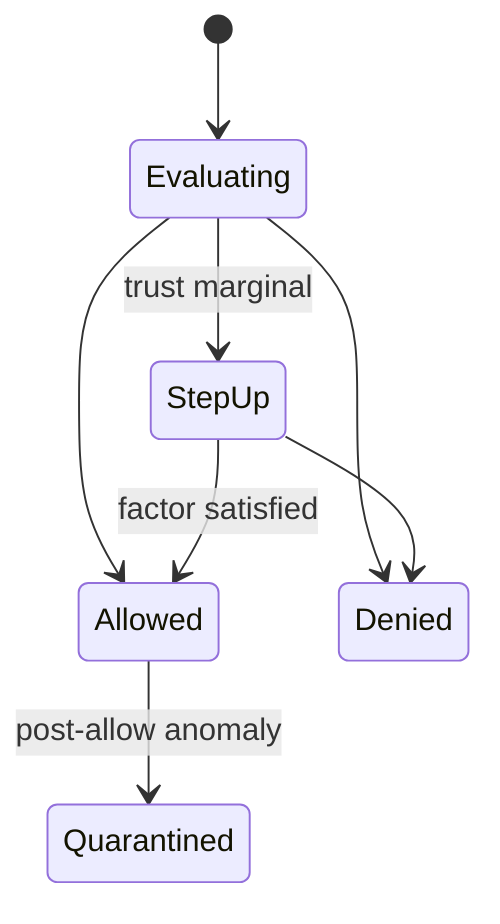
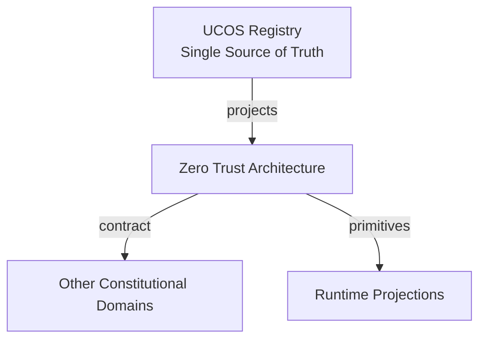
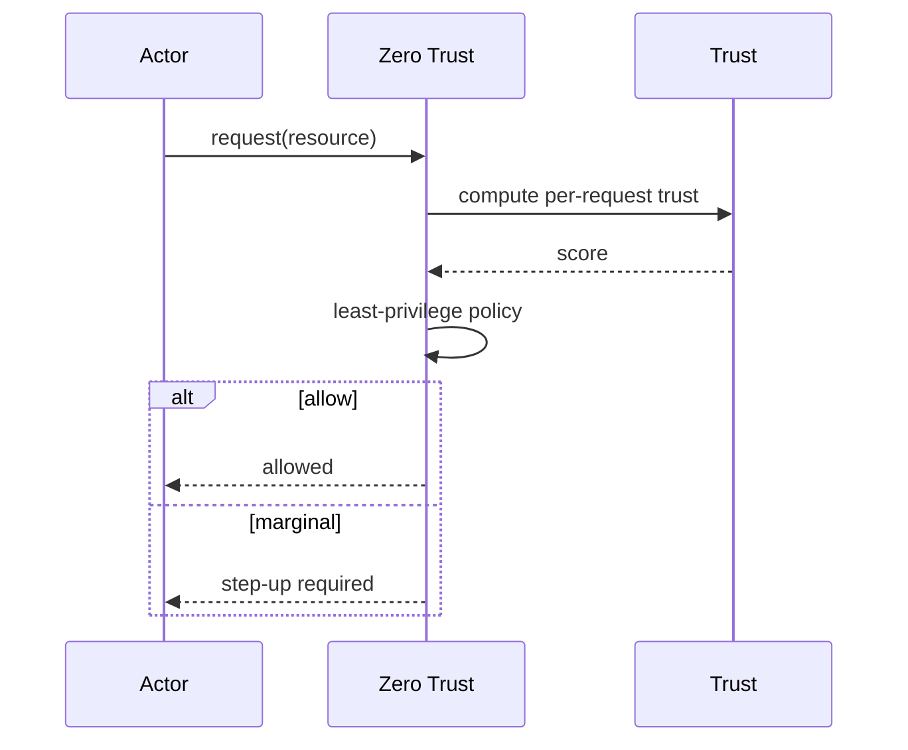
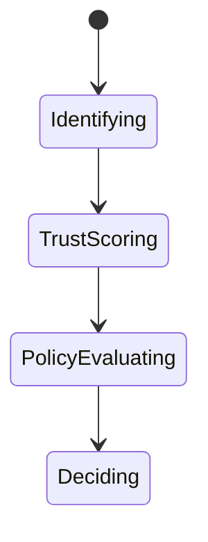
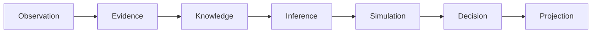
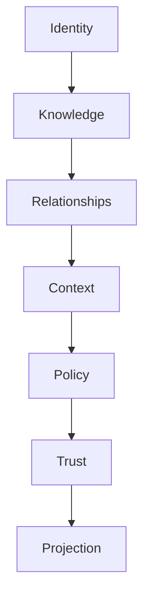

# UCOS-ZTA-000001
# Zero Trust Architecture

**Version:** Ω∞.1  |  **Status:** Constitutional Artifact  |  **Authority:** UCOS Ω∞ Constitutional Authority
**Category:** Security  |  **Source of Truth:** `_registry/` (projected, never hand-authored)

> Constitutional notice: this document is a **projection**. Its truth lives in the registry. Editing this document directly violates Law 002 (Knowledge Once).

---

## 1. Executive Summary

**UCOS-ZTA-000001 — Zero Trust Architecture**

This artifact is a constitutionally governed, implementation-ready specification projected from the _UCOS Registry_ single source of truth.
It conforms to the _Immutable Primitive Registry_ (27 frozen primitives) and the _Canonical Terminology Registry_ (31 governed terms).
It contains no hardcoded business, industry, currency, country, or commerce concepts. All such concepts are runtime projections.

---

## 2. Constitutional Purpose

To define the binding contract for **Zero Trust Architecture** such that:
- every concept it names has exactly one owner,
- every capability it exposes has exactly one boundary,
- every boundary is expressed as an explicit contract,
- every contract is enforceable by the Governance Constitution.

---

## 3. Scope

In scope: the primitives, contracts, schemas, events, and policies owned by **Zero Trust Architecture**.
In scope: the projection rules by which this domain exposes its truth to other domains.
In scope: the verification obligations this domain must satisfy before activation.

---

## 4. Out of Scope

Out of scope: any concept owned by another constitutional domain.
Out of scope: business, industry, commerce, country, currency, or language content (all projected).
Out of scope: mutation of another domain’s internal state.

---

## 5. Definitions

All terms in this artifact are used in their canonical sense as defined in the Canonical Terminology Registry.
Where a term appears, its `termId` is normative and its `prohibitedMeanings` are void.

---

## 6. Canonical Terminology

| Term | Canonical Definition | Owner | Prohibited Meanings |
|---|---|---|---|
| Existence | Anything that may exist. | Universal Existence Kernel | business meaning, commercial meaning, operational meaning |
| Entity | Technical representation of an Existence Object. | Identity Domain | existence itself |
| Knowledge | Interpreted information with evidence and meaning. | Knowledge Domain | data, information, evidence |
| Data | Raw observations. | Observation Domain | knowledge, meaning |
| Information | Organized data. | Observation Domain | knowledge |
| Evidence | Proof supporting an assertion. | Evidence Domain | knowledge, trust |
| Trust | Computed confidence in an assertion, derived from evidence. | Trust Domain | evidence, faith |
| Meaning | Semantic interpretation; higher-level understanding. | Semantic Domain | classification, taxonomy, ontology |
| Ontology | What exists. | Semantic Domain | taxonomy, classification |
| Taxonomy | How things are classified. | Semantic Domain | ontology, meaning |
| Classification | Assignment into taxonomy. | Semantic Domain | meaning |
| Relationship | Connection between objects. | Relationship Domain | causality |

---

## 7. Ownership Boundaries

Ownership is recorded in the _Domain Ownership Registry_.

---

## 8. Domain Responsibilities

See the Domain Ownership Registry for the authoritative responsibility list.

---

## 9. Domain Non-Responsibilities

See the Domain Ownership Registry.

---

## 10. Concepts

Zero Trust Architecture assumes no implicit trust anywhere. Every request is authenticated, authorized, encrypted, and evidenced — regardless of network location. 'Inside the network' is not a concept the platform recognizes.

---

## 11. Ontology

Zero Trust is a property of every interaction: Identity verified, Context evaluated, Policy enforced, Least-privilege applied, Session bounded, and Everything logged. Trust is computed per request, never cached across sessions.

---

## 12. Taxonomy

By enforcement: Per-request / Per-session / Per-flow. By network: Mesh / Perimeter-less / Segmented. By evidence: Cryptographic / Behavioral / Attestation-based.

---

## 13. Registries

This domain is registry-driven. Its registries are entries in the Universal Registry System:

```yaml
RegistryEntry:
  registryId: UCOS-REG-DOMAIN
  owner: Constitutional Authority
  law: Knowledge Once — each concept defined exactly once
```

---

## 14. Data Model

```yaml
ZeroTrustDecision:
  decisionId: <Identity>
  subject: <Identity>
  resource: <registry resource>
  context: <Context>
  trustScore: <Trust>
  policyVersion: <version>
  decision: <Allow|Deny|StepUp|Challenge>
  evidence: [<Evidence>]
  temporal: {at}
```

---

## 15. Graph Model

(:Decision)-[:FOR]->(:Identity); (:Decision)-[:ON]->(:Resource); (:Decision)-[:UNDER]->(:Policy); (:Decision)-[:SCORED_BY]->(:Trust)

---

## 16. Schemas

```yaml
# Canonical projection schema for UCOS-ZTA-000001
ucos_zta_000001:
  identity:      <Identity primitive>
  intent:        <Intent primitive>
  meaning:       <Meaning primitive>
  knowledge:     <Knowledge primitive>
  registry:      <Registry primitive>
  relationship:  <Relationship primitive>
  context:       <Context primitive>
  policy:        <Policy primitive>
  authority:     <Authority primitive>
  evidence:      <Evidence primitive>
  trust:         <Trust primitive>
  temporal:      <Time primitive>
  metadata:      <Metadata primitive>
```

---

## 17. Contracts

```yaml
DomainContract:
  domain: Zero Trust Architecture
  commands:   []   # registry-driven
  queries:    []   # registry-driven
  events:     []   # registry-driven
  policies:   []   # registry-driven
  permissions: []  # registry-driven
```

Contract law: domains never directly access another domain’s internal structures.

---

## 18. APIs

POST /zt.v1.evaluate,POST /zt.v1.stepup,GET  /zt.v1/decision/{id},POST /zt.v1.attest

---

## 19. Events

ZTEvaluated,ZTDenied,StepUpRequested,AttestationVerified,ZTQuarantine

---

## 20. Commands

zt.evaluate,zt.stepUp,zt.attest,zt.quarantine

---

## 21. Queries

zt.decisions,zt.denials,zt.risky,zt.attestations

---

## 22. State Machines



---

## 23. Workflows

identify → score trust in context → evaluate least-privilege policy → allow / step-up / deny → continuously verify post-allow

---

## 24. Policies

```yaml
Policy:
  identity: <Identity>
  conditions: []   # registry-driven
  actions:    []   # registry-driven
  priorities: []   # registry-driven
  exceptions: []   # registry-driven
```

All behavior derives from policy. Policy ≠ Rule: policy is behavioral governance; the rule is its executable projection.

---

## 25. Rules

```yaml
Rule:
  ruleId: <Identity>
  derivedFrom: <Policy identity>
  executable: true
  constraint: <registry expression>
```

---

## 26. Authorities

Zero Trust Authority (policy); decisions are per-request and never delegated implicitly.

---

## 27. Permissions

zt.evaluate (system, every request),zt.attest (platform authority),zt.quarantine (security authority)

---

## 28. Security Model

Zero Trust applies: no implicit trust between domains, services, agents, or tenants.
Every call is authenticated, authorized against Policy, and evidenced.
Cryptographic identity is issued by the Identity Domain; keys by the Key Management Architecture.

---

## 29. Privacy Model

Behavioral evidence is minimized and consent-scoped; post-allow monitoring targets patterns, not contents.

---

## 30. Trust Model

Trust is computed, never assumed. Inputs: evidence, authority, consistency, provenance, confidence.
```yaml
Trust:
  evidenceScore: <0..1>
  authorityScore: <0..1>
  consistencyScore: <0..1>
  provenanceScore: <0..1>
  confidenceScore: <0..1>
```

---

## 31. Audit Model

Every decision — allow and deny — is logged with trust inputs, policy version, and evidence. Denials are first-class audit artifacts.

---

## 32. Observability Model

Every action emits: What happened? Why? Who authorized it? Which policy allowed it? What evidence supports it? What confidence exists? What alternatives were evaluated?
These are the seven Explainability questions and are mandatory event fields.

---

## 33. Digital Twin Model

Zero Trust twin monitors decision latency, denial rates, and step-up friction as security UX signals.

---

## 34. Agent Model

Zero Trust agent continuously re-evaluates active sessions and revokes on trust decay.

---

## 35. Runtime Model

Evaluation is in-line on every request; mTLS is mandatory service-to-service; no plaintext internal traffic exists.

---

## 36. Scaling Model

Evaluation is cached per (subject, resource, policy-version) with short TTL; trust decay invalidates.

---

## 37. Multi-Tenant Model

Tenant isolation is enforced at every layer — network, compute, storage — never assumed from segmentation.

---

## 38. Geo-Distribution Model

Attestation and decision logs reside in-jurisdiction; cross-region requests are re-evaluated, not trusted.

---

## 39. Failure Model

Trust staleness, policy version skew, attestation failure, evaluation timeout (default deny).

---

## 40. Recovery Model

Quarantine is the safe state; recovery is governed re-attestation, never automatic.

---

## 41. Verification Model

Before activation, Zero Trust Architecture must pass identity, knowledge, relationship, context, policy, authority, trust, and reality integrity checks.
Verification is performed by the Formal Verification Architecture (UCOS-FML-000001).

---

## 42. Certification Model

Platform must prove no implicit-trust path exists — every flow carries a decision record.

---

## 43. Migration Model

New trust factors are registry additions.

---

## 44. Evolution Model

Evolution is governed and history-preserving. Primitives are frozen; extension occurs through registries, policies, capabilities, contexts, relationships, knowledge, agents, and projections — never through primitive expansion.

---

## 45. Implementation Blueprint

Build order for ZTA: (1) define registry entries — this domain owns by enforcement: per-request / per-session / per-flow as registry truth, not code; (2) implement the contract surface first (zt.evaluate, zt.stepUp, zt.attest) and validate against ZTA boundaries; (3) event-source all state so history is reconstructable; (4) wire the enforcement points — authority check, policy guard, evidence binding, trace — in-line, with no bypass path; (5) add tests per the Testing Architecture, citing evidence per gate; (6) obtain Verification and Certification before activation. Acceptance: the Zero Partial and Law 001 audits pass, every action answers the seven explainability questions, and this domain mutates no other domain internals.

---

## 46. Reference Architecture Diagram



---

## 47. Sequence Diagrams



---

## 48. State Diagrams



---

## 49. Data Flow Diagrams



---

## 50. Dependency Maps



Forbidden: circular dependencies, mutual ownership, cross-domain state mutation.

---

## ∞

Constitutionally governed. Implementation ready. Universally extensible.